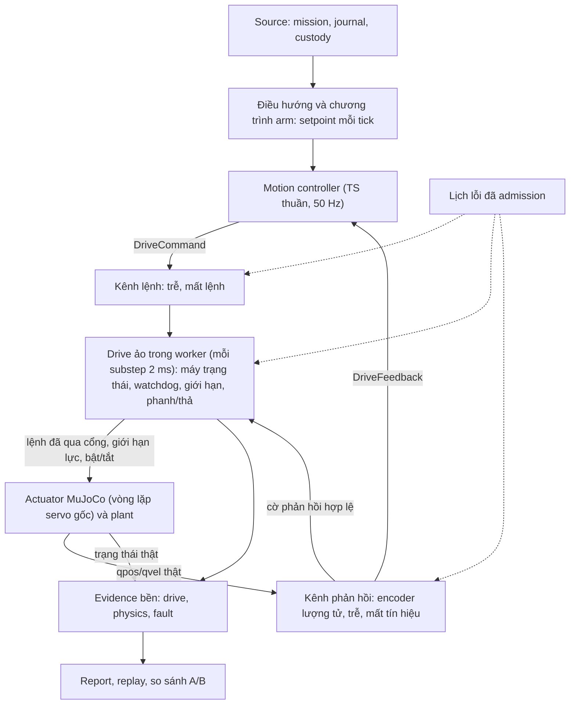
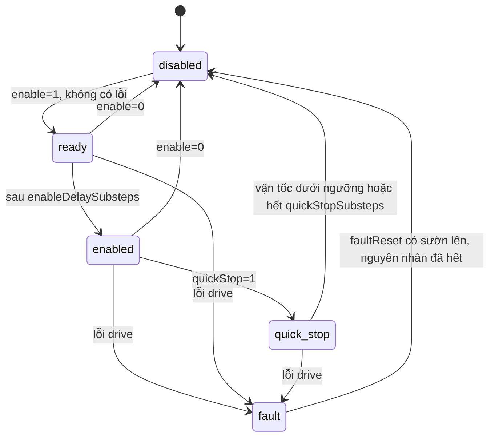

# Spec R4-A — Drive ảo, controller-in-the-loop, bàn chỉnh điều khiển, studio lỗi và demo khay ba cốc

**Mã:** MKQ-SIM-R4-A-01 · **Trạng thái:** V01–V07 đã triển khai; đợt sửa sau review đang thực hiện ngày 20/11/2026. V08–V10 chưa triển khai; kết quả phần mềm chưa có chữ ký acceptance.

Đọc cùng [nghiên cứu](01-research.md), [contracts/evidence](05-contracts-and-evidence.md) và [plan](plans/README.md). Mọi quyết định chỉ áp dụng cho input/profile mới; run không tham chiếu drive model giữ nguyên hành vi và byte của R2b.

## 1. Kết quả sản phẩm

Hôm nay Lab trả lời "robot và cốc chuyển động ra sao" với actuator lý tưởng: lệnh tới thẳng actuator MuJoCo, phản hồi là trạng thái thật của engine. R4-A thêm phần còn thiếu giữa controller và plant, để Lab trả lời được ba câu khác:

1. **Controller có chịu được thiết bị không lý tưởng không?** Cùng một controller chạy qua drive có trạng thái enable/fault, giới hạn mô-men, encoder lượng tử, trễ và timeout.
2. **Chỉnh gì thì đáp ứng đổi ra sao?** Chọn một trục, sửa gain trong biên, chạy bước nhảy, đọc overshoot/settling, so hai profile trên cùng model và seed, xuất profile có phiên bản.
3. **Khi thiết bị hỏng thì chuyện gì xảy ra, sau bao lâu?** Soạn lịch lỗi, chạy, đọc báo cáo: lỗi bắt đầu ở tick nào, ai phát hiện sau bao nhiêu tick, controller ra lệnh gì, plant phản ứng thế nào, invariant nào bị vi phạm.

| Đợt | Trong phạm vi | Điều kiện ra |
|---|---|---|
| R4.1 | Hợp đồng drive trung lập, drive ảo trong worker MuJoCo, hai motion controller, thí nghiệm CIL có đăng ký, evidence theo trục | G-DRV1, G-CIL1 |
| R4.2 | Bench run một trục, metric đáp ứng, tab **Điều khiển**, A/B, gợi ý gain từ quán tính, xuất/nhập profile | G-TUNE1 |
| R4.3 | Danh mục lỗi drive/cảm biến/kênh lệnh, studio lỗi, báo cáo lỗi, scenario khay ba cốc A–D với câu gợi ý thiết kế | G-FLT1, G-TRAY1 |

Không thuộc ba đợt: mô phỏng dòng điện/nhiệt, chế độ mô-men trực tiếp (`cst`), vòng lặp firmware tần số thấp, auto-tuning bằng relay, FMU, phần cứng thật, HIL, nhiều AMR, người có vật lý, chất lỏng. Xem [§9](#9-các-việc-chủ-ý-hoãn) và [spec R4-C](04-r4-calibration-and-deferred-spec.md).

## 2. Điều kiện vào

V00 chụp lại tuple sau khi R2b/R3 đóng trên `main`: source/Lab HEAD, pin, schema hash, closure, engine lock, fixture digest, qualification và guard. Theo [trạng thái 19/11](../../source/docs/implementation/web-lab-to-physical/status-2026-11-19.md), chuỗi đã được ghi lại ở source `3d8c2a8` / Lab `4b57a9a`: `r2b-candidate-03` có G-MJ1, G-CELL1, G-WEB1, G-X1, G-REG4 `tested` và G-HOST1 `blocked_external`; cả năm guard đạt khi chạy ở source `4e7789d`. Mọi record `accepted:false`, chưa có sidecar. Hai nhánh `main` đã được push, và runtime Cloud Run báo commit `3d8c2a8` (đọc `/lab/v2/health` ngày 19/11). Sáu profile chuẩn bị của R3 đã được ghi ở `33847b9` (`nativeReady:false`); native và phần cứng bị chặn bên ngoài. R4 không sửa record nào và không suy acceptance từ `tested`. V00 đọc lại trạng thái thực tại lúc bắt đầu, không chép từ đoạn này.

Golden phải giữ: mock BV01, IR-SIM chunk hash, Webots world bytes, MJ-BV01, campaign payload 19 ca, cell 3 seed + 5 fault, replay package đã ghi.

Ngân sách hiệu năng R4 phải giữ ([R4-D17](#4-quyết-định)): probe gần nhất của cell cho 12,75–14,45 ms/tick trên máy ghi, và capture 185 giây đạt 0,993×. Chuỗi ghi 19/11 cũng gặp các khoảng tick đứng trên 500 ms ở ba lần capture bị loại, nguyên nhân chưa được điều tra. Biên còn lại mỏng: mọi chi phí thêm ở đường tick phải được đo, và nguyên nhân khoảng đứng nên được tìm trước khi R4 ghi capture web của mình. Đo lại ngày 19/11 bằng `tick-cost-probe` cho 13,3 ms/tick trên 1.500 tick.

Hai đích chạy của R4 ([R4-D19](#4-quyết-định)) có điểm xuất phát khác nhau. Trên máy phát triển (arm64), cell còn khoảng 6,7 ms dư mỗi tick ở 1×. Trên Cloud Run (x86-64, 1 vCPU, 2 GiB, một instance), runtime ở commit `3d8c2a8` quảng bá cell, nhưng repo mới có bằng chứng `MJ-BV01` chạy hết trên x86-64 thật (ngày 14/11). Cell chạy hết trên Cloud Run và chi phí tick ở đó chưa được đo. Image amd64 chạy giả lập trên Mac hỏng ở lượt gắp đầu (`BADQACC`, tick 1585), nên hành vi x86-64 chỉ kiểm được trên Cloud Run thật. V00 đo phần còn thiếu.

## 3. Kiến trúc mục tiêu



Hai nhịp, hai nơi chạy:

- **Drive** gồm actuator của engine (vòng lặp servo và giới hạn lực) và một lớp mỏng trong worker Python chạy mỗi substep 2 ms, giữa hai lần `mj_step`. Worker là nơi duy nhất nhìn thấy trạng thái thật và là nơi duy nhất tạo ra "phản hồi đo được".
- **Motion controller** chạy ở runtime TS, mỗi tick 20 ms, là hàm thuần `step(state, feedback, setpoint) → commands`. Nó chỉ nhận phản hồi đo được, không nhận trạng thái thật.

Tick nguồn, số substep, thứ tự ACK → append → commit, một request đang bay và quy tắc mất ACK của R2b giữ nguyên. Lớp mới không thêm worker, không thêm clock.

### 3.1 Đích chạy: Mac local và cloud

| | Mac local | Cloud |
|---|---|---|
| Runtime | `pnpm lab:mujoco` từ pin của Lab, `.venv-mujoco` | Image `deploy/lab-runtime` trên Cloud Run |
| Kiến trúc | arm64 | x86-64; image arm64 chạy trong container trên Mac để kiểm trước |
| Tài nguyên | Máy phát triển | 1 vCPU, 2 GiB, tối đa một instance, timeout 3.600 giây, thu về 0 khi không có request |
| Dữ liệu run | Thư mục run cục bộ | `/tmp/runs`, mất khi instance dừng hoặc bị thay |
| World đồng thời | Một world MuJoCo mỗi runtime | Một world MuJoCo cho cả dịch vụ |

Hệ quả cho thiết kế:

- Mọi thứ R4 thêm nằm trong ba thứ image đã chép: `runtime.mjs`, schema và thư mục `robotics/simulation-mujoco`. R4 không thêm dependency hệ thống hay tiến trình, không cần GPU hay màn hình.
- Kết quả chỉ tất định trong một phiên bản engine và một kiến trúc. Mỏ neo trùng bit (DRV02, DRV06) được kiểm riêng trên từng kiến trúc. Giữa arm64 và x86-64 chỉ so kết quả nghiệp vụ và metric trong dung sai; smoke ngày 14/11 đã thấy cùng kết quả vật lý nhưng khác hash giữa hai nơi.
- Một instance giữ một world. Bench run và study phải nhả slot khi xong. Campaign nhiều run (CIL, lỗi, khay, nhận thức) chạy headless trên máy phát triển, không chạy trên Cloud Run.
- Dữ liệu run trên cloud không bền. Thứ cần giữ từ một buổi demo trên cloud là report và bản xuất, tải về trước khi instance thu về 0.
- Lớp drive chạy thêm việc ở mỗi substep trong tiến trình Python, trên cùng một vCPU với gateway. Chi phí tick được đo trên cả hai đích ([R4-13 và R4-15](#8-yêu-cầu-đo-được)). Nếu cloud chậm hơn 1× thì UI hiển thị đúng tốc độ thật; tăng `--cpu` là quyết định của người dùng vì nó đổi chi phí.

## 4. Quyết định

| ID | Quyết định |
|---|---|
| R4-D01 | Không thêm simulator, engine hay runtime ngoài. Giữ `mujoco==3.17.0`; nâng engine là candidate riêng, không cùng commit với lớp drive |
| R4-D02 | Drive ảo là lớp **tùy chọn**: scene có `engine.driveModelRef` + `engine.controlProfileRef` thì chạy qua drive; scene không có thì đi đường R2b, byte không đổi |
| R4-D03 | Vòng lặp drive ở worker (substep), controller ở TS (tick). Browser không đóng vòng servo và không gửi mã |
| R4-D04 | **Dùng tính năng gốc của engine trước**: vòng lặp và giới hạn của drive là actuator MuJoCo (`position`, `velocity`, và `pid` khi cần tích phân). Lớp của MEKONIQ chỉ thêm máy trạng thái, kênh lệnh/phản hồi, watchdog và lỗi ([§5.2](#52-cơ-chế-số)). Spike V01 kiểm trên engine thật rồi mới khóa |
| R4-D05 | Máy trạng thái drive có năm trạng thái trung lập. Bảng ánh xạ sang CiA 402 chỉ để tham khảo khi viết adapter thật; R4 không tuyên bố tương thích CiA 402 |
| R4-D06 | Controller chỉ đọc `DriveFeedback`. Trạng thái thật (`actual*`) chỉ đi vào evidence. Có test bắt controller đọc nhầm trường thật |
| R4-D07 | Vòng lặp bên trong drive thuộc về drive và dùng actuator của engine. `pid-v1` giữ vai trò đặc tả cho vòng lặp **phía controller** (firmware tự viết về sau), đã có oracle ở L1; R4 không đưa nó vào plant |
| R4-D08 | Hai chế độ lệnh: `csp` (vị trí tuần hoàn) cho khớp và kẹp, `csv` (vận tốc tuần hoàn) cho bánh. Không có `cst`, không có dòng điện/nhiệt cho tới khi có hằng số motor có nguồn |
| R4-D09 | Watchdog, timeout và mọi thời hạn đếm theo thời gian mô phỏng (tick/substep). Pause, pacing 4×/16×/64× hay tab ẩn không được tạo lỗi timeout |
| R4-D10 | Mọi thứ người dùng chỉnh trên browser là **dữ liệu có schema và nằm trong biên do server giữ**; mỗi lần đổi tạo input revision mới và run mới. Run đang chạy giữ input cũ |
| R4-D11 | Bench run là họ scenario do server đăng ký, tạo qua route tạo run hiện có và `simulationFactory`. Không mở endpoint điều khiển trục tự do |
| R4-D12 | Lỗi là danh mục đóng, tham số có biên. Mỗi loại lỗi có oracle phát hiện (ai phải phát hiện, tối đa bao nhiêu tick) khai trong profile có phiên bản **trước** campaign |
| R4-D13 | Lỗi được chèn đúng lớp nó mô tả: kênh lệnh, drive, phản hồi, cảm biến hoặc runtime. Không sửa pose, custody hay kết quả để giả hậu quả |
| R4-D14 | Run stress bắt đúng lỗi là **test đạt**; report của run đó không được ghi là giao thành công |
| R4-D15 | Gợi ý thiết kế là câu mẫu điền bằng số đo của hai run cùng phạm vi, luôn kèm giới hạn. Không sinh bằng mô hình ngôn ngữ, không khuyến nghị cho máy thật |
| R4-D16 | Người đi ngang trong MuJoCo mobile là proxy động học có khai báo, không có động lực học cơ thể. Chạm vào proxy là lỗi của scenario, không phải số đo va chạm với người |
| R4-D17 | Lớp drive không được làm cell live tụt dưới ngưỡng reader hiện tại. Đo bằng `tick-cost-probe` trước và sau; vượt ngân sách thì giới hạn số trục có drive hoặc chỉ chạy headless, và ghi rõ |
| R4-D18 | Mọi tham số drive, encoder, trễ và ngưỡng là `assumed` cho tới khi có dữ liệu đo theo [R4-C](04-r4-calibration-and-deferred-spec.md). Ngưỡng là chính sách thử nghiệm, không phải thông số an toàn |
| R4-D19 | Đích chạy của R4 là máy Mac local và image cloud (`deploy/lab-runtime`, Cloud Run x86-64), theo [§3.1](#31-đích-chạy-mac-local-và-cloud). Không tính năng nào phụ thuộc host Linux native, GPU hay phần cứng. Hai kiến trúc được so theo kết quả và dung sai, không theo hash. Deploy chỉ theo lệnh của người dùng |
| R4-D20 | Web công khai là bề mặt demo. R4 không mở rộng đường xuất replay; nó thêm hai bản ghi mẫu từ run cell vào catalog mẫu của Lab. Run mobile, bench và rig xem trực tiếp trên runtime local hoặc cloud |

## 5. R4.1 — Drive ảo và controller-in-the-loop

### 5.1 Drive mô phỏng những gì

| Nhóm | Hành vi | Ghi chú |
|---|---|---|
| Trạng thái | `disabled` → `ready` → `enabled`; `quick_stop`; `fault` có chốt, chỉ rời khi có `faultReset` | Bật máy ở `disabled`; controller phải thực hiện trình tự enable |
| Lệnh | `csp` hoặc `csv`, mỗi lệnh có `seq` tăng dần | Lệnh tới trục chưa `enabled` bị bỏ qua và ghi nhận |
| Vòng lặp | Actuator của engine: vị trí (`kp`, `kd`) cho `csp`, vận tốc (`kp`) cho `csv`; thêm tích phân có kẹp và giới hạn slew khi profile khai | Gain lấy từ control profile lúc compile |
| Giới hạn | Mô-men theo đường đặc tính (bánh) hoặc effort khớp; vận tốc; gia tốc lệnh; sai số bám (tùy chọn, `csp`) | Bão hòa được đếm từng substep |
| Phản hồi | Thứ controller nhận: encoder lượng tử theo `countsPerRev`; vận tốc ước lượng bằng sai phân trên cửa sổ; trễ theo substep; cờ không hợp lệ khi mất tín hiệu | Không có nhiễu ngẫu nhiên ở encoder trong R4. Vòng lặp của drive không dùng phản hồi này (§5.2) |
| Kênh lệnh | Trễ theo substep; giữ hoặc nội suy tuyến tính trong tick; watchdog theo tick | Mất lệnh quá hạn → `COMMAND_TIMEOUT` |
| Khi tắt/lỗi | `coast` (thả) hoặc `brake` (phanh giữ theo `brakeTorqueNm`) | Khớp tay máy mặc định `brake`: tắt drive không được làm tay rơi tự do nếu model khai có phanh |
| Telemetry | Trạng thái, mã lỗi, lệnh áp dụng, phản hồi, mô-men, số substep bão hòa, sai số bám | `currentA`, `temperatureC` không có trường; không ghi số 0 giả |

Mã lỗi drive của R4: `COMMAND_TIMEOUT`, `FEEDBACK_LOSS`, `FOLLOWING_ERROR`, `OVERSPEED`, `EXTERNAL_TRIP` (chỉ do lịch lỗi). Lỗi số của engine vẫn là `PLANT_UNSTABLE` và không đi qua máy trạng thái drive.



Ánh xạ tham khảo sang CiA 402 nằm ở [nghiên cứu §3](01-research.md#3-nguồn-upstream-đã-kiểm). `faultReset` chỉ có tác dụng theo sườn lên và khi nguyên nhân không còn; giữ `faultReset=1` không xóa lỗi mới.

### 5.2 Cơ chế số

**Dùng tính năng gốc của engine trước.** MuJoCo 3.17.0 đang ghim đã có actuator `pid` (tích phân có kẹp, giới hạn slew), bộ đệm trễ và bật/tắt nhóm actuator ([nghiên cứu U07–U09](01-research.md#31-dự-án-plc--mujoco-engine-và-các-chuẩn-liên-quan)). Vì vậy:

- **Vòng lặp và giới hạn của drive là actuator của engine.** Trục có `ki = 0` và không giới hạn slew giữ nguyên actuator `position`/`velocity` của R2b; trục có tích phân hoặc slew dùng actuator `pid`. Gain đi vào MJCF lúc compile từ control profile; không đổi gain lúc chạy. Giới hạn mô-men là `forcerange`; với bánh, nó được cập nhật mỗi substep theo đường đặc tính như R2b.
- **Lớp của MEKONIQ** là module thuần `drive_model.py` chạy mỗi substep. Nó chỉ làm những gì engine không có: máy trạng thái enable/fault, watchdog, kênh lệnh (trễ, nội suy, mất lệnh), kênh phản hồi dành cho controller (lượng tử, cửa sổ vận tốc, trễ, cờ mất tín hiệu), phanh/thả khi tắt, và ghi trace.
- **Vòng lặp của drive chạy trên trạng thái thật của engine.** Sai lệch do encoder ảnh hưởng tới thứ controller nhìn thấy (odometry, giám sát bám), không ảnh hưởng tới lực của drive. Đó là mô hình của một servo drive có encoder riêng độ phân giải cao và tự giám sát encoder đó.

Hệ quả kiểm được: với model lý tưởng, lớp của MEKONIQ chuyển lệnh nguyên vẹn tới đúng các actuator của R2b, nên run phải **trùng bit** với đường legacy trong cùng build. Đây là mỏ neo hồi quy DRV02.

Cơ chế này không biểu diễn được một trường hợp: vòng lặp do chính MEKONIQ viết, chạy trên encoder thô hoặc ở tần số thấp (PID firmware 50–100 Hz). Phương án cho trường hợp đó là định hình tham chiếu (mỗi substep tính lại tham chiếu của actuator sao cho lực bằng luật điều khiển trên phản hồi đo được) hoặc actuator mô-men trực tiếp. R4 không làm; spike V01 ghi phương án và điều kiện mở.

Spike V01 kiểm trên engine thật trước khi khóa: actuator `pid` với `ki > 0` ổn định ở bước 2 ms với integrator hiện tại; tắt một trục cho lực bằng 0; phanh giữ được tư thế và là mô hình (thả thì khớp chuyển động); đổi giới hạn lực lúc chạy; trễ lệnh bằng hàng đợi phía worker so với `delay` gốc; trùng bit ở model lý tưởng; lặp cùng build trùng bit; chi phí thêm mỗi tick. Kết quả ghi vào `source/docs/research/2026-11-virtual-drive-spike.md`. Không đạt thì gói drive dừng theo [plan §4](plans/README.md#4-khi-nào-dừng-một-nhánh).

Tầm lệnh của trục có drive được kiểm ở lớp của MEKONIQ trước khi đổi bất kỳ trạng thái nào, với mã lỗi như hiện tại.

### 5.3 Controller

```ts
// source/packages/lab-runtime/src/v2/control/controller.ts (mới)
export interface MotionController<State, Setpoint, Config> {
  readonly id: string;
  readonly revision: number;
  init(config: Config): State;
  step(state: State, input: {tick: number; setpoint: Setpoint; feedback: readonly DriveFeedbackV1[]}):
    {state: State; commands: DriveCommandV1[]; events: ControllerEvent[]};
}
export interface ControllerEvent {tick: number; code: string; axisId?: string; detail?: string}
```

Hai controller của R4, đều thuần, không clock, không ngẫu nhiên:

| ID | Setpoint | Việc làm | Sự kiện |
|---|---|---|---|
| `diff-drive-base-v1` | `{vMps, omegaRadps}` từ controller điều hướng hiện có | Trình tự enable; đổi sang vận tốc hai bánh; giới hạn gia tốc/jerk theo profile; odometry từ phản hồi encoder; khi drive lỗi thì lệnh 0 cho cả hai bánh và giữ | `DRIVE_NOT_READY`, `DRIVE_FAULT`, `TRACKING_DEGRADED` |
| `joint-trajectory-follower-v1` | Mục tiêu khớp và độ mở kẹp từ máy trạng thái chương trình arm hiện có | Trình tự enable; gửi `csp`; giám sát sai số bám theo oracle hiện có; khi drive lỗi thì giữ tại phản hồi cuối, không mở kẹp | `DRIVE_NOT_READY`, `DRIVE_FAULT`, `ARM_FOLLOWING_ERROR` |

Controller điều hướng (`grid-diff-*`) và máy trạng thái chương trình arm không đổi vai: chúng tạo setpoint. Khi chạy qua drive, **đo lường dùng cho quyết định** (đến nơi, đã dừng, khoảng dừng trước vật cản) vẫn lấy từ quan sát plant như R2b; odometry encoder là kênh độc lập để so, đúng tinh thần R2B-D06.

Lỗi drive chốt lại. Controller không tự `faultReset`. Run chuyển `needs_attention` với lý do; custody giữ nguyên. Đường reset chỉ được kiểm bằng mục `drive-reset` có trong lịch lỗi của campaign, tương tự `arm-reset` của mock.

"Cùng một controller chạy trên phần cứng" trong R4 có nghĩa hẹp và kiểm được: đặc tả có phiên bản cộng bộ vector chuẩn. Mọi bản cài đặt sau này (Python trong agent, C trên vi điều khiển) phải qua đúng bộ vector đó. R4 không chạy controller nào trên phần cứng.

### 5.4 Thí nghiệm CIL có đăng ký

Registry đóng phía server, cùng kiểu `PAYLOAD_EXPERIMENTS`. Mọi số là giá trị khởi điểm `assumed`, V01/V03 đo rồi khóa trước campaign; không phải thông số của một driver cụ thể.

| ID | Khác biệt so với lý tưởng | Dùng cho |
|---|---|---|
| `drive-ideal-v1` | Không có | Mỏ neo trùng bit với R2b |
| `drive-nominal-v1` | Encoder lượng tử, trễ lệnh và trễ phản hồi 1 substep, watchdog 5 tick, trình tự enable | Baseline CIL |
| `drive-torque-limited-v1` | Đường mô-men bánh × 0,1 (× 0,4 rồi × 0,2 không quan sát được gì; xem tài liệu spike) | Bánh không đạt tốc độ lệnh |
| `drive-latency-v1` | Trễ lệnh 100 ms | Ổn định khi trễ tăng |
| `drive-coarse-encoder-v1` | Encoder thô hơn một bậc | Odometry và giám sát bám của controller với phản hồi thô; không có cảnh báo giả khi đứng yên |

Scenario dùng lại: `MJ-FD01` (AMR có tải) và `MJ-CELL-BV01` (cell). Thí nghiệm được chọn đúng chỗ mà mỗi loại run đã chọn input của mình: với run mobile, `driveExperimentId` là trường của engineering project, đọc lúc compile như `mujocoExperimentId`, tạo bundle mới; với cell, nó là trường của run request như `worldExperimentId`. Cả hai tạo run mới; không sửa run đang chạy. Drive không được chọn cho `MJ-BV01` (arm-only): trục tay máy có drive qua cell và qua bench.

Cell với `drive-nominal-v1` trên cả AMR và arm phải phục vụ 2 cốc trên ba seed (CIL06). Nếu profile khởi điểm không đạt, chỉnh **control profile** bằng bàn chỉnh, ghi revision mới trước campaign; không nới ngưỡng dock/handoff/oracle.

### 5.5 Các cấp kiểm thử

| Cấp | Tên | Trạng thái | Chứng minh được | Không chứng minh |
|---|---|---|---|---|
| L1 | Thuật toán | Có (RTB, `pid-v1`, IR-SIM) | Toán và logic khớp oracle độc lập | Plant, thiết bị |
| L2 | Vật lý | Có (Webots, MuJoCo) | Chuyển động, tiếp xúc trong model | Drive, cảm biến thật |
| L3 | **Controller-in-the-loop** | **R4.1** | Controller chịu được drive/cảm biến không lý tưởng **đã mô hình hóa** | Thiết bị thật có đúng các sai lệch đó |
| L4 | Hardware-in-the-loop | Hoãn | Bộ điều khiển hoặc driver thật nối plant mô phỏng | Cơ khí thật |
| L5 | Commissioning vật lý | R3.2 chỉ chuẩn bị hồ sơ | Robot thật, có người chịu trách nhiệm | — |

Report của run CIL ghi `testLevel:'controller_in_the_loop'` cạnh `calibration:'not_calibrated'`. Không dùng chữ "HIL" cho L3.

## 6. R4.2 — Bàn chỉnh điều khiển

### 6.1 Bench run

Bench run là một run ngắn không có đơn hàng: một trục nhận tín hiệu thử, các trục khác giữ. Nó đi qua cùng phiên, CSRF, quyền writer, slot engine, pacing, SSE và report như mọi run; khác ở chỗ không có mission, journal nghiệp vụ hay custody. Bench tự ghi trace bền bằng recorder riêng (dùng lại helper chunk/hash hiện có); kết quả xem lại từ report và trace đã lưu. Bench không xuất replay package: hôm nay chỉ run một world làm được việc đó và R4 không mở rộng.

| Scenario | Set | Plant | Trục |
|---|---|---|---|
| `MJ-BENCH-WHEEL` | `engineering-mujoco-bench-v1` | `serve-payload-v1`, tải `empty`, sàn trống | Hai bánh cùng lệnh (đi thẳng) |
| `MJ-BENCH-ARM` | `engineering-mujoco-bench-v1` | `xarm6-g2-v1`, không cốc, tay ở `home` | Một khớp J1–J6 hoặc kẹp |

`engineering-mujoco-bench-v1` là set mới với `bundle:false`: scene bench do runtime dựng từ fixture server-owned, nên không cần engineering bundle và không đụng các set hiện có.

Giới hạn: tối đa 500 tick (10 giây mô phỏng); trace 500 Hz tối đa 5.000 mẫu mỗi trục, tối đa 2 trục có trace. Vượt giới hạn bị từ chối trước khi tạo engine.

Tín hiệu thử là danh mục đóng:

| Tín hiệu | Tham số (trong biên) | Dùng cho |
|---|---|---|
| `step` | Biên độ thuộc tập đăng ký; thời điểm | Rise, overshoot, settling, sai số xác lập |
| `trapezoid` | Quãng, vận tốc đỉnh, gia tốc | Sai số bám khi chạy, bão hòa |
| `hold` | Thời lượng | Rung khi đứng yên, giữ vị trí với encoder thô |

Bench bất ổn (ví dụ gain quá cao) là **kết quả**, không phải sự cố: run kết thúc `unstable` với tick và cảnh báo engine, slot được nhả, UI hiện đúng lý do. Không tự hạ gain rồi chạy lại.

### 6.2 Metric

Định nghĩa đầy đủ ở [contracts §5](05-contracts-and-evidence.md#5-định-nghĩa-metric-điều-khiển). Tóm tắt: rise time 10–90 %, overshoot %, settling time với dải ±2 % giữ liên tục, sai số xác lập, RMS sai số bám, mô-men đỉnh, tỷ lệ substep bão hòa. Metric không tính được trả `unavailable` kèm lý do (chưa ổn định trong cửa sổ, trace có gap, biên độ quá nhỏ so với bước lượng tử); không trả 0.

Metric tính từ **trace bền đã đọc lại**, không từ mẫu SSE.

### 6.3 Giao diện

Tab mới **Điều khiển** trong workspace hiện có, dùng lại kết nối runtime, thanh run và panel báo cáo. Vẽ đồ thị bằng SVG nội tuyến; không thêm thư viện.

```
┌ Điều khiển ───────────────────────────────────────────────────────────────┐
│ Plant: MuJoCo 3.17.0 · serve-payload-v1 r1 · drive-nominal-v1 r1           │
│ [Mô phỏng · chưa hiệu chuẩn]                      Mức model: giả định      │
├───────────────┬────────────────────────────────────────────────────────────┤
│ Trục          │  Vận tốc bánh (rad/s)                                      │
│ ● Hai bánh    │   ┌──────────────────────────────────────────────────┐     │
│ ○ J1 … J6     │   │ ── đặt   ── thực   ·· phản hồi encoder            │     │
│ ○ Kẹp         │   └──────────────────────────────────────────────────┘     │
│               │  Sai số bám                 Mô-men (vùng bão hòa tô đậm)   │
│ Tín hiệu      │                                                            │
│ [Bước ▾] 0,5  │  Rise 0,18 s · Overshoot 6,2 % · Settling 0,44 s           │
│ Kp [ 2,0   ]  │  Xác lập 0,3 mrad/s · RMS 12 mrad/s · Bão hòa 14 %         │
│ Ki [ 0,0   ]  │                                                            │
│ Kd [ 0,0   ]  │  So sánh:  A = profile r3     B = bản nháp                 │
│ Gia tốc [0,5] │  [Chạy thử]  [Gợi ý từ quán tính]  [Xuất profile]          │
└───────────────┴────────────────────────────────────────────────────────────┘
```

Số trong hình là minh họa bố cục, không phải kết quả đã đo.

Hành vi bắt buộc:

- Ô nhập có biên do server trả về (tuning envelope). Giá trị ngoài biên, NaN hoặc rỗng bị chặn ở UI **và** bị server từ chối với mã lý do; UI hiện lý do đó.
- "Chạy thử" tạo revision nháp và run mới. Sửa ô trong lúc run đang chạy không ảnh hưởng run đó.
- A/B chỉ hiện delta khi cùng plant digest, drive model digest, tín hiệu, seed và engine; khác thì chỉ liệt kê đầu vào đã đổi.
- "Gợi ý từ quán tính" điền gain khởi điểm tính từ quán tính hiệu dụng của trục tại tư thế bench, băng thông và hệ số cản người dùng chọn trong tập đăng ký. Nhãn: *gợi ý khởi điểm từ model, chưa hiệu chuẩn*.
- "Xuất profile" tải file `ControlProfileV1` có digest, `plantModelDigest`, `driveModelDigest`, nguồn `tuned_in_simulation` và tham chiếu tới bench đã chạy. Nhập profile kiểm schema, digest và plant; profile của plant khác bị từ chối, không tự áp.
- VI/JA/EN qua `tr`, bàn phím, 390/1024/1440 px, reduced motion, và bảng số thay cho đồ thị khi cần (a11y).

### 6.4 Không làm trong R4.2

Auto-tuning bằng relay hay tối ưu lặp: chưa có plant hiệu chuẩn nên kết quả chỉ đúng cho model giả định, và gợi ý giải tích đã đủ cho điểm khởi đầu. Chirp/đáp ứng tần số: mở khi R4-C cần dữ liệu nhận dạng tần số.

## 7. R4.3 — Studio lỗi và demo khay ba cốc

### 7.1 Danh mục lỗi

Lịch lỗi drive là **input của run**, không nằm trong project: run MuJoCo mobile hiện từ chối mọi `project.faultSchedule`, và cell từ chối project lệch digest fixture. Lịch dùng lại shape `FaultScheduleEntry` (thêm `params` tùy chọn) và trình soạn đã có trong Lab; đối tượng là trục hoặc cảm biến thay vì entity. Lỗi mới chỉ hợp lệ trên run có drive model. Lịch lỗi mock và native trong project không đổi.

| `faultId` | Lớp | Đối tượng | Tham số và biên | Thực hiện | Bên phải phát hiện (oracle) |
|---|---|---|---|---|---|
| `encoder-dropout` | Phản hồi | Trục | `durationMs` 20–5.000 | Worker: phản hồi của trục không hợp lệ trong cửa sổ lỗi | Drive: `FEEDBACK_LOSS` sau `feedbackLossSubsteps` của model |
| `motor-weak` | Drive | Trục | `torqueScale` 0,2–0,95; `durationMs` hoặc tới hết run | Worker: nhân đường mô-men | Controller: `TRACKING_DEGRADED`; nếu không vượt ngưỡng thì ghi sai lệch quan sát |
| `drive-trip` | Drive | Trục | — | Worker: vào `fault` với `EXTERNAL_TRIP` | Controller: `DRIVE_FAULT` → Source `needs_attention` |
| `command-delay` | Kênh lệnh | Trục hoặc nhóm | `delayMs` 20–200, bội của 2 | Worker: hàng đợi lệnh | Không bắt buộc phát hiện; đo ổn định |
| `command-loss` | Kênh lệnh | Trục hoặc nhóm | `durationMs` 20–2.000 | Runtime TS: không gửi lệnh mới | Drive: `COMMAND_TIMEOUT` khi vượt watchdog |
| `grip-weak` | Drive | Kẹp | `torqueScale` 0,1–0,9 | Worker: nhân giới hạn lực kẹp | Chương trình arm: xác nhận kẹp/nhấc thất bại, dừng, custody giữ nguyên |
| `lidar-noise` | Cảm biến | LiDAR | `sigmaM` 0,005–0,1; `dropoutFraction` 0–0,5 | Runtime TS: biến đổi scan trước khi vào controller, stream PRNG có tên | Chính sách điều hướng: giảm tốc/dừng theo policy hiện có |
| `drive-reset` | Drive | Trục | — | Worker: `faultReset` có sườn lên | Chỉ dùng trong campaign để kiểm đường reset |

Lỗi runtime (`worker-kill`, `ack-loss`) vẫn do campaign harness thực hiện như R2b, không đưa vào trình soạn của browser.

Quy tắc chung: tối đa 16 mục mỗi lịch; hai mục cùng loại không được chồng thời gian trên cùng đối tượng; mục chưa tới giờ khi run kết thúc được báo `not_fired`, không tính là đã kiểm. Mỗi lần chèn có biên nhận của nơi thực hiện (tick áp dụng, tick kết thúc), không tin lịch tự nó.

`lidar-noise` là thành phần ngẫu nhiên đầu tiên của đường MuJoCo. Nó dùng PRNG có tên của runtime (`xoshiro128**`, seed theo `seed:streamId`), stream riêng cho từng cảm biến; scan thật và scan sau nhiễu đều được ghi.

### 7.2 Báo cáo lỗi

Mỗi mục đã chèn có một dòng báo cáo:

| Trường | Nội dung |
|---|---|
| Chèn | `faultId`, đối tượng, tham số, tick áp dụng và tick kết thúc theo biên nhận |
| Phát hiện | Ai phát hiện (drive, controller, chương trình arm, Source), mã, tick, độ trễ so với tick áp dụng; hoặc `not_detected` |
| Lệnh controller | Tick đầu tiên lệnh thay đổi, tóm tắt lệnh sau đó |
| Phản ứng plant | Tùy loại: quãng đường tới khi dừng, lệch ngang lớn nhất, nghiêng, trượt tải trong khung khay, cốc còn được kẹp hay không |
| Invariant | Từng invariant: đạt, vi phạm hoặc không áp dụng, kèm tham chiếu evidence |
| Phán quyết | So với oracle của loại lỗi: `detected_in_time`, `detected_late`, `not_detected`, `not_fired` |

Invariant kiểm ở mọi run có lỗi: không phục vụ giả; không gửi lại lệnh sau trạng thái unknown; không có lệnh chuyển động tới trục chưa `enabled`; custody không đổi do lỗi; lỗi đã chốt không tự xóa; sau `COMMAND_TIMEOUT` mô-men về 0 hoặc phanh trong số substep khai ở drive model.

### 7.3 Giao diện studio

Trình soạn hiện có được nâng thành dòng thời gian theo lớp. Báo cáo lỗi nằm trong panel báo cáo; bấm một dòng đưa viewport và đồ thị về tick tương ứng.

```
Lịch lỗi cho lần chạy mới                                  [Kiểm tra] [Chạy]
 thời gian mô phỏng →  0 s       5 s       10 s      15 s      20 s
 kênh lệnh  ─────────────────────▓▓▓▓ command-delay 100 ms ───────────
 drive      ───────────────────────────────────■ drive-trip · bánh trái
 phản hồi   ──────────▒▒ encoder-dropout 300 ms · bánh phải ──────────
 cảm biến   ──────────────────────────────────────────────────────────

Báo cáo
 encoder-dropout · bánh phải · tick 412–427
   phát hiện: drive FEEDBACK_LOSS tick 414 (+2) · đúng hạn
   controller: lệnh 0 từ tick 415 · AMR dừng sau 0,31 m · trượt khay 1,2 mm
   invariant: 6/6 đạt
```

Số trong hình là minh họa bố cục. "Kiểm tra" gửi lịch tới server để kiểm schema, biên và chồng lấn mà chưa tạo run.

### 7.4 Scenario khay ba cốc

**`MJ-TRAY01`**: một AMR Serve chở khay ba cốc từ bếp tới bàn thứ tám theo thứ tự id trong project, dừng, chờ xác nhận. Cần ba thứ mới, mỗi thứ có kiểm khả thi trước khi khóa:

1. Load profile `cup-triple`: ba cốc `free` trên `amr-1/tray-1` (đa giác khay 0,40 × 0,46 m, cốc bán kính 0,04 m). Vị trí đề xuất trong khung khay: (−0,10; −0,09), (0,10; −0,09), (0; 0,10) m. V10 kiểm footprint nằm trong vùng đỡ sau margin và không xuyên nhau; không đạt thì đổi bố trí có revision, không ép về tâm.
2. Proxy người đi ngang cho MuJoCo mobile (hiện compiler từ chối actor: `MODEL_UNSUPPORTED`): hộp động học có khai báo, LiDAR nhìn thấy, vị trí cập nhật qua `actorUpdates` đã có trên wire.
3. Thí nghiệm đăng ký:

| Biến thể | ID | Thay đổi duy nhất | Quan sát chính |
|---|---|---|---|
| A — Tăng tốc bình thường | `tray-nominal-v1` | Không | Trượt tải, nghiêng, thời gian phục vụ |
| A′ — Khay trơn | `tray-low-friction-v1` | So với A: ma sát cốc–khay thấp theo load profile đăng ký | Trượt tải ở gia tốc thường |
| B — Tăng tốc gắt trên khay trơn | `tray-accel-high-v1` | So với A′: `maxAccelerationMps2` của navigation policy cao hơn theo biến thể đăng ký | Trượt tải so với cận Coulomb; khoảng dừng |
| C — Motor bị giới hạn | `tray-torque-limited-v1` | So với A: drive model `drive-torque-limited-v1` | Thiếu hụt vận tốc, sai số bám đường, thời gian |
| D — Khách đi ngang | `tray-person-crossing-v1` | So với A: proxy người cắt đường tại tick đăng ký | Khoảng dừng, trượt tải khi giảm tốc, tiếp tục sau khi đường thông |

Mỗi biến thể khác **đúng một input** so với biến thể nó được so, vì `comparePhysicsRuns` chỉ chấp nhận cặp khác một chiều. Gia tốc được đổi ở navigation policy, là nơi hôm nay giới hạn gia tốc và tính khoảng dừng; giới hạn gia tốc ở base controller chỉ là chặn trên và không thấp hơn policy. Engine lấy giá trị ma sát lớn hơn của hai mặt tiếp xúc, nên profile khay trơn phải hạ cả cốc lẫn khay hoặc khai cặp tiếp xúc riêng; V10 kiểm bằng readback.

Biến thể B có **oracle giải tích độc lập**: cốc đứng trên mặt phẳng bắt đầu trượt khi gia tốc khay vượt `μ·g`. Test so thời điểm bắt đầu trượt đo được với cận đó trong dung sai khai trước. Không hứa cốc sẽ trượt hay rơi: với ma sát 0,6 của fixture hiện tại, cận trượt là khoảng 5,9 m/s², nhiều khả năng vượt quá gia tốc mà đường mô-men giả định cho phép. Kết quả "không trượt ở cấu hình này" là kết quả hợp lệ và phải được ghi đúng như vậy; đó cũng là bài học B04a (cốc rơi ở campaign cũ là do lực mô phỏng đăng ký, không phải do vào cua).

Ngưỡng nằm trong `tray-policy-v1` (`assumed`): cảnh báo trượt 5 mm, lỗi trượt 20 mm trong khung khay, `LOAD_FELL` theo stop policy hiện có. Ngưỡng là chính sách thử nghiệm.

### 7.5 Gợi ý thiết kế

Sau hai run khác đúng một input (ví dụ A′ và B), panel so sánh hiện một câu điền bằng số đo:

> Với bộ tham số mô phỏng này (chưa hiệu chuẩn), giảm giới hạn gia tốc từ *a₁* xuống *a₂* m/s² làm độ trượt cốc lớn nhất giảm từ *s₁* xuống *s₂* mm và thời gian phục vụ tăng từ *t₁* lên *t₂* giây. Cần đối chiếu bằng thử nghiệm vật lý trước khi áp dụng lên robot.

Câu chỉ xuất hiện khi `comparePhysicsRuns` chấp nhận cặp run và mọi metric dùng trong câu đều `available`. Thiếu một điều kiện thì hiện "không đủ dữ liệu để so sánh" kèm lý do. Một run mỗi bên: không có p50/p95, không có chữ "tối ưu".

## 8. Yêu cầu đo được

| ID | Yêu cầu | Plan / case |
|---|---|---|
| R4-01 | Baseline sau R2b/R3 chụp lại; golden legacy không đổi | V00 / REG05 |
| R4-02 | Hợp đồng drive có schema, sinh type cho TS/Python, có negative test; scene không có drive model chạy như cũ | V02 / DRV01 |
| R4-03 | Model lý tưởng trùng bit với đường legacy; lặp cùng build trùng bit ở mọi profile đăng ký | V01, V03 / DRV02, DRV06 |
| R4-04 | Máy trạng thái, watchdog, giới hạn, lượng tử và trễ đúng đặc tả, kiểm bằng engine thật và bằng module thuần | V03 / DRV03–DRV05 |
| R4-05 | Controller thuần, chỉ đọc feedback, cùng chuỗi lệnh trên mock drive và MuJoCo drive với cùng chuỗi phản hồi; gain của control profile khớp giá trị đọc lại từ model đã compile | V04 / CIL01 |
| R4-06 | `MJ-FD01` và `MJ-CELL-BV01` chạy qua drive nominal; lỗi drive không tạo phục vụ giả và không làm thả cốc | V04, V05 / CIL02–CIL06 |
| R4-07 | Evidence theo trục bền, có coverage/gap, đọc lại fail-closed; report cũ không có drive vẫn nhập được | V05 / DRV07 |
| R4-08 | Bench run có giới hạn, bất ổn là kết quả; metric đúng định nghĩa trên trace đã đọc lại | V06 / TUNE01–TUNE03 |
| R4-09 | Tab Điều khiển: biên, A/B cùng phạm vi, gợi ý gain, xuất/nhập profile gắn plant | V07 / TUNE04, TUNE05 |
| R4-10 | Lịch lỗi có biên, biên nhận chèn, oracle khai trước; báo cáo lỗi đủ trường; invariant được kiểm | V08 / FLT01–FLT05 |
| R4-11 | Studio lỗi trên web: soạn, kiểm tra, chạy, đọc báo cáo, nhảy tới tick | V09 / FLT06 |
| R4-12 | `MJ-TRAY01` năm biến thể có evidence; oracle Coulomb cho A′ và B; câu gợi ý chỉ từ số đo hợp lệ | V10 / TRAY01–TRAY05 |
| R4-13 | Lớp drive giữ ngân sách tick của cell; số đo trước/sau được ghi | V03, V16 / DRV08 |
| R4-14 | Mọi panel mới của R4 (kể cả của R4-B và R4-C): VI/JA/EN, a11y, ba bề rộng, reduced motion; replay package có stream mới mở offline; đồ thị và lớp belief giữ mục tiêu frame của R2b | V07, V09, V12, V15, V16 / WEB07–WEB09 |
| R4-15 | Mỗi đợt chạy được trên hai đích: runtime local trên Mac, và image cloud (arm64 trong container, amd64 dựng được từ cùng commit). Sau mỗi lần deploy theo lệnh, smoke Cloud Run x86-64 chạy cell có drive tới phục vụ 2 và ghi chi phí tick | V00, V05, V07, V10, V13, V16 / CLD01–CLD03 |
| R4-16 | Hai bản ghi mẫu của R4 trong catalog mẫu của Lab (lỗi drive; belief và phục hồi), đều từ run cell, mở được không cần runtime và ghi rõ `not_calibrated` | V09, V13, V16 / WEB10 |

## 9. Các việc chủ ý hoãn

- **Xuất replay package cho run mobile, bench và rig:** web công khai là bề mặt demo và chỉ cần vài bản ghi chọn lọc (R4-D20). Mở khi cần trình diễn một loại run cụ thể mà không có runtime.
- **Chế độ mô-men, dòng điện, nhiệt:** engine đang ghim đã có actuator `dcmotor` (điện trở, hằng số mô-men, điện cảm, trạng thái nhiệt, bão hòa dòng), tham số hóa được từ ba số datasheet: điện áp danh định, mô-men khóa rotor, tốc độ không tải. Đường kỹ thuật có sẵn; thứ thiếu là datasheet của motor định dùng. Mở cùng R4-C khi có; cho tới lúc đó không có trường dòng/nhiệt.
- **Vòng lặp do MEKONIQ viết chạy trên encoder thô hoặc ở tần số thấp (PID firmware 50–100 Hz):** cần biết đích firmware và cần cơ chế định hình tham chiếu (§5.2). Mở khi chọn phần cứng AMR dùng vòng lặp tự viết.
- **Auto-tuning, đáp ứng tần số:** xem §6.4.
- **I/O số tổng quát kiểu PLC:** R4 chỉ có các tín hiệu mà scenario dùng (enable, quick stop, fault reset). Thêm tín hiệu khi có scenario cần.
- **Nhiễu ngẫu nhiên ở encoder:** lượng tử và trễ đã tạo sai lệch tất định; thêm nhiễu khi có số đo nhiễu thật.
- **Người có vật lý, nhiều AMR trong MuJoCo:** giữ quyết định hoãn của R2b.
