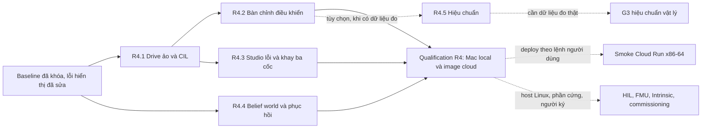

# MEKONIQ — R4: Bàn thử nghiệm vận hành ảo (Virtual Commissioning Workbench)

**Ngày thiết kế:** 2026-11-19 · **Trạng thái:** V00–V07 đã được triển khai trên nhánh `r4/virtual-commissioning` của hai repo. Đợt sửa ngày 20/11 đã xử lý các phát hiện của [review V01–V07](REVIEW-v01-v07-2026-11-20.md); xem [handover V08](plans/HANDOVER-v08.md) để tiếp tục với runtime đã kiểm chứng. Chưa có acceptance của người review. Đoạn dưới giữ mô tả lúc thiết kế. Hướng đã chốt sau khi R3 push/deploy ở [§0](#0-hướng-đã-chốt-với-người-dùng-1911).

**Yêu cầu:** đọc các cải tiến và tích hợp gần đây; R2b và R3 gần xong; dựa trên hai tài liệu đề xuất (bài học từ dự án PLC + MuJoCo, và đánh giá Intrinsic Core), nghiên cứu sâu, mở rộng và lập spec/plan cho phiên bản kế tiếp.

**Một câu:** R2b cho thấy robot và cốc chuyển động ra sao; R4 kiểm thử chính **controller, drive, cảm biến và nhận thức** trong mô phỏng, để kết quả dùng được khi chọn motor, chỉnh bộ điều khiển và quyết định cần đo gì trên máy thật. Không thêm simulator. Không cài runtime ngoài. Lab vẫn không bao giờ nói chuyện với robot thật.

## 0. Hướng đã chốt với người dùng (19/11)

Sau khi R3 đã push và deploy, người dùng chốt ba điểm. Chúng đứng trên mọi lựa chọn ở [§9](#9-những-lựa-chọn-bộ-này-tự-quyết-cần-người-dùng-xem):

1. **Đích chạy là máy Mac local và cloud.** Mỗi đợt của R4 phải chạy được trên runtime local và trong image cloud (`source/deploy/lab-runtime`, Cloud Run x86-64). Không phần nào của R4 được chờ host Linux native hay phần cứng ([R4-D19](02-r4-control-chain-spec.md#4-quyết-định), [R4-15](02-r4-control-chain-spec.md#8-yêu-cầu-đo-được)).
2. **Web là bề mặt demo cho nhà đầu tư và đối tác**, không cần trình diễn mọi thứ. R4 không mở rộng đường xuất replay; nó thêm hai bản ghi mẫu chọn lọc từ run cell, phần còn lại xem trực tiếp trên runtime local hoặc cloud ([R4-D20](02-r4-control-chain-spec.md#4-quyết-định), [R4-16](02-r4-control-chain-spec.md#8-yêu-cầu-đo-được)).
3. **Chưa có lịch phần cứng.** R4.5 (hiệu chuẩn) ra khỏi đường đóng R4 và thành đợt tùy chọn, mở khi có dữ liệu đo hoặc lịch phần cứng ([R4-C §1](04-r4-calibration-and-deferred-spec.md#1-kết-quả-sản-phẩm)).

Kết quả kiểm sẵn sàng cùng ngày, gồm hai việc phải làm trước V01, ở [nghiên cứu §1.1](01-research.md#11-kiểm-lại-sau-khi-r3-đã-push-và-deploy-1911).

## 1. Đọc theo thứ tự

| Tài liệu | Nội dung |
|---|---|
| [01 — Nghiên cứu](01-research.md) | Baseline 19/11, phát hiện từ code, nguồn ngoài đã kiểm, đối chiếu hai tài liệu đề xuất, các hướng đã cân nhắc |
| [02 — Spec R4-A](02-r4-control-chain-spec.md) | Drive ảo, controller-in-the-loop, bàn chỉnh điều khiển, studio lỗi, demo khay ba cốc |
| [03 — Spec R4-B](03-r4-perception-recovery-spec.md) | Belief world, sai số nhận thức, gắp theo niềm tin, phục hồi có giới hạn, ranh giới workcell |
| [04 — Spec R4-C](04-r4-calibration-and-deferred-spec.md) | Hiệu chuẩn, mức trưởng thành của model, các lane hoãn (FMU, HIL, Intrinsic, camera, CNC) |
| [05 — Contracts và evidence](05-contracts-and-evidence.md) | Schema, wire, metric, stream, case, gate, qualification |
| [Plan — Tổng quan](plans/README.md) | Thứ tự, dependency, ràng buộc chung, điểm dừng |
| [Plan 01](plans/01-drive-and-cil.md) | V00–V05: baseline, spike, hợp đồng, drive trong worker, controller, campaign CIL |
| [Plan 02](plans/02-workbench-faults-tray.md) | V06–V10: bench run, tab Điều khiển, lỗi và studio, khay ba cốc |
| [Plan 03](plans/03-belief-and-recovery.md) | V11–V13: belief và bộ ước lượng, rig và study, phục hồi |
| [Plan 04](plans/04-calibration-and-closeout.md) | V14–V16: nhập log và dự đoán, nhận dạng và mức model, qualification và đóng |

Đường dẫn bắt đầu bằng `source/` hoặc `lab/` tính từ workspace `robot/`. File ghi **Create** là đầu ra tương lai. Lệnh trong plan là lệnh khi thực thi, không phải kiểm thử đã chạy.

## 2. Quan hệ với tài liệu đang có

- Bộ này **nối tiếp** [bộ R2b/R3](../2026-11-13-web-lab-to-physical/README.md), không sửa nó. Mọi quyết định R2B-/R3- giữ hiệu lực; R4 chỉ thêm input, stream và panel mới.
- ID mới: yêu cầu `R4-NN`, quyết định `R4-DNN`, task `V00`–`V16`, case `DRV`, `CIL`, `TUNE`, `FLT`, `TRAY`, `BEL`, `REC`, `CAL`, `CLD`, `WEB07`–`WEB10`, `REG05`; gate `G-DRV1`, `G-CIL1`, `G-TUNE1`, `G-FLT1`, `G-TRAY1`, `G-BEL1`, `G-REC1`, `G-WEB2`, `G-REG5`, `G-CLOUD2`, và `G-CAL1` của đợt tùy chọn R4.5.
- Tài liệu nằm ở workspace `robot/docs/`, ngoài bốn repo, cùng lý do với bộ trước: recorder và build từ chối cây có file chưa theo dõi. Khi đóng R4, V16 chép bộ này vào `source/docs/`.
- Tên "R4" và các tiền tố trên là đề xuất của bộ này.

## 3. Điểm xuất phát

Theo [trạng thái 19/11](../../source/docs/implementation/web-lab-to-physical/status-2026-11-19.md): chuỗi IR-SIM → R1 → R1.1 → R2a → R2b đã ghi lại ở source `3d8c2a8` / Lab `4b57a9a`, mọi guard đạt, G-WEB1 đã `tested`, capture 185 giây đạt 0,993×. Sáu profile chuẩn bị của R3 đã ghi ở source `33847b9` (`nativeReady:false`); native và phần cứng chặn bên ngoài. Chưa có sidecar chấp nhận.

Kiểm lại ngày 19/11 sau khi R3 đóng ([nghiên cứu §1.1](01-research.md#11-kiểm-lại-sau-khi-r3-đã-push-và-deploy-1911)): hai repo sạch và trùng `origin/main` (source `33847b9`, Lab `4b57a9a`, pin `3d8c2a8`); runtime Cloud Run báo commit `3d8c2a8`, cùng schema hash với pin của Lab, và quảng bá `MJ-CELL-BV01`; cell chạy headless 13,3 ms/tick trên máy phát triển; các tính năng actuator gốc mà R4.1 dựa vào chạy đúng trên wheel đã cài. Lỗi hiển thị của baseline (run cell đã hoàn thành mất hình 3D) đã được sửa ở Lab `260f4aa` và `65a4593`; V00 đã xong và cụm V01–V03 có [thông tin bàn giao](plans/HANDOVER-v01-v03.md).

| Đã có | Khoảng trống R4 nhắm tới |
|---|---|
| MuJoCo: xArm 6 gắp bằng tiếp xúc, AMR có tải, cell một world, evidence vật lý bền | Lệnh tới thẳng actuator lý tưởng; controller nhìn thấy trạng thái thật |
| Gain servo cố định trong fixture; `pid-v1` có oracle ở mức thuật toán | Chưa có nơi chỉnh gain và xem đáp ứng của plant |
| Lịch lỗi và trình soạn cho mock/native; ba nhiễu loạn đăng ký cho MuJoCo | Không có lỗi ở lớp drive, cảm biến, kênh lệnh; không có báo cáo lỗi |
| Chương trình gắp cố định, cốc sinh đúng tại điểm danh định | Tay máy chưa bao giờ phải tin một vị trí; không có sai số nhận thức; không có thử lại |
| Giao thức G3 và bộ đánh giá hiệu chuẩn | Không có đường nhập log, không có bước nhận dạng, không có nhãn mức model |

## 4. Các đợt có thể bàn giao riêng

| Đợt | Người dùng thấy gì | Phụ thuộc |
|---|---|---|
| **R4.1 — Drive ảo và CIL** | AMR và tay máy chạy qua drive có trạng thái, giới hạn, encoder, trễ; report có lệnh so với thực theo từng trục | Baseline R2b/R3 |
| **R4.2 — Bàn chỉnh điều khiển** | Tab **Điều khiển**: chọn trục, sửa gain trong biên, chạy bước nhảy, đọc overshoot/settling, A/B, xuất profile | R4.1 |
| **R4.3 — Studio lỗi và khay ba cốc** | Soạn lịch lỗi theo lớp, đọc báo cáo lỗi; chạy khay ba cốc với năm biến thể và một câu gợi ý có số đo | R4.1 |
| **R4.4 — Belief world và phục hồi** | Bật/tắt sai số nhận thức, thấy vị trí tin cạnh vị trí thật, đọc tỷ lệ gắp theo mức sai số, thấy tay máy thử lại có giới hạn | Chỉ baseline; song song được với R4.1–R4.3 |
| **R4.5 — Hiệu chuẩn (tùy chọn, sau R4)** | Nhập log đo, so với mô phỏng, nhận dạng tham số, revision model có miền hiệu lực; huy hiệu mức model khắp UI | R4.2. Không nằm trong đường đóng R4; mở khi có dữ liệu đo hoặc lịch phần cứng |

Mỗi đợt R4.1–R4.4 chỉ được coi là bàn giao khi kịch bản của đợt đó chạy được trong image cloud (CLD01). Smoke trên Cloud Run thật (CLD03) chạy sau mỗi lần deploy do người dùng ra lệnh.

Nếu phải cắt: giữ **R4.1** và **R4.4**. Đó là hai gốc của hai tài liệu đề xuất, độc lập nhau, và mọi đợt còn lại xây trên chúng. Kế đến R4.2, rồi R4.3. R4.5 đã ra khỏi đường đóng.

## 5. Quyết định trọng tâm

1. **Không thêm simulator hay runtime.** Giữ MuJoCo 3.17.0. FMU, PLCSIM, Intrinsic Core không được cài trong R4; R4 để lại seam và ghi điều kiện mở cho từng lane.
2. **Drive ở worker, controller ở TS.** Drive chạy mỗi substep 2 ms và là nơi duy nhất tạo ra "phản hồi đo được"; controller thuần chạy mỗi tick 20 ms và không bao giờ thấy trạng thái thật.
3. **Mọi đường cũ giữ nguyên byte.** Drive, belief, phục hồi và lỗi đều là input tùy chọn. Model drive lý tưởng phải cho kết quả trùng bit với R2b; đó là mỏ neo hồi quy.
4. **Người dùng chỉnh dữ liệu, không chỉnh mã.** Gain, lịch lỗi, mô hình sai số là tài liệu có schema nằm trong biên do server giữ; mỗi lần đổi là một run mới.
5. **Hai thế giới tách bằng kiểu dữ liệu.** Trạng thái thật chỉ đi tới evidence và tới các mô hình tạo sai số; mã quyết định chỉ nhận phản hồi đo được hoặc niềm tin.
6. **Chỉ phục hồi từ thất bại đã biết.** Trạng thái không xác định giữ quy tắc R2b: không gửi lại, không tự tiếp tục, không mở kẹp.
7. **Mức model là hàm của nguồn tham số.** Minh họa, giả định, danh định, đã hiệu chuẩn; qualification là trục riêng. Không trục nào là chứng nhận an toàn.
8. **Không hứa kết quả vật lý.** Scenario stress ghi điều quan sát được; "không trượt ở cấu hình này" là kết quả hợp lệ. Câu gợi ý thiết kế chỉ điền bằng số đo của hai run cùng phạm vi.
9. **Mac local và cloud là hai đích bắt buộc.** Mỗi đợt chạy được trên runtime local và trong image cloud. Hai kiến trúc (arm64 và x86-64) được so theo kết quả và dung sai, không theo hash. Không tính năng nào phụ thuộc host Linux native, GPU hay phần cứng.
10. **Web là bề mặt demo.** Không mở rộng đường xuất replay; chỉ thêm bản ghi mẫu chọn lọc từ run cell.

## 6. R4 cố ý không làm

Mô phỏng dòng điện và nhiệt; chế độ mô-men trực tiếp; vòng lặp firmware tần số thấp; auto-tuning; camera render và bộ ước lượng pose thật; engine behavior tree; hợp đồng `WorkcellJob` mới; HIL; FMU; tích hợp Intrinsic Core; machine tending CNC; nâng MuJoCo 4.x; nhiều AMR trong MuJoCo; xuất replay package cho run mobile, bench và rig; bất kỳ lệnh nào tới phần cứng. Lý do và điều kiện mở của từng mục ở cuối mỗi spec và ở [R4-C §6](04-r4-calibration-and-deferred-spec.md#6-các-lane-hoãn-và-điều-kiện-mở).

## 7. Hoàn tất nghĩa là gì

R4 hoàn tất khi mười gate ở [contracts §9](05-contracts-and-evidence.md#9-case-và-gate) có artifact xem lại được ở một tuple source/Lab: chín gate local (G-DRV1, G-CIL1, G-TUNE1, G-FLT1, G-TRAY1, G-BEL1, G-REC1, G-WEB2, G-REG5) và G-CLOUD2. Lab pin đúng source, và chuỗi regression trước đó được ghi lại cùng tuple. G-CLOUD2 cần một lần deploy Cloud Run do người dùng ra lệnh; trước lần đó các gate local vẫn đóng được và CLD03 ghi `not_run` có lý do. Mọi record `accepted:false`; chấp nhận chỉ do người ký viết trong sidecar.

Bốn thứ **không** nằm trong hoàn tất R4 và được ghi riêng: R4.5 cùng G-CAL1 (đợt tùy chọn), G3 (hiệu chuẩn bằng dữ liệu đo), mọi gate native/phần cứng của R3, và mọi lane hoãn.

## 8. Ước lượng

Engineer-days cho một kỹ sư quen codebase, chỉ để lập kế hoạch:

| Đợt | Task | Ước lượng |
|---|---|---|
| R4.1 | V00–V05 | 13–19 |
| R4.2 | V06–V07 | 6–9 |
| R4.3 | V08–V10 | 10–15 |
| R4.4 | V11–V13 | 12–18 |
| Cloud và bản ghi mẫu | CLD01–CLD03, WEB10, rải theo các đợt | 3–5 |
| Đóng | V16 | 3–5 |
| R4.5 (tùy chọn, không cộng) | V14–V15 | 6–9 |

Tổng 47–71 cho R4, không gồm R4.5; gồm cả việc sửa lỗi hiển thị và đo baseline cloud ở V00. Con số cao hơn ước lượng 20–31 ngày của đề xuất gốc cho V1–V5 vì ba lý do: đề xuất đó chưa gồm phần nhận thức và phục hồi; chưa gồm evidence bền, campaign, hồi quy trùng bit và qualification, là phần R2b đã cho thấy tốn thời gian thật (chuỗi ghi 19/11 có ba lần chạy hỏng trước khi đạt); và chưa gồm yêu cầu ba ngôn ngữ, a11y, ba bề rộng cho mỗi panel. Chưa gồm chờ host, phần cứng hay dữ liệu đo. Chốt lại sau spike V01; không cộng thành ngày hứa bàn giao.

## 9. Những lựa chọn bộ này tự quyết, cần người dùng xem

Người dùng đã chốt hướng ở [§0](#0-hướng-đã-chốt-với-người-dùng-1911). Các điểm dưới đây không có trong yêu cầu; tôi chọn và ghi lý do trong spec. Đổi bất kỳ điểm nào là đổi phạm vi tương ứng:

1. Gộp cả hai tài liệu đề xuất vào **một** phiên bản R4 gồm bốn đợt độc lập và một đợt tùy chọn (R4.5), thay vì hai phiên bản.
2. **Không cài** Intrinsic Core, FMU hay phần mềm Siemens; chỉ lấy khái niệm và để seam ([R4-C §6](04-r4-calibration-and-deferred-spec.md#6-các-lane-hoãn-và-điều-kiện-mở)).
3. Sai số nhận thức là **mô hình tham số**, không render camera ([R4-D22](03-r4-perception-recovery-spec.md#4-quyết-định)).
4. Phục hồi là **bảng quy tắc**, không phải engine behavior tree ([R4-D27](03-r4-perception-recovery-spec.md#4-quyết-định)).
5. **Không thêm** hợp đồng `WorkcellJob`; dùng `CellAdapter` hiện có ([R4-D31](03-r4-perception-recovery-spec.md#4-quyết-định)).
6. Thang mức model có thêm **Giả định** và tách **Qualified** thành trục riêng ([R4-C §5](04-r4-calibration-and-deferred-spec.md#5-mức-trưởng-thành-của-model)).
7. Demo khay ba cốc **không hứa cốc trượt**; biến thể tăng tốc gắt có oracle Coulomb và chấp nhận kết quả "không trượt" ([R4-A §7.4](02-r4-control-chain-spec.md#74-scenario-khay-ba-cốc)).
8. Mọi số khởi điểm (encoder, trễ, watchdog, ngưỡng, sai số) là `assumed`, khóa sau spike V01, không phải thông số của driver nào.
9. Làm trên cặp nhánh riêng và fast-forward về `main` ở cuối. Push và deploy chỉ theo lệnh của người dùng.
10. "Chạy được trên cloud" được hiểu là: image arm64 chạy kịch bản của từng đợt trong container trên Mac, image amd64 dựng được từ cùng commit, và smoke trên Cloud Run x86-64 sau mỗi lần deploy theo lệnh ([contracts §9](05-contracts-and-evidence.md#9-case-và-gate)). Cấu hình Cloud Run giữ nguyên (1 vCPU, 2 GiB, một instance) cho tới khi số đo cho thấy cần đổi.
11. Bản ghi mẫu cho web: hai, đều từ run cell (một lỗi drive có báo cáo lỗi; belief ước lượng với một lần phục hồi). Run cell qua drive danh định trông giống mẫu giao cà phê hiện có nên không có mẫu riêng. Khay ba cốc và bàn chỉnh xem trực tiếp, không có bản ghi mẫu.
12. R4.5 thành đợt tùy chọn sau R4 vì chưa có lịch phần cứng. Spec và plan của nó giữ nguyên để dùng lại.
13. Thêm thí nghiệm đăng ký `world-cup-nudge-v1` cho cell ([R4-D33](03-r4-perception-recovery-spec.md#4-quyết-định)): không có nó thì người xem web không bao giờ thấy tay máy thử lại, vì run cell danh định không có lượt gắp hụt.
