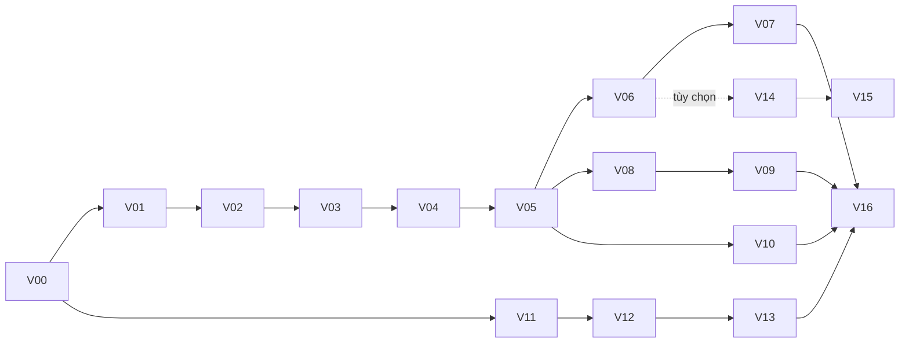

# R4 Virtual Commissioning Workbench — Implementation Plan

**Đầu vào V08 sau sửa ngày 20/11:** xem [HANDOVER-v08.md](HANDOVER-v08.md) cho checkpoint, thay đổi hợp đồng, bằng chứng và gate còn riêng.

> **For agentic workers:** REQUIRED SUB-SKILL: Use superpowers:subagent-driven-development (recommended) or superpowers:executing-plans to implement this plan task-by-task. Steps use checkbox (`- [ ]`) syntax for tracking. Đây là plan đề xuất; chưa cho phép bắt đầu khi spec chưa được duyệt và baseline R2b/R3 chưa khóa (V00).

**Goal:** Đưa Lab từ "robot chuyển động trong mô phỏng" tới "controller, drive, cảm biến và nhận thức được kiểm thử trong mô phỏng", với kết quả dùng được để chọn và chỉnh bộ điều khiển, mà không thêm simulator và không đổi authority của source.

**Architecture:** Lớp drive ảo chạy trong worker MuJoCo ở nhịp substep, controller thuần chạy ở runtime TS ở nhịp tick, nối bằng hợp đồng lệnh/phản hồi trung lập. Bench run, lịch lỗi, belief world và hiệu chuẩn đều là input có schema và biên do server giữ, tạo run mới qua route hiện có. Evidence mới là stream bền cộng thêm; mọi đường R2b giữ nguyên byte khi không dùng input mới.

**Tech Stack:** Node 24.22.2, pnpm 10.32.1, TypeScript/Ajv/Vitest/Playwright/three.js hiện có; Python 3.11, `mujoco==3.17.0`, numpy của lock hiện có. Không thêm thư viện.

**Spec:** [R4-A chuỗi điều khiển](../02-r4-control-chain-spec.md), [R4-B nhận thức và phục hồi](../03-r4-perception-recovery-spec.md), [R4-C hiệu chuẩn và lane hoãn](../04-r4-calibration-and-deferred-spec.md), [contracts/evidence](../05-contracts-and-evidence.md), [nghiên cứu](../01-research.md).

## Global Constraints

- Node 24.22.2 (`export PATH="$HOME/.nvm/versions/node/v24.22.2/bin:$PATH"`), pnpm 10.32.1. Lệnh dài chạy dưới `perl -e 'alarm N; exec @ARGV' …`.
- Pytest: `PYTHONDONTWRITEBYTECODE=1 … -p no:cacheprovider`; không để `__pycache__`/`.pytest_cache` dưới portable tool root.
- Engine giữ `mujoco==3.17.0`, Python 3.11. Không nâng lock, không thêm dependency Python hay npm.
- Một logical tick 20 ms = 10 substep × 2 ms. Mọi thời hạn mới đếm theo thời gian mô phỏng.
- Input mới là tùy chọn và có version. Scene/run không dùng input mới phải cho đúng byte và hành vi R2b: mock BV01, IR-SIM chunk hash, Webots bytes, MJ-BV01, payload 19 ca, cell 3 seed + 5 fault, replay package đã ghi.
- Source giữ mission/journal/custody. Lab chỉ mô phỏng và replay; không thêm đường Lab → phần cứng. Browser chỉ gửi dữ liệu có schema trong biên server; không gửi mã, MJCF, path hay URL.
- Một world MuJoCo đang hoạt động mỗi runtime; một request đang bay; mất ACK → unknown, không gửi lại, không respawn tiếp tục cùng run.
- Mọi tham số drive, encoder, trễ, sai số nhận thức và ngưỡng là `assumed`; physics `not_calibrated`. Ngưỡng oracle khóa trước campaign và không nới sau khi thấy test fail.
- Controller chỉ đọc phản hồi đo được; mã quyết định gắp chỉ đọc belief. Trạng thái thật chỉ đi vào evidence.
- UI dùng `tr(vi, ja, en)` cho mọi chuỗi, giữ a11y, reduced motion, 390/1024/1440 px, đường không cần runtime. Đồ thị bằng SVG nội tuyến.
- Không sửa `trial/`, `web/`, cổng 1880/1884, evidence lịch sử. Không ghi `accepted:true`.
- Mỗi commit source đổi runtime/schema/portable tools → export sạch → một commit Lab `chore: pin source runtime <sha>`. Không Git ở workspace root.
- Commit dùng tiền tố `feat:`/`fix:`/`test:`/`docs:`/`chore:`/`build:`, kết thúc bằng dòng `Co-Authored-By` theo quy định phiên làm việc.
- Hai đích chạy bắt buộc: runtime local trên Mac và image cloud (`source/deploy/lab-runtime`, Cloud Run x86-64). Không task nào được chờ host Linux native, GPU, phần cứng hay dữ liệu đo. Không thêm dependency hệ thống hay tiến trình vào image.
- So sánh trùng bit và hash chỉ có nghĩa trong cùng kiến trúc. Giữa arm64 và x86-64 so theo kết quả và dung sai đã khai.
- Không push `main`, không deploy Vercel hay Cloud Run, không chạy phần cứng khi chưa có lệnh riêng của người dùng. Push `main` là deploy production. Khóa truy cập của runtime cloud chỉ đọc từ môi trường, không ghi vào file hay log.

## 1. Dependency và đường ra sớm

| Gói | Task | Đầu ra | Phụ thuộc ngoài |
|---|---|---|---|
| [01 — Drive và CIL](01-drive-and-cil.md) | V00–V05 | Baseline và hai việc làm trước, drive ảo, hai controller, campaign CIL, evidence theo trục | Khóa truy cập cloud cho số baseline ở V00 (không chặn V01) |
| [02 — Bàn chỉnh, lỗi, khay](02-workbench-faults-tray.md) | V06–V10 | Bench run, tab Điều khiển, studio lỗi, `MJ-TRAY01` | Không |
| [03 — Belief và phục hồi](03-belief-and-recovery.md) | V11–V13 | Belief world, study sai số, phục hồi có giới hạn | Không |
| [04 — Hiệu chuẩn và đóng](04-calibration-and-closeout.md) | V16; V14–V15 tùy chọn | Qualification R4. Công cụ hiệu chuẩn và mức model chỉ khi R4.5 được mở | V14–V15 cần dữ liệu đo hoặc lịch phần cứng; CLD03 ở V16 cần một lần deploy theo lệnh |

Gói 03 chỉ phụ thuộc V00 và có thể chạy song song với gói 01–02. Đường một người: V00 → V01–V05 → V06–V07 → V08–V10 → V11–V13 → V16. V14–V15 chỉ làm khi R4.5 được mở ([R4-C §1](../04-r4-calibration-and-deferred-spec.md#1-kết-quả-sản-phẩm)) và không chặn V16. Có thể bàn giao sớm sau V05 (R4.1), sau V07 (R4.2), sau V10 (R4.3), sau V13 (R4.4). Bàn giao sớm được kiểm bằng các suite tập trung, test golden/hash của đường legacy, guard của các record đang nằm trong cây và CLD01 của đợt; chuỗi recording đầy đủ chỉ ghi một lần, ở V16.

## 2. Quy ước thực thi

Paths tính từ workspace `robot/`; lệnh `pnpm/node` mặc định chạy tại `source/`, lệnh ghi rõ `lab/` chạy tại đó. File **Create** chưa tồn tại tại baseline. Interface mới được định nghĩa trong spec hoặc ngay task sản xuất nó.

Làm trên cặp nhánh/worktree riêng ở cả hai repo (cùng cách R2b đã làm), fast-forward về `main` ở V16. Bằng chứng ghi SHA nên không rewrite lịch sử.

Mỗi task theo chu kỳ: viết test hành vi thất bại → chạy xác nhận fail vì tính năng thiếu → implement → focused tests → review diff → commit. Test cần engine thì dùng engine thật; double chỉ kiểm protocol/lifecycle và gắn nhãn `protocol_double`.

Sau task đổi source runtime/schema/tool và commit sạch, re-pin Lab theo đúng thủ tục của [plan R2b §2](../../2026-11-13-web-lab-to-physical/plans/README.md#2-quy-ước-thực-thi): export ra thư mục tạm ngoài hai repo, import, sync contracts, `pnpm check:source`, commit pin.

Kiểm tra cloud theo đợt (R4-15): sau V05, V07, V10 và V13, với cây source sạch tại commit của task, dựng image `linux/arm64` bằng `deploy/lab-runtime/build.sh`, chạy test container của R4 (CLD01), rồi dựng image `linux/amd64` và chạy test Python của tool root trong image (CLD02). Các bước này không deploy gì. Deploy Cloud Run và smoke CLD03 chỉ chạy khi người dùng ra lệnh, theo [runbook Cloud Run](../../../source/docs/operations/lab-runtime-cloud-run.md) mục 3–5. Chưa có lệnh thì ghi CLD03 `not_run` với lý do `deploy_order_pending` và làm tiếp task sau.

## 3. Review và qualification

| Mốc | Bắt buộc kiểm |
|---|---|
| Sau V00 | Tuple thực, gate còn mở của R2b/R3, số đo chi phí tick baseline trên Mac và trên cloud (hoặc `not_run` có lý do), lỗi hiển thị của run hoàn thành đã sửa và có test |
| Sau V01 | Cơ chế số được khóa bằng số đo: trùng bit ở model lý tưởng, hữu hạn ở mọi biên, chi phí |
| Sau V03 | Đường legacy giữ byte; máy trạng thái và watchdog theo thời gian mô phỏng; không sửa pose |
| Sau V05 | Controller không đọc được trạng thái thật; cell qua drive nominal; evidence fail-closed; cell có drive chạy được trong image cloud |
| Sau V07 | Biên được kiểm ở cả hai phía; gain bất ổn là kết quả; profile gắn plant |
| Sau V10 | Biên nhận lỗi tại đúng lớp; oracle khai trước; không hứa cốc trượt |
| Sau V13 | Truth không rò vào quyết định; không phục hồi từ unknown; không mở kẹp khi cốc còn bị giữ |
| Sau V15 (nếu mở R4.5) | Dữ liệu tổng hợp không thể sinh model hiệu chuẩn; file gốc giữ byte; mức model là hàm thuần |
| Sau V16 | Đủ case/artifact/regression cùng tuple; G-CLOUD2 đúng trạng thái thực; phần external ghi riêng; `accepted:false` |

## 4. Khi nào dừng một nhánh

- **V01 không khóa được cơ chế** (không trùng bit ở model lý tưởng, hoặc bất ổn trong biên đăng ký): dừng gói 01–02, giữ artifact spike. Gói 03 và phần nhập/đánh giá của gói 04 vẫn làm được.
- **Lớp drive làm cell tụt dưới ngưỡng reader:** giới hạn drive ở AMR hoặc chỉ chạy cell-CIL headless, ghi rõ trong report và README; không hạ ngưỡng reader.
- **Cell với drive nominal không phục vụ được 2 cốc sau khi chỉnh control profile có revision:** giữ kết quả là phát hiện, G-CIL1 ghi CIL06 fail; không nới ngưỡng dock/handoff.
- **Proxy người hoặc `cup-triple` không khả thi:** bàn giao A–C, biến thể D ghi blocked có lý do; không dùng animation thay proxy.
- **IK hoặc sweep không đạt cho lệch đăng ký của rig:** thu nhỏ vùng làm việc có revision và ghi giới hạn; không bỏ cửa kiểm.
- **Kịch bản của đợt không chạy được trong image cloud (CLD01):** không bàn giao đợt đó. Sửa cho tới khi chạy được, hoặc ghi rõ phần nào chỉ chạy local kèm lý do; không gỡ kiểm tra.
- **Cloud Run chậm hơn 1× hoặc cell không hoàn thành trên x86-64 (CLD03):** ghi số đo và tick lỗi đầu tiên, giữ kết quả local. Không hạ ngưỡng reader, không đổi tham số plant để vừa cloud. Tăng `--cpu` hay đổi cấu hình dịch vụ là quyết định của người dùng.
- **Chưa có dữ liệu đo hay lịch phần cứng:** không mở R4.5. R4 đóng mà không có G-CAL1; G3 giữ `not_run`.

## 5. Traceability

R4-01→V00/V16; R4-02→V02; R4-03→V01/V03; R4-04→V03; R4-05→V04; R4-06→V04/V05; R4-07→V05; R4-08→V06; R4-09→V07; R4-10→V08; R4-11→V09; R4-12→V10; R4-13→V03/V16; R4-14→V07/V09/V12/V15/V16; R4-15→V00/V05/V07/V10/V13/V16; R4-16→V09/V13/V16.

R4-21→V11; R4-22→V11; R4-23→V11; R4-24→V12; R4-25→V12; R4-26→V13; R4-27→V13; R4-28→V13; R4-29→V13.

R4-31→V14; R4-32→V14; R4-33→V15; R4-34→V15; R4-35→V15; R4-36→V16. R4-31 tới R4-35 chỉ áp dụng khi R4.5 được mở.

Case và gate chính xác ở [contracts §9](../05-contracts-and-evidence.md#9-case-và-gate); không đặt gate trùng chỉ để bảng đủ màu xanh.
