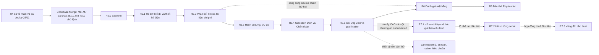

# Roadmap từ R5 — MEKONIQ Robot Lab sau R4 và Codebase Merge

**Ngày lập:** 2026-11-25 · **Trạng thái:** đề xuất, chưa được duyệt. Không có ngày hứa bàn giao; ước lượng tính bằng engineer-day chỉ để xếp thứ tự.

Đọc cùng [nghiên cứu](01-research.md). Spec chi tiết của R5 ở [03](03-r5-hardware-electrical-spec.md), [04](04-r5-stop-diagnostics-spec.md), [05](05-r5-contracts-and-evidence.md); spec gọn của R6 ở [06](06-r6-venue-readiness-spec.md).

## 1. Ba quy tắc xếp thứ tự

Các cuộc trao đổi đưa ra sáu phiên bản roadmap R5–R8 chồng lên nhau ([§2](#2-sáu-phiên-bản-roadmap-trong-các-cuộc-trao-đổi)). Roadmap này hợp nhất chúng bằng ba quy tắc, theo thứ tự ưu tiên:

1. **Hướng người dùng đã chốt đứng trên mọi đề xuất.** Đích chạy là Mac local và cloud; không việc nào trên đường găng được chờ host Linux, GPU, phần cứng hay dữ liệu đo; web là bề mặt demo; chưa có lịch phần cứng (19/11). Vì vậy roadmap tách **release xếp lịch được** khỏi **lane chờ điều kiện**. Một lane chỉ có số release khi điều kiện mở của nó đã có.
2. **Mở rộng cái đã có trước khi dựng cái mới.** Repo đã có catalog linh kiện, BOM có báo giá, kiểm nguồn và dòng ở mức cổng, hồ sơ commissioning, hợp đồng candidate, bộ lập đường nhận biết footprint. Phần lớn "nền tảng mới" trong các cuộc trao đổi là tầng tiếp theo của những thứ này ([nghiên cứu §3](01-research.md#3-phát-hiện-từ-code)).
3. **Mỗi release phải để lại một thứ dùng được ngay, không cần robot.** R5 để lại bộ hồ sơ để chọn và đặt mua phần cứng. R6 để lại báo cáo đánh giá mặt bằng, là thứ gói "đánh giá luồng phục vụ" trong kế hoạch GTM ngày 14/11 định bán.

## 2. Sáu phiên bản roadmap trong các cuộc trao đổi

| # | Nguồn | R5 | R6 | R7 | R8 |
|---|---|---|---|---|---|
| 1 | Chiến lược sau R4 và merge | Hardware Platform | Manufacturing & Lifecycle | Sim-to-Real & Physical AI | — |
| 2 | BIM2Bot | Hardware & Spatial Foundation | Manufacturing, Lifecycle & Venue Readiness | Facility Digital Twin & Fleet Intelligence | Sim-to-Real & Physical AI |
| 3 | 3D HMI | + Equipment Registry, Tag Binding, Inspector | + cảnh báo và chẩn đoán theo serial | + dashboard 3D nhà hàng/nhà máy | + cổng dữ liệu OT |
| 4 | Vetaion | + Electrical Connectivity Model, wiring | + Manufacturing Compiler, QC, as-built | + theo dõi bảo trì | + robot hỗ trợ lắp ráp |
| 5 | Drive-Integrated I/O | Drive-Integrated Hardware Platform (R5-00…09) | Manufacturing & Production Readiness | Native Commissioning & Venue Intelligence | Advanced Robotics & Physical AI |
| 6 | AI + QElectroTech | Hardware & Electrical Engineering (+ R5-E01…08) | Manufacturing & Lifecycle | Venue & Native Commissioning | Physical AI |

Cộng dồn, "R5" của các cuộc trao đổi gồm bốn nhánh (phần cứng, điện, không gian, chẩn đoán 3D) với ước lượng riêng lẻ 27–41 và 14–26 engineer-day cho hai nhánh có số, hai nhánh còn lại chưa có số. Đó là một release quá lớn để duyệt và để ghi một chuỗi qualification. Phiên bản 5 và 6 còn xếp phần native và phần mặt bằng chung một release, tức trộn việc xếp lịch được với việc phải chờ.

## 3. Roadmap đề xuất

| Release | Một câu | Người dùng nhận được | Phụ thuộc ngoài | Ước lượng |
|---|---|---|---|---|
| **R5 — Bàn kỹ thuật phần cứng và điện** | Biến drive ảo của R4 thành công cụ chọn và kiểm một cấu hình phần cứng chế tạo được | Ba phương án Serve so được trên một bảng; bảng phân bổ I/O; danh sách dây, bảng chân, BOM; so sánh ba kiểu dừng với khay ba cốc; gói ứng viên kèm checklist bàn thử | Không. Deploy công khai theo lệnh | 37–55 |
| **R6 — Đánh giá mặt bằng** | Biến mặt bằng của một quán thành báo cáo robot đi được tới đâu và vì sao không | Mô hình không gian có nguồn; kiểm khoảng hở theo footprint kèm lý do; báo cáo đánh giá mặt bằng; bảng năng lực 1 so với 2 robot | Không | 30–45 |
| **R7.1 — Hồ sơ chế tạo** | Từ gói ứng viên sinh bộ hồ sơ để chế tạo và báo giá | Manifest chế tạo sinh từ cây CAD có kiểm lệch; hướng dẫn lắp và checklist QC cuối dây chuyền; báo giá theo cấu hình | Cây CAD của Serve; một phương án `documented` | 12–18 |
| **R8 — Bàn thử Physical AI** | Người điều khiển robot ảo, ghi lại, phát lại, và chấm một policy bằng hành vi vòng kín | Oracle động lực học độc lập; teleop và ghi demonstration; đánh giá vòng kín có khoảng tin cậy | Không cho phần chạy trên Mac | 27–43 |

Tổng các phần xếp lịch được: 106–161 engineer-day. R4 có ước lượng 47–71 và đã mất sáu ngày lịch với các phiên agent chạy song song cùng nhiều vòng review; con số ở đây cùng thang đo đó, không phải ngày lịch.

### 3.1 Điều kiện vào, không phải release

| Việc | Trạng thái 25/11 | Ai quyết |
|---|---|---|
| R4 trên `main` và đã deploy | Xong: source `6285c490`, Lab `77dcce3`, pin và Cloud Run `0650ecbd` | — |
| Chữ ký acceptance cho các record R4 và chuỗi trước | Chưa có sidecar nào | Người ký |
| Codebase Merge M0–M10 | Sáng 25/11 chưa task nào chạy. Tới 18:05 cùng ngày M0–M6 đã diễn tập và M7 đã chạy tới bước push: `main` = `origin/main` = `c7df3381` có Lab ở `apps/lab`, `robot/lab` là symlink, pin vẫn `0650ecbd`. Chưa làm: `lab.mekoniq.app` (M8), `mekoniq.app` về trang marketing (M9), đóng (M10). Bước nối Vercel của M7 tôi không kiểm | M8–M10 cần lệnh từng bước |

**Người dùng chốt ngày 25/11: merge trước R5** ([§4](#4-thứ-tự-và-điểm-quyết-định) mục 2). Lần gộp đã diễn ra trong ngày, nên R5 bắt đầu từ `main` của repo đã gộp và làm trên **một** nhánh `r5/hardware-electrical`. Plan của R5 viết đường dẫn theo `source/…` và `lab/…`; `robot/lab` nay là symlink tới `source/apps/lab` nên các đường dẫn đó vẫn đúng. Quy ước commit, pin và định danh trong một repo ở [plan §2](plans/README.md#2-quy-ước-thực-thi).

Câu trả lời của người dùng kèm một đường lùi: muốn R5 ra nhanh hơn thì làm trên cặp nhánh như R4. Sau lần gộp không còn hai repo để tách cặp nhánh. Cách hiểu của tôi về ý đó: R5 không phải chờ M8–M10. Ba task đó đổi domain, cấu hình Vercel và Cloud Run, tài liệu và bộ nhớ; chúng thêm commit vào `main`, và nhánh R5 nhận các commit đó bằng `git merge main` rồi pin lại trước khi ghi evidence.

### 3.2 R5 — Bàn kỹ thuật phần cứng và điện

| Đợt | Nội dung | Gate | Task |
|---|---|---|---|
| R5.0 | Khóa baseline sau R4 và sau lần gộp; ghi ngày gửi câu hỏi cho Hoàng Anh; spike các điểm chưa chắc | — | E00–E01 |
| R5.1 | `DeviceProfileV1`, catalog mở rộng, kiểm chéo EDS/ESI, mức bằng chứng, `ElectricalDesignV1`, ba phương án Serve | G-DEV1 | E02–E05 |
| R5.2 | Phân bổ I/O, netlist, tiết diện, bộ quy tắc điện, tài liệu đấu dây, BOM mở rộng, so sánh chi phí | G-ELE1, G-DOC1 | E06–E10 |
| R5.3 | Drive model suy từ hồ sơ; ba chức năng dừng; campaign `stop-v1`; I/O ảo và `vio-v1` | G-STP1, G-VIO1 | E11–E14 |
| R5.4 | Phần Điện của trang Lắp ráp; panel Chẩn đoán; hai mẫu tĩnh trên web | G-DGN1, G-WEB3 | E15–E18 |
| R5.5 | Gói ứng viên phần cứng; kiểm cloud; qualification | G-REG6, G-CLOUD3 | E19–E21 |

Nếu phải cắt: giữ **R5.1 và R5.2**. Hai đợt đó không chạy mô phỏng nào, rẻ để kiểm, và đã đủ để Hoàng Anh có bảng so sánh và bộ hồ sơ đấu dây. Kế đến R5.3 (không có I/O ảo), rồi R5.4. I/O ảo (R5.3b) là phần cắt đầu tiên.

Hai gate nằm ngoài R5 và luôn `blocked_external`: G-BENCH1 (thiết bị trên bàn thử) và G-SAFE1 (đánh giá an toàn).

### 3.3 R6 — Đánh giá mặt bằng

Lý do đặt ngay sau R5 thay vì sau phần chế tạo: nó xếp lịch được hoàn toàn trên Mac và cloud, và nó tạo ra đúng thứ kế hoạch GTM định bán. Gói "đánh giá luồng phục vụ" ở đó có giá giả thuyết 8 triệu đồng mỗi điểm và đầu ra là một báo cáo; cổng G2 của kế hoạch đó yêu cầu khảo sát mặt bằng, tuyến và điểm dừng. Phần chế tạo theo serial thì ngược lại, chưa có robot nào để gắn vào.

| Đợt | Nội dung | Gate |
|---|---|---|
| R6.1 | `VenueSpatialModelV1` (đa giác, lối mở có bề rộng thông thủy kèm cơ sở, vùng, trạm, revision theo thiết kế và theo khảo sát); compile sang scene điều hướng hiện có | G-VEN1 |
| R6.2 | Kiểm khoảng hở theo footprint: bề rộng nút thắt, phần tử giới hạn, `needs_survey`; giải thích truy về phần tử nguồn | G-CLR1 |
| R6.3 | Báo cáo đánh giá mặt bằng; bảng năng lực 1 so với 2 robot bằng campaign IR-SIM có sẵn | G-RDY1 |
| R6.4 | Nhập: vẽ lại trên ảnh có tỉ lệ hai điểm (rẻ nhất); IFC qua tool venv IfcOpenShell đã ghim (PoC); DXF khi có khách cần | G-IMP1 |
| R6.5 | Giao diện, mẫu web, kiểm cloud, qualification | G-WEB4, G-REG7, G-CLOUD4 |

R6 chỉ dùng chung với R5 footprint của robot, nên chạy song song được với R5.3–R5.5 nếu có phiên thứ hai. Nó không thêm engine điều hướng, không mô phỏng thang máy, không dùng IFC làm nguồn điều khiển.

### 3.4 R7 — Hồ sơ chế tạo và vòng đời

Chỉ R7.1 xếp lịch được, và chỉ khi có đầu vào thật:

| Đợt | Nội dung | Điều kiện mở |
|---|---|---|
| R7.1 | Manifest chế tạo sinh từ cây CAD, không sửa tay, có kiểm lệch trong CI (bài học Asimov, thêm số lượng, revision, hash file, vật liệu, nhà cung cấp); góc nhìn EBOM và MBOM trên cùng cấu trúc nút; hướng dẫn lắp từ netlist và manifest; mẫu checklist QC cuối dây chuyền; báo giá theo cấu hình (danh sách tùy chọn → chênh lệch BOM → cộng giá từ báo giá có ngày → công → quy tắc biên → hạn hiệu lực) | Có cây CAD của Serve; có ít nhất một phương án R5 ở mức `documented` |
| R7.2 | `RobotUnit`, `AsBuiltConfig`, `ServiceEvent` trong platform; nhãn QR là định danh; so "theo thiết kế" với "theo thực lắp" và cho Lab mô phỏng đúng cấu hình của một serial | Lệnh chế tạo đầu tiên |
| R7.3 | `RentalContract`, sổ tiền cọc là khoản phải trả, kinh tế vòng đời tính từ số thực | Hợp đồng thuê đầu tiên |

Quyết định dựng hay dùng sẵn ([nghiên cứu §4.4](01-research.md#44-chế-tạo-vòng-đời-và-cho-thuê)): tới năm chiếc đầu, BOM là CSV trong Git và mỗi serial một thư mục hồ sơ; **không dựng gì**. Platform chỉ sở hữu những thứ nó phải biết lúc chạy (đơn vị, cấu hình thực lắp, sự kiện dịch vụ, hợp đồng, tiền cọc). Chuyển sang InvenTree tự host làm hệ ghi sổ chế tạo khi có đơn mua cho lô từ năm chiếc, hoặc lần thay linh kiện tại hiện trường đầu tiên cần truy nguồn theo serial.

Tên trường đặt theo các submodel AAS (Digital Nameplate, Hierarchical Structures, Technical Data, Handover Documentation) để việc xuất AAS về sau là cơ học; không áp dụng AAS nguyên khối.

### 3.5 R8 — Bàn thử Physical AI

| Đợt | Nội dung | Ghi chú |
|---|---|---|
| R8.0 | Oracle động lực học độc lập: Pinocchio so với MuJoCo trên fixture xArm 6 (FK, Jacobian, mô-men trọng lực, ma trận khối lượng), trong tool venv riêng | Kéo lên trước được; 2–3 engineer-day. Probe ngày 25/11 cho sai lệch cỡ 1e-15 sau khi căn thứ tự khớp, quy ước Jacobian và armature |
| R8.1 | Teleop tay máy xArm 6 ảo sẵn có bằng bàn phím hoặc tay cầm, trong biên do server giữ; ghi ở runtime (tick, hành động, trạng thái, khung hình do worker render), băm như mọi run; phát lại bằng cách áp lại hành động và đòi cùng quỹ đạo trạng thái | Render camera offscreen đo được 3,3–3,7 ms mỗi khung trên Mac; đường render không GPU trên Cloud Run chưa kiểm |
| R8.2 | Xuất dataset LeRobot v3.0 bằng một công cụ Python 3.12 riêng, kiểm bằng cách nạp lại bằng chính LeRobot | LeRobot 0.7 đòi Python ≥ 3.12 và luôn kéo theo torch, nên không vào được venv 3.11 của worker và không vào runtime |
| R8.3 | Chấm policy bằng tỷ lệ thành công vòng kín trên điều kiện đầu chốt trước khi huấn luyện, đọc từ trạng thái simulator, báo k/N kèm khoảng Wilson; policy chỉ chạy trong mô phỏng | Loss lúc huấn luyện không phải bằng chứng. Ví dụ đã đọc: một policy huấn luyện sạch, suy luận 37 Hz, đạt 3/12 lượt và bỏ qua câu lệnh |

Lát cắt dựng trên worker xArm 6 đang có, không dựng trên LeKiwi: bản mô phỏng LeKiwi của Ekumen ghim LeRobot 0.4.0 và giao thức dây của LeRobot đã đổi từ đó, nên lời hứa "cùng một API cho robot ảo và thật" hiện chỉ đúng ở phiên bản cũ. Không bắt đầu bằng huấn luyện VLA, humanoid hay Dora. Source vẫn giữ mission; policy chỉ đề xuất hành động trong phạm vi mô phỏng đã cấp.

## 4. Thứ tự và điểm quyết định

Đường đã chốt: Merge → R5.0 → R5.1 → R5.2 → (R5.3 → R5.4 → R5.5) song song với (R6.1 → R6.5) → R8.0 → R7.1 khi đủ điều kiện → R8.1–R8.3.

Bộ này để lại bốn điểm cho người dùng quyết. Chiều 25/11 người dùng dán bốn câu trả lời vào phiên làm việc; tôi ghi chúng là quyết định của người dùng và chép nguyên văn dưới đây. Văn bản xưng "bạn" với người đọc, tức nó được soạn cho người dùng ở nơi khác rồi được chuyển vào đây. Mọi phần còn lại vẫn là lựa chọn của tôi, ghi ở [README §9](README.md#9-những-lựa-chọn-bộ-này-tự-quyết-cần-người-dùng-xem).

1. **R6 đứng trước phần chế tạo: có.** Các cuộc trao đổi xếp "Manufacturing & Lifecycle" là R6 và mặt bằng là R7; bộ này đảo lại vì quy tắc 1 và 3.

   > R6 trước phần chế tạo: có. R6 xếp lịch trọn vẹn trên Mac và cloud, và tạo ra đúng báo cáo mặt bằng mà kế hoạch GTM định bán. R7.1 đã bị khóa bởi cây CAD và một phương án documented, nên đảo thứ tự gần như không tốn gì. Đổi lại nếu Hoàng Anh có lịch chế tạo chiếc đầu trong vài tuần.

   Hệ quả: thứ tự ở [§3](#3-roadmap-đề-xuất) giữ nguyên. Điều kiện đảo lại là một câu hỏi cho Hoàng Anh, hỏi cùng lúc với điểm 3 ([§4.1](#41-câu-hỏi-gửi-hoàng-anh-trước-e03) câu 5).

2. **Merge trước R5.**

   > Merge trước R5. Điều kiện R4 về main đã thỏa và hai cây đang sạch, nên đây là lúc merge rẻ nhất. M7–M10 vẫn cần lệnh từng bước của bạn. Nếu muốn R5 ra nhanh hơn, làm R5 trên cặp nhánh như R4 đã làm.

   Hệ quả: lần gộp đã chạy tới M7 trong ngày; R5 làm trên một nhánh trong một repo. Chi tiết ở [§3.1](#31-điều-kiện-vào-không-phải-release).

3. **Giữ ba phương án phần cứng.** Đề xuất ở [spec R5-A §5.4](03-r5-hardware-electrical-spec.md#54-ba-phương-án-cho-serve) lấy từ tài liệu đã đọc, không phải từ trao đổi với Hoàng Anh.

   > Giữ ba phương án BLV-R, ZLAC8015D và BLV-R + I/O rời. Ba phương án khác nhau theo cấu trúc, và compiler không phụ thuộc hãng. Nên hỏi Hoàng Anh trước E03 xem có danh sách ngắn khác không, vì nhập hồ sơ thiết bị là phần tốn thời gian nhất.

   Hệ quả: fixture giữ nguyên. Câu hỏi gửi Hoàng Anh ở [§4.1](#41-câu-hỏi-gửi-hoàng-anh-trước-e03); E00 ghi ngày gửi, E03 và E05 có điểm kiểm trước bước nhập hồ sơ ([plan 01](plans/01-profiles-and-design.md)).

4. **Giữ một chuỗi regression đầy đủ ở E21.** Chuỗi của R4 mất nhiều giờ và 12 GB.

   > Giữ một chuỗi regression đầy đủ ở E21. Đó là luật của repo. R5.1–R5.2 không chạy mô phỏng nào, nên chi phí chấp nhận được.

   Hệ quả: không đổi gì. Plan đã ghi chuỗi đầy đủ một lần ở E21; các đợt bàn giao sớm dùng suite tập trung, test golden của đường legacy, guard của record đang trong cây và CLD04.

### 4.1 Câu hỏi gửi Hoàng Anh trước E03

Người gửi là người dùng. Sáu câu, để một lần trả lời đủ cho cả điểm 1 và điểm 3:

1. Motor và driver nào đang được cân nhắc, hoặc đã có sẵn, cho hai bánh chủ động của Serve (hãng, mã đặt hàng, công suất)? Bộ này đang dùng ba phương án: Oriental Motor BLV-R 60 W với driver BLVD-KRD; ZLTECH ZLAC8015D với bánh hub ZLLG65ASM250-L; BLV-R cộng một module I/O rời.
2. Bus điều khiển dự định dùng là CANopen, Modbus RTU hay EtherCAT? Bộ điều khiển là máy tính nào hay PLC nào?
3. Module I/O, nút dừng khẩn, rơ-le an toàn và bumper: đã chọn mã nào chưa?
4. Với mỗi thiết bị, có sẵn manual, datasheet và file EDS hoặc ESI không? Lab chỉ nhận giá trị từ tài liệu ghim được bằng hash.
5. Có lịch chế tạo chiếc Serve đầu tiên trong vài tuần tới không? Nếu có, phần hồ sơ chế tạo (R7.1) được kéo lên trước phần đánh giá mặt bằng (R6).
6. Đã có cây CAD của Serve chưa (định dạng, nơi lưu)? R7.1 cần nó.

Cách xử lý câu trả lời là đề xuất của tôi:

| Câu trả lời | Việc làm |
|---|---|
| Danh sách ngắn trùng ba phương án | Không đổi gì |
| Danh sách ngắn khác | Đổi thiết bị của fixture ở spec R5-A §5.4. Hợp đồng, compiler và bộ quy tắc không đổi. Tài liệu của thiết bị mới phải ghim được trước khi nhập; ước lượng E03 và E05 tính lại |
| Chưa có câu trả lời khi E03 tới bước nhập hồ sơ | Nhập HW-A trước: BLV-R là ứng viên đã có trong `robotics/catalog/selection.md`, nên ít khả năng bỏ đi nhất. Các bước code của E03 và E04 không phụ thuộc câu trả lời và vẫn chạy |
| Vẫn chưa có khi tới E05 | Hỏi người dùng một lần: nhập tiếp ZLAC8015D và module I/O theo mặc định, hay chờ |
| Có lịch chế tạo trong vài tuần (câu 5) | Báo người dùng để đảo R7.1 lên trước R6, đúng điều kiện ở điểm 1 |

## 5. Các lane chờ điều kiện

Mỗi lane có giá trị, nhưng hôm nay thiếu một điều kiện bên ngoài hoặc chưa có câu hỏi cần nó trả lời. Roadmap để lại seam; không xây lane.

| Lane | Vì sao chưa làm | Seam đã có hoặc R5/R6 để lại | Điều kiện mở |
|---|---|---|---|
| **L-BENCH** — conformance trên bàn thử | Chưa có thiết bị | Checklist bàn thử sinh từ bundle; hồ sơ thiết bị; drive model R4 | Có drive và motor của một phương án trên bàn thử cách ly, có người vận hành |
| **L-SAFE** — đánh giá và thử nghiệm an toàn | Việc của người có chuyên môn; cần thiết bị | Sổ yêu cầu an toàn; báo cáo dừng làm đầu vào tham khảo | Có người chịu trách nhiệm an toàn và một phương án đã chọn |
| **L-NATIVE** — adapter `ros2_control`, Nav2 native | Cần host Linux | Hợp đồng lệnh/phản hồi trung lập của R4; ánh xạ bus trong hồ sơ thiết bị; sáu profile chuẩn bị của R3 | Có host Linux đúng yêu cầu R3 và thiết bị đã chọn |
| **L-CAL** — hiệu chuẩn bằng dữ liệu đo | Chưa có số đo | Công cụ R4.5; bài thả trôi do báo cáo dừng chỉ ra | Có một bộ log đo từ thiết bị thật |
| **L-SITE** — commissioning tại quán | Cần robot đã qua L-BENCH và L-SAFE | Hồ sơ commissioning chassis; dossier R3; báo cáo mặt bằng R6 | Robot đã `hardware_validated` và một quán đồng ý |
| **L-QET** — sơ đồ QElectroTech nhiều trang | Tự động hóa chỉ có trong bản nightly; xuất không màn hình chưa chạy thử; chi phí thật là đặt ký hiệu | Netlist và id ổn định; quy tắc đối chiếu | Có yêu cầu hồ sơ kiểu tủ điện, và spike trong container Linux đạt |
| **L-MJ4** — nâng MuJoCo lên 4.x | Đổi engine làm mất mỏ neo trùng bit; 4.0.1 đã phát hành nhưng chưa ai chạy lại gate | Mọi kiểm R2b/R4/R5 chạy lại được trên pin mới | Candidate riêng chạy lại toàn bộ gate trên pin mới, có báo cáo so sánh |
| **L-ASSET** — nhập tài sản ngoài (SimReady, RoboCasa, Scanned Objects) | USD sang MJCF chưa tin được: mất ma sát, quán tính bị tính lại, collision là một bao lồi; đường đọc USD cần MuJoCo 4.x | Ý tưởng manifest và chuỗi hash của SimReady; quy tắc nguồn của catalog | Một scenario cần vật thể mà primitive không đủ. Khi đó thử Scanned Objects (MJCF sẵn) trước USD |
| **L-CAMERA** — camera render và bộ ước lượng pose | Như R4-C §6 | `PerceptionProfileV1` | Có camera và vật thể cụ thể kèm dataset pose đo |
| **L-WORKCELL** — Intrinsic Core, machine tending | Yêu cầu Ubuntu 26.04 x86-64, 32 GiB; vẫn không có đường ARM/macOS; không có adapter xArm | Ánh xạ sang `CellAdapter`; belief và phục hồi đã có bản gốc | Năm điều kiện ở R4-C §6.1 |
| **L-LOC** — benchmark định vị | Chưa có log cảm biến thật; robot nhà hàng không cần LiDAR 3D | Belief world của R4 là mẫu cho "tư thế tin" so với "tư thế thật" | Có log LiDAR/odometry thật, hoặc một câu hỏi thiết kế cần sai số định vị |
| **L-MULTIFLOOR** — nhiều tầng, thang máy | Khách đầu tiên là quán một tầng; thang máy thật cần tích hợp và thẩm định riêng | `verticals[]` của mô hình không gian, ghi `not_modelled` | Một khách có nhu cầu nhiều tầng và có đường tích hợp thang |
| **L-OT** — cổng dữ liệu OT, HMI vận hành | Chưa có thiết bị để đọc | Hợp đồng mẫu tag có chất lượng và timestamp nguồn | Có thiết bị thật cần giám sát chỉ đọc |
| **L-MFG-OPS** — InvenTree | Dưới năm chiếc thì CSV và Git đủ | Tên trường theo AAS | Xem [§3.4](#34-r7--hồ-sơ-chế-tạo-và-vòng-đời) |
| **L-OMNI**, **L-HUMANOID**, **L-PANEL** | Không gắn với sản phẩm đầu tiên | Model Asimov đã thử nạp được trên engine đang ghim | Có định hướng kinh doanh cụ thể |

## 6. Truy vết: mỗi đề xuất trong các cuộc trao đổi đi đâu

"Đã có" nghĩa là R4 đã làm trước khi các cuộc trao đổi được gom lại; cuộc trao đổi về Intrinsic được viết khi R2b còn dang dở.

| Nguồn | Đề xuất | Đi đâu | Ghi chú |
|---|---|---|---|
| Intrinsic | Belief World, Perception Reality Gap | Đã có (R4.4) | Mô hình tham số, không render camera |
| Intrinsic | Behavior Tree & Recovery Lab | Đã có (R4.4), dạng bảng quy tắc | Engine behavior tree: không làm |
| Intrinsic | Industrial Manipulation Test Suite | Đã có một phần (rig gắp, study 92 lượt, phục hồi) | Planner gắp thật: L-WORKCELL |
| Intrinsic | `WorkcellJob`/`WorkcellResult`, CNC tending, cài runtime | L-WORKCELL | R4-D31 đã chọn dùng `CellAdapter` |
| lidar_localization | `LocalizationProvider`, LOC-01…05 | L-LOC | |
| lidar_localization | Mua LiDAR 3D | Không | |
| Asimov | Fabrication manifest, quản lý revision | R7.1 | Lấy cách sinh từ cây CAD và kiểm lệch |
| Asimov | PoC nhập humanoid AS-01…07 | L-HUMANOID | Đã thử: hai model nạp được trên 3.17.0; giấy phép copyleft nên chỉ là fixture ngoài |
| Asimov | Nghiên cứu controller nhiều CAN | Không | Robot hai bánh không cần |
| SimReady | Asset registry, PoC tủ bếp và vật gắp | L-ASSET | Gói tủ nặng 268 MB; chuyển đổi chưa tin được |
| LeKiwi/Ekumen | Teleoperation & Demonstration Recorder | R8.1 | |
| LeKiwi/Ekumen | Independent Dynamics Oracle (Pinocchio) | R8.0 | Kéo lên trước được |
| LeKiwi/Ekumen | Imitation Learning Workbench, đánh giá policy | R8.2–R8.3 | |
| LeKiwi/Ekumen | Robot Platform Importer, Holonomic Drive | L-OMNI | |
| Chiến lược | P0-1 Hardware Abstraction & Device Profiles | R5.1 | Mở rộng catalog sẵn có |
| Chiến lược | P0-2 Manufacturing Digital Thread | R7.1–R7.2 | |
| Chiến lược | P1-3 Robot Asset Lifecycle & RaaS | R7.2–R7.3 | Chờ robot và hợp đồng thật |
| Chiến lược | P1-4 Deployment & Venue Commissioning | R6 + L-SITE + L-NATIVE | |
| Chiến lược | R5-02 Virtual MCU/I-O, drive conformance | R5.3b; phần trên thiết bị: L-BENCH | |
| Chiến lược | R5-06 Target hardware adapter specification | Một phần: ánh xạ bus trong hồ sơ; đặc tả đầy đủ: L-NATIVE | Viết đặc tả adapter cho phần cứng chưa chọn là suy đoán |
| BIM2Bot | R5-S01 `VenueSpatialModelV1` | R6.1 | |
| BIM2Bot | R5-S02/S03 nhập IFC, IFC → world | R6.4 | IfcOpenShell là bộ nhập chính thức; web-ifc để sau |
| BIM2Bot | R5-S04/S05 ngữ nghĩa, truy vết ô lưới → phần tử | R6.1–R6.2 | |
| BIM2Bot | R5-S06 kiểm footprint và khoảng hở | R6.2 | Tính năng có giá trị trực tiếp nhất |
| BIM2Bot | R5-S07 xuất sang IR-SIM và định dạng native | R6.1; bản đồ Nav2: tùy chọn ở R6.3 | |
| BIM2Bot | R5-S08 nhiều tầng, thang máy; mô phỏng đội 8 robot | L-MULTIFLOOR; năng lực đội: R6.3 bằng IR-SIM sẵn có | Không port bộ mô phỏng của BIM2Bot |
| 3D HMI | Equipment Inspector, Live Tag Binding, Alarm Overlay, Incident Review | R5.4 | Trên evidence của run, không phải thiết bị |
| 3D HMI | Multi-level HMI, OT Data Gateway | L-OT | |
| Vetaion | MFG-01 mô hình điện, MFG-03 kiểm đấu dây | R5.1–R5.2 | |
| Vetaion | MFG-02 xem lắp ráp 2D/3D | Sơ đồ khối 2D: R5.4; bố trí 3D: chờ CAD khoang điện | |
| Vetaion | MFG-04 BOM chế tạo | R5.2 (BOM mở rộng), R7.1 (MBOM) | |
| Vetaion | MFG-05 hướng dẫn lắp, MFG-06 QC, MFG-07 as-built | R7.1, R7.2 | |
| Vetaion | Configure-to-Quote | R7.1 | Dựa trên so sánh chi phí của R5.2 |
| Vetaion | Robot lắp tủ điện | L-PANEL | |
| Drive I/O | R5-00…R5-09 | E00–E21 | Xem [plan README §5](plans/README.md#5-traceability) |
| Drive I/O | Tám hợp đồng | Sáu file schema | `IOPoint` và `DriveCapability` nằm trong hồ sơ thiết bị; `WiringManifest` là netlist của bundle; `DeviceConformanceReport` thuộc L-BENCH |
| Drive I/O | Test IO01–IO12 | DEV, IOA, ERC, STP, VIO, CLD | IO06, IO07, IO09 phần lớn đã có ở `fault-v1` của R4 |
| Drive I/O | G-R5-BENCH, G-R5-SAFETY | G-BENCH1, G-SAFE1 | Luôn `blocked_external` trong R5 |
| QElectroTech | R5-E02 netlist, R5-E05 kiểm quy tắc, R5-E06 xuất dây và BOM, R5-E08 kiểm nhất quán | R5.2 | |
| QElectroTech | R5-E01 spike, R5-E03 bộ sinh `.qet` | L-QET | |
| QElectroTech | R5-E04 AI soạn bản nháp | Ngoài sản phẩm | Agent sửa JSON, validator quyết định; có bản hướng dẫn |
| QElectroTech | R5-E07 quy trình revision và duyệt | Một phần: digest, `--check`, gói có manifest | Chữ ký duyệt theo mẫu sidecar hiện có |
| Tài chính | Mô hình cho thuê 100 triệu / 8 triệu mỗi tháng | Kiểm lại bằng số ở [nghiên cứu §4.4](01-research.md#44-chế-tạo-vòng-đời-và-cho-thuê); sổ sách: R7.3 | |

## 7. Rủi ro chính

| Rủi ro | Dấu hiệu | Cách xử lý đã đặt sẵn |
|---|---|---|
| Hồ sơ thiết bị thành việc nhập liệu vô tận | Một hồ sơ mất hơn nửa ngày | R5 chỉ cần ba đến bốn drive và các thiết bị của ba phương án; mức `candidate` là hợp lệ; kiểm chéo EDS/ESI bắt lỗi gõ |
| Tài liệu hãng mâu thuẫn hoặc thiếu | Manual ELD3 ghi 8 DI ở một mục và 6 DI ở mục khác | Nguồn dẫn tới đúng trang; mâu thuẫn thành mục "chưa kiểm", không ai tự chọn số |
| Kết quả dừng bị đọc thành số an toàn | Có người trích quãng đường dừng ra ngoài | Mọi report mang danh sách tham số quyết định và nhãn `assumed`; câu gợi ý luôn kết bằng bài đo cần làm |
| Mỗi schema mới làm bản web công khai lệch runtime | Lab công khai báo `CONTRACT_MISMATCH` | Phần mới chạy trên runtime local cho tới lần deploy theo lệnh; không push `main` giữa chừng |
| `main` đi tiếp trong lúc R5 chạy (M8 và M10 của lần gộp, hoặc một phiên khác) | Commit source của `main` khác điểm tách nhánh R5 | `git merge main` vào nhánh R5, pin lại, rồi mới ghi evidence; không rebase vì evidence đã ghi SHA |
| Hoàng Anh có danh sách thiết bị khác sau khi hồ sơ đã nhập | Câu trả lời tới sau E03 | Hỏi trước E00; nhập HW-A trước; hợp đồng và compiler không phụ thuộc hãng nên chỉ fixture đổi ([§4.1](#41-câu-hỏi-gửi-hoàng-anh-trước-e03)) |
| R6 trượt thành một nền tảng BIM | Yêu cầu thang máy, nhiều tầng, đồng bộ IFC hai chiều | IFC chỉ là một nguồn nhập; nhiều tầng là lane; mô hình không gian là nguồn sự thật |
| Giả định thuê 5–8 triệu mỗi tháng không có bằng chứng thị trường Việt Nam | Không tìm được giá công khai nào bằng VND | Không dựng tính năng cho thuê trước khi có hợp đồng; R6 phục vụ gói đánh giá có trả phí là thứ kiểm được sớm hơn |
