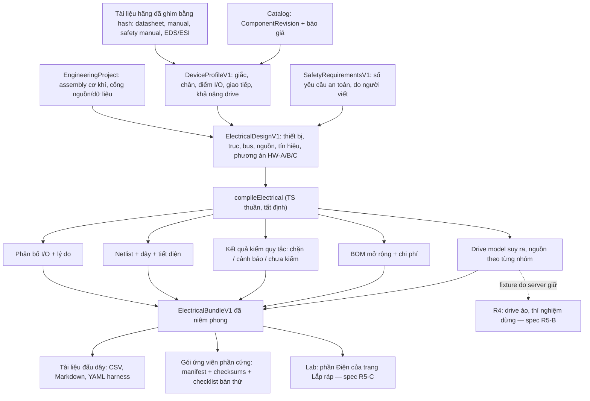

# Spec R5-A — Hồ sơ thiết bị, thiết kế điện, phân bổ I/O, netlist và gói ứng viên phần cứng

**Mã:** MKQ-ENG-R5-A-01 · **Trạng thái:** đề xuất ngày 25/11/2026, chưa có schema hay code nào của R5 tồn tại. Chưa có phần cứng nào được mua hay chốt.

Đọc cùng [nghiên cứu](01-research.md), [roadmap](02-roadmap.md), [spec R5-B/C](04-r5-stop-diagnostics-spec.md), [contracts và evidence](05-r5-contracts-and-evidence.md) và [plan](plans/README.md). Mọi thứ trong spec này là tài liệu có schema và hàm thuần; không phần nào gửi lệnh tới thiết bị thật.

## 1. Kết quả sản phẩm

R4 kiểm thử controller qua một drive ảo mà mọi tham số là `assumed`. Bước tiếp theo không phải viết driver. Bước tiếp theo là để Lab trả lời được bốn câu mà Hoàng Anh (phần cứng, Hà Nội) và Henry (phần mềm, TP.HCM) cần trước khi đặt mua bất cứ thứ gì:

1. **Cấu hình này có đấu được không?** Mỗi tín hiệu của robot (bumper, cảm biến dock, đèn, còi, trạng thái E-stop…) có một chân I/O hợp lệ để đi vào không, trên đúng model drive và firmware đã chọn?
2. **Đấu như thế nào?** Từ cùng dữ liệu đó sinh ra danh sách dây, bảng chân, BOM gồm cả giắc và dây, kèm các lỗi điện phát hiện được trên giấy (điện áp, dòng, tiết diện, cầu chì).
3. **Phương án nào rẻ hơn khi tính đủ?** So HW-A, HW-B, HW-C trên cùng bảng, và nói thẳng dòng nào chưa có báo giá.
4. **Còn phải đo gì trên bàn thử?** Một danh sách sinh tự động gồm mọi giá trị còn `assumed` hoặc chưa kiểm mà cấu hình đang dựa vào.

| Đợt | Trong phạm vi | Điều kiện ra |
|---|---|---|
| R5.1 | Hợp đồng hồ sơ thiết bị, mở rộng catalog, mức bằng chứng tính bằng máy, hợp đồng thiết kế điện, ba phương án Serve | G-DEV1 |
| R5.2 | Phân bổ I/O tất định, netlist, tính tiết diện, bộ kiểm quy tắc điện, sinh tài liệu đấu dây, BOM mở rộng và so sánh chi phí | G-ELE1, G-DOC1 |
| R5.5 (phần của spec này) | Gói ứng viên phần cứng xuất ra được, drive model suy từ hồ sơ | G-DOC1 |

Không thuộc R5-A: driver phần cứng, adapter `ros2_control`, đọc/ghi tham số drive, kiểm thử trên bàn thử, thiết kế mạch an toàn, thiết kế PCB, bố trí 3D khoang điện, mô phỏng dòng điện và nhiệt. Xem [§10](#10-các-việc-chủ-ý-hoãn).

## 2. Hiện trạng trong code (đã đọc ngày 25/11)

Đây là phát hiện quan trọng nhất của đợt nghiên cứu: phần lớn "nền tảng phần cứng" mà các cuộc trao đổi đề xuất dựng mới **đã có một nửa trong repo**. R5 mở rộng nó, không dựng song song.

| Quan sát | Nguồn | Hệ quả cho R5 |
|---|---|---|
| Catalog linh kiện có 13 mục, mỗi mục là `ComponentRevision` với `ports` (`mount`/`power`/`data`, dải điện áp, dòng liên tục, `protocol`, `pinoutRevision`), `documents` (URL + digest, blob trong `documents/<digest>`), `models`. Báo giá nằm ở `catalog.json` và chỉ hợp lệ khi dẫn tới một tài liệu linh kiện đã khai. Hiện có **0 báo giá** | `source/robotics/catalog/`, `packages/lab-runtime/src/engineering/catalog.ts` | Hồ sơ thiết bị gắn vào linh kiện sẵn có; báo giá dùng cơ chế sẵn có |
| `resolveAssembly` đã kiểm ở mức cổng: hướng nguồn, giao điện áp, ngân sách dòng (`POWER_BUDGET_EXCEEDED`), khớp giao thức (`DATA_INTERFACE_MISSING`), cổng dùng lại; và đã sinh **BOM** có `missingPriceLineIds`, `incompleteTotal`, `requiredAccessories` (đang rỗng) | `engineering/assembly.ts` | R5 thêm tầng **chân** bên dưới tầng cổng; phụ kiện (giắc, dây, cầu chì) đi vào đúng trường đang rỗng |
| Tham số có nguồn `manufacturer`/`measured` phải dẫn tới tài liệu đã khai, đúng digest, nếu không là `PROVENANCE_UNRESOLVED` | `catalog.ts` | Dùng lại nguyên quy tắc cho hồ sơ thiết bị |
| `engineering-component.schema.json` **bị đóng băng theo hash** bởi baseline R2a, cùng `lab-project-v2`, `lab-fault-schedule`, `arm-cell-scene-v1`, `arm-scene-3d-v1` | `scripts/native-sim/r2a-arm-baseline.json` | Không sửa `Port` hay `ComponentRevision`. Mọi thứ mới là **file schema mới** tham chiếu định nghĩa cũ |
| Thêm, đổi tên hay sửa một byte của bất kỳ schema nào làm đổi `schemaHash`, `portableToolsDigest` và closure native; runtime từ chối client lệch `schemaHash` | `scripts/export-lab-runtime.mjs`, `v2/gateway.ts` | Mỗi task thêm schema kéo theo một lần re-pin Lab; bản web công khai chỉ khớp lại sau một lần deploy theo lệnh |
| Ứng viên motor trong catalog là **Oriental Motor BLV-R** (chỉ có trang hãng, `license: unreviewed`, chưa có SKU). Worksheet tính tải: 35 kg, bánh r = 0,10 m, 0,8 m/s, 0,5 m/s² → 1,2 N·m liên tục và 2,4 N·m đỉnh mỗi bánh ở 76 vòng/phút, **khoảng 10 W cơ mỗi bánh** | `robotics/catalog/selection.md` | Các cuộc trao đổi giả định 150–200 W mỗi bánh và drive EtherCAT có STO; con số trong repo nhỏ hơn 15 lần. Ba phương án của R5 phải đặt cạnh nhau đúng tải này |
| Hồ sơ commissioning cho chassis ZLTECH và WHEELTEC S100 đã có schema và validator; mọi giá trị của hãng là `null`, `blocked_external`. Quy tắc ghi rõ: **không điền từ trí nhớ hay từ web** | `robotics/hardware/profiles/`, `docs/operations/robot-commissioning.md` | R5 giữ quy tắc đó: giá trị của hãng chỉ vào hồ sơ khi tài liệu gốc đã được ghim bằng hash |
| Đã có `EngineeringCandidate` (`status:'draft'`, `hardwareValidated:false`, `controlAuthority:false` là hằng) và `PhysicalTargetDossierV1` | `engineering-candidate.schema.json`, `physical-target-dossier-v1.schema.json` | Gói ứng viên phần cứng giữ đúng ba hằng đó và là đầu vào tham chiếu của dossier, không phải quyền chạy máy |
| Mức trưởng thành của model là hàm thuần của nguồn tham số; nhóm `drive` đọc `sources` của `serve-drive-nominal-v1.json`, hiện cả bảy nguồn đều `assumed` | `engineering/maturity.ts` | Một drive model suy từ hồ sơ có nguồn hãng sẽ **tự** đổi mức của nhóm, không cần trường mới |
| Trang Lắp ráp của Lab đã có chọn linh kiện, nối cổng, danh sách vấn đề, compile trên runtime, BOM, ước lượng | `lab/src/ui/assembly-page.ts`, `lab/src/cost/`, `lab/src/design/` | Giao diện R5 là một phần mới của trang này, không phải workspace mới |

## 3. Kiến trúc mục tiêu



Ba nguyên tắc cấu trúc:

- **Tài liệu soạn tách khỏi tài liệu suy ra.** Người thiết kế soạn `DeviceProfileV1`, `ElectricalDesignV1`, `SafetyRequirementsV1`. Mọi thứ còn lại do compiler sinh, mang digest của đầu vào, và không ai sửa tay.
- **Thiết bị thuần điện không vào assembly cơ khí.** Drive, cầu chì, DC/DC, máy tính, nút E-stop nằm trong `ElectricalDesignV1.devices`. Nhờ đó `assemblyDigest`, scene digest và mọi golden của R2b/R4 giữ nguyên byte. Thiết bị vừa cơ vừa điện (pin, bánh có motor, LiDAR) tham chiếu instance đã có trong assembly.
- **Compile chạy ở runtime, không ở trình duyệt.** Cùng quy tắc R4-D10: trình duyệt gửi dữ liệu có schema, server giữ quyền kiểm và niêm phong.

Code mới nằm ở `source/packages/lab-runtime/src/engineering/electrical/` và dùng lại `hashJson`, `Problem`, `SourceRef`, `Scalar`, `uniqueSources`, `loadCatalog`. Không thêm thư viện.

## 4. Quyết định

| ID | Quyết định |
|---|---|
| R5-D01 | Không thêm simulator, runtime hay framework điều khiển. R5-A là dữ liệu có schema cộng hàm thuần TS trong module engineering sẵn có |
| R5-D02 | `ComponentRevision` giữ nguyên. Hồ sơ thiết bị là tài liệu **anh em**, gắn vào linh kiện bằng `{id, revision, digest}`; một linh kiện có thể có nhiều hồ sơ (biến thể mã đặt hàng, firmware) |
| R5-D03 | Giá trị của hãng chỉ được nhập khi tài liệu gốc nằm trong `robotics/catalog/documents/<digest>` và được khai trong hồ sơ. Không điền từ trí nhớ, từ bài tổng hợp hay từ câu trả lời của mô hình ngôn ngữ. Nguồn không ghim được thì giá trị là `assumed` |
| R5-D04 | **Mức bằng chứng** của hồ sơ (`candidate`, `documented`) là hàm thuần của tài liệu và nguồn; không có trường để gõ. Mức `bench_verified` không tồn tại trong R5: nó chỉ xuất hiện cùng lane bàn thử, qua bản ghi đo có chữ ký |
| R5-D05 | Mọi tuyên bố an toàn của thiết bị (STO, SS1, SBC) được chép **nguyên văn** kèm tài liệu và vị trí trích. Lab không suy mức an toàn, không cộng mức, không tô xanh |
| R5-D06 | Tín hiệu thuộc chuỗi an toàn không bao giờ được compiler phân bổ hay tự đấu. Chúng chỉ xuất hiện trong netlist dưới dạng "theo tài liệu an toàn đã duyệt", với đầu mút do người viết và trạng thái `review_required` |
| R5-D07 | Phân bổ I/O tất định: cùng đầu vào cho cùng byte đầu ra. Người thiết kế được ghim trước một phần; compiler không đổi phần đã ghim, chỉ báo xung đột |
| R5-D08 | Không phân bổ được là **kết quả**, không phải lỗi của công cụ: bundle vẫn sinh ra với danh sách tín hiệu chưa có chỗ và lý do theo từng ứng viên bị loại. Đó chính là câu trả lời "phương án này cần thêm module I/O" |
| R5-D09 | Một tài liệu `ElectricalDesignV1` là một phương án. HW-A/B/C là ba tài liệu cho cùng một `EngineeringProject`; so sánh là so ba bundle |
| R5-D10 | File của công cụ vẽ (WireViz YAML, `.qet`) là **đầu ra**. Nguồn duy nhất là thiết kế điện và bundle. Ai sửa file vẽ thì công cụ đối chiếu sẽ báo lệch; không có đường nhập ngược tự động trong R5 |
| R5-D11 | AI hỗ trợ soạn thảo nằm **ngoài** đường tin cậy: một agent (Claude Code hoặc tương đương) sửa JSON thiết kế trong repo theo bản hướng dẫn có sẵn, rồi chính compiler và bộ kiểm quy tắc quyết định. Sản phẩm không gọi mô hình ngôn ngữ, không có khung chat |
| R5-D12 | Giá chỉ đến từ báo giá hợp lệ trong catalog (số tiền, tiền tệ, ngày, tài liệu). Thiếu báo giá là "chưa biết", không bao giờ là 0. Chi phí công và dịch vụ là giả định có nhãn trong một fixture riêng |
| R5-D13 | Drive model suy từ hồ sơ là **revision mới**, không ghi đè fixture R4. Nó chỉ chạy được trong mô phỏng sau khi được sinh bằng script tất định và commit làm fixture do server giữ |
| R5-D14 | Gói ứng viên phần cứng mang ba hằng `status:'draft'`, `hardwareValidated:false`, `controlAuthority:false`. Nó là hồ sơ để trao đổi và chuẩn bị bàn thử; không cấp quyền gì |
| R5-D15 | Đích chạy vẫn là Mac local và image cloud. Sinh tài liệu đấu dây bằng công cụ ngoài (nếu dùng) là bước CLI trên máy kỹ sư, **không** nằm trong image runtime |

## 5. R5.1 — Hồ sơ thiết bị và thiết kế điện

### 5.1 Hồ sơ thiết bị mô tả những gì

| Nhóm | Nội dung | Ghi chú |
|---|---|---|
| Định danh | Linh kiện nó mô tả, mã đặt hàng, revision phần cứng, firmware | `null` nghĩa là chưa khóa và được đưa vào checklist bàn thử |
| Tài liệu | Datasheet, manual, safety manual, file mô tả thiết bị (EDS/ESI), bản vẽ, báo giá; mỗi mục có URL, digest, giấy phép | Blob nằm trong catalog; giấy phép `unreviewed` chặn việc phát hành blob ra ngoài repo, không chặn dùng nội bộ |
| Giắc và chân | Mỗi giắc: nhãn trên thiết bị, mã giắc cái, danh sách chân với tên và vai trò | Vai trò: nguồn, hồi, PE, DI, DO, AI, AO, bus, STO, phanh, pha motor, encoder, chống nhiễu, không nối |
| Điểm I/O | Hướng, kiểu điện, dải điện áp, dòng tối đa, chân và chân chung, chức năng firmware cho phép, chức năng mặc định, có gán lại được không, việc gán có còn sau khi mất nguồn không, cách lộ ra bus | Sáu chân DI trên vỏ không có nghĩa sáu chân dùng được: chân đã dành cho home, limit, probe phải khai đúng như tài liệu. Có driver mất phép gán chân sau mỗi lần cấp nguồn ([nghiên cứu §4.1](01-research.md#41-drive-io-và-an-toàn)) |
| Lộ ra bus | `cyclic` (trong ảnh tiến trình mỗi chu kỳ), `acyclic` (đọc theo yêu cầu, có chu kỳ poll), `none`; kèm đối tượng, bit và điều kiện tiên quyết | "Tương thích CiA 402" không nói một chân hiện ở đâu trên bus: cùng đối tượng 60FDh, hai hãng đã kiểm đặt chân vào các bit khác nhau, và có hãng dùng 60FEh cho "đầu vào từ xa" chứ không phải chân ra |
| Giao tiếp | Cổng dữ liệu nào, giao thức, profile (`cia402` hoặc không), tài liệu mô tả | Dùng để kiểm bus và để viết adapter sau này |
| Khả năng drive | Số trục, chế độ, dòng định mức và đỉnh, loại phản hồi và độ phân giải, watchdog, quick stop và **giá trị cấu hình** của các lựa chọn dừng, đường ngắt mô-men (có/không, số kênh, chân, có đầu ra giám sát không), đầu ra phanh, bảng ánh xạ mã lỗi sang năm lỗi trung lập của R4 | Chỉ có ở thiết bị là drive. Mặc định của lựa chọn quick stop khác nhau giữa các hãng, nên hồ sơ ghi giá trị cấu hình chứ không ghi "có hỗ trợ" |
| Tuyên bố an toàn | Chức năng, câu nguyên văn, tài liệu, vị trí trích, và chứng chỉ nếu có | Không có tài liệu an toàn thì không có tuyên bố. Tuyên bố chỉ được hiện là "có chứng chỉ" khi một chứng chỉ **nêu đúng model** đã được ghim; cùng một hãng có dòng có chứng chỉ và dòng chỉ ghi trong manual |

Mức bằng chứng, tính bằng máy:

| Mức | Điều kiện máy kiểm | Được nói | Không được nói |
|---|---|---|---|
| `candidate` | Mặc định. Có ít nhất một nguồn `assumed`, hoặc thiếu mã đặt hàng, hoặc thiếu datasheet hay manual | "Ứng viên, dữ liệu chưa đủ nguồn" | Bất kỳ kết luận tương thích nào |
| `documented` | Có mã đặt hàng; có datasheet và manual đã ghim; mọi nguồn trong chân, điểm I/O, giao tiếp và khả năng drive là `manufacturer` dẫn tới tài liệu đã khai đúng digest; nếu khai profile bus hoặc lộ `cyclic` thì có file mô tả thiết bị; nếu có tuyên bố an toàn thì có safety manual | "Theo tài liệu của hãng, revision R" | "Đã kiểm trên thiết bị"; mọi kết luận về an toàn |

Firmware chưa khóa không hạ mức, nhưng luôn sinh một dòng `FIRMWARE_UNPINNED` trong checklist bàn thử, vì ánh xạ I/O và PDO phụ thuộc firmware.

### 5.2 Kiểm chéo với file mô tả của hãng

File EDS (CANopen, dạng INI) và ESI (EtherCAT, XML) chứa từ điển đối tượng, quyền truy cập, cờ ánh xạ PDO và mặt nạ chế độ hỗ trợ. Đợt nghiên cứu đã đọc được cả hai loại chỉ bằng thư viện chuẩn của Python ([nghiên cứu §4.1](01-research.md#41-drive-io-và-an-toàn)). Chúng **không** chứa số chân, mức điện áp, dòng định mức hay chức năng mặc định của chân; các thứ đó chỉ có trong manual.

Vì vậy R5 không sinh hồ sơ từ file mô tả. Nó làm việc ngược lại và rẻ hơn: một script nhỏ đọc file mô tả đã ghim và ghi ra **bản tóm tắt** JSON tất định (định danh thiết bị, mặt nạ chế độ, danh sách đối tượng kèm quyền và cờ PDO), commit cạnh blob. Validator TS so hồ sơ viết tay với bản tóm tắt:

- hồ sơ khai một điểm lộ `cyclic` qua đối tượng mà file mô tả không cho ánh xạ PDO → `BUS_EXPOSURE_CONTRADICTS_DESCRIPTION`;
- hồ sơ khai một chế độ không có trong mặt nạ chế độ → `MODE_CONTRADICTS_DESCRIPTION`;
- hồ sơ tham chiếu đối tượng không tồn tại → `OBJECT_UNKNOWN`.

Hãng không công bố file mô tả thì không có kiểm chéo, và mọi `busExposure` của hồ sơ đó sinh mục `UNVERIFIED_BUS_EXPOSURE`.

### 5.3 Thiết kế điện

Một `ElectricalDesignV1` trả lời "robot này dùng những thiết bị điện nào và chúng cần nối với nhau ra sao", ở mức chức năng. Nó không ghi dây nào đi vào chân nào, trừ khi người thiết kế muốn ghim.

| Phần | Người thiết kế khai | Compiler kiểm |
|---|---|---|
| `devices` | Mỗi thiết bị: id, hồ sơ dùng (id, revision, digest), và instance trong assembly nếu có | Hồ sơ tồn tại; digest linh kiện của hồ sơ khớp instance |
| `axes` | Trục nào (`amr-1/wheel-left`) do drive nào, kênh nào điều khiển; motor nào | Mọi trục có drive của project đều được ánh xạ; kênh hợp lệ; chế độ trung lập của R4 được thiết bị đáp ứng: `csp` cần `csp`; `csv` cần `csv` **hoặc** `pv`. Với `pv`, drive tự tạo ramp, nên hồ sơ phải có gia tốc profile và control profile phải có `accelerationLimit` |
| `buses` | Giao thức, thiết bị chủ, thành viên theo thứ tự nối, địa chỉ, chu kỳ | Khớp giao thức; địa chỉ không trùng; thành viên có đúng giao tiếp đó |
| `power` | Ray nguồn, nguồn cấp, các nhánh, thiết bị bảo vệ của từng nhánh, chiều dài ước lượng | Dải điện áp; ngân sách dòng; nhánh nào cũng có bảo vệ; bảo vệ không lớn hơn khả năng tải của dây |
| `signals` | Tín hiệu chức năng: vai trò, hướng, thiết bị trường và chân của nó, kiểu điện, ai tiêu thụ, trễ tối đa, có ghim không | Xem [§6.1](#61-phân-bổ-io) |
| `stopFunctions` | Dừng thường, dừng bảo vệ, dừng khẩn: chuỗi phản ứng dự định | Dùng cho spec R5-B; ở đây chỉ kiểm tham chiếu |
| `safetyRequirementsRef` | Sổ yêu cầu an toàn dùng cho phương án này | Mọi tín hiệu `safety_chain` được một yêu cầu nhắc tới |
| `wiringPolicyRef` | Bảng tiết diện theo dòng, sụt áp cho phép, quy ước màu | Fixture có nguồn; xem [§6.3](#63-tính-tiết-diện-và-kiểm-quy-tắc) |

Ba giá trị của `consumer` quyết định cách xử lý một tín hiệu:

- `controller`: bộ điều khiển phải đọc hoặc ghi được qua bus, trong `maxLatencyMs`.
- `drive_local`: chức năng do chính drive thực hiện (ví dụ đầu vào limit); chỉ gán được vào chân mà firmware cho phép chức năng đó.
- `safety_chain`: không phân bổ, không tự đấu (R5-D06).

### 5.4 Ba phương án cho Serve

Ba fixture `serve-hw-a-v1`, `serve-hw-b-v1`, `serve-hw-c-v1` cho cùng project Serve, cùng danh sách tín hiệu. Định nghĩa theo **cấu trúc**, không theo hãng:

| Phương án | Cấu trúc | Câu hỏi nó trả lời |
|---|---|---|
| HW-A — I/O trên drive | Drive có I/O tích hợp; mọi tín hiệu thường đi vào chân của drive; hệ an toàn độc lập | Có đủ chân, đúng kiểu điện, lộ ra bus đủ nhanh không? |
| HW-B — Drive + I/O phụ | Như A, thêm một module I/O không an toàn (MCU hoặc module bus) cho phần thiếu | Thiếu bao nhiêu chân thì phải thêm module, và thêm gì vào BOM? |
| HW-C — I/O rời | Drive chỉ lo trục; toàn bộ tín hiệu đi qua module I/O rời | Tách hẳn thì tốn thêm gì, đổi lại được gì khi sửa chữa? |

Thiết bị cụ thể của từng phương án lấy từ bốn ứng viên đã đọc tài liệu gốc ở [nghiên cứu §4.1](01-research.md#41-drive-io-và-an-toàn). Đề xuất cho fixture, chưa phải quyết định mua:

| Fixture | Drive | Vì sao là ứng viên của phương án này | Điều fixture phải phơi ra |
|---|---|---|---|
| `serve-hw-a-v1` | 2 × Oriental Motor BLV-R 60 W với driver BLVD-KRD (đang là ứng viên trong catalog) | Đúng cỡ tải; mỗi driver có 4 DI và 2 DO; có đường ngắt mô-men hai kênh kèm đầu ra giám sát | Bốn DI xuất xưởng đã mang chức năng riêng; DO chỉ chịu 10 mA nên đèn và còi cần rơ-le trung gian; driver chỉ có `pv`, không có `csv` |
| `serve-hw-b-v1` | 1 × ZLTECH ZLAC8015D hai kênh với bánh hub servo, cộng một module I/O | Lớp hàng phổ thông rẻ nhất; driver chỉ có 2 DI mức 5 V và 2 DO, **không có** đường ngắt mô-men | Thiếu chân ngay từ đầu; phép gán chân mất sau mỗi lần cấp nguồn; chức năng dừng khẩn phải do contactor và rơ-le an toàn ngoài thực hiện |
| `serve-hw-c-v1` | Như HW-A, toàn bộ tín hiệu đi qua một module I/O rời | Tách I/O khỏi drive | Thêm bao nhiêu thiết bị, dây và điểm hỏng để đổi lấy việc thay drive không đụng tới I/O |

Leadshine 2ELD2-CAN (hai trục, CANopen, 4 DI và 2 DO mỗi trục, có chứng chỉ SIL 3 / PL e nêu đúng model, có file EDS) được giữ làm biến thể `serve-hw-a2-v1` không bắt buộc: nó là thiết bị duy nhất trong bốn ứng viên có chứng chỉ công bố, nhưng công suất 750 W mỗi trục lớn hơn tải khoảng 40 lần.

Quy tắc chung: thiết bị chưa ghim được tài liệu vẫn dùng được nhưng hồ sơ ở mức `candidate` và mọi kết quả mang nhãn đó. Vì tải thật của Serve chỉ khoảng 10 W cơ mỗi bánh, so sánh phải luôn có phương án đúng cỡ (HW-A) để không lệch về phía drive quá cỡ.

Danh sách tín hiệu khởi điểm của Serve, mọi giá trị điện là `assumed` cho tới khi chọn cảm biến:

| Tín hiệu | Hướng | Tiêu thụ | Ghi chú |
|---|---|---|---|
| `bumper-front`, `bumper-left`, `bumper-right` | vào | controller | Giám sát thường. Nếu đánh giá rủi ro yêu cầu bumper là chức năng an toàn thì chuyển sang `safety_chain` |
| `cliff-left`, `cliff-right` | vào | controller | Phụ thuộc công nghệ cảm biến |
| `dock-detect` | vào | controller | |
| `cover-switch` | vào | controller | |
| `estop-status` | vào | controller | Chỉ để **quan sát** trạng thái chuỗi dừng khẩn; không phải đường dừng |
| `charger-present` | vào | controller | |
| `lamp-status`, `buzzer` | ra | controller | Kiểm dòng tải so với khả năng của DO |
| `brake-release` | ra | drive_local | Chỉ khi motor có phanh |
| `estop-chain`, `sto-left`, `sto-right` | — | safety_chain | Không phân bổ; theo sổ yêu cầu an toàn |

BMS, LiDAR, IMU, camera đi bằng giao tiếp riêng và nằm ở `buses`, không chiếm chân DI/DO.

## 6. R5.2 — Phân bổ, netlist, kiểm quy tắc và tài liệu

### 6.1 Phân bổ I/O

Với mỗi tín hiệu chưa ghim và không thuộc chuỗi an toàn, tập ứng viên là các điểm I/O thỏa đồng thời:

1. Thuộc thiết bị nằm trên một bus có thiết bị chủ là bộ điều khiển (`controller`), hoặc thuộc chính drive thực hiện chức năng (`drive_local`).
2. Đúng hướng.
3. Kiểu điện tương thích theo bảng tương thích có version; điện áp danh định nằm trong dải của điểm; với đầu ra, dòng tải không vượt dòng tối đa.
4. Còn trống: chức năng mặc định là dùng chung, hoặc gán lại được và chưa bị tín hiệu ghim nào chiếm.
5. Lộ ra bus `cyclic`, hoặc `acyclic` với chu kỳ poll không vượt `maxLatencyMs`.
6. Không mang tuyên bố an toàn (chân an toàn để dành cho chuỗi an toàn).

Ghép cặp bằng thuật toán đường tăng (Kuhn) trên đồ thị hai phía, với thứ tự duyệt cố định: tín hiệu theo số ứng viên tăng dần rồi theo id; ứng viên theo `cyclic` trước, rồi theo `(deviceId, pointId)`. Kết quả là một ghép cặp cực đại và tất định.

Đầu ra gồm bốn danh sách: đã gán (kèm bus và kiểu lộ), **chưa gán** (kèm lý do theo từng lớp ứng viên bị loại), còn dư, và đã dành riêng. Mã lý do: `NO_CANDIDATE_DEVICE`, `DIRECTION_MISMATCH`, `ELECTRICAL_MISMATCH`, `VOLTAGE_OUT_OF_RANGE`, `OUTPUT_OVERCURRENT`, `POINT_RESERVED`, `NOT_BUS_EXPOSED`, `LATENCY_EXCEEDED`, `SAFETY_POINT_RESERVED`, `NO_FREE_POINT`.

Compiler là bộ **cấu hình và kiểm tra**. Nó không phải bộ điều khiển an toàn và không sinh logic chạy trên thiết bị.

### 6.2 Netlist

Netlist được suy ra, không soạn:

| Loại net | Suy từ | Thành phần |
|---|---|---|
| Nguồn và hồi | `power` | Nguồn → thiết bị bảo vệ → chân nguồn của từng tải; một net hồi cho mỗi ray |
| Bus | `buses` | Nối chuỗi theo thứ tự thành viên; chân ghép theo tên tín hiệu của giao thức (bảng có version: CAN_H/CAN_L/GND, A/B/GND). Giao tiếp dạng cáp đúc (USB, Ethernet, EtherCAT) là một dòng cáp, không tách chân |
| Tín hiệu | Kết quả phân bổ | Chân của thiết bị trường → chân của điểm I/O; chân hồi → chân chung của điểm |
| Trục | `axes` | Cáp motor và cáp encoder là dòng cáp; tách chân chỉ khi hồ sơ khai chân |
| An toàn | `SafetyRequirementsV1` | Chỉ đầu mút do người viết, `review_required`, không có dây suy ra |

Mỗi đoạn nối hai chân là một dây có id ổn định, sinh từ id net và hai đầu mút đã sắp xếp. Id ổn định là điều kiện để diff giữa hai revision đọc được.

### 6.3 Tính tiết diện và kiểm quy tắc

Chính sách đấu dây là một fixture có nguồn (`wiring-policy-v1`): bảng dòng cho phép theo tiết diện, sụt áp tối đa, tiết diện tối thiểu cho tín hiệu, quy ước màu. Bảng dòng lấy từ một tiêu chuẩn hoặc tài liệu hãng dây **đã ghim**; trước lúc đó nó là `assumed` và mọi dây mang nhãn đó.

Bộ quy tắc khởi điểm. Cột "Dữ liệu" cho biết quy tắc quyết định được từ đâu:

| Mã | Mức | Kiểm gì | Dữ liệu |
|---|---|---|---|
| `ELD_PROFILE_UNAVAILABLE`, `ELD_PROFILE_COMPONENT_MISMATCH` | chặn | Hồ sơ có và đúng linh kiện | Catalog |
| `ELD_AXIS_UNMAPPED`, `ELD_MODE_UNSUPPORTED` | chặn | Trục có drive; drive khai chế độ cần | Project, hồ sơ |
| `ELD_BUS_PROTOCOL_MISMATCH`, `ELD_BUS_ADDRESS_DUPLICATE` | chặn | Bus nhất quán | Hồ sơ |
| `ELD_PIN_UNKNOWN`, `ELD_PIN_REUSED` | chặn | Chân tồn tại và không nằm trong hai net | Hồ sơ |
| `ELD_VOLTAGE_MISMATCH` | chặn | Điện áp ray nằm trong dải của chân | Hồ sơ |
| `ELD_POWER_BUDGET_EXCEEDED` | chặn | Tổng dòng liên tục của các nhánh không vượt nguồn và bảo vệ | Hồ sơ, cổng |
| `ELD_PROTECTION_MISSING`, `ELD_PROTECTION_OVERSIZED` | chặn | Nhánh có bảo vệ; bảo vệ không lớn hơn khả năng tải của dây | Chính sách |
| `ELD_WIRE_UNDERSIZED` | chặn | Dòng không vượt khả năng tải của tiết diện | Chính sách |
| `ELD_VOLTAGE_DROP_EXCEEDED` | chặn | Sụt áp theo chiều dài không vượt ngưỡng | Chính sách, chiều dài |
| `IOA_SIGNAL_UNALLOCATED` | chặn | Tín hiệu bắt buộc có chỗ | Phân bổ |
| `IOA_PINNED_CONFLICT` | chặn | Phần ghim không tự mâu thuẫn và hợp lệ | Thiết kế |
| `SAF_SIGNAL_ON_ORDINARY_IO` | chặn | Tín hiệu an toàn không bị ghim vào chân thường | Hồ sơ |
| `SAF_REQUIREMENT_UNREFERENCED` | chặn | Tín hiệu an toàn có yêu cầu nhắc tới | Sổ yêu cầu |
| `ELD_INDUCTIVE_LOAD_UNSUPPRESSED` | cảnh báo | DO lái tải cảm mà không khai triệt xung | Hồ sơ tải |
| `IOA_ASSIGNMENT_VOLATILE` | cảnh báo | Tín hiệu được gán vào chân mà phép gán mất sau khi mất nguồn: bộ điều khiển phải cấu hình lại mỗi lần khởi động, và cho tới lúc đó chân không mang chức năng | Hồ sơ |
| `IOA_SPARE_LOW` | cảnh báo | Không còn chân dư | Phân bổ |
| `UNVERIFIED_ASSUMED_SOURCE` | chưa kiểm | Mỗi giá trị `assumed` mà kết quả dựa vào | Nguồn |
| `UNVERIFIED_FIRMWARE`, `UNVERIFIED_BUS_EXPOSURE`, `UNVERIFIED_LENGTH`, `UNVERIFIED_PRICE` | chưa kiểm | Firmware chưa khóa; ánh xạ bus chưa thử trên thiết bị; chiều dài chưa đo; thiếu báo giá | Hồ sơ, thiết kế, catalog |

Ba mức có nghĩa khác nhau: **chặn** là thiết kế sai trên giấy; **cảnh báo** là điều kỹ sư nên xem; **chưa kiểm** không phải lỗi, nó là nội dung của checklist bàn thử. Một bundle có mục chặn vẫn được niêm phong và xuất, với `state:'blocked'`; nó không được dùng để sinh drive model hay gói ứng viên.

Các kiểm tra này bắt sai sót của thiết kế và hồ sơ. Chúng không thay đo điện, đo cách điện, kiểm tiếp địa, thử EMC hay kiểm định an toàn trên sản phẩm thật.

### 6.4 Tài liệu sinh ra

Từ một bundle `compiled`, CLI `scripts/lab-hardware.mjs docs` sinh, tất định theo byte:

| File | Nội dung | Ai dùng |
|---|---|---|
| `io-allocation.md` | Bảng tín hiệu → chân, lý do của phần chưa gán, chân dư | Kỹ sư phần cứng |
| `wire-list.csv` | Mỗi dây: id, net, từ, đến, tiết diện, màu, chiều dài, nguồn của từng giá trị | Người đấu dây |
| `pinout.csv` | Mỗi giắc của mỗi thiết bị: chân, tên, net | Người đấu dây, người kiểm |
| `bom.csv` | BOM mở rộng: thiết bị, giắc cái, dây theo mét, bảo vệ; giá, ngày báo giá, dòng thiếu giá | Mua sắm |
| `checks.md` | Kết quả quy tắc theo ba mức | Người duyệt |
| `bench-checklist.md` | Mọi mục "chưa kiểm", nhóm theo thiết bị, kèm cách kiểm đề xuất | Bàn thử |
| `harness.yml` | Mô tả bó dây ở định dạng WireViz | Vẽ hình bó dây, tùy chọn |

Sơ đồ tủ nhiều trang kiểu công nghiệp (QElectroTech) **không** nằm trong R5; lý do và điều kiện mở ở [nghiên cứu §5](01-research.md#5-các-hướng-đã-cân-nhắc) và [§10](#10-các-việc-chủ-ý-hoãn). Hình bó dây do WireViz vẽ và cần Graphviz trên máy kỹ sư (máy phát triển hiện chưa có `dot`); thiếu công cụ thì `harness.yml` vẫn sinh ra và bước vẽ báo `TOOL_NOT_INSTALLED`, không thay thế bằng hình khác. WireViz gộp chiều dài dây theo tiết diện và màu, nên danh sách dây từ–đến luôn là file của MEKONIQ, không lấy từ WireViz.

Đối chiếu khi có người sửa file vẽ: `lab-hardware.mjs docs --check <thư mục>` sinh lại vào bộ nhớ và so byte; khác thì liệt kê file lệch. Sửa đúng cách là sửa thiết kế điện rồi sinh lại.

### 6.5 BOM mở rộng và so sánh chi phí

BOM của bundle = BOM cơ khí sẵn có của project + thiết bị điện + phụ kiện suy ra (giắc cái theo `matingPart`, dây theo mét từng tiết diện, thiết bị bảo vệ). Mỗi dòng giữ cờ `candidate` và nguồn như BOM hiện tại.

So sánh HW-A/B/C là một hàm thuần trên ba bundle và một fixture giả định (`tco-assumptions-v1`: phút công mỗi dây và mỗi giắc, đơn giá công, số lần thay drive dự kiến, thời gian dừng mỗi lần sửa; tất cả `assumed`):

```
TCO = phần cứng + dây và giắc + công lắp + công kiểm + dịch vụ dự kiến + thời gian dừng dự kiến
```

Đầu ra luôn có ba phần: số tính được, danh sách dòng **thiếu báo giá** làm tổng chưa đủ, và biến nào chi phối chênh lệch giữa các phương án. Khi một phương án thiếu giá của chính thiết bị tạo ra khác biệt (ví dụ drive), bảng ghi "chưa so được" thay vì một con số. I/O tích hợp không miễn phí: nó nằm trong giá drive, nên so sánh chỉ có nghĩa khi cả ba phương án đều có báo giá drive.

## 7. Sổ yêu cầu an toàn

`SafetyRequirementsV1` là **sổ ghi**, do người chịu trách nhiệm an toàn viết. Nó không phải logic chạy được và Lab không đánh giá nó đúng hay sai về mặt an toàn.

Mỗi yêu cầu ghi: chức năng (dừng khẩn, dừng bảo vệ, chống tự khởi động lại, giữ xe khi mất nguồn…), điều kiện kích hoạt, phản ứng dự định theo loại dừng (0, 1, 2), thiết bị tham gia, tín hiệu `safety_chain` liên quan, tài liệu căn cứ (đánh giá rủi ro, mục của safety manual), và trạng thái bằng chứng: `open`, `documented` (có đủ tài liệu căn cứ đã ghim), `bench_tested` (chỉ đặt bởi bản ghi đo có chữ ký; không đạt được trong R5).

Những điều Lab làm với sổ này: kiểm mọi tín hiệu an toàn được nhắc tới; kiểm thiết bị được nhắc có tuyên bố tương ứng trong hồ sơ; in sổ vào gói ứng viên; đưa mọi yêu cầu chưa `bench_tested` vào checklist. Những điều Lab **không** làm: tính PL hay SIL, suy sơ đồ STO từ tên chân, tuyên bố robot an toàn.

STO chỉ ngắt khả năng tạo mô-men; xe đang chạy vẫn trôi theo quán tính. Vì vậy sổ phải phân biệt dừng thường, dừng bảo vệ, dừng khẩn và trạng thái cuối, và spec R5-B đo riêng từng chuỗi dừng trong mô phỏng với nhãn giới hạn rõ ràng.

## 8. Gói ứng viên phần cứng và drive model suy ra

`lab-hardware.mjs package` gom một thư mục có `manifest.json` và `checksums.json`:

- thiết kế điện, các hồ sơ thiết bị đã dùng, sổ yêu cầu an toàn;
- bundle điện và bảy tài liệu ở [§6.4](#64-tài-liệu-sinh-ra);
- drive model suy ra và bảng so với drive model R4 (trường nào đổi, nguồn nào đổi);
- tham chiếu tới evidence mô phỏng của phương án (run id, digest report), nếu có;
- danh sách readiness theo mẫu `LabDeploymentCandidate`: mỗi mục `ready`, `pending` hoặc `blocked_external` kèm lý do.

Drive model suy ra: với mỗi trục, một trường chỉ được thay khi hồ sơ cho giá trị có nguồn hãng. Nguồn của từng nhóm (`torque`, `velocity`, `encoder`, `delays`, `watchdog`, `disable`, `followingError`) chỉ thành `manufacturer` khi **mọi** trường của nhóm đến từ tài liệu hãng; còn lại giữ nguồn cũ. Hệ quả nhìn thấy được: huy hiệu mức model của nhóm drive trong Lab tự chuyển từ "Giả định" sang "Danh định" khi và chỉ khi cả bảy nhóm đủ nguồn. Trễ lệnh và phản hồi gần như chắc chắn vẫn `assumed` cho tới khi đo, nên R5 kỳ vọng nhóm drive vẫn ở "Giả định", và giao diện hiện số nhóm con đã có nguồn hãng thay vì hứa một huy hiệu.

Control profile đã chỉnh trên drive model cũ mất hiệu lực với model mới (lệch digest), đúng quy tắc R4-D46.

## 9. Yêu cầu đo được

| ID | Yêu cầu | Plan / case |
|---|---|---|
| R5-01 | Baseline sau R4 được khóa; mọi đường R2b/R4 giữ byte khi không dùng tài liệu mới | E00 / REG06 |
| R5-02 | Hồ sơ thiết bị và catalog mở rộng fail-closed: thiếu tài liệu, lệch digest, nguồn hãng không dẫn được, tuyên bố an toàn thiếu tài liệu đều bị bắt | E02, E03 / DEV01–DEV03 |
| R5-03 | Mức bằng chứng là hàm thuần; không trường nào gõ được mức; ba phương án Serve nạp được | E03, E05 / DEV04, DEV05 |
| R5-04 | Thiết kế điện fail-closed: thiết bị, trục, bus, nguồn, tín hiệu | E04 / ELD01, ELD02 |
| R5-05 | Phân bổ tất định, tôn trọng phần ghim, trả lý do cho phần chưa gán; không gán tín hiệu an toàn | E06 / IOA01–IOA05 |
| R5-06 | Netlist và dây có id ổn định; tiết diện theo chính sách; mỗi quy tắc có test dương và âm | E07, E08 / NET01–NET03, ERC01–ERC04 |
| R5-07 | Tín hiệu an toàn không bao giờ có dây suy ra; sổ yêu cầu được kiểm tham chiếu; không đầu ra nào tuyên bố mức an toàn | E08 / SAF01, SAF02 |
| R5-08 | Tài liệu và gói sinh ra tất định theo byte, gắn digest bundle; sửa tay bị phát hiện; bundle `blocked` không sinh gói | E09, E19 / DOC01–DOC04 |
| R5-09 | BOM mở rộng và so sánh chi phí không bao giờ coi thiếu giá là 0; "chưa so được" khi thiếu giá của thiết bị quyết định | E10 / TCO01, TCO02 |
| R5-10 | Drive model suy ra là revision mới, nguồn đúng theo nhóm, fixture R4 giữ byte | E11 / DEV06 |

Yêu cầu R5-11 trở đi ở [spec R5-B/C §8](04-r5-stop-diagnostics-spec.md#8-yêu-cầu-đo-được).

## 10. Các việc chủ ý hoãn

| Việc | Vì sao chưa làm | Điều kiện mở |
|---|---|---|
| Sinh sơ đồ QElectroTech nhiều trang | CLI headless, scripting, MCP và `.qetz` đều có thật nhưng chỉ nằm trong bản nightly chưa phát hành (bản ổn định 0.100 không có); xuất PDF không màn hình chưa được chạy thử; chi phí thật của một bộ sinh `.qet` là đặt ký hiệu và tự vẽ ký hiệu; khoang điện của một robot nhỏ cần danh sách dây và hình bó dây hơn là sơ đồ tủ | Có yêu cầu hồ sơ kiểu tủ điện từ khách hoặc đơn vị kiểm định; và một spike trong container Linux cho thấy file tối thiểu mở được, xuất PDF chạy offscreen, hai lần xuất trùng hash |
| Sơ đồ đi dây ở mức chân trong Lab | Sơ đồ khối cột cố định đủ cho tổng quan; mức chân cần bộ bố cục có cổng | Người dùng cần lần dây trên hình thay vì trên bảng; khi đó thêm `elkjs` (EPL-2.0, tải lười), đã thử chạy tất định trong Node |
| Nhập ngược từ file vẽ | Hai nguồn sự thật | Không mở trong lane này |
| Bố trí 3D khoang điện, đi dây 3D, chiều dài dây tự tính | Chưa có CAD khoang điện | Có STEP của khung và vị trí thiết bị |
| AI soạn thảo ngay trong sản phẩm | R5-D11: validator là thứ tạo ra độ tin cậy, không phải khung chat | Có người dùng ngoài nhóm cần nó, và có bộ đo chất lượng bản nháp |
| Adapter `ros2_control`, driver, đọc/ghi tham số drive | Cần Linux và thiết bị | Lane L-NATIVE và L-BENCH ở [roadmap §5](02-roadmap.md#5-các-lane-chờ-điều-kiện) |
| Mức `bench_verified`, báo cáo conformance trên thiết bị | Cần thiết bị và người ký | Lane L-BENCH |
| Tính PL/SIL, thiết kế mạch an toàn | Việc của người có chuyên môn an toàn, không phải của công cụ này | Lane L-SAFE |
