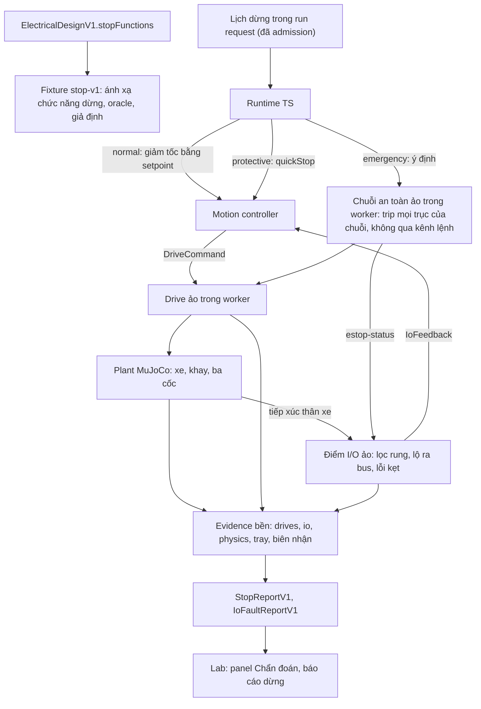

# Spec R5-B/C — Hành vi dừng, I/O ảo và giao diện chẩn đoán

**Mã:** MKQ-ENG-R5-BC-01 · **Trạng thái:** đề xuất ngày 25/11/2026, chưa được thực thi. Mọi tham số vật lý liên quan (cản lăn, mô-men phanh, ma sát caster, ma sát khay) là `assumed`; physics `not_calibrated`.

Đọc cùng [spec R5-A](03-r5-hardware-electrical-spec.md), [contracts và evidence](05-r5-contracts-and-evidence.md), [plan 03](plans/03-stop-and-virtual-io.md) và [plan 04](plans/04-lab-ui-package-closeout.md). Spec này chỉ thêm input, stream và panel mới trên nền R4; run không dùng input mới giữ nguyên hành vi và byte.

## 1. Kết quả sản phẩm

R5-A cho biết một cấu hình **đấu được** hay không. R5-B cho biết cấu hình đó **phản ứng ra sao khi phải dừng**, trong đúng plant mà R4 đã dựng; R5-C đưa cả hai lên giao diện.

1. **Ba kiểu dừng khác nhau thế nào khi trên khay có ba cốc?** Dừng thường (controller giảm tốc), dừng bảo vệ (drive tự giảm tốc rồi ngắt), dừng khẩn (ngắt mô-men ngay, xe trôi hoặc phanh). Mỗi kiểu có thời gian dừng, quãng đường, gia tốc đỉnh, độ trượt của cốc.
2. **Một đầu vào số hỏng thì ai phát hiện?** Bumper kẹt ở mức 0 không ai thấy; bumper kẹt ở mức 1 làm robot không chịu chạy. Lab ghi đúng điều đó, kèm biên nhận.
3. **Bấm vào một bánh hay một khớp thì thấy gì?** Thiết bị nào điều khiển nó, trạng thái drive, điểm I/O, cảnh báo, và đúng thời điểm trong bản phát lại.

| Đợt | Trong phạm vi | Điều kiện ra |
|---|---|---|
| R5.3 | Ba chức năng dừng ánh xạ vào cơ chế R4, lịch dừng có biên nhận, metric dừng, báo cáo dừng, campaign `stop-v1` | G-STP1 |
| R5.3b | Hai điểm DI ảo (bumper, trạng thái E-stop), scenario `MJ-IO01`, ba lỗi I/O, campaign `vio-v1` | G-VIO1 |
| R5.4 | Phần **Điện** của trang Lắp ráp, panel **Chẩn đoán**, hai mẫu xem không cần runtime | G-DGN1, G-WEB3 |

Nếu phải cắt: bỏ R5.3b trước (G-VIO1 ghi `not_run` có lý do), giữ R5.3. Kết quả dừng có giá trị quyết định phần cứng; I/O ảo chủ yếu minh họa.

## 2. Hiện trạng trong code

| Quan sát | Nguồn | Hệ quả |
|---|---|---|
| Drive ảo có `quick_stop`, `fault` có chốt, `onDisable: coast\|brake`, `brakeTorqueNm`, `quickStopSubsteps`; lỗi `EXTERNAL_TRIP` chỉ đến từ lịch lỗi | `drive-model-v1`, `mujoco_worker/drive_model.py` (`DriveGroup.trip`) | Dừng khẩn dùng lại `trip`; không cần máy trạng thái mới |
| Lỗi `drive-trip` do worker áp dụng, rộng một tick, có ý định và biên nhận | `v2/control/drive-faults.ts`, contracts R4 §4 | Chuỗi an toàn ảo đi cùng đường biên nhận đó, độc lập với kênh lệnh |
| `FaultReportV1.plantResponse` đã có `ticksToRest`, `baseTravelM`, `peakActualSpeedRadS` | `control-evidence-v1` | Metric dừng mở rộng từ số đã có, không đo lại bằng đường khác |
| `MJ-TRAY01` có khay ba cốc, độ trượt đọc trong cửa sổ 25 tick, oracle Coulomb; gia tốc điều hướng từ 1,0 m/s² làm hỏng mission trên drive giả định | R4 plan 02, `tray-campaign.ts`, `tray-oracle.ts` | Scenario và metric cốc dùng lại nguyên vẹn |
| Controller chưa bao giờ tự phát `quickStop`; hành động của run là `start`, `pause`, `resume`, `cancel`, `step`, `confirm`, `injectFault`, `reconcile`, `restoreCup` | `diff-drive-base.ts`, `lab-action-v2` | Yêu cầu dừng là input mới của run, không phải action tự do |
| `FaultOracleV1` cố định đúng 8 lỗi; `FaultReportV1` cố định đúng 6 invariant | `control-evidence-v1` | Lỗi I/O và dừng có oracle và báo cáo **riêng**, không sửa tài liệu R4 |
| Người đi ngang là proxy động học; chạm proxy là lỗi scenario. LiDAR và va chạm chung một mặt phẳng | R4-D16, giới hạn `PLANAR_OCCLUSION_NO_HEIGHT_FILTER` | Bumper được thử bằng scenario riêng với vật cản cố định, không bằng proxy người |
| Lab có 5 tab inspector (tab thứ năm là Điều khiển), studio lỗi, báo cáo lỗi có "nhảy tới tick", đồ thị SVG nội tuyến; chọn thực thể qua `twin/selection.ts` | `lab/src/ui/`, `lab/src/twin/` | Panel chẩn đoán ghép từ các mảnh có sẵn |
| Bản phát lại chỉ xuất được từ run cell (R4-D20) | R4 README §5 | Mẫu web của R5 là **báo cáo** tĩnh, không phải replay mới |

## 3. Kiến trúc mục tiêu

Điểm cốt lõi: **dừng khẩn không đi qua controller**. Ý định dừng khẩn được runtime ghi trước, worker áp dụng trực tiếp lên drive ở đúng substep, và controller chỉ *quan sát* hậu quả qua phản hồi và qua điểm `estop-status`. Vì vậy một run vừa mất kênh lệnh vừa bị dừng khẩn vẫn phải ngắt mô-men; đó là ca kiểm quan trọng nhất của đợt.

Tick nguồn, số substep, thứ tự ACK → append → commit, một request đang bay và quy tắc mất ACK giữ nguyên. Không thêm worker, không thêm clock.

## 4. Quyết định

| ID | Quyết định |
|---|---|
| R5-D21 | Ba chức năng dừng là dữ liệu của thiết kế điện, ánh xạ vào cơ chế đã có của R4. Không thêm trạng thái drive, không thêm mã lỗi drive |
| R5-D22 | Yêu cầu dừng là input của run (`stopSchedule`), theo danh mục đóng, có ý định và biên nhận như lỗi R4. Không mở action "dừng" tự do từ trình duyệt |
| R5-D23 | Dừng khẩn do worker áp dụng, độc lập với kênh lệnh và với controller. Controller không thể hoãn, đổi hay hủy nó |
| R5-D24 | Sau dừng bảo vệ và dừng khẩn không có tự khởi động lại: run vào `needs_attention`, lệnh chuyển động cũ không được tiếp tục, drive chỉ rời `fault` bằng `faultReset` theo sườn sau khi nguyên nhân hết. Đây là invariant, không phải tùy chọn |
| R5-D25 | Metric dừng là **quan sát trong model giả định**. Report ghi rõ tham số nào quyết định kết quả (cản lăn, ma sát caster, mô-men phanh) và rằng chúng chưa được đo. Không số nào được gọi là quãng đường dừng của robot |
| R5-D26 | Oracle của campaign dừng chỉ kiểm thứ kiểm được: mô-men về 0 đúng tick, không lệnh chuyển động sau dừng, không tự khởi động lại, biên nhận khớp ý định. Cốc trượt hay không là kết quả ghi lại, không phải điều kiện đạt |
| R5-D27 | Điểm I/O ảo chỉ mô phỏng tín hiệu **đổi hành vi robot** trong scenario có sẵn hoặc scenario tối thiểu mới: bumper và trạng thái E-stop. Đèn, còi, dock chỉ có ở tầng phân bổ và netlist |
| R5-D28 | Điểm I/O ảo lấy cách lộ ra bus từ hồ sơ thiết bị: `cyclic` cập nhật mỗi tick, `acyclic` theo chu kỳ poll. Giá trị quá hạn mang cờ `stale`; controller không dùng giá trị `stale` như giá trị mới |
| R5-D29 | Bumper trong R5 là đầu vào **thường**. Ca "kẹt ở 0" được kỳ vọng `not_detected` ở tầng I/O và là kết quả hợp lệ: nó cho thấy vì sao một tín hiệu như vậy không thể là chức năng an toàn duy nhất |
| R5-D30 | Lỗi I/O và dừng có danh mục, oracle và báo cáo riêng (`io-fault-oracle-v1`, `StopReportV1`, `IoFaultReportV1`). Danh mục 8 lỗi, oracle và báo cáo của R4 không bị sửa |
| R5-D31 | Panel chẩn đoán chỉ hiển thị giá trị có nguồn là evidence của run, kèm chất lượng `good`, `stale` hoặc `unavailable`. Chuyển động của mesh không bao giờ là bằng chứng. Thiếu dữ liệu hiện "không có dữ liệu", không hiện 0 và không tô xanh |
| R5-D32 | Mọi cảnh báo có trong danh sách 2D đọc được bằng bàn phím và trình đọc màn hình. 3D là cách định vị, không phải kênh cảnh báo duy nhất. Màu chỉ dùng cho trạng thái bất thường |
| R5-D33 | Web công khai nhận hai mẫu tĩnh mở không cần runtime: một gói ứng viên phần cứng và một báo cáo dừng. Không mở rộng đường xuất replay |
| R5-D34 | Lab vẫn không nói chuyện với thiết bị thật. Cổng dữ liệu OT (OPC UA, MQTT, Modbus) không nằm trong R5 |

## 5. R5.3 — Hành vi dừng

### 5.1 Ba chức năng dừng

| Chức năng | Ai thực hiện | Cơ chế R4 dùng lại | Trạng thái cuối | Tương ứng tham khảo |
|---|---|---|---|---|
| `normal` | Controller | Setpoint vận tốc giảm về 0 theo gia tốc thiết kế; drive vẫn `enabled` | Đứng yên, còn mô-men giữ | Dừng loại 2 |
| `protective` | Controller ra lệnh, drive thực hiện | `quickStop=1` → `quick_stop` → `disabled` | Ngắt drive sau khi giảm tốc; chốt cho tới khi người xử lý | Dừng loại 1 |
| `emergency` | Chuỗi an toàn ảo trong worker | `trip(EXTERNAL_TRIP)` trên mọi trục của chuỗi → `onDisable` | Ngắt mô-men ngay; xe trôi (`coast`) hoặc bị phanh giữ (`brake`) | Dừng loại 0 |

Cột "tương ứng tham khảo" chỉ để người đọc đối chiếu với cách phân loại dừng trong tiêu chuẩn điện máy; R5 không tuyên bố tuân thủ tiêu chuẩn nào. Biến thể "giảm tốc rồi mới ngắt mô-men bằng đường an toàn" (kiểu SS1) cần thiết bị an toàn thực hiện việc giám sát; trong mô phỏng nó trùng với `protective` về động học, nên R5 không dựng biến thể riêng và ghi rõ điều đó.

Mỗi thiết kế điện khai `stopFunctions`: chức năng nào kích hoạt bởi gì, và drive ở trạng thái cuối nào. Compiler kiểm: `protective` cần drive khai có quick stop; `emergency` cần drive khai có đường ngắt mô-men (STO hoặc contactor trong sổ yêu cầu); `brake` cần motor có phanh trong hồ sơ.

### 5.2 Lịch dừng

Run request nhận `stopSchedule` tùy chọn: tối đa 4 mục, mỗi mục gồm id, chức năng, và thời điểm theo thời gian mô phỏng. Admission ở server: chỉ cho run có drive; chức năng phải nằm trong thiết kế của fixture; không trùng thời điểm; không đặt sau khi mission kết thúc.

Quy tắc thực hiện:

- `normal` và `protective`: runtime ghi ý định, controller nhận ở tick kế tiếp và ghi biên nhận khi lệnh đầu tiên phản ánh yêu cầu.
- `emergency`: runtime ghi ý định; worker áp dụng ở substep đầu của tick và trả biên nhận trong snapshot. Lệnh của controller ở cùng tick vẫn tới worker nhưng trục đã ở `fault` nên bị bỏ qua và được đếm.
- Thứ tự trong một tick: dừng khẩn trước lỗi kênh lệnh, trước lệnh của controller.
- Mục không có biên nhận là `not_fired`. Biên nhận không khớp ý định làm evidence không hoàn chỉnh, như R4.

### 5.3 Metric dừng

Tính từ stream đã có (`drives`, physics, khay), cùng định nghĩa cho mọi kiểu dừng:

| Metric | Định nghĩa | Không tính được khi |
|---|---|---|
| `stopTimeMs` | Từ tick áp dụng tới tick đầu tiên mà tốc độ thân xe dưới ngưỡng nghỉ và giữ dưới ngưỡng 25 tick | Xe chưa về nghỉ trong cửa sổ quan sát |
| `stopDistanceM` | Quãng đường thân xe đi trong khoảng đó | Như trên |
| `peakDecelerationMps2` | Gia tốc âm lớn nhất của thân xe, lọc trên cửa sổ 5 tick | Thiếu mẫu |
| `torqueZeroTick` | Tick đầu tiên mà mô-men mọi trục của chuỗi bằng 0 (chỉ cho `emergency`) | Không có stream `drives` |
| `cupMaxSlipMm`, `cupTipped` | Như metric khay của R4, đọc trong cửa sổ từ tick áp dụng tới khi nghỉ cộng 25 tick | Run không có khay |
| `postStopDriftMm` | Dịch chuyển thân xe trong 100 tick sau khi nghỉ | Run kết thúc sớm |
| `wheelSlip` | Có substep nào bánh quay ngược chiều thân xe hoặc khóa trong khi xe còn trượt | Thiếu vận tốc bánh thật |

Ngưỡng nghỉ và các cửa sổ là chính sách thử nghiệm, khóa trong fixture `stop-v1` trước campaign.

### 5.4 Campaign `stop-v1`

Scenario `MJ-TRAY01`, khay ba cốc, đường thẳng dài nhất của biến thể A. Điểm kích hoạt là tick đầu tiên xe đạt tốc độ hành trình ổn định (xác định trước từ một run khảo sát, ghi vào fixture).

| Nhóm | Chức năng | Tốc độ | Khay | Số run |
|---|---|---|---|---|
| S1 | `normal`, `protective`, `emergency`+`coast`, `emergency`+`brake` | 0,8 m/s | thường | 4 |
| S2 | bốn kiểu trên | 0,4 m/s | thường | 4 |
| S3 | bốn kiểu trên | 0,8 m/s | trơn | 4 |
| S4 | `emergency`+`brake` trong lúc đang có `command-loss` | 0,8 m/s | thường | 1 |
| S5 | lặp S1 `emergency`+`coast` ba lần cùng seed | 0,8 m/s | thường | 3 |

Tối thiểu 16 run. Oracle (khai trước, [contracts §6](05-r5-contracts-and-evidence.md#6-oracle-và-invariant)): mô-men bằng 0 trong đúng tick áp dụng với `emergency`; sau `protective` và `emergency` không có lệnh chuyển động nào được drive nhận, và run ở `needs_attention`; S4 vẫn ngắt mô-men; S5 trùng bit trong cùng kiến trúc. Không có ngưỡng đạt cho quãng đường hay độ trượt.

Tốc độ 0,8 m/s chỉ dùng được nếu run khảo sát cho thấy mission đến được tốc độ đó trên drive giả định; nếu không, campaign dùng tốc độ hành trình lớn nhất đạt được và ghi số đó.

### 5.5 Báo cáo dừng và câu gợi ý

`StopReportV1` của một run: chức năng, tick áp dụng, biên nhận, bảy metric (hoặc lý do `unavailable`), trạng thái drive từng trục, kết quả oracle, và danh sách **tham số quyết định** kèm nguồn của chúng. Report mang `accepted:false`.

Câu gợi ý theo quy tắc R4-D15: chỉ sinh từ hai run khác đúng một input và có metric available, ba ngôn ngữ, luôn kèm giới hạn. Mẫu:

> "Trong model giả định này, ở 0,8 m/s, ngắt mô-men và thả trôi dừng sau **X m**; dừng có điều khiển dừng sau **Y m**. Cốc trượt tối đa **A mm** so với **B mm**. Cản lăn và ma sát caster chưa được đo; cần bài thả trôi trên xe thật trước khi dùng số này."

Câu cuối không phải trang trí: bài thả trôi là đúng bài đo mà lane hiệu chuẩn (R4.5) cần để nhận dạng cản lăn, và nó đi thẳng vào checklist bàn thử của gói ứng viên.

## 6. R5.3b — I/O ảo

### 6.1 Điểm I/O trong worker

Hai điểm vào, lấy cấu hình từ hồ sơ thiết bị của phương án đang chạy:

| Điểm | Nguồn giá trị | Lọc | Ghi chú |
|---|---|---|---|
| `bumper-front` | Tiếp xúc giữa geom thân xe phía trước và vật cản tĩnh trong substep | Lọc rung theo số substep (giả định) | Không tính tiếp xúc với sàn, khay, cốc |
| `estop-status` | Trạng thái chốt của chuỗi an toàn ảo | Không | Chỉ để quan sát |

Mỗi tick snapshot mang `io`: giá trị đo, cờ hợp lệ, tick của mẫu. Điểm `acyclic` chỉ có mẫu mới mỗi *k* tick; giữa hai lần poll controller thấy mẫu cũ kèm tick cũ. Giá trị thật của tiếp xúc chỉ đi vào evidence, cùng quy tắc tách hai thế giới của R4.

### 6.2 Phản ứng của controller

Controller mobile có thêm một quy tắc, là revision mới của controller và của control profile: `bumper-front` đúng và hợp lệ → yêu cầu `protective`; run vào `needs_attention` với lý do `BUMPER_ACTIVE`. Bumper đúng ngay từ lúc bắt đầu → không cho chuyển động, cùng lý do. Mẫu `stale` quá hạn → `IO_FEEDBACK_STALE`, dừng `normal`.

### 6.3 Scenario `MJ-IO01`

Scenario mobile tối thiểu, dựng từ fixture `serve-payload-v1`: xe chạy thẳng 2 m ở tốc độ thấp tới một vật cản tĩnh thấp hơn mặt phẳng quét LiDAR. Không có proxy người, không có khay. Mục đích duy nhất là tạo một tiếp xúc sạch, lặp lại được. Tính khả thi (tiếp xúc đúng geom, không lật, lặp lại trùng bit) được kiểm bằng spike trước khi viết phần còn lại; không khả thi thì R5.3b dừng theo [plan README §4](plans/README.md#4-khi-nào-dừng-một-nhánh).

### 6.4 Lỗi I/O

| Lỗi | Lớp | Ai áp dụng | Kỳ vọng khai trước |
|---|---|---|---|
| `di-stuck-off` trên `bumper-front` | I/O | worker | Tầng I/O **không** phát hiện. Controller chỉ phát hiện gián tiếp qua giám sát bám vận tốc của R4, trễ hơn; quãng đường đẩy vật cản được ghi |
| `di-stuck-on` trên `bumper-front` | I/O | worker | Controller phát hiện trong hạn; robot không chuyển động; không phục vụ giả |
| `io-bus-loss` | kênh | runtime | Mẫu I/O thành `stale`; controller dừng `normal` trong hạn; mất lệnh kéo dài thì watchdog của drive chốt như R4 |

Campaign `vio-v1`: danh định 3 seed; mỗi lỗi 2 run; `di-stuck-off` có thêm một run với vật cản; tối thiểu 10 run. Báo cáo `IoFaultReportV1` cùng hình dạng báo cáo lỗi R4 với bộ invariant riêng.

## 7. R5.4 — Giao diện

### 7.1 Phần Điện của trang Lắp ráp

Thêm một phần vào trang Lắp ráp hiện có, sau BOM:

| Khối | Nội dung | Hành vi |
|---|---|---|
| Phương án | Chọn HW-A/B/C hoặc nhập thiết kế điện từ file | Đổi phương án là compile lại; kết quả cũ được giữ để so |
| Thiết bị | Bảng thiết bị: linh kiện, mã đặt hàng, firmware, mức bằng chứng, số nguồn còn `assumed` | Mở tài liệu gốc theo digest; huy hiệu mức chỉ đến từ runtime |
| Phân bổ I/O | Bảng tín hiệu → thiết bị/chân/bus; phần chưa gán kèm lý do; chân dư | Ghim và bỏ ghim một dòng; mỗi thay đổi là revision mới của thiết kế |
| Kiểm tra | Danh sách theo ba mức, lọc được | Bấm một mục nhảy tới dòng liên quan |
| Đấu dây | Bảng dây lọc theo thiết bị hoặc net; bảng chân của thiết bị đang chọn; sơ đồ khối SVG (thiết bị là khối, bus và ray nguồn là đường) | Chọn một dây làm nổi hai đầu mút |
| Chi phí | BOM mở rộng; bảng so ba phương án; dòng thiếu giá | "Chưa so được" khi thiếu giá quyết định |
| Xuất | Tải gói ứng viên | Chỉ bật khi bundle `compiled` |

Sơ đồ khối là hình tổng quan, không phải sơ đồ nguyên lý: bố cục cột cố định (nguồn, bảo vệ, điều khiển, drive, thiết bị trường), không dùng thư viện bố cục đồ thị. Thứ người đấu dây dùng là bảng dây và bảng chân.

Không có runtime thì trang vẫn mở được thiết kế và hồ sơ để đọc; mọi kết quả compile hiện "cần runtime", theo đúng nguyên tắc hiện tại của trang Lắp ráp: chỉ biên nhận của server nói một thiết kế đã compile.

### 7.2 Panel Chẩn đoán

Một tab inspector mới, mở khi chọn một thực thể trong twin 2D hoặc 3D, hoặc từ danh sách thiết bị:

- **Chọn được:** AMR, từng bánh, tay máy, từng khớp J1–J6, kẹp. Có danh sách thay thế cho bàn phím; thứ tự tab ổn định.
- **Hiển thị:** thiết bị điều khiển trục (từ thiết kế điện), trạng thái và lỗi drive, lệnh so với thực trên đồ thị nhỏ, điểm I/O của thiết bị đó, và cảnh báo liên quan.
- **Cảnh báo:** một danh sách 2D gom mục của báo cáo lỗi, báo cáo dừng và báo cáo lỗi I/O của run, sắp theo tick, mỗi mục có nút nhảy tới tick trong bản phát lại. Thực thể đang có cảnh báo được đánh dấu trong 3D bằng viền và biểu tượng, không chỉ bằng màu.
- **Chất lượng dữ liệu:** mỗi giá trị mang `good`, `stale` (kèm tuổi) hoặc `unavailable` (kèm lý do). Run không có stream tương ứng hiện "không có dữ liệu".

Dữ liệu lấy từ report, trace và evidence của run qua các route đang có. Panel không mở kênh dữ liệu mới tới runtime và không đọc thiết bị thật.

### 7.3 Mẫu trên web công khai

Hai mẫu tĩnh trong catalog mẫu của Lab, mở không cần runtime, hash khớp manifest, ghi `not_calibrated` và `accepted:false`:

- `hardware-candidate`: gói ứng viên của một phương án Serve, xem được bảng phân bổ, kiểm tra, dây và checklist.
- `stop-report`: báo cáo dừng của nhóm S1 với đồ thị so bốn kiểu dừng.

### 7.4 Không làm trong R5.4

Trình soạn sơ đồ kéo thả; bố trí 3D khoang điện; dashboard nhiều cấp nhà máy → workcell → thiết bị; đồ thị xu hướng dài hạn; cổng dữ liệu OT; chỉnh tham số drive từ giao diện.

## 8. Yêu cầu đo được

| ID | Yêu cầu | Plan / case |
|---|---|---|
| R5-11 | Ba chức năng dừng ánh xạ vào cơ chế R4; admission lịch dừng fail-closed; run không có lịch giữ byte | E12 / STP01, STP02 |
| R5-12 | Dừng khẩn độc lập kênh lệnh: vẫn ngắt mô-men khi đang mất lệnh; không tự khởi động lại; biên nhận khớp ý định | E12 / STP03, STP04 |
| R5-13 | Metric dừng đúng trên vector tham chiếu; đủ lý do `unavailable`; báo cáo dừng dựng từ stream; campaign `stop-v1` đủ run và trùng bit ở nhóm lặp | E13 / STP05, STP06 |
| R5-14 | Câu gợi ý chỉ từ cặp run khác đúng một input, có metric available, ba ngôn ngữ, có giới hạn | E13 / STP07 |
| R5-15 | Điểm I/O ảo: lọc, cách lộ ra bus, cờ `stale`; giá trị thật không tới controller | E14 / VIO01, VIO02 |
| R5-16 | Lỗi I/O có biên nhận đúng lớp; kỳ vọng khai trước, kể cả `not_detected`; campaign `vio-v1` | E14 / VIO03, VIO04 |
| R5-17 | Phần Điện: chọn phương án → compile → phân bổ → ghim → kiểm tra → đấu dây → chi phí → xuất; đường không cần runtime | E15, E16 / DGN01, WEB11 |
| R5-18 | Panel Chẩn đoán: chọn bằng chuột và bàn phím; giá trị có chất lượng; cảnh báo nhảy tới tick; không xanh giả khi thiếu dữ liệu | E17 / DGN02–DGN04 |
| R5-19 | VI/JA/EN, 390/1024/1440 px, axe serious/critical = 0, reduced motion cho mọi panel mới; hai mẫu tĩnh mở offline | E18 / WEB12, WEB13 |
| R5-20 | Mỗi đợt chạy được trên Mac local và trong image cloud; so hai kiến trúc theo kết quả và dung sai | E05, E10, E14, E18, E21 / CLD04–CLD06 |
| R5-21 | Qualification R5 ghi đủ case và gate ở một tuple, regression chuỗi trước, `accepted:false` | E21 / REG06 |

## 9. Điều R5-B/C không khẳng định

- Không số nào trong báo cáo dừng là quãng đường dừng, thời gian dừng hay độ an toàn của robot thật.
- Mô phỏng ngắt mô-men không chứng minh mạch STO của một drive cụ thể đạt yêu cầu an toàn nào.
- Bumper ảo không chứng minh bumper thật phát hiện được va chạm, và việc robot dừng trong mô phỏng không phải bằng chứng bảo vệ con người.
- Panel chẩn đoán là công cụ đọc evidence của mô phỏng; nó không phải HMI vận hành và không giám sát thiết bị thật.
