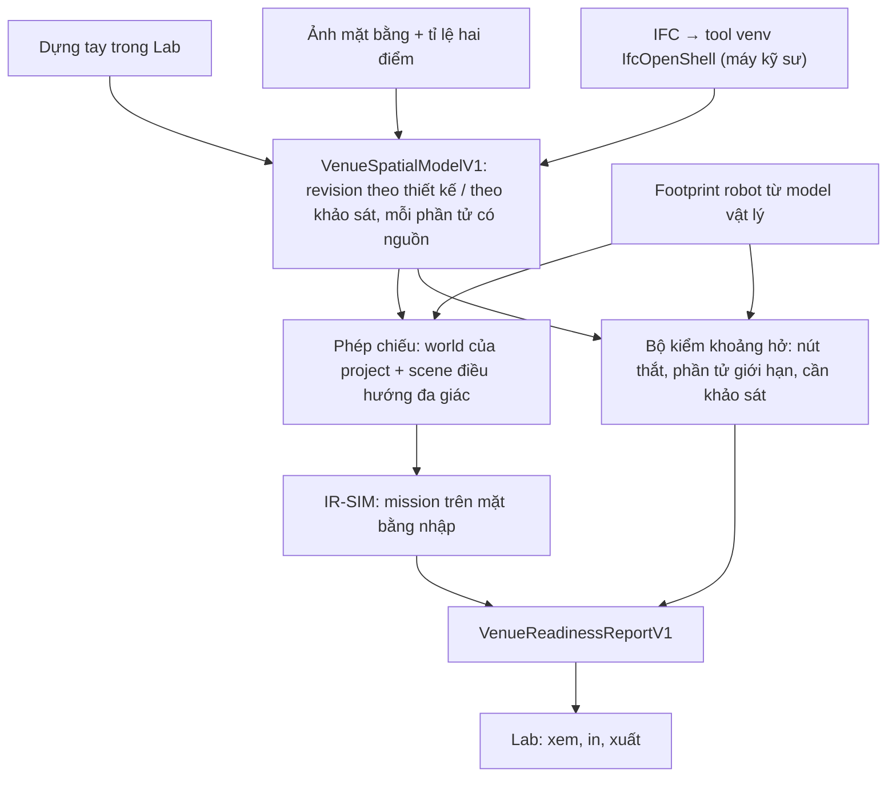

# Spec R6 — Đánh giá mặt bằng (Venue Readiness)

**Mã:** MKQ-ENG-R6-01 · **Trạng thái:** đề xuất ngày 25/11/2026, ở mức spec gọn. Plan chi tiết theo task được viết khi R5.2 đã bàn giao, vì R6 dùng lại mẫu gói và mẫu evidence của R5. Chưa có khảo sát mặt bằng thật nào; chưa có file BIM của khách nào.

Đọc cùng [nghiên cứu §4.3](01-research.md#43-không-gian-bim-và-mặt-bằng), [báo cáo thô](research/spatial-bim.md) và [roadmap §3.3](02-roadmap.md#33-r6--đánh-giá-mặt-bằng).

## 1. Kết quả sản phẩm

Hôm nay một mặt bằng trong Lab là hình chữ nhật với các vật cản chữ nhật song song trục, dựng tay. R6 để Lab trả lời câu hỏi mà một chủ quán hỏi trước khi trả tiền cho bất cứ thứ gì:

1. **Robot này có đi được từ bếp tới từng bàn trong quán tôi không?**
2. **Nếu không, vướng ở đâu, hẹp bao nhiêu, và do cái gì?**
3. **Cần đo lại những chỗ nào trước khi tin kết quả?**
4. **Một robot đủ không, hay cần hai?**

Đầu ra là một **báo cáo đánh giá mặt bằng** in được, sinh từ một mô hình không gian có nguồn. Đó là sản phẩm bàn giao của gói "đánh giá luồng phục vụ" trong kế hoạch GTM ngày 14/11.

| Đợt | Trong phạm vi | Điều kiện ra |
|---|---|---|
| R6.1 | `VenueSpatialModelV1`; phép chiếu sang world và scene điều hướng hiện có | G-VEN1 |
| R6.2 | Kiểm khoảng hở theo footprint, có giải thích truy về phần tử nguồn | G-CLR1 |
| R6.3 | Báo cáo đánh giá mặt bằng; so 1 và 2 robot | G-RDY1 |
| R6.4 | Nhập: dựng tay và vẽ lại trên ảnh có tỉ lệ; IFC bằng tool venv (PoC) | G-IMP1 |
| R6.5 | Giao diện, mẫu web, kiểm cloud, qualification | G-WEB4, G-REG7, G-CLOUD4 |

Không thuộc R6: nhiều tầng và thang máy; điều khiển cửa; SLAM hay định vị; engine điều hướng mới; đồng bộ hai chiều với BIM; nhập DXF, RoomPlan; bất kỳ kết luận nào về an toàn với người. Xem [§8](#8-các-việc-chủ-ý-hoãn).

## 2. Hiện trạng trong code và nguồn ngoài

| Quan sát | Nguồn | Hệ quả |
|---|---|---|
| `LabProjectV2.world` chỉ có vật cản chữ nhật song song trục, tối đa 200, cùng `points` và `handoffPoints`; schema này **bị đóng băng theo hash** | `lab-project-v2.schema.json`, baseline R2a | Mô hình không gian là tài liệu mới; world cũ thành phép chiếu sinh ra |
| `NavigationSceneV1.world.obstacles` đã là **đa giác** (tới 500), có `zones` (tới 32) và `actors` | `navigation-scene-v1` | Tường xiên vào được scene mà không đổi schema scene |
| Bộ lập đường `grid-diff-v1` đã nhận biết footprint: lưới, thổi phồng theo bán kính nội tiếp, kiểm va chạm bằng cả đa giác thân xe; footprint là bao lồi của các primitive va chạm | `v2/navigation2d/controller.ts`, `engineering/navigation-model.ts` | Bộ kiểm khoảng hở dùng lại chính bộ này; không viết lưới thứ hai |
| Kiểm chồng lấn đa giác dùng trục tách, **chỉ đúng với đa giác lồi** | `v2/navigation2d/geometry.ts` | Compile phải tách đa giác lõm thành phần lồi |
| Compiler scene đã từ chối điểm xuất phát và điểm đích va chạm hay ra ngoài world; bàn và bếp cần điểm handoff | `engineering/navigation-compiler.ts` | Giữ nguyên quy tắc fail-closed đó |
| BIM2Bot Lab là thật, giấy phép MIT, 12.002 dòng JSX, không có test; dùng web-ifc 0.0.35 (năm 2022); cửa được đóng dấu thành hộp song song trục; robot là hình tròn; nhiều đường lùi fail-open | Clone tại `63d0df9` | Lấy **ý tưởng** (truy vết ô lưới → phần tử, checklist readiness, giải thích bằng phần tử gần nhất); không lấy code |
| IfcOpenShell 0.9.0 và web-ifc 0.0.81 đọc cùng số liệu trên file mẫu KIT; IfcOpenShell cho thêm tường chủ, lỗ mở, bề dày khuôn; hai lần chạy trùng hash trên cùng máy | Probe ngày 25/11 | IfcOpenShell là bộ nhập chính thức; web-ifc chỉ để xem trước, để sau |
| Một file IFC 8,9 KB tự sinh bằng `ifcopenshell.api` tái lập trùng byte | Probe | Fixture là của MEKONIQ, không phụ thuộc giấy phép file mẫu |
| Bề rộng thông thủy của cửa **không** phải thuộc tính IFC: file ArchiCAD có dữ liệu khuôn, file Revit không có và lưới cửa rộng hơn danh định | Probe | Mỗi bề rộng mang cơ sở (`measured`, `derived`, `nominal`, `assumed`); cơ sở yếu gần ngưỡng thì kết quả là "cần khảo sát" |
| Nội thất là vật cản chính của nhà hàng và hầu như không có trong IFC | File mẫu KIT có 0 phần tử nội thất | Đường nhập quan trọng nhất là dựng tay và vẽ lại trên ảnh, không phải IFC |

## 3. Kiến trúc mục tiêu



Mô hình không gian là **nguồn sự thật**. IFC, ảnh hay bản dựng tay chỉ là nguồn nhập; một lần nhập mới không bao giờ ghi đè revision theo khảo sát. World của project (đóng băng) được **sinh ra** từ mô hình không gian và không soạn tay khi project có mặt bằng.

## 4. Quyết định

| ID | Quyết định |
|---|---|
| R6-D01 | Một `VenueSpatialModelV1` do MEKONIQ sở hữu, dùng chung cho mọi nguồn nhập. Không có đường nào bắt buộc phải có IFC |
| R6-D02 | Hai loại revision: `as_designed` và `as_observed`. Kết quả luôn ghi nó tính trên loại nào. Nhập lại bản thiết kế tạo revision mới, không sửa bản khảo sát |
| R6-D03 | Mỗi phần tử mang `sourceRef` (nguồn, id trong nguồn, hash file nguồn). Id của BIM có thể đổi khi xuất lại, nên tham chiếu luôn kèm hash file |
| R6-D04 | Bề rộng thông thủy mang cơ sở. Giá trị `nominal` hoặc `assumed` nằm trong biên của ngưỡng cho kết quả `needs_survey`, không cho `pass` |
| R6-D05 | Một tầng. `verticals[]` có trong schema và luôn `not_modelled`; mission không bao giờ đi qua chúng |
| R6-D06 | Không thêm engine điều hướng. Bộ kiểm khoảng hở và mission dùng bộ lập đường và IR-SIM hiện có |
| R6-D07 | Bộ kiểm khoảng hở là hàm thuần TS trên lưới của policy; mọi kết luận kèm sai số lưới. Kết quả nằm trong sai số là `needs_survey` |
| R6-D08 | Thiếu dữ liệu thì dừng có lý do. Thiếu không gian, sai đơn vị, cửa không nối hai không gian, sàn không xác định được: sinh `issue`, không suy rằng vùng trống đi được |
| R6-D09 | IFC được đọc bởi một tool venv ghim (`.venv-spatial`) trên máy kỹ sư, sinh ra mô hình không gian đã băm. Tool này **không** nằm trong image runtime. Trên runtime và trên cloud chỉ có mô hình đã sinh |
| R6-D10 | Báo cáo là quan sát trong model: nó không chứng minh robot thật đi được, không thay khảo sát hiện trường, không nói gì về an toàn với người |
| R6-D11 | So 1 và 2 robot dùng kịch bản đơn hàng có đăng ký và seed; kết quả là số đo của kịch bản đó, không phải dự báo công suất |

## 5. Mô hình không gian

```ts
// Dạng dữ liệu dự kiến.
interface VenueSpatialModelV1 {
  schemaVersion: 1; documentType: 'venue-spatial-model'; id: string; revision: number; digest: Digest;
  kind: 'as_designed'|'as_observed'; basedOn: {id: string; revision: number; digest: Digest}|null;
  frame: {unit: 'm'; up: 'z'; originNote: string; fromSource: number[]|null};     // ma trận 4×4 từ tọa độ nguồn
  sources: {id: string; kind: 'manual'|'image_trace'|'ifc'|'dxf'|'roomplan'|'survey'; fileSha256: string|null; bytes: number|null;
    schema: string|null; sourceUnit: string|null; importer: {name: string; version: string; lockDigest: string|null}|null}[];
  levels: {id: string; name: string; elevationM: number; outline: P[];
    spaces: {id: string; name: string; usage: string|null; polygon: P[]; sourceRef: SourceElementRef}[];
    walls: {id: string; polygon: P[]; heightBandM: [number, number]; sourceRef: SourceElementRef}[];
    openings: {id: string; kind: 'door'|'gap'; segment: [P, P]; clearWidthM: {value: number; basis: 'measured'|'derived'|'nominal'|'assumed'};
      clearHeightM: number|null; defaultState: 'open'|'closed'; connects: [string, string]|null; hostWallId: string|null; sourceRef: SourceElementRef}[];
    obstacles: {id: string; kind: 'table'|'chair'|'counter'|'fixture'|'other'; polygon: P[]; heightBandM: [number, number]; movable: boolean; sourceRef: SourceElementRef}[];
    zones: {id: string; kind: 'blocked'|'speed_limit'|'directed'; polygon: P[]; params: Record<string, number>}[];
    stations: {id: string; name: string; kind: 'table'|'kitchen'|'parking'|'dock'|'coffee_pickup'; position: P; handoff: {position: P; yawRad: number}|null}[];
  }[];
  verticals: {id: string; kind: 'stair'|'lift'|'ramp'; status: 'not_modelled'}[];
  issues: {code: string; severity: 'blocking'|'warning'; elementId: string|null; detail: string}[];
}
interface SourceElementRef {sourceId: string; elementId: string|null; elementClass: string|null; name: string|null}
```

Tên trạm giữ nguyên năm loại của `LabProjectV2.world.points` để phép chiếu sang world là một-một. Loại vùng lấy tập con của VDA 5050 phiên bản 3 (đã có trên nhánh chính của tiêu chuẩn; adapter trong repo vẫn là 2.0.0). Cấu trúc tầng, cửa là đoạn thẳng hai điểm và thang là mượn từ thông điệp bản đồ tòa nhà của Open-RMF; không dùng nguyên định dạng nào.

Phép chiếu, tất định:

- **World của project**: hình chữ nhật bao của `outline`; `points` và `handoffPoints` từ `stations`; `obstacles` là hình chữ nhật bao của từng tường và vật cản, chỉ để các màn hình cũ vẽ được. Project có mặt bằng mà world không khớp phép chiếu thì bị từ chối (`VENUE_WORLD_MISMATCH`).
- **Scene điều hướng**: vật cản là đa giác của tường và của vật cản có dải cao cắt dải cao của robot; đa giác lõm được tách thành phần lồi; lối mở `closed` được chèn một đa giác chắn; vùng `blocked` thành vật cản. Vượt 500 vật cản thì từ chối (`VENUE_TOO_COMPLEX`), không gộp ngầm.

## 6. Bộ kiểm khoảng hở

Với mỗi cặp trạm (từ bếp hoặc chỗ đỗ tới từng điểm handoff), trên lưới có độ phân giải của policy:

1. Tính trường khoảng cách tới vật cản gần nhất, mỗi ô nhớ **phần tử nguồn** gần nhất.
2. Tìm đường "rộng nhất" giữa hai trạm (cực đại hóa khoảng hở nhỏ nhất dọc đường). Hai lần khoảng hở nhỏ nhất đó là **bề rộng nút thắt**.
3. So với hai ngưỡng của robot: bề ngang nhỏ nhất của footprint cộng hai lần biên an toàn (`W + 2c`), và đường kính ngoại tiếp cộng hai lần biên (`2(R + c)`).

| Kết quả | Điều kiện | Nghĩa |
|---|---|---|
| `blocked` | nút thắt < `W + 2c` − sai số lưới | Không qua được dù xoay thế nào |
| `aligned_only` | nằm giữa hai ngưỡng, và bộ lập đường nhận biết footprint tìm được đường | Qua được nhưng không xoay tại chỗ được ở nút thắt |
| `free_rotation` | nút thắt ≥ `2(R + c)` + sai số lưới | Xoay tại chỗ được dọc cả đường |
| `needs_survey` | nằm trong sai số lưới của một ngưỡng, hoặc nút thắt dính một lối mở có cơ sở `nominal`/`assumed` | Chưa đủ dữ liệu; nêu đúng chỗ cần đo |
| `no_route` | Hai trạm không cùng thành phần liên thông ngay cả với bán kính 0 | Mặt bằng tách rời hoặc cửa đóng |

Giải thích của mỗi kết quả khác `free_rotation`: tọa độ nút thắt; bề rộng đo được và bề rộng cần; hai phần tử giới hạn hai bên kèm `sourceRef`; nếu nút thắt nằm trong một lối mở thì tên cửa và cơ sở của bề rộng. Probe ngày 25/11 trên fixture tự sinh đã cho đúng dạng câu này: "lối hẹp nhất 0,780 m tại (3,00; 1,89) < cần 0,800 m; cửa 'D1 kitchen-dining'; giới hạn bởi tường 'W-mid'".

Giới hạn ghi trong mọi kết quả: footprint là bao lồi bảo thủ của các primitive, nên `blocked` không chứng minh robot thật không qua được; vật cản di động được coi là đứng yên ở vị trí khai; người không có trong model.

## 7. Yêu cầu đo được

| ID | Yêu cầu | Case |
|---|---|---|
| R6-01 | Schema và admission mô hình không gian; project không có mặt bằng giữ byte | VEN01 |
| R6-02 | Phép chiếu sang world và scene tất định; tách lồi đúng; lối mở đóng chắn đường; vượt giới hạn bị từ chối | VEN02, VEN03 |
| R6-03 | Mission `FD01` chạy trên một mặt bằng nhập, evidence mang id, revision và digest của mô hình | VEN04 |
| R6-04 | Bề rộng nút thắt đúng trên các hình có lời giải giải tích (hành lang, cửa, góc chữ L) trong sai số lưới | CLR01 |
| R6-05 | Năm kết quả đúng nhánh; đổi bề rộng robot làm đổi kết quả; đóng một cửa làm đổi đường và lý do | CLR02, CLR03 |
| R6-06 | Giải thích truy đúng về phần tử nguồn; cơ sở yếu gần ngưỡng cho `needs_survey` | CLR04 |
| R6-07 | Báo cáo dựng từ mô hình và kết quả, ba ngôn ngữ, in được, ghi loại revision và giới hạn; không có câu khẳng định an toàn | RDY01, RDY02 |
| R6-08 | So 1 và 2 robot trên kịch bản có seed; lặp lại trùng kết quả | RDY03 |
| R6-09 | Nhập IFC: giữ id và đơn vị đúng; thiếu không gian, sai đơn vị, hình học lỗi đều dừng có lý do; hai lần nhập trùng digest trên cùng máy | IMP01–IMP03 |
| R6-10 | Vẽ lại trên ảnh có tỉ lệ hai điểm; tỉ lệ sai lệch bị phát hiện bằng một kích thước kiểm | IMP04 |
| R6-11 | Giao diện ba ngôn ngữ, ba bề rộng, a11y; mẫu báo cáo mở offline; chạy được trong image cloud | WEB14–WEB16, CLD07–CLD09 |
| R6-12 | Qualification ở một tuple, `accepted:false` | REG07 |

Chín ca PoC của cuộc trao đổi về BIM2Bot (BIM01–BIM09) nằm trong IMP01–IMP03, VEN02–VEN04 và CLR02–CLR04.

Task dự kiến, ở mức đề mục: S00 baseline và spike điểm tích hợp world; S01 hợp đồng và phép chiếu; S02 tách lồi và scene; S03 mission trên mặt bằng nhập; S04 trường khoảng cách và đường rộng nhất; S05 kết quả và giải thích; S06 báo cáo; S07 so đội robot; S08 tool nhập IFC và fixture tự sinh; S09 trình vẽ lại trên ảnh; S10 giao diện và mẫu; S11 qualification. Ước lượng 30–45 engineer-day.

## 8. Các việc chủ ý hoãn

| Việc | Vì sao chưa làm | Điều kiện mở |
|---|---|---|
| web-ifc trong trình duyệt để xem trước và để chỉ dữ liệu đã suy ra rời máy khách | Thêm bộ nhập thứ hai phải khớp với bộ chính; chưa có khách từ chối tải file lên | Một khách không cho file IFC rời máy của họ |
| DXF (`ezdxf`), RoomPlan, ứng dụng quét | Cần bước ánh xạ layer và xác nhận đơn vị; RoomPlan cần ứng dụng iOS riêng hoặc ứng dụng bên thứ ba | Một khách đưa DXF hoặc bản quét thay cho ảnh |
| Nhiều tầng, thang máy, điều khiển cửa | Lane L-MULTIFLOOR | Xem [roadmap §5](02-roadmap.md#5-các-lane-chờ-điều-kiện) |
| Xuất bản đồ Nav2 (PGM + YAML), mặt nạ keepout | Chưa có robot chạy Nav2 | Lane L-NATIVE mở |
| Nội thất lấy từ thư viện tài sản ngoài | Lane L-ASSET | Xem roadmap §5 |
| Tính quyết định giữa arm64 và x86-64 của bước nhập IFC | Chưa kiểm; tool chạy trên máy kỹ sư | Khi cần chạy tool nhập trên CI Linux: lượng tử hóa và so mô hình đã suy ra |
