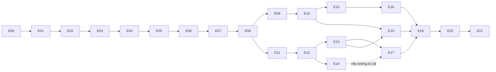

# R5 Hardware & Electrical Engineering Workbench — Implementation Plan

> **For agentic workers:** REQUIRED SUB-SKILL: Use superpowers:subagent-driven-development (recommended) or superpowers:executing-plans to implement this plan task-by-task. Steps use checkbox (`- [ ]`) syntax for tracking. Đây là plan đề xuất; chưa cho phép bắt đầu khi spec chưa được duyệt và baseline sau R4 và sau lần gộp chưa khóa (E00). Bốn quyết định của người dùng ngày 25/11 ở [roadmap §4](../02-roadmap.md#4-thứ-tự-và-điểm-quyết-định).

**Goal:** Đưa Lab từ "controller được kiểm thử qua một drive ảo giả định" tới "một cấu hình phần cứng cụ thể được kiểm trên giấy, được mô phỏng khi dừng, và xuất thành gói hồ sơ để đặt mua và chuẩn bị bàn thử", mà không thêm simulator, không thêm thư viện và không mở đường nào tới thiết bị thật.

**Architecture:** Tầng điện là phần mở rộng của module engineering sẵn có: hồ sơ thiết bị nằm trong catalog, thiết kế điện tham chiếu project, `compileElectrical` là hàm thuần TS sinh một bundle đã niêm phong qua service và route engineering hiện có. Hành vi dừng và I/O ảo là input tùy chọn của run MuJoCo, đi cùng đường ý định và biên nhận của lỗi R4. Mọi đường R2b/R4 giữ nguyên byte khi không dùng tài liệu mới.

**Tech Stack:** Node 24.22.2, pnpm 10.32.1, TypeScript/Ajv/Vitest/Playwright/three.js hiện có; Python 3.11, `mujoco==3.17.0`, numpy của lock hiện có; thư viện chuẩn Python cho bản tóm tắt EDS/ESI. Không thêm dependency npm hay Python. WireViz và Graphviz là công cụ tùy chọn trên máy kỹ sư, không vào lock và không vào image.

**Spec:** [R5-A phần cứng và điện](../03-r5-hardware-electrical-spec.md), [R5-B/C dừng, I/O ảo, giao diện](../04-r5-stop-diagnostics-spec.md), [contracts/evidence](../05-r5-contracts-and-evidence.md), [nghiên cứu](../01-research.md), [roadmap](../02-roadmap.md).

## Global Constraints

- Node 24.22.2 (`export PATH="$HOME/.nvm/versions/node/v24.22.2/bin:$PATH"`), pnpm 10.32.1. Lệnh dài chạy dưới `perl -e 'alarm N; exec @ARGV' …`.
- Pytest: `PYTHONDONTWRITEBYTECODE=1 … -p no:cacheprovider`; không để `__pycache__`/`.pytest_cache` dưới portable tool root. Script Python mới chạy bằng `python -I -B`.
- Engine giữ `mujoco==3.17.0`, Python 3.11. Không nâng lock, không thêm dependency Python hay npm.
- Không sửa năm schema bị đóng băng (`engineering-component`, `lab-project-v2`, `lab-fault-schedule`, `arm-cell-scene-v1`, `arm-scene-3d-v1`), 25 file fixture xArm và `robotics/simulation-mujoco/requirements.lock`. Mọi thứ mới là file mới; mở rộng schema khác chỉ bằng trường tùy chọn.
- Input mới là tùy chọn và có version. Project, bundle engineering, scene và run không dùng input mới phải cho đúng byte và hành vi R4: mock BV01, IR-SIM chunk hash, Webots bytes, MJ-BV01, payload 19 ca, cell 3 seed + 5 fault, `cil-v1`, `fault-v1`, `tray-v1`, replay package đã ghi.
- Giá trị của hãng chỉ vào hồ sơ thiết bị khi tài liệu gốc đã nằm trong `robotics/catalog/documents/<digest>`. Không điền từ trí nhớ, từ web hay từ câu trả lời của mô hình ngôn ngữ; không ghim được thì nguồn là `assumed`. Các tài liệu đã tải trong đợt nghiên cứu nằm ở `docs/2026-11-25-R5~/research/vendor-documents/` kèm `SHA256SUMS`.
- Không trường nào nhận mức bằng chứng, mức an toàn hay trạng thái "đã kiểm". Không đầu ra nào khẳng định mức an toàn hay tuân thủ tiêu chuẩn. Tín hiệu `safety_chain` không bao giờ được phân bổ hay tự đấu.
- `compileElectrical` chỉ dùng cộng, trừ, nhân, chia và so sánh trên số hữu hạn; digest bundle phải trùng giữa arm64 và x86-64.
- Source giữ mission/journal/custody. Lab chỉ mô phỏng và replay; không thêm đường Lab → phần cứng. Browser chỉ gửi dữ liệu có schema trong biên server; không gửi mã, MJCF, path hay URL.
- Một world MuJoCo đang hoạt động mỗi runtime; một request đang bay; mất ACK → unknown, không gửi lại.
- Mọi tham số dừng, lọc rung, ngưỡng nghỉ là `assumed`; physics `not_calibrated`. Ngưỡng oracle khóa trước campaign và không nới sau khi thấy test fail.
- Controller chỉ đọc phản hồi đo được và mẫu I/O đo được. Trạng thái thật chỉ đi vào evidence.
- UI dùng `tr(vi, ja, en)` cho mọi chuỗi, giữ a11y, reduced motion, 390/1024/1440 px, đường không cần runtime. Đồ thị và sơ đồ bằng SVG nội tuyến.
- Không sửa `trial/`, `web/`, cổng 1880/1884, evidence lịch sử. Không ghi `accepted:true`.
- Một repo từ ngày 25/11: phía source là mọi đường dẫn ngoài `apps/lab`, phía Lab là `apps/lab`. Mỗi commit phía source đổi runtime/schema/portable tools → export sạch → một commit `chore: pin source runtime <sha>` chỉ đụng `apps/lab`. Không Git ở workspace root.
- Script mới lấy commit source từ `scripts/repo-identity.mjs` (`sourceCommit`, `sourceDirty`, `labIdentity`). Không thêm chỗ đọc `git rev-parse HEAD` làm commit source: test `no new HEAD reader stands in for the source commit` trong `tests/unit/repo-identity.test.ts` sẽ fail, và R5 không có lý do để thêm ngoại lệ.
- Giữ biên import của lần gộp (MG-10): code dưới `packages/` và `robotics/` không nhắc tới `apps/lab`; `apps/lab/src` không import ra ngoài Lab, chỉ dùng các file sinh trong `src/shared/`.
- R5 không thêm dependency, nên `pnpm-lock.yaml` ở root không được đổi.
- Commit dùng tiền tố `feat:`/`fix:`/`test:`/`docs:`/`chore:`/`build:`, kết thúc bằng dòng `Co-Authored-By` theo quy định phiên làm việc.
- Hai đích chạy bắt buộc: runtime local trên Mac và image cloud. Không task nào được chờ host Linux native, GPU, phần cứng hay dữ liệu đo. Không thêm dependency hệ thống hay tiến trình vào image.
- Không push `main`, không deploy Vercel hay Cloud Run, không chạy phần cứng khi chưa có lệnh riêng của người dùng. Push `main` là deploy production. Thêm schema làm bản web công khai lệch runtime cho tới lần deploy đó; đây là điều đã biết, không phải lỗi cần sửa bằng cách push.

## 1. Dependency và đường ra sớm

| Gói | Task | Đầu ra | Phụ thuộc ngoài |
|---|---|---|---|
| [01 — Hồ sơ thiết bị và thiết kế điện](01-profiles-and-design.md) | E00–E05 | Baseline, spike, hợp đồng hồ sơ, catalog mở rộng, kiểm chéo EDS/ESI, thiết kế điện, ba phương án Serve | Không |
| [02 — Phân bổ, netlist, tài liệu](02-allocation-netlist-documents.md) | E06–E10 | Phân bổ I/O, netlist, bộ quy tắc, `compileElectrical`, route, CLI, tài liệu, BOM và so sánh chi phí | Graphviz và WireViz chỉ cho hình bó dây, tùy chọn |
| [03 — Dừng và I/O ảo](03-stop-and-virtual-io.md) | E11–E14 | Drive model suy ra, lịch dừng, metric và báo cáo dừng, `stop-v1`, I/O ảo, `vio-v1` | Không |
| [04 — Giao diện, gói, đóng](04-lab-ui-package-closeout.md) | E15–E21 | Phần Điện, panel Chẩn đoán, hai mẫu tĩnh, gói ứng viên, kiểm cloud, qualification | CLD06 cần một lần deploy theo lệnh |

Gói 03 chỉ cần E08 (bundle có `stopFunctions` và drive model nháp). Đường một người: E00 → E05 → E06 → E10 → E11 → E14 → E15 → E16 → E17 → E19 → E18 → E20 → E21 (E19 đứng trước E18 vì mẫu tĩnh trên web được sinh bằng chính lệnh đóng gói). Có thể bàn giao sớm sau E05 (R5.1), sau E10 (R5.2), sau E13 (R5.3), sau E18 (R5.4). Bàn giao sớm được kiểm bằng các suite tập trung, test golden/hash của đường legacy, guard của các record đang nằm trong cây và CLD04 của đợt; chuỗi recording đầy đủ chỉ ghi một lần, ở E21 (người dùng chốt ngày 25/11).

## 2. Quy ước thực thi

Paths tính từ workspace `robot/`; lệnh `pnpm/node` mặc định chạy tại `source/` (root của repo), lệnh ghi rõ `lab/` chạy tại `source/apps/lab`. Từ lần gộp ngày 25/11, `robot/lab` là symlink tới `source/apps/lab` nên các đường dẫn `lab/…` vẫn đúng; `git -C lab` nay trả về chính repo `source`. File **Create** chưa tồn tại tại baseline. Interface mới được định nghĩa trong spec hoặc ngay task sản xuất nó.

Làm trên **một** nhánh `r5/hardware-electrical` tách từ `main` của repo đã gộp, fast-forward về `main` ở E21 (người dùng chốt ngày 25/11: merge trước R5). Bằng chứng ghi SHA nên không rewrite lịch sử. Nếu `main` đi tiếp trong lúc làm (M8 và M10 của lần gộp đều thêm commit phía source), đưa nó vào nhánh bằng `git merge main`, không rebase, rồi pin lại.

Mỗi task theo chu kỳ: viết test hành vi thất bại → chạy xác nhận fail vì tính năng thiếu → implement → focused tests → review diff → commit. Test cần engine thì dùng engine thật; double chỉ kiểm protocol/lifecycle và gắn nhãn `protocol_double`.

Định danh trong một repo, theo `scripts/repo-identity.mjs`: **commit source** là commit cuối cùng đụng tới đường dẫn ngoài `apps/lab`; **commit Lab** là commit cuối cùng đụng tới `apps/lab`. Thứ tự commit của mỗi task theo đó:

1. Commit phía source trước: runtime, schema, tool, script và test của root.
2. Rồi "re-pin Lab", theo thủ tục của [plan R2b §2](../../2026-11-13-web-lab-to-physical/plans/README.md#2-quy-ước-thực-thi) áp vào một repo: từ root, export ra thư mục tạm ngoài repo; tại `apps/lab`, import, `node scripts/sync-engineering-contracts.mjs`, `pnpm check:source`; commit `chore: pin source runtime <commit source>`. Commit này chỉ đụng `apps/lab` (file lock và các file sinh trong `src/shared/`), nên không làm đổi commit source.
3. Thay đổi của Lab (UI, script, test dưới `apps/lab`) đi trong commit riêng chỉ đụng `apps/lab`, trước hay sau commit pin đều được.

Một commit đụng cả hai phía là commit source mới, và pin nằm trong nó không thể trỏ tới chính nó; sau commit như vậy luôn cần một commit pin. Một commit chỉ sửa tài liệu ở phía source cũng làm đổi commit source và đòi pin lại trước khi ghi evidence. Recorder từ chối khi `pin.sourceCommit` khác commit source, khi một trong hai phía bẩn, hoặc khi output nằm trong repo.

`pnpm typecheck` ở root nay chạy cả typecheck của Lab, và CI chạy unit test của Lab; `eslint` của root bỏ qua `apps/lab/**`. Các quy ước trong mục này chép từ code và từ [bản ghi của lần gộp](../../2026-11-20-codebase-merge/rehearsal-2026-11-25.md); E00 kiểm lại trên cây thật.

Một việc lần gộp để lại (ruling 2 của bản ghi đó): `native-providers.ts` và `xarm-cli.ts` trong runtime vẫn đọc `HEAD`, chờ "lần đổi runtime tới đã cần re-pin" mới dọn. E02 là lần đổi runtime đó. Việc dọn không thuộc phạm vi R5 và R5 không dùng đường native; nêu nó với người dùng ở E02 và chỉ làm khi được bảo.

Kiểm tra cloud theo đợt: sau E05, E10, E13 (và E14 nếu có) và E18, với cây source sạch tại commit của task, dựng image `linux/arm64` bằng `deploy/lab-runtime/build.sh` và chạy test container của R5 (CLD04). CLD05 chạy ở E20. Các bước này không deploy gì. Deploy Cloud Run và smoke CLD06 chỉ chạy khi người dùng ra lệnh; chưa có lệnh thì ghi CLD06 `not_run` với lý do `deploy_order_pending` và làm tiếp.

## 3. Review và qualification

| Mốc | Bắt buộc kiểm |
|---|---|
| Sau E00 | Tuple thực trong repo đã gộp (commit source và commit Lab theo đường dẫn, pin, Cloud Run); năm schema và 25 fixture đóng băng còn đúng hash; guard của record đang trong cây đạt; trạng thái catalog (số linh kiện, số báo giá); ngày gửi câu hỏi cho Hoàng Anh |
| Sau E01 | Thêm file dưới `robotics/catalog` và khóa `deviceProfiles` không đổi golden hay closure nào ngoài dự kiến; quyết định chỗ đặt fixture được khóa bằng số đo |
| Sau E05 | Không trường nào gõ được mức; nguồn hãng không dẫn được bị bắt; ba phương án nạp được; project và bundle cũ giữ byte |
| Sau E08 | Hai lần compile trùng byte; tín hiệu an toàn không bao giờ được gán; không đủ chân là kết quả có lý do; mỗi quy tắc có ca dương và ca âm |
| Sau E10 | Tài liệu sinh lại trùng byte; sửa tay bị phát hiện; thiếu giá không thành 0; digest bundle trùng trong image arm64 |
| Sau E13 | Dừng khẩn không đi qua controller và vẫn ngắt mô-men khi mất lệnh; không tự khởi động lại; oracle không có ngưỡng cho quãng đường hay độ trượt |
| Sau E14 (nếu có) | Giá trị thật của tiếp xúc không tới controller; `not_detected_as_declared` là verdict đạt; mẫu `stale` không dùng như mẫu mới |
| Sau E18 | Thiếu dữ liệu không hiện 0 và không tô xanh; cảnh báo đọc được bằng bàn phím; mẫu tĩnh mở offline |
| Sau E21 | Đủ case/artifact/regression cùng tuple; G-CLOUD3 đúng trạng thái thực; G-BENCH1 và G-SAFE1 `blocked_external`; `accepted:false` |

## 4. Khi nào dừng một nhánh

- **`main` đi tiếp trong lúc làm R5** (M8 và M10 của lần gộp, hoặc một phiên khác): `git merge main` vào nhánh R5, chạy lại focused tests của task đang làm, pin lại. Không rebase.
- **Hoàng Anh trả lời bằng một danh sách thiết bị khác:** đổi thiết bị của fixture theo [roadmap §4.1](../02-roadmap.md#41-câu-hỏi-gửi-hoàng-anh-trước-e03); hợp đồng, compiler và bộ quy tắc giữ nguyên; tính lại ước lượng E03 và E05 và báo người dùng.
- **E01 cho thấy file mới dưới catalog làm đổi golden hay closure không kiểm soát được:** đặt hồ sơ thiết bị và thiết kế điện ở một thư mục anh em ngoài closure, ghi quyết định vào tài liệu spike, rồi làm tiếp. Không sửa golden.
- **Không ghim được tài liệu gốc cho một thiết bị của phương án:** hồ sơ ở mức `candidate`, mọi nguồn `assumed`, fixture vẫn dùng được và mang nhãn đó. Không điền số từ nguồn thứ cấp.
- **Tài liệu hãng tự mâu thuẫn:** ghi cả hai giá trị với vị trí trích vào mục "chưa kiểm", chọn giá trị bảo thủ hơn cho phép kiểm, và đưa vào checklist bàn thử. Không tự phân xử.
- **Run khảo sát của `MJ-TRAY01` không đạt 0,8 m/s:** campaign dùng tốc độ hành trình lớn nhất đạt được và ghi số đó. Không đổi tham số plant hay policy để đạt tốc độ.
- **Spike `MJ-IO01` không cho tiếp xúc sạch và lặp lại trùng bit:** dừng R5.3b, G-VIO1 ghi `not_run` kèm số đo của spike. R5 đóng là "R5 không có I/O ảo". Không thay tiếp xúc bằng tín hiệu giả.
- **Lớp I/O làm cell live tụt dưới ngưỡng reader:** chỉ bật I/O ở scenario mobile, ghi rõ trong report; không hạ ngưỡng reader.
- **Kịch bản của đợt không chạy được trong image cloud (CLD04):** không bàn giao đợt đó; sửa hoặc ghi rõ phần nào chỉ chạy local kèm lý do; không gỡ kiểm tra.
- **Digest bundle lệch giữa arm64 và x86-64:** đây là lỗi của compiler (có phép tính không tất định theo nền tảng), không phải sai khác chấp nhận được. Tìm và bỏ phép tính đó; không chuyển sang so theo dung sai.

## 5. Traceability

Yêu cầu → task: R5-01→E00/E21; R5-02→E02/E03; R5-03→E03/E05; R5-04→E04; R5-05→E06; R5-06→E07/E08; R5-07→E08; R5-08→E09/E19; R5-09→E10; R5-10→E11; R5-11→E12; R5-12→E12; R5-13→E13; R5-14→E13; R5-15→E14; R5-16→E14; R5-17→E15/E16; R5-18→E17; R5-19→E18; R5-20→E05/E10/E13/E14/E18/E20; R5-21→E21.

Work package của cuộc trao đổi về Drive-Integrated I/O → task: R5-00→E00; R5-01→E02; R5-02→E06–E08; R5-03→E03; R5-04→E04 và E12–E13; R5-05→E14; R5-06→E15–E16; R5-07→E13–E14 (cộng `fault-v1` của R4); R5-08→E10; R5-09→E20–E21.

Case và gate chính xác ở [contracts §8](../05-r5-contracts-and-evidence.md#8-case-và-gate); không đặt gate trùng chỉ để bảng đủ màu xanh.
