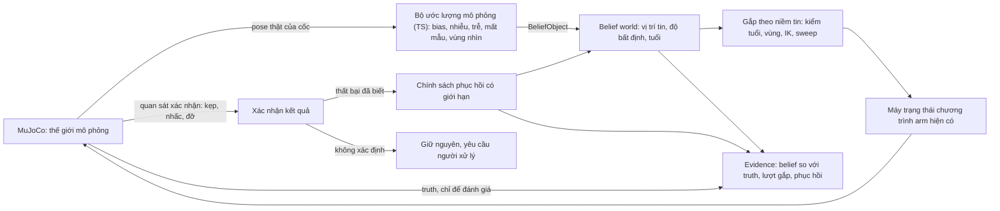

# Spec R4-B — Belief world, sai số nhận thức và phục hồi cho tay máy

**Mã:** MKQ-SIM-R4-B-01 · **Trạng thái:** đề xuất sau R2b/R3, chưa được thực thi.

Đọc cùng [nghiên cứu](01-research.md), [contracts/evidence](05-contracts-and-evidence.md) và [plan 03](plans/03-belief-and-recovery.md). Đợt này độc lập với R4-A: không cần drive ảo để chạy, và không cần cài bất kỳ runtime ngoài nào.

## 1. Kết quả sản phẩm

Trong R2b tay máy không bao giờ phải *tin* một vị trí. Chương trình gắp là dãy waypoint tính sẵn cho vị trí cốc danh định; engine chỉ được hỏi để **xác nhận** (cốc có nằm giữa hai má, đã nhấc đủ cao, đã nằm trên khay). Trong workflow, cốc sinh ra đúng tại điểm danh định nên chương trình cố định luôn gắp được. Điều đó che mất một lớp lỗi của robot thật: hệ thống nhìn sai, nhìn trễ, hoặc nhìn đúng nhưng vật đã bị xê dịch.

R4-B làm ba việc:

1. **Tách hai thế giới.** Thế giới mô phỏng là trạng thái thật của engine. Belief world là những gì bộ điều khiển cho là đúng: vị trí ước lượng, độ bất định, tuổi của ước lượng.
2. **Cho tay máy gắp theo niềm tin**, rồi bật sai số nhận thức có kiểm soát và đo: tỷ lệ gắp thành công, số lần gắp lại, thời gian, va chạm, số lần cần người xử lý.
3. **Phục hồi có giới hạn** khi gắp hụt: lùi về tư thế an toàn, quan sát lại, thử lại tối đa N lần, rồi dừng và gọi người.

| Đợt | Trong phạm vi | Điều kiện ra |
|---|---|---|
| R4.4 | Belief world, bộ ước lượng mô phỏng, gắp theo niềm tin, rig gắp và study sai số, phục hồi có giới hạn, lớp hiển thị belief trên web | G-BEL1, G-REC1 |

Không thuộc đợt này: render camera và chạy bộ ước lượng pose thật, lập kế hoạch chuyển động tránh vật cản lúc chạy, gắp vật thể bất kỳ, engine behavior tree, tích hợp Intrinsic Core, machine tending CNC. Xem [§12](#12-các-việc-chủ-ý-hoãn) và [spec R4-C](04-r4-calibration-and-deferred-spec.md).

## 2. Hiện trạng trong code

| Quan sát | Nguồn | Hệ quả |
|---|---|---|
| Chương trình arm lấy nguyên văn waypoint của fixture; ghi chú "No IK at run time" | `source/packages/lab-runtime/src/v2/simulation3d/mujoco-arm-ports.ts` (`mujocoProgramSet`) | Gắp theo niềm tin cần đường tính waypoint lúc chạy, có kiểm |
| Trong workflow cốc sinh đúng tại điểm danh định; 5 mm là biên chấp nhận của worker, và rig B05 đã thử lệch tới mức đó | `mujoco-world-ports.ts` (birth dùng `birth.centerM`), `handoff-policy.json` (`birth.maxOffsetXYM`) | Muốn thấy giá trị của nhận thức phải có fixture cho lệch lớn hơn |
| Má kẹp mở hết 88,9 mm, cốc đường kính 80 mm | `fixtures/xarm6-g2-v1/physics.json` (`openingMaxM`) | Khe hở mỗi bên khoảng 4,5 mm: sai lệch ngang lớn hơn thế có thể làm má chạm cốc khi tiếp cận |
| IK giải tích/số có sẵn ở TS, đã đối chiếu với Robotics Toolbox | `v2/models/arm-kinematics.ts` (`solvePose`), gate G-ALG1 | Không cần thư viện IK mới |
| Kiểm sweep ARM03 chạy ở TS trên hình học capsule | `v2/models/arm-collision.ts` | Kiểm được chương trình mới trước khi chuyển động |
| Kẹp hụt không chốt tay máy: chương trình chạy tiếp và hoàn tất với `objectPresent:false`. Cốc mất sau khi đã kẹp thì chốt `CUP_DROPPED`. Không có thử lại | `source/packages/cell-adapters/src/mock-arm.ts` (`completeContact`) | Phục hồi là hành vi mới, phải là tùy chọn và giữ đường cũ nguyên byte |
| Recorder bền và xuất replay package chỉ có cho cell một world; run arm-only giữ trace trong bộ nhớ | `mujoco-world-ports.ts`, `scenario-runner.ts` | Chế độ belief trên web chạy ở cell; rig có artifact riêng |
| Runtime có PRNG có tên, một stream mỗi actor | `v2/random.ts` | Sai số ngẫu nhiên tái lập được và kiểm được |

## 3. Kiến trúc



Bộ ước lượng và belief world nằm ở runtime TS, chạy mỗi tick từ observation **đã commit**. Worker không đổi: nó tiếp tục trả pose thật. Truth đi tới đúng hai nơi: bộ ước lượng mô phỏng (để tạo ra số đo có sai số) và evidence (để chấm điểm). Mã quyết định gắp không nhận truth.

## 4. Quyết định

| ID | Quyết định |
|---|---|
| R4-D21 | Hai thế giới tách bằng kiểu dữ liệu: mã chọn điểm gắp chỉ nhận `BeliefView`. Có test bắt việc rò truth vào quyết định |
| R4-D22 | R4 dùng **mô hình sai số tham số** (bias, nhiễu, trễ, mất mẫu, vùng nhìn thấy). Không render camera, không chạy bộ ước lượng pose thật. Mọi tham số `assumed` |
| R4-D23 | Ba chế độ gắp là input của run: `fixed_program` (hành vi R2b), `belief_ground_truth` (niềm tin bằng sự thật), `belief_estimated` (niềm tin từ bộ ước lượng). Hai chế độ belief chạy trên cell (`MJ-CELL-BV01`) và trên rig; `MJ-BV01` arm-only giữ `fixed_program` |
| R4-D24 | Vật thể trong belief ở R4 là cốc trụ đứng trên mặt đỡ đã khai: ước lượng (x, y); z lấy từ mặt đỡ; không có yaw |
| R4-D25 | Mỗi lượt gắp theo niềm tin đi qua bốn cửa theo thứ tự: belief hợp lệ và đủ mới → nằm trong vùng làm việc đăng ký → IK đạt ngưỡng oracle → sweep ARM03 đạt. Trượt một cửa là từ chối có mã, không chuyển động |
| R4-D26 | Chỉ phục hồi từ **thất bại đã biết** với quan sát mới. Trạng thái không xác định (mất ACK, mất worker, lệnh unknown) giữ nguyên quy tắc R2b: không gửi lại, không tự tiếp tục |
| R4-D27 | Phục hồi là bảng quy tắc khai báo có giới hạn số lần, không phải engine behavior tree. Cấu trúc tương đương Retry/Fallback/Sequence để xuất sang định dạng cây sau này nếu cần |
| R4-D28 | Không mở kẹp khi cốc có thể đang được giữ. Mở kẹp chỉ là bước phục hồi khi quan sát xác nhận cốc không nằm giữa hai má |
| R4-D29 | Tỷ lệ thành công là kết luận trên quần thể: mỗi điểm của study ghi số run, seed và khoảng tin cậy. Một run không tạo ra tỷ lệ |
| R4-D30 | Truth và dữ liệu vào bộ ước lượng cùng đến từ một engine. Report gọi đúng tên: *sai số nhận thức được mô hình hóa*, không phải dữ liệu camera |
| R4-D31 | Không thêm hợp đồng `WorkcellJob`. Ranh giới Source ↔ workcell vẫn là `CellAdapter`/`CellCommand` hiện có ([§9](#9-ranh-giới-workcell)) |
| R4-D32 | Gắp theo niềm tin và phục hồi nằm **trong plant tay máy, dưới `CellAdapter`**. Source vẫn stage và start một job gắp như R2b, và job đó chạy suốt các lượt thử. Id của bước phục hồi là id nội bộ của plant. `packages/domain` và journal không đổi; thời gian phục hồi tính vào hạn của job |
| R4-D33 | REC06 hiện dùng `world-cup-nudge-v2` cùng `cup-pick-two-stage-v1` trong cell. Năm đoạn lực liên tiếp bắt đầu ở tick ngay sau cam kết đầu. Mỗi đoạn có ý định bền vững và ACK native. Chế độ `fixed_program` bị từ chối trước khi mở worker. Các kết quả của nhiễu loạn v1 được giữ trong LEDGER-v11-v13. |

## 5. Belief world và bộ ước lượng mô phỏng

### 5.1 Dữ liệu

Một `BeliefObject` gồm: id vật thể, khung tọa độ, vị trí ước lượng, độ bất định khai báo, tick quan sát, tick công bố, tuổi, nguồn (`ground_truth` hoặc `pose_estimator_sim`), cờ hợp lệ và lý do khi không hợp lệ. Shape ở [contracts §6](05-contracts-and-evidence.md#6-belief-nhận-thức-và-phục-hồi).

Belief world chỉ giữ bản ước lượng mới nhất của mỗi vật thể và lịch sử ngắn phục vụ hiển thị. Evidence giữ toàn bộ.

### 5.2 Mô hình sai số

`PerceptionProfileV1` là file trong bundle admission, có digest:

| Tham số | Nghĩa | Biên |
|---|---|---|
| `updateEveryTicks` | Chu kỳ ra một ước lượng | 1–250 |
| `latencyTicks` | Ước lượng mô tả trạng thái của bao nhiêu tick trước | 0–100 |
| `biasM` | Lệch cố định (x, y) trong khung tay máy | mỗi thành phần tối đa 0,03 m |
| `sigmaM` | Độ lệch chuẩn nhiễu Gauss (x, y), độc lập giữa các lần ra ước lượng | tối đa 0,03 m |
| `dropoutProbability` | Xác suất một lần cập nhật không ra ước lượng | 0–0,9 |
| `visibleRegionId` | Vùng mà vật thể được nhìn thấy; ngoài vùng không có ước lượng | id vùng đã khai trong scene |
| `maxAgeTicks` | Tuổi tối đa để ước lượng còn dùng được cho quyết định gắp | 1–500 |

Ước lượng tại tick công bố *t*: lấy vị trí thật tại *t − latencyTicks*, cộng bias, cộng nhiễu rút từ stream PRNG `perception:<objectId>`. Phân phối Gauss được tạo bằng một phép biến đổi cố định ghi trong contract để hai bản cài đặt cho cùng dãy số. Seed của run quyết định dãy; cùng seed và profile cho cùng dãy ước lượng.

Chế độ `belief_ground_truth` là profile có mọi sai số bằng 0 và trễ 0: niềm tin trùng sự thật. Nó là điểm so sánh, không phải đường riêng trong code.

### 5.3 Niềm tin cũ

Một ước lượng đúng lúc tạo ra có thể sai lúc dùng. Rig có nhiễu loạn đăng ký `rig-cup-nudge-v1`: một lực mô phỏng đẩy cốc đi một quãng sau khi ước lượng cuối được công bố. Hai tình huống phải phân biệt được trong evidence:

- Cốc bị đẩy **trước** thời điểm cam kết gắp và ước lượng quá tuổi: cửa tuổi chặn, hệ thống chờ ước lượng mới.
- Cốc bị đẩy **sau** thời điểm cam kết: lượt gắp có thể hụt; xác nhận phát hiện; phục hồi quan sát lại.

Thời điểm cam kết là lúc bắt đầu hạ từ tư thế tiếp cận xuống tư thế gắp.

## 6. Gắp theo niềm tin

Waypoint `pickApproach`, `pick` và `lift` được định nghĩa tương đối với cốc bằng offset lấy từ layout hiện có (khung gắp so với cốc danh định). Lúc chạy:

1. Lấy `BeliefObject` của cốc. Không có hoặc không hợp lệ → `BELIEF_UNAVAILABLE`. Quá `maxAgeTicks` → `BELIEF_STALE`. Chờ tối đa `beliefWaitTicks` của chính sách; hết hạn thì yêu cầu người xử lý.
2. Vị trí tin phải nằm trong vùng làm việc đăng ký trên mặt đỡ → nếu không: `BELIEF_OUT_OF_REGION`.
3. Giải IK cho ba waypoint, seed từ waypoint fixture tương ứng. Sai số, số điều kiện Jacobian và giới hạn khớp theo oracle profile hiện có → nếu không: `GRASP_UNREACHABLE`.
4. Chạy kiểm sweep ARM03 cho đoạn chương trình mới với hình học và các cặp tiếp xúc được phép hiện có → nếu không: mã ARM03 hiện có.
5. Ghi một bản ghi lượt gắp (belief đã dùng, waypoint đã giải, residual IK, kết quả sweep) **trước** khi gửi lệnh chuyển động đầu tiên, rồi plant thay ba waypoint gắp của chương trình đang chạy bằng waypoint đã giải. Source không stage chương trình mới cho từng lượt.

Các waypoint còn lại của chương trình (`high`, `placeApproach`, `place`, `home`) giữ nguyên từ fixture. R4 không ước lượng vị trí khay; dock AMR vẫn theo ngưỡng handoff của R2b.

Xác nhận kết quả dùng đúng các quan sát engine và ngưỡng oracle R2b (hai má chạm cốc sau thời gian ổn định, độ cao nhấc tối thiểu, trượt trong khung TCP). R4 không nới ngưỡng nào.

## 7. Phục hồi

### 7.1 Nguyên tắc

Phục hồi tự động chỉ hợp lệ khi hệ thống **biết** chuyện gì đã xảy ra. Điều kiện chung cho mọi quy tắc:

- Trạng thái khớp tay máy mới và hợp lệ.
- Không có lệnh nào đang ở trạng thái unknown.
- Cốc được **quan sát** đang đứng trên một mặt đỡ đã khai và **không** nằm giữa hai má.

Thiếu một điều kiện thì không phục hồi: giữ nguyên, chốt, `needs_attention`. Cốc rơi xuống sàn, cốc còn giữa hai má nhưng đang trượt, va chạm, mất worker/ACK đều thuộc nhóm này.

### 7.2 Chính sách

`RecoveryPolicyV1` là file trong bundle admission. Chính sách khởi điểm `pick-recovery-v1` (`assumed`):

| Khi | Các bước | Số lần tối đa |
|---|---|---|
| Xác nhận kẹp cho biết không có cốc giữa hai má | Mở kẹp → lùi về `pickApproach` → chờ ước lượng mới → gắp lại | 2 |
| Belief không có hoặc quá tuổi trước khi chuyển động | Chờ ước lượng mới tới `beliefWaitTicks` → gắp | 2 |
| Mọi trường hợp khác | Giữ nguyên, chốt, yêu cầu người xử lý | — |

Điểm hỏi chính sách là lúc xác nhận kẹp; hôm nay ở điểm đó chương trình chạy tiếp và hoàn tất với `objectPresent:false`. Cốc mất **sau khi** đã kẹp giữ nguyên hành vi R2b: chốt `CUP_DROPPED`, không phục hồi.

Bộ đếm tính theo cốc trong một run. Hết số lần → `RECOVERY_EXHAUSTED`, `needs_attention`. Mỗi bước phục hồi là một lệnh có id riêng và được ghi trước khi thực hiện; không có bước nào là "gửi lại lệnh cũ".

Custody không đổi trong suốt quá trình phục hồi lượt gắp: cốc chưa rời vòi về mặt nghiệp vụ cho tới khi xác nhận nhấc đạt. Số cốc đã phục vụ chỉ tăng theo journal Source như R2b.

Run không khai chính sách phục hồi chạy đúng hành vi R2b.

### 7.3 Liên hệ với cấu trúc behavior tree

Chính sách trên tương đương một cây `Fallback[ Retry(n){ Sequence[quan sát, gắp, xác nhận] }, gọi người ]` với một nhánh phục hồi cố định. R4 giữ nó ở dạng bảng vì chỉ có một quy trình và vài loại thất bại đã biết; thêm engine cây cho một cây là thừa. Điều kiện mở lại: xuất hiện quy trình thứ hai có cấu trúc phục hồi khác, hoặc cần trao đổi quy trình với một runtime dùng cây.

## 8. Rig, study và scenario tích hợp

### 8.1 Rig gắp

`pick-rig-v1` là fixture mới dẫn xuất từ cell hiện có: tay máy, giá vòi, khay tĩnh, một cốc. Nó cho phép cốc sinh lệch tới 30 mm theo chính sách riêng của rig; chính sách handoff ±5 mm của cell không đổi. Lệch thật của một lượt là một vectơ có độ lớn đăng ký (0 hoặc 20 mm) và hướng rút từ stream `rig:<seed>`; hướng được ghi vào artifact vì lệch ngang và lệch dọc hướng tiếp cận cho kết quả khác nhau. Một lượt rig: sinh cốc → ước lượng → gắp → nhấc → đặt lên khay tĩnh → xác nhận. Rig là scenario chỉ dành cho campaign, không nằm trong registry của browser, cùng cách với rig B05.

### 8.2 Study sai số nhận thức

`perception-gap-v1` là danh sách điểm đăng ký trước:

| Nhóm | Chế độ | Lệch thật của cốc | Sai số ước lượng | Số lượt |
|---|---|---|---|---|
| Đối chứng cũ | `fixed_program` | 0 | — | 1 (tất định) |
| Đối chứng cũ, có lệch | `fixed_program` | 20 mm, hướng theo seed | — | 10 |
| Đối chứng tốt | `belief_ground_truth` | 0 | 0 | 1 (tất định) |
| Đối chứng tốt, có lệch | `belief_ground_truth` | 20 mm, hướng theo seed | 0 | 10 |
| Quét nhiễu | `belief_estimated` | 20 mm, hướng theo seed | σ ∈ {2, 5, 10, 15} mm, bias 0 | 4 × 10 |
| Quét bias | `belief_estimated` | 20 mm, hướng theo seed | σ = 2 mm; bias 5 và 10 mm, mỗi mức theo trục x và theo trục y của khung tay máy | 4 × 5 |
| Niềm tin cũ | `belief_estimated` | 0, có `rig-cup-nudge-v1` hướng theo seed | σ = 2 mm | 10 |

Tổng 92 lượt rig. Điểm không có gì thay đổi giữa các seed chỉ chạy một lượt. Khoảng tin cậy mô tả tỷ lệ trên các hướng lệch và các lần rút nhiễu đã đăng ký; nó không phải xác suất của một tay máy thật. Đầu ra `PerceptionStudyV1`: với mỗi điểm, số lượt, số thành công ngay lần đầu, số thành công sau phục hồi, số cần người xử lý, khoảng tin cậy Wilson 95 %, trung vị thời gian, số va chạm ngoài dự kiến, sai số belief tại thời điểm cam kết. Không có xếp hạng, không có "ngưỡng an toàn"; chỉ có "trong fixture X với mô hình sai số Y, quan sát Z".

Study không khẳng định trước kết quả. Nếu chương trình cố định vẫn gắp được ở lệch 20 mm, hoặc ước lượng σ = 15 mm vẫn đạt, đó là kết quả và được ghi đúng như vậy.

### 8.3 Tích hợp

`MJ-CELL-BV01` chạy thêm ở chế độ `belief_estimated` với profile danh định và chính sách phục hồi, ba seed, phải phục vụ 2 cốc; cùng năm ca fault R2b không được tạo phục vụ giả. Đây là kiểm rằng đường mới không phá workflow, không phải study.

REC06 hiện dùng campaign `mj-cell-recovery-v2` với chương trình `cup-pick-two-stage-v1` và nhiễu loạn `world-cup-nudge-v2` sau cam kết đầu của cup-1. Ba seed 7, 42 và 99 phải phục vụ hai cốc sau một lần hụt đã biết và một lần thử lại bằng quan sát mới. Đối chứng gồm ba ca danh định và năm ca lỗi chuẩn. Vùng làm việc giữ nguyên ±20 mm. Các phép đo với v1 trong LEDGER-v11-v13 là kết quả lịch sử. Xem quy trình ghi và kiểm lại ở [R4 qualification](../../../operations/r4-qualification.md).

## 9. Ranh giới workcell

Đề xuất gốc là thêm `WorkcellJob`/`WorkcellResult` để một runtime ngoài nhận tác vụ mức workcell. Đối chiếu với code cho thấy ranh giới đó đã tồn tại: `CellAdapter` (`source/packages/cell-adapters/src/contract.ts`) có `execute` idempotent theo `commandId`, `cancel`, `observe`, `reconcile` sau unknown, manifest có mức validation; `CellCommand` có `stage_program`, `start_job`, `pause_job`, `resume_job`, `cancel_job`, `query_outcome`.

Vì vậy R4 không thêm schema. Một runtime workcell bên ngoài, khi được tích hợp, là **một bản cài đặt `CellAdapter` mới** phía source, với:

| Khái niệm ngoài | Ánh xạ sang MEKONIQ |
|---|---|
| Quy trình/skill mức workcell (gắp, đặt, kiểm, nạp máy) | `programRef` đã duyệt + `start_job` |
| Hủy, tạm dừng | `cancel_job`, `pause_job`/`resume_job` |
| Trạng thái và lỗi của quy trình | `CellObservation` + `reconcile` |
| Bằng chứng thực thi | `TransferEvidence` và evidence stream của run |
| Thế giới niềm tin của runtime ngoài | Nằm trong runtime đó; Source chỉ nhận observation |

Source giữ mission, journal, custody. Runtime ngoài không trở thành bộ điều phối thứ hai, và Lab không có đường tới nó. Điều kiện mở lane này ở [R4-C §6](04-r4-calibration-and-deferred-spec.md#6-các-lane-hoãn-và-điều-kiện-mở).

## 10. Giao diện

Dùng viewport và panel hiện có; thêm một lớp hiển thị và một khung chọn chế độ.

```
Viewport 3D
  ● cốc thật (đặc)      ◌ vị trí tin (viền nét đứt)      ↔ sai lệch 7,2 mm
  phase: pha → ước lượng (tuổi 3 tick) → gắp (lượt 2/3) → đặt → di chuyển

Nhận thức
  ( ) Chương trình cố định   ( ) Vị trí thật   (•) Ước lượng mô phỏng
  Mô hình sai số: σ 5 mm · bias 0 · trễ 5 tick · mất mẫu 0 %     [Giả định]

Lượt gắp
  1  tick 240  belief lệch 9,1 mm  → kẹp không hình thành → phục hồi
  2  tick 395  belief lệch 2,3 mm  → nhấc đạt 0,151 m
```

Số trong hình là minh họa bố cục. Quy tắc:

- Vị trí tin và vị trí thật luôn vẽ khác kiểu; chú thích nói rõ vị trí thật chỉ có trong mô phỏng.
- Lớp belief chỉ vẽ khi stream belief có dữ liệu tại con trỏ; thiếu thì hiện "không có dữ liệu nhận thức", không vẽ ghost trùng cốc thật.
- Replay dùng đúng evidence đã ghi; không tính lại ước lượng ở browser.
- Chế độ và profile được chọn **trước** khi tạo run; đổi là run mới. Trên web, hai chế độ belief có ở preset cell. Khi chế độ là belief, danh sách thí nghiệm của preset cell có thêm `world-cup-nudge-v2`.
- Study có màn hình riêng trong Report: bảng điểm và đồ thị tỷ lệ thành công theo σ với khoảng tin cậy, kèm số lượt mỗi điểm.
- VI/JA/EN, bàn phím, 390/1024/1440 px, reduced motion như các panel hiện có.

## 11. Yêu cầu đo được

| ID | Yêu cầu | Plan / case |
|---|---|---|
| R4-21 | Belief và perception profile có schema, digest, negative test; run `fixed_program` giữ nguyên byte R2b | V11 / BEL01 |
| R4-22 | Bộ ước lượng tái lập theo seed, đúng bias/nhiễu/trễ/mất mẫu/vùng nhìn; mã quyết định không nhận truth | V11 / BEL02, BEL03 |
| R4-23 | Gắp theo niềm tin qua bốn cửa; từ chối có mã trước khi chuyển động; bản ghi lượt gắp có trước lệnh đầu | V11 / BEL04 |
| R4-24 | Rig và study chạy đủ điểm, mỗi lượt có artifact; kết quả có quần thể và khoảng tin cậy | V12 / BEL05 |
| R4-25 | Lớp belief và màn hình study trên web đúng dữ liệu tại con trỏ, replay offline | V12 / BEL06 |
| R4-26 | Phục hồi chỉ từ thất bại đã biết; giới hạn số lần; mọi bước có id và được ghi trước | V13 / REC01–REC03 |
| R4-27 | Trạng thái unknown, cốc rơi, cốc còn bị giữ không kích hoạt phục hồi; không phục vụ giả; custody không đổi | V13 / REC04 |
| R4-28 | Cell chạy `belief_estimated` danh định ba seed phục vụ 2; năm fault R2b giữ kết quả | V13 / REC05 |
| R4-29 | Cell chế độ belief với `cup-pick-two-stage-v1` và `world-cup-nudge-v2`: nhiễu loạn có ý định và biên nhận; lượt đầu hụt đã biết; phục hồi trong giới hạn; phục vụ 2. Chế độ `fixed_program` với thí nghiệm này bị từ chối | V13 / REC06 |

## 12. Các việc chủ ý hoãn

- **Camera render và bộ ước lượng pose thật:** thêm một chuỗi phụ thuộc lớn (render headless, model học máy, giấy phép model) và nguồn bất định mới trước khi có camera thật để đối chiếu. Mô hình tham số trả lời được câu hỏi "controller chịu sai số bao nhiêu" với chi phí thấp hơn nhiều. Mở khi có camera và bài toán cụ thể; khi đó tham số của mô hình sai số được hiệu chuẩn từ dữ liệu thật theo R4-C.
- **Ước lượng yaw, vật thể không đối xứng, nhiều vật thể:** mở khi có vật thể cần.
- **Ước lượng vị trí khay/dock bằng nhận thức:** giữ ngưỡng dock R2b; mở sau khi phần gắp ổn.
- **Lập kế hoạch chuyển động và gắp tổng quát:** R4 chỉ đổi điểm gắp trong vùng nhỏ quanh danh định với IK và kiểm sweep. Planner là dự án riêng.
- **Engine behavior tree:** xem §7.3.
- **Tích hợp Intrinsic Core, OMTS, machine tending CNC:** xem R4-C §6.
