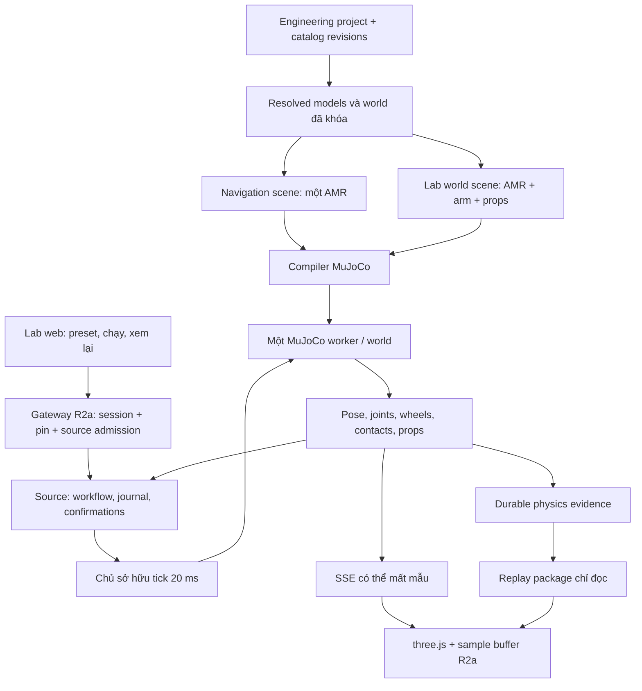

# Spec R2b — Lab web có tải và hành trình cà phê liên tục

**Hiện trạng sau N1, 16/11:** [kết quả mới](../post-n1-final-recording/status.md), [tái hiện](../post-n1-final-recording/reproduce.md) và [disposition](../post-n1-final-recording/dispositions.md) dùng Source `0d46403` / Lab `7c97b20`. Review giữ verdict lịch sử ở tuple/scope đã nêu; capture mới và bốn assertions mock chưa giải quyết, native/physical chưa nghiệm thu. Các snapshot/kế hoạch cũ bên dưới giữ ngày và identity riêng.

**Mã:** MKQ-SIM-R2B-02 · **Trạng thái:** đề xuất sau R2a, chưa được thực thi.

Đọc cùng [nghiên cứu](01-research.md), [contracts/evidence](03-contracts-and-evidence.md) và [plan](plans/README.md). Các quyết định chỉ áp dụng cho set/fixture mới; không đổi hành vi R2a đang phát triển.

## 1. Kết quả sản phẩm

Người dùng mở Lab, xem được một bản ghi tốt ngay cả khi chưa nối runtime. Khi nối runtime đúng pin, họ chạy một kịch bản, thấy robot và cốc chuyển động, thay **một** đầu vào rồi chạy lại, biết vì sao kết quả khác, và chia sẻ được bản ghi đủ ngữ cảnh. Kỹ sư dùng chính đầu vào/model/evidence ấy để kiểm native trên Linux, không dựng lại demo bằng scene khác.

Ba increment:

| Increment | Trong phạm vi | Điều kiện ra |
|---|---|---|
| R2b.1 | Một AMR Serve có caster, khay, payload; MuJoCo navigation và thử tải; report/replay vật lý | Gate G-MJ1; hành trình local xem được, có fault và evidence |
| R2b.2 | Một xArm 6 cố định + một AMR + tối đa hai cốc trong cùng world; cà phê vẫn mock; giao cốc theo workflow source | Gate G-CELL1; không “dịch chuyển tức thời” cốc từ arm sang AMR |
| R2b.3 | Preset có hướng dẫn, camera theo phase tùy chọn, replay package, study đa engine, gói runtime HTTPS | G-WEB1, G-X1, G-REG4; hosting thật có record riêng |

Fleet physics, người đông, SLAM, camera/depth, chất lỏng, firmware thật, tối ưu RL, custom PID bắt buộc, motion planning online và multi-tenant cloud không thuộc ba increment. IR-SIM/Webots vẫn dùng để regression và so sánh phạm vi phù hợp.

## 2. Điều kiện bàn giao từ R2a

Trước code R2b, B00 chụp source/Lab HEAD cuối R2a, pin, schema hash, closure, engine lock, fixture digest và qualification. Với đường arm tích hợp cần `G-MA1/G-MA2/G-RT1/G-RT2/G-UI1/G-INT4/G-REG3` tested ở phạm vi host đã ghi. Nếu R2a phát hành từng phần, chỉ mở task dùng phần đã có bằng chứng; không đánh toàn bộ R2a hoàn tất từ một phần.

`G-CLOUD1` của R2a được thiết kế luôn `blocked_external` tại snapshot này. R2b không sửa record đó để biến thành tested. Một lần hosting sau này có record mới gắn release/host/architecture riêng.

Các golden phải giữ: mock BV01 outcome, IR-SIM chunk hashes, Webots world bytes, request/response cũ và report đọc lại. Có thay đổi cần thiết sau baseline thì tạo revision/test giải thích đúng phạm vi, không sửa golden chỉ để xanh.

## 3. Kiến trúc mục tiêu

R2b.1 tiếp tục `createFixedStepScenarioRun`/`PlantPort` cho navigation. R2b.2 mở một seam `WorldPlantPorts` trong lifecycle của scenario runner để workflow cà phê và AMR cùng nhận observations từ **một** bước world. Không để `CoffeePlantPorts.advance()` tự step engine rồi AMR step lần thứ hai. Interface và thứ tự tick ở [contracts §3](03-contracts-and-evidence.md#3-một-world-một-bước-mỗi-tick).

Đây là thay đổi orchestration thật, không phải chỉ cấu hình backend. Task B05 chứng minh tick/handoff bằng rig nhỏ trước B06 ghép BV01. Không nhân bản toàn bộ journal/recovery/mission logic thành runner thứ ba.

## 4. Quyết định

| ID | Quyết định |
|---|---|
| R2B-D01 | Kế thừa pin MuJoCo và xArm của R2a đã bàn giao; nâng engine là experiment có candidate riêng, không cùng commit thêm payload |
| R2B-D02 | Backend AMR `mujoco_3d`, set `engineering-mujoco-3d-v1`, scenario `MJ-FD01`; cell set `engineering-mujoco-cell-v1`, scenario **`MJ-CELL-BV01`**. Không đổi ý nghĩa `MJ-BV01` của R2a |
| R2B-D03 | Cell set có providers `{amr:'mujoco_3d',arm:'mujoco_arm',coffee:'mock_coffee'}` và execution discriminator mới `composition:'single_world'`; dispatcher xét discriminator trước nhánh arm cũ. Catalog vẫn server-owned |
| R2B-D04 | Một process runtime giữ tối đa một world MuJoCo đang hoạt động, dùng chung slot giữa arm-only/mobile/cell. Slot busy trả reason, không spawn engine thứ hai hoặc đổi provider |
| R2B-D05 | 20 ms logical tick; khởi điểm 10 substeps × 2 ms, `implicitfast`, giữ controller/solver params trong fixture. Không đổi bước thời gian theo tốc độ UI |
| R2B-D06 | Wheel controller mặc định là **velocity actuator hữu hạn lực** ở engine; TS tiếp tục đưa `[v,ω]` sau giới hạn gia tốc. Motoring theo drive curve, braking theo `brakeTorqueNm` riêng có provenance; đọc actual wheel velocity mỗi substep. Không gọi `pidStep` trong baseline |
| R2B-D07 | Chassis là free body có gravity/contact thật; bánh/caster đúng physical model. Không khóa roll/pitch, không đặt lại root pose mỗi tick để “đi đúng đường” |
| R2B-D08 | Payload có geometry, mass, inertia, pose, ma sát, provenance và digest. Cốc/khối tải trên khay là free body; `fixed_ballast` chỉ dành case ballast riêng, không dùng để giả ổn định cốc |
| R2B-D09 | Một world cell chứa đúng cốc đã gắp, khay gắn chassis AMR. Custody là nghiệp vụ, không tự biến thành weld, teleport hoặc xóa prop |
| R2B-D10 | Contact bình thường và collision bất thường tách bằng pair + phase + geometry; không cho phép blanket `arm × AMR` |
| R2B-D11 | Hình ảnh minh họa không tham gia physics phải ghi rõ; collider cần cho thao tác có geometry trong scene và digest. Trang trí không tạo bằng chứng “an toàn” |
| R2B-D12 | Metrics tính từ durable observations, không từ pose đã nội suy để vẽ. Mất telemetry chỉ ảnh hưởng độ mượt; mất evidence ảnh hưởng coverage/verdict |
| R2B-D13 | So sánh đa engine là semantic study riêng. `compareRuns` tiếp tục chặn delta/ranking cross-backend |
| R2B-D14 | Browser chỉ gửi các intent/schema đã đăng ký; không gửi MJCF/Python, URL driver, topic hoặc path host. Model edits tạo revision mới; run đang chạy giữ input cũ |
| R2B-D15 | Run đã mất worker/ACK không được phục hồi vật lý bằng cách dựng world mới rồi tiếp tục cùng runId. Xem lại hoặc chạy run mới có liên kết tới bản cũ |
| R2B-D16 | Mọi dynamics là `not_calibrated`; ngưỡng mô phỏng là test policy, không là sức tải/phanh an toàn của máy thật |

## 5. R2b.1 — AMR và tải

### 5.1 Fixture và compiler

Tạo fixture **`serve-payload-v1`** từ các thành phần của `serve-3d-v1`; không sửa fixture Webots. Giữ drive radius 0,09 m và separation 0,36 m khi đó vẫn là dữ liệu của fixture nguồn. Không gọi chúng là thông số hardware. Chỉ thêm/sửa geometry khay khi B01 chứng minh cần, với revision mới và danh sách khác biệt.

Ba load profile khởi điểm, tất cả `assumed`:

- `empty`: không payload.
- `cup-center`: một cốc theo geometry R2a, tổng mass 0,32 kg, đặt giữa vùng đỡ của khay đã chọn.
- `cup-offset`: cùng cốc lệch 50 mm theo +y của tray, chỉ hợp lệ khi footprint cốc vẫn nằm trong vùng đỡ; nếu không thì fixture này bị từ chối, không clamp về tâm.

Không gọi 0,32 kg là “đầy tải AMR”. Muốn quét 5/10/20 kg phải có load profile mô phỏng riêng có provenance, collider/inertia rõ; không dùng con số đó làm rated payload.

Compiler đọc physical projection, drive, collider và world3d; từ chối thiếu inertia, mass không dương, trục bánh sai, mesh không có proxy phù hợp, caster thiếu, initial penetration, hoặc tải vượt hình học được khai. Đọc lại `mjModel` để so mass/COM/inertia/joint axis/limits/drive dimensions; không chỉ so XML với chính generator.

### 5.2 Điều khiển và quan sát

`grid-diff-v1` tiếp tục quyết định đường đi ở mức điều hướng. MuJoCo đổi body velocity sang wheel target, giới hạn drive torque tại từng substep. Motor saturation được ghi nhận; không “bù” pose để hoàn thành goal.

Đường điều khiển R2b dùng **ground-truth pose của plant** như các provider mô phỏng hiện tại và ghi rõ `localization:'ground_truth'`. Wheel odometry tích phân từ bánh là kênh độc lập để đo slip; chưa hứa localization thực. LiDAR raycast từ geometry scene, sensor frame/cadence hữu hạn như contract đang có; không tự thành dữ liệu Nav2 đã kiểm.

Các bài thử: đi thẳng, cua bán kính cố định, dừng từ vận tốc đã khai, quét ma sát, payload lệch; faults gồm bánh bão hòa, thiếu contact stream, worker chết, lệnh/ACK trễ. Một scenario stress có thể kết thúc bằng cốc rơi và vẫn là **test đạt vì bắt đúng lỗi**, nhưng report run không được ghi “giao thành công”.

R2b mobile dùng giới hạn nghiêng theo policy riêng; không áp nguyên hằng `TILT_LIMIT_RAD=0.35` của runner Webots cho mọi experiment tipping. Webots giữ hằng cũ. Phân biệt `LOAD_FELL`, `BASE_TIPPED` (quan sát vật lý) với `PLANT_UNSTABLE` (solver/NaN/numerical error).

## 6. R2b.2 — Cà phê tới bàn trong một world

### 6.1 Bố cục có thể thực hiện

Tạo fixture **`coffee-delivery-world-v1`** gồm scene nhà hàng gọn, trạm xArm cố định, nozzle support và AMR có tray trong tầm với. B01/B05 phải kiểm `T_map_base`, `T_base_TCP`, `T_map_AMR × T_AMR_tray`, chiều cao và sweep. Nếu khay Serve hiện tại không tới được, tạo biến thể docking/khay explicit; không dịch vật lý để khớp hình đã vẽ.

Waypoint R2a chỉ tái dùng nếu task poses và model digest khớp. Nếu thay pose đặt lên khay di động, sinh lại chương trình offline bằng `solvePose`, lưu IK residual/condition/limits. Không lấy khớp PUMA thay xArm. Đỗ AMR vào một dock đã định; chưa làm online moving-target manipulation.

**Cập nhật triển khai B05/B06 ngày 14/11:** `coffee-delivery-world-v1` là fixture rig đã qua review B05. Workflow B06 dùng fixture mới `coffee-delivery-cell-v1`, giữ các input vật lý/chương trình của rig và khai policy điều hướng riêng. AMR ở dock quay `π/2`; planner có biên hữu hạn từ `[-0,6; -0,6]` đến `[6; 4]` m trên sàn mở không tường. Renderer/replay phải dùng đúng biên này và giữ nguyên tọa độ vật lý. Policy mới khai translation tolerance 4 mm, goal position 8 mm và goal yaw 16 mrad; không thay các default legacy hoặc ngưỡng dock/receipt bên dưới. Sau lỗi trôi quá đích của lượt freeze-01, policy world v2 bổ sung design braking deceleration 0,25 m/s² và yêu cầu vận tốc thực xuống ngưỡng dừng trước khi kết thúc mỗi đoạn dịch chuyển; giữ bound tăng/giảm lệnh 0,5 m/s². Các ngưỡng này được kiểm trong B06 và không áp dụng thay đổi cho các mode legacy.  Probe quay về sau đó phát hiện drift khi quay cuối; thử tiếp cận phía trước 0,20 m va chạm bệ vòi và đã được giữ là phương án không đạt. Policy world v4 dùng tiếp cận lùi 0,20 m, giữ hướng thân/vùng quét/cảm biến phía sau đúng với chuyển động lùi. Probe đã đạt sai số dock 0,444 mm và giới hạn giảm lệnh về zero trước arrival. Matrix freeze-04 sau đó đạt cả ba seed full Source: mỗi lượt 10.850 tick, served 2, hoàn tất hai lần quay về; năm fault cũng đạt yêu cầu phát hiện/không false serve. Đây là bằng chứng phát triển đã qua review B06; bản sửa publication đồng thời được kiểm riêng và đọc lại giữ nguyên trace/props. Chưa đóng performance hoặc qualification cuối. Xem [quyết định 38–40 và 46–53](05-implementation-decisions.md).

### 6.2 Hành trình

1. Source nhận order; mock coffee tạo cốc tại vòi theo event có journal.
2. AMR đến dock, giữ yên; source khóa vùng thao tác.
3. Arm gắp, nhấc, đặt cốc lên **tray của AMR đó**; engine tiếp tục theo dõi free body.
4. Chỉ chuyển custody sau observation đủ điều kiện, ACK và journal; arm rút khỏi vùng rồi AMR mới được đi.
5. AMR đi tới bàn, dừng. Chờ xác nhận giao; tới tọa độ bàn chưa tăng served.
6. Khi có xác nhận lấy cốc của người dùng hoặc actor giả lập đã khai, ghi một interaction event rồi đưa prop ra khỏi world theo policy. Không xóa cốc để tự tuyên bố giao thành công.

“Người nhận lấy cốc” và “máy pha tạo cốc” là tương tác scripted/mock, được gắn nhãn. Gắp của arm và vận chuyển của AMR là physics. Chất lỏng chỉ góp khối lượng; không mô phỏng tràn.

Dock acceptance ban đầu cho **fixture mô phỏng**: sai số XY ≤ 10 mm, yaw ≤ 0,02 rad, `|v|≤0,01 m/s`, `|ω|≤0,02 rad/s` liên tục 10 tick. Release: cốc đỡ bởi tray đúng ID, tốc độ tương đối với tray ≤ 0,01 m/s trong 25 tick, COM trong support polygon sau margin 5 mm, không còn held bởi hai má. Các ngưỡng nằm trong `handoff-policy-v1`, chưa là dung sai máy thật. Không thay ngưỡng sau khi thấy test fail mà thiếu revision/review.

Arm chưa rút an toàn, mất freshness, dock trôi hoặc ACK mất → giữ motion hold, custody unknown nếu không xác định; không gửi lại command tự động, không ra lệnh mở kẹp khi lỗi. Cancel giữ đúng semantics dừng mô phỏng; không gọi đó là E-stop phần cứng.

Báo cáo sweep phải bao phủ hết lượt world: cap 4.096 interval của report legacy có thể bị vượt khi geometry AMR đổi mỗi tick. B06 giữ report cũ trung thực khi truncated và bổ sung đường kiểm từ stream world đầy đủ, với phase/pair/region đã admission. Context điều khiển do Source ghi không tự cấp quyền bỏ contact. Kết quả hình học, tiếp xúc MuJoCo ở mọi substep và xác nhận custody là ba loại bằng chứng riêng; thiếu/gap/uncertain không được biến thành pass. Thiết kế đang triển khai này theo [quyết định 42](05-implementation-decisions.md).

## 7. R2b.3 — Trải nghiệm web

### 7.1 Ba việc rõ ràng trên cùng UI R2a

| Việc | Hành vi |
|---|---|
| **Xem mẫu** | Chọn replay đã ghi, bấm xem; không hỏi pairing và không gọi runtime. Nhãn “Bản ghi mô phỏng”, thời gian/engine/assumptions luôn tới được |
| **Chạy thử** | Kết nối runtime → chọn preset được hỗ trợ → kiểm readiness → chạy 1×. Tốc độ 4×/16× chỉ thay pacing; báo tốc độ đạt thực tế |
| **Thử một thay đổi** | Chọn tải/ma sát/speed từ profile được đăng ký → tạo input revision mới → run mới → A/B nếu cùng scope. Không sửa world đang chạy |

Ba preset bắt buộc: **Giao cà phê**, **Cốc rơi do tác động**, **Dừng và tiếp tục xử lý**. Tên stress phản ánh lực mô phỏng đã đăng ký; chỉ dùng tên “trượt khi vào cua” nếu có bằng chứng riêng cho nguyên nhân đó. “Tiếp tục xử lý” không cho phép tự resume/respawn world sau mất ACK hoặc trạng thái unknown. Preset stress phải được chọn qua trường scenario/fault hợp lệ server-owned; không mở `physicsOverride` chỉ dành test hiện tại ra API trình duyệt.

Viewport giữ bố cục R2a. Thêm phase ribbon “pha → gắp → đặt → di chuyển → chờ nhận”, với trạng thái lấy từ source/custody, không dựa timer animation. Chạm một issue mở object và tick gây lỗi; không ép người xem đọc mã reason trước khi hiểu tình huống.

Camera có Overview / Cell / Follow AMR. Theo phase là tùy chọn; kéo camera tắt tự theo cho đến khi người dùng bật lại. Reduced motion dùng đổi góc tức thời, không bay camera. Giữ lựa chọn VI/JA/EN, 2D fallback, bàn phím và panel R2a.

### 7.2 Chỉ số và hình vẽ

Mặc định hiện thời gian, số đã giao, phase và issue. Inspector mở được tilt, slip relative tray, khoảng cách dừng, bánh lệnh/thực và tiếp xúc. Vector lực/contact chỉ vẽ khi stream tương ứng có dữ liệu; mất mẫu thì hiện “không đủ dữ liệu”, không vector 0 giả.

Cốc luôn vẽ theo pose plant/replay. Chỉ interpolation giữa hai mẫu đã nhận, không extrapolation đoán cốc vẫn bám tay. Khi run/boot/revision đổi phải xóa buffer. Camera/mesh/video không tham gia tính metric.

### 7.3 Replay và chia sẻ

Một `web-replay-package-v1` gồm input identities, model/NOTICE hoặc ref tới asset đúng digest, report, event timeline và chunks đủ cho hình đã thấy. Package không chứa token, URL private, script hoặc mã executable. Manifest ghi `coverage` và gaps; xuất incomplete được nhưng không giả complete.

Mở package được khi không có runtime và khi đang offline sau khi asset đã tải. Dùng catalogue replay đi kèm bản Lab hoặc import file local. Không tự upload/chia sẻ công khai; publishing package là thao tác người dùng riêng. Browser chỉ kiểm integrity/hiển thị; package nhập từ ngoài không tự trở thành qualification được tin cậy.

### 7.4 Runtime web

Giữ local launcher. Gói cho host Linux một runtime: image immutable, HTTPS reverse proxy, persistent run volume, source pin, health, stop/drain, logs và export. UI vẫn là bản static Lab. Một active run có một writer; SSE/report đọc không chiếm quyền writer. Session cùng process nhưng khác token không được đồng thời điều khiển cùng run.

R2b không hứa resume physics sau restart: run đang chạy chuyển `unknown/interrupted`; các chunks đã commit và report xem lại còn đọc được. Tạo run mới là thao tác rõ ràng. Không dùng Vercel function làm physics server.

Cloud Run service của R2a được giữ như lựa chọn demo phiên ngắn sau native amd64 pass và có lệnh deploy riêng. Không đổi `concurrency=1` để làm mutex: SSE và HTTP action cần nhiều request đồng thời. Run ownership nằm trong runtime; lifecycle instance phải được ghi nhận.

## 8. Yêu cầu đo được

| ID | Yêu cầu | Plan / case |
|---|---|---|
| R2B-01 | Baseline/pin/closure R2a chụp lại; legacy golden không đổi | B00 / REG04 |
| R2B-02 | Fixture payload và dock versioned, provenance đầy đủ, compiler/readback parity | B01–B02 / MJ01 |
| R2B-03 | AMR physics, bounded servo, odometry độc lập, LiDAR/frame/clock đúng | B02 / MJ01, MJ03, MJ05 |
| R2B-04 | Cua, phanh, ma sát, lệch tải có full evidence, repeat scope rõ | B03–B04 / MJ02–MJ07 |
| R2B-05 | Một worker/one step world cell; không nhân đôi clock/custody | B05–B06 / CELL01–CELL03 |
| R2B-06 | Cốc không mất continuity; release/dock/withdraw guards; lỗi không false serve | B06 / CELL02–CELL06 |
| R2B-07 | Cốc, AMR, arm và issues đúng pose/phase ở live lẫn replay | B04, B07 / WEB01, WEB02 |
| R2B-08 | Replay package đủ identity/chunks, offline, không command | B07 / WEB03 |
| R2B-09 | A/B cùng scope; cross-engine semantic study, không ranking | B08 / X01 |
| R2B-10 | Responsive, VI/JA/EN, a11y và performance có số đo | B07 / WEB04 |
| R2B-11 | Runtime image/HTTPS profile/ownership/crash export kiểm được | B09 / WEB05, WEB06 |
| R2B-12 | Candidate mới có traces, source/Lab pins, gate/limitation, accepted false | B10 / REG04 và mọi gate R2b |

Performance targets là **tiêu chí đề xuất**, chưa đo: preset cell 1440×900, display frame p95 ≤ 33 ms trên máy ghi; worker+IPC tick p95 ≤ 15 ms để còn ngân sách 1×; pause tới tick cuối ≤ 500 ms tại 1× trên mạng kiểm; mỗi view đóng phải giải phóng geometry/material/listeners. 390 px dùng panel dưới và 2D fallback. Đo ít nhất 3 phút sau warm-up, ghi CPU/browser/DPR/RAM/mạng và dropped samples. Nếu không đạt thì ghi fail/giảm preset có revision; không gọi nội suy 60 FPS là physics 60 Hz.

## 9. Các việc chủ ý hoãn

- PID/wheel torque tự viết: chỉ mở khi cần đối chiếu drive/encoder thật; không chặn G-MJ1.
- So sánh ba engine tất cả scenario: X01 bắt buộc một FD01 tương đương; dynamics không có ở IR-SIM ghi unsupported. Không tái tạo arm xArm trong Webots chỉ để đủ ba cột.
- Nhiều AMR trong MuJoCo: giữ fleet IR-SIM/Webots hiện có; đợi single-world cell ổn trước khi mở concurrency traffic.
- Sloshing/tràn, perception, robot policies học máy: không có dữ liệu/nhu cầu cần thiết để chứng minh web flow hiện tại.
- SaaS đa người, orchestration cluster, durable physics resume: tách dự án khi có nhu cầu thực; không giấu trong task đóng gói container.
