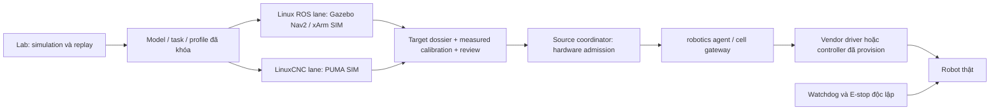

# Spec R3 — Linux native và hồ sơ sẵn sàng tới physical

> Cập nhật 14/11/2026: [bằng chứng R2a mới](01-research.md#cập-nhật-bằng-chứng-r2a--2026-11-14-0900-ict) ghi một MJ-BV01 hoàn tất trên Cloud Run amd64 và kiểm Chrome production tại pin `4f893ac`. Nhận định ngày 13/11 về “chỉ có giả lập” bên dưới là lịch sử. L01 vẫn cần bộ case/inventory đầy đủ; chưa dùng bằng chứng này để đóng DEP-MJ-01 hay gate phần cứng.

**Mã:** MKQ-SIM-R3-02 · **Trạng thái:** đề xuất; chưa có host mới được chạy, chưa có phần cứng được chọn.

**Ưu tiên người dùng:** trải nghiệm web trước, chuẩn bị cả xArm/ROS 2 và PUMA/LinuxCNC. Chuẩn bị hai nhánh không có nghĩa mua hai tay máy hoặc dựng hai stack trước khi R2b ra được.

## 1. Ba mức kết quả độc lập

| Mức | Đầu ra | Được tuyên bố | Không được tuyên bố |
|---|---|---|---|
| R3.0 — Prepared | Handoff bundle, validator, profiles, runbook, case matrix | Sẵn sàng mang tới host đã chọn | Đã chạy Linux/native/hardware |
| R3.1 — Native tested | MuJoCo native CPU; Gazebo/Nav2; arm từng profile thực chạy trên Linux, có traces | Đường SIM của profile đó chạy trong phạm vi case | Robot thật có cùng sai số, tải hoặc độ an toàn |
| R3.2 — Commissioning prepared | Target dossier, contract/conformance tests, calibration plan, operator steps, source deployment boundaries | Những gì cần làm khi có robot đã rõ và kiểm được | Robot đã được commissioning hoặc dispatch live |

Hardware execution là công việc có điều kiện sau R3.2. Không đổi `G-HW`, `G-HW-READY`, `G-HW-ACCEPT`, calibration G3 hay manifest ladder chỉ vì hoàn thành software work.

## 2. Quyết định và phạm vi thay thế

| ID | Quyết định |
|---|---|
| R3-D01 | Giữ Ubuntu 24.04 + ROS 2 Jazzy + Gazebo Harmonic cho ROS lane. Upstream mới hơn tồn tại nhưng đổi distro không phục vụ việc nghiệm thu code hiện tại |
| R3-D02 | Native CPU lane đầu tiên ưu tiên Linux amd64 thực, vì gap R2a và Cloud Run. Linux arm64 là profile riêng, không sao inventory/acceptance sang amd64 |
| R3-D03 | Linux máy vật lý hoặc VM cloud đúng ISA có thể kiểm native SIM. VM/container Linux trên Mac là rehearsal theo quy tắc cũ; không đóng G-NATIVE. Mọi VM đều không chứng minh timing của IPC máy thật |
| R3-D04 | Tách ROS engineering và LinuxCNC. LinuxCNC dùng candidate Debian 12/2.9.x của package hiện có hoặc profile mới được pin và smoke; không bỏ `forbidden linuxcnc-uspace` của engineering lock |
| R3-D05 | Legacy Gazebo/Nav2/PUMA adapters được tái dùng. Native xArm và engineering lifecycle còn thiếu phải có implementation rõ; bỏ giả định “R3 chỉ viết runbook, không cần adapter mới” |
| R3-D06 | G-NATIVE-AMR và G-NATIVE-ARM giữ ID nhóm, nhưng record bắt buộc có profile/model/engine/host. PUMA tested không làm xArm tested, và ngược lại |
| R3-D07 | xArm description đang nhập từ humble không tự dùng làm driver Jazzy. Pin repo/submodules/native config riêng; giữ model identity so với R2a và ghi mọi khác biệt |
| R3-D08 | Không ép waveform MuJoCo giống Gazebo hoặc LinuxCNC. Dùng model/frame/unit/limits parity và task invariants; plant dynamics và firmware là scopes khác |
| R3-D09 | Source/coordinator giữ mission và custody trên cả SIM/physical; Nav2 hoặc arm controller giữ vòng điều khiển cục bộ. Browser không đóng vòng servo và không sở hữu safety |
| R3-D10 | Lab runtime từ chối hardware commands như hiện tại. Physical adapter được triển khai trong source/robotics agent/cell gateway, cấu hình bởi operator, không bật bằng nút backend trong Lab |
| R3-D11 | Thiếu host/SDK/robot/measured data → trạng thái có reason; task chuẩn bị và nhánh còn lại không bị ép dừng. Không điền vendor/register/safety params từ trí nhớ |
| R3-D12 | Chữ ký commissioning/release thật do nơi giữ khóa và người có trách nhiệm cung cấp. Test key chỉ kiểm validator; không ký simulated data thành hardware_validated |

## 3. Bản đồ môi trường

| Profile mục tiêu | Cái đã có | Phần cần thêm/kiểm |
|---|---|---|
| `mujoco-linux-amd64` (mới) | Image R2a build được cho amd64, chỉ đã chạy giả lập thất bại | Run trên CPU amd64 không emulation; engine/wheel/libc/image/CPU identity; M00 grip + full MJ-BV01 + R2b scenarios có sẵn |
| `engineering-amd64` | Lock Ubuntu/Jazzy/Harmonic, packages/digests chưa resolve | Dpkg/overlay/plugin inventory; clean install smoke; lifecycle engineering và scene canonical |
| `engineering-arm64` | Lock khác kiến trúc, cũng chưa qualified | Chỉ chạy nếu có target arm64; ghi evidence riêng |
| `xarm6-jazzy-sim` (mới, trên ROS lane) | Vendor ROS branch tồn tại upstream; repo local chỉ asset data | Fake hardware conformance, Gazebo joint/trajectory, gripper/mimic spike; typed source adapter |
| `puma560-linuxcnc-sim` | Package bridge/arbiter/HMI/profile/smoke/installer | Debian 12 candidate pins thực, controller process, remote socket tunnel, ALG04, packaging/trust và GUI case |

Tài nguyên khởi điểm để provision, **chưa là benchmark**: Linux host 8 vCPU, 16 GiB RAM, 80 GiB disk trống cho ROS lane; chạy từng campaign, không chạy Gazebo+Webots+hai arm stacks đồng thời. Nếu cả image/build cache vượt budget thì chọn volume lớn hơn; không xóa dữ liệu người dùng để “đủ ổ”. CPU headless là baseline; GPU chỉ khi sensor/rendering thực sự cần và được probe.

## 4. R3.0 — Handoff có thể thực hiện trước khi có Linux

`native-handoff-v1` chứa:

- Source/Lab tuple đã bàn giao, tool closures, schema hashes, compiler versions.
- Project, physical model, world, controller/motion/physics profiles, seed, fixture refs và SHA-256.
- Bảng frame/units: map, base, drive, tray, arm base, flange, TCP, sensors; joint signs/offsets, limits, inertia order, clock domains.
- Native launch profile IDs, required/forbidden packages, inventory schema; tất cả version host chưa thu là trạng thái unresolved có reason, không phải giá trị giả.
- Case IDs, oracle policy trước khi đo, expected failure mode, file/log cần giữ, stop conditions.
- Một bảng “có thể tái dùng / phải đo lại”: workflow contracts tái dùng; collision/driver/calibration/latency/hardware không kế thừa.

Handoff validator kiểm path confinement, hash, model/units/frame compatibility, target/source/schema identity, package lock resolution và trạng thái. `prepared` chỉ nói gói cấu trúc hợp lệ; `nativeReady` còn cần host inventory và probe. Không biến `prepared:true` thành backend installed/commissioned.

**Làm rõ khi triển khai L00, 15/11 — [quyết định 78](05-implementation-decisions.md):** provenance cài đặt theo profile đã khóa có hai loại: OCI image hoặc native apt. OCI cần manifest/config đúng một platform; native apt cần distro/ISA/package và nguồn package đã khóa cùng inventory khớp. Phần image digest chỉ áp dụng profile dùng image. Handoff MuJoCo R2a theo image và image R2b hiện tại vẫn bắt buộc OCI; không dùng nhãn native apt để vượt image chưa build. Kiểm dữ liệu được cung cấp không tự xác thực nguồn gốc host hay thay bằng chứng doctor/campaign.

**Làm rõ admission tĩnh, 15/11 — [quyết định 79](05-implementation-decisions.md):** hash hợp lệ chưa đủ cho `prepared`. Validator phải đọc đúng loại tài liệu project/world/model, kiểm schema và quan hệ ID/ref/frame/unit cùng joint/limit/inertia áp dụng. PUMA dùng manifest và các reference DH/frame/pose đã khóa, không thay bằng bảng minh họa hoặc thông số tự đặt. Canonical model xArm/ROS chưa có mapping native đã expand vẫn phải báo prerequisite chưa resolve; doctor và campaign sau đó kiểm hành vi runtime riêng.

## 5. R3.1 — Trình tự trên Linux

### 5.1 Kiểm host và kiến trúc trước

Ghi `/etc/os-release`, kernel, `uname -m`, CPU model, `systemd-detect-virt`, container runtime, image digest theo platform, Python packages/lock, ROS/Gazebo binary hashes, source/Lab pins. `systemd-detect-virt` không chứng minh toàn bộ topology; operator ghi thêm host origin và có dùng emulation không. Quên khai → `HOST_PROVENANCE_INCOMPLETE`.

L01 chạy **đúng image R2a cuối đã bàn giao** trước khi test phiên bản mới. Thử 10/10 grasp trials theo recipe M00, 3 full MJ-BV01 seeds và bad-state/fault case. Nếu hỏng native amd64, giữ artifact/report/solver params; điều tra độc lập. Không cập nhật version hoặc friction để biến kết quả thành cùng baseline. Một fix tạo pin/candidate mới và chạy lại hai kiến trúc đã hỗ trợ.

Ranh giới thực thi L01 được làm rõ ở quyết định82: bad-state chạy với WorkerSession và engine thật của R2a qua harness fault có hash riêng; case này chỉ chứng minh worker dừng khi engine lỗi, không suy ra custody/served của Source. Worker-loss qua runtime R2a không đổi phải kiểm riêng không false serve, không gửi lại hoặc respawn. Recipe M00 lấy nguyên văn từ tài liệu đã khóa, ghi provenance riêng với image. Reader phải yêu cầu đủ các scope/case; unit log không thay native evidence.

Quyết định83 đặt adapter chạy campaign payload/cell của R2b hiện tại vào tooling B10, cùng bước tích hợp image và recorder; L01 chỉ giữ campaign R2a lịch sử. Adapter R2b phải có code thực thi và review trước qualification cuối, dù chưa có host/image để chạy. Quyết định84 cho phép preload observer có hash riêng ghi wire worker để kiểm không gửi lại lệnh; phải ghi rõ instrumentation, giữ nguyên byte của subject và từ chối assertion nếu trace thiếu hoặc tràn.

Chạy được MuJoCo trên Linux vẫn chưa phải Nav2 hay G-NATIVE-ARM. Dùng case riêng `DEP-MJ-01`, không nhập vào gate arm controller.

### 5.2 AMR / Nav2

Đầu tiên smoke stack upstream và legacy compiled world để biết host hoạt động. Sau đó mới dùng **engineering bundle từ cùng canonical model**. Hiện SIL CLI chủ động chặn engineering lifecycle; L02 phải mở bằng factory/compiler/readiness thực, không xóa guard rồi chạy fixture legacy thay thế.

Quyết định85 chốt input của L02 là đúng project/scene/model canonical `serve-3d-v1` đã dùng trong L00, qua mapping Gazebo riêng. Giữ `requestedProfile` Webots của tài liệu nguồn như provenance và ghi profile thực thi engineering riêng; không đổi byte canonical hoặc bỏ qua mọi profile mismatch. Ví dụ `fd01.project.json` cũ không có binding này nên chưa thuộc adapter native mới; các đường đọc/fixture cũ giữ nguyên.

Native `/clock` là authority của simulation native. Source giữ business clock mapping; lưu mapping provider sim-time → coordinator tick + receive monotonic time. Không ép callback ROS vào fixed-step MuJoCo 20 ms và không gọi đó là clock tương đương.

Cần kiểm:

1. Description physical parity: root/drive origin, wheel radius/separation, collider envelope, mass/COM/inertia, sensor extrinsics, tray; model assumptions còn nguyên.
2. TF `map→odom→base` và sensor frames; timestamps `/clock`, `/odom`, `/scan`, `/tf`, `/tf_static`, cmd/feedback phù hợp.
3. FD01 load → travel → handoff → return; confirmation do source; obstacle/no-path/cancel/worker mất không false completion.
4. ROS_DOMAIN_ID/GZ partition riêng cho run; node/topic allowlist và process cleanup; không kết nối LAN robot thật.
5. Sensor liveness/coverage và command correlation có raw bag + normalized trace; screenshots không thay thế.

Không làm SLAM commissioning trong đợt này. Native scene có localization simulated khai rõ; hardware localization cần dữ liệu sau.

### 5.3 Nhánh xArm / ROS 2

Chuẩn bị và kiểm theo bốn tầng, mỗi tầng lưu loại evidence riêng:

| Tầng | Thực hiện | Được chứng minh |
|---|---|---|
| X0 — model | Pin xarm_ros2 Jazzy + submodules, khai tool/gripper, so FK/joint mapping với xArm R2a | Model/units/frame parity |
| X1 — fake hardware | ros2_control fake system + FollowJointTrajectory; cancel/result/freshness/restart | Driver contract và orchestration; không dynamics/contact |
| X2 — Gazebo | gz_ros2_control/Harmonic thực; joint actual, limits, motion, stop; MoveIt planning/collision nếu profile dùng | Native controller + simulated plant của model đó |
| X3 — tool/contact | Spike G2/mimic trên stack Jazzy; grip/release evidence hoặc reason unsupported | Chỉ contact case thực chạy; không nâng fake gripper thành contact |

Nếu G2 không được hỗ trợ: model và trajectory vẫn được test; case grip ghi blocked với lý do. Có thể dùng gripper thay thế **ở profile khác**, ghi model/name/licensing và giới hạn; không gắn nhãn G2 cho gripper đó. Không cần làm lại coffee process simulator để đóng X0/X1/X2; `mock_coffee` tiếp tục khai đúng.

Adapter `moveit_gazebo_arm` hiện đang unbuilt trong catalog: task mới cần typed command/observation mapping và native lifecycle, server-owned config. Không đưa `robot_ip` hoặc launch arguments tùy ý từ Lab vào driver. Khi có xArm thật, `xarm_native` là provider/handoff khác, chưa được kích hoạt bởi native SIM pass.

### 5.4 Nhánh PUMA / LinuxCNC

Dùng package `integrations/arm-controller` và native bridge đã có. Model là PUMA tham chiếu, **không phải cam kết phần cứng cuối cùng**. Smoke terminal start/home/run/pause/resume/stop/fault; trace controller actual/commanded đi qua bridge, ALG04 đối chiếu đúng bảng PUMA từ controller, không bảng xArm hay mock trace.

Candidate dependencies hiện gồm Debian 12 và hai lựa chọn LinuxCNC chưa được resolve thành cùng một bản đã verified. Chọn **một** package/source version ở lúc provision, chụp exact hashes và runtime inventory; không lấy branch head làm lock. Profile uspace SIM không nạp HAL driver phần cứng.

Bridge/HMI tranh quyền qua arbiter có sẵn. Tunnel pin known_hosts, socket quyền tối thiểu, reconnect/controller epoch không tự resume. GUI smoke có checklist người xem; mở được cửa sổ không tự pass UI acceptance. Cấu hình SIM virtual grip nếu có không trở thành bằng chứng contact G2 hay gắp thật.

ROS và LinuxCNC có thể nằm trên hai VM/host Linux, kết nối qua tunnel hiện có; identity clock/host của từng bên được giữ riêng. Không cần trộn hai apt profile.

## 6. R3.2 — Handoff physical có hai nhánh

**Không có mũi tên Lab → robot thật.** Một browser Lab bị compromise hoặc package replay độc hại không có credential/route để bật motor. Dashboard production giám sát hardware là công việc thuộc source, không phải extension endpoint Lab.

### 6.1 Target dossier bắt buộc trước motion

| Nhóm | AMR | xArm | Tự chế/LinuxCNC |
|---|---|---|---|
| Danh tính | chassis/vendor/serial/firmware | model/serial/firmware/controller | machine ID/controller/drive/firmware |
| Giao diện | SDK/protocol/encoder/cmd feedback | official SDK/ROS driver pin, mode/state/errors | bus/pinout/drive mode/HAL mapping theo tài liệu |
| Hình học | wheel/track/tray/COM/footprint đo | base/TCP/tool/gripper/load đo | DH/joint signs/zero/home/tool đo |
| Vòng điều khiển | frequency/watchdog/command expiry | trajectory execution/cancel/hold, local limits | servo periods/latency/homing/limits và driver thực |
| Safety vật lý | independent E-stop, bumper/cliff, stop tests | guard/cell, E-stop, collision/protection vendor | E-stop/drive-enable/limit circuits độc lập |
| Bằng chứng | odom/scan/tf + motion/load trials | actual joints/TCP/grip + task trials | actual joints + drive/IO + task trials |

Chưa có phần cứng thì `targetKind:'undecided'`, cả hai arm paths có danh sách prerequisites. Không chọn serial hay giả lập firmware cho hợp lệ. Validator của S100/ZLTECH hiện có chỉ áp dụng đúng profile đó; không tái dùng schema chassis làm schema tay máy.

Contract chung phải giữ: command ID/idempotency, lease/owner, boot/control epoch, deadlines, observation seq/freshness, unknown không tự resend, local stop và manual recovery. Các profile vật lý có version và no-default-live. `CellAdapter`/robot adapter tests dùng doubles chứng minh contract, không chứng minh máy.

### 6.2 Calibration và commissioning khi có robot

Giữ [calibration protocol hiện có](../../../engineering-lab/calibration-protocol.md): chỉ measured data, unit/frame/clock đúng, tune/validation tách, ≥3 validation trials độc lập mỗi điều kiện, policy chốt trước đo. Payload/chuyển động/ma sát/TCP khác revision làm scope calibration hết hiệu lực tương ứng.

Trình tự có người giám sát: đọc-only identity → quan sát shadow → single subsystem unloaded tại vùng thử → stop/watchdog tests → load/task trials → cell integration → venue acceptance. Vận tốc/tải/stop distance giới hạn lấy từ tài liệu vendor và người commissioning trước motion; bộ này không cung cấp con số mặc định để chạy máy chưa biết.

`tests/hardware/commissioning.py active-motion` hiện chỉ từ chối vì chưa có vendor interface. R3.2 giữ refusal đó cho target chưa đủ dữ liệu, thêm dossier/conformance/reporting. Viết driver motion thật là task riêng sau chọn hardware và scope vận hành; không “hoàn thiện” bằng bypass manifest/signature.

## 7. Cases, gates và trạng thái

| Case | Phạm vi | Gate/record |
|---|---|---|
| DEP-PREP-01 | Handoff schema/path/digest/model negative; Mac chưa thể qualified Linux | R3.0 prepared checks, không native gate |
| DEP-MJ-01 | MuJoCo trên CPU Linux thật, engine/arch identity và full grasp scenarios | Compatibility record `mujoco-linux-<arch>`, không G-NATIVE-ARM |
| DEP-NAV-01 | Host inventory, stack smoke, model parity, TF/clock | G-NATIVE-AMR @ engineering profile |
| DEP-NAV-02 | FD01 domain + Nav2 actual observations, source confirmations | cùng gate |
| DEP-NAV-03 | Obstacle/no-path/cancel/disconnect, cleanup, unknown | cùng gate |
| DEP-NAV-04 | Durable bag/trace/report/replay và repeat seeds | cùng gate |
| DEP-XARM-01 | X0 model + X1 fake hardware contract, typed adapter | Nhánh xArm; riêng case fake, chưa đủ gate |
| DEP-XARM-02 | X2 native Gazebo/MoveIt trajectory, stop/restart/collision evidence | G-NATIVE-ARM @ xarm6-jazzy-sim, scope motion |
| DEP-XARM-03 | X3 gripper/contact + transfer observations | Cùng profile, scope contact riêng; blocked không được ghi contact tested |
| DEP-CNC-01 | Inventory, terminal smoke và model/units parity | G-NATIVE-ARM @ puma560-linuxcnc-sim |
| DEP-CNC-02 | Arbiter/tunnel/deadline/controller restart/fault/no auto-resume | cùng profile |
| DEP-CNC-03 | Packaging/install/rollback/trust và GUI checklist | cùng profile; GUI manual evidence riêng |
| ALG04 | RTB kiểm actual/commanded trace từ LinuxCNC bridge thật | nhánh PUMA, không dùng xArm trace để đóng case cũ |
| DEP-SEC-01 | Isolation, allowlist, one writer, endpoint/MDI/HAL refusal, không route Lab→hardware | mọi native profile đã chạy |
| PHYS-PREP-01 | Dossier hai nhánh, unknown fields refusal, calibration/signature validator | R3.2 prepared; không đóng G-HW |

`G-NATIVE-ARM` là **record có scope**, không boolean chung toàn sản phẩm. Một candidate xArm khai `motion` chỉ đòi DEP-XARM-01/02/SEC; contact vẫn là capability `not_run/blocked`. Muốn tuyên bố cả contact phải đòi DEP-XARM-03. Candidate PUMA đòi DEP-CNC-01/02/03 + ALG04 + SEC; GUI thiếu thì chỉ terminal subset tested, full candidate chưa đủ. Báo cáo phải viết rõ subset đã kiểm, không tô xanh một cột “arm” che phần còn thiếu.

Thiếu Linux: cases native `not_run`, gates `blocked_external`. Đã chạy và assertion sai: `failed`, không đổi thành blocked. Doctor pass chỉ prerequisite, không test scenario. Accepted vẫn do reviewer sidecar gắn candidate/hash/profile, không script tự đặt.

## 8. Definition of done và handoff

R3.0 xong khi người khác nhận gói có thể xác định chính xác thiếu gì và chạy từng bước mà không tìm lại chat. R3.1 xong theo **profile đã chọn chạy** với inventory, raw traces, cases và limitations đầy đủ; chưa chọn nhánh phần cứng không bắt buộc cả hai profile native phải tested. R3.2 xong phần chuẩn bị khi dossier/validator/runbook hai nhánh kiểm được và không cho unknown target thành live.

Tệp qualification ở `source/docs/implementation/evidence/sim-extension/r3-<profile>-candidate-NN/` khi thực thi; file hiện tại chỉ là đề xuất. Không chép inventory arm64 thành amd64, không sửa evidence Mac để làm Linux pass, không cập nhật ledger compatibility lịch sử tự động.

### Bổ sung implementation 15/11/2026 — artifact mapping xArm

Theo quyết định86, handoff có thể thêm role optional `refs.nativeMapping` gồm đúng URDF native đã capture và record mapping/readback. Hai artifact được kiểm path/hash/identity/giới hạn và nội dung model/joint/tool/plugin riêng; không thay canonical model hoặc closure của runtime/tool. Thiếu mapping giữ prerequisite, artifact sai bị từ chối. Model match không tự chứng minh host, controller, motion hoặc contact. Hồ sơ cũ không đổi byte; chi tiết và rủi ro ở [decision ledger](05-implementation-decisions.md).

Theo quyết định87, model1305 được chọn qua selector mô phỏng cố định, có nhãn synthetic riêng; không dùng như serial robot thật. Việc decode selector và so URDF là kiểm model, chưa phải lượt chạy native.

Theo quyết định88, gate review code chuẩn bị L03 tách với qualification native còn incomplete/not_run. X1/X2/X3 vẫn yêu cầu bằng chứng thật trên host phù hợp; downstream portable có thể tiếp tục sau khi code được review. Không dùng reopen-refusal, direct trajectory hay G2 chưa quan sát để thay các gate restart/planning/contact.

Theo quyết định89, native tool closure của tuple mới bao gồm script và packaging LinuxCNC, để ràng buộc bộ thu trace, launcher, inventory và lock/trust bất biến. Trace sinh ra và inventory quan sát là evidence riêng; việc đưa file vào closure không thay kiểm installed provenance hoặc native execution. Artifact lịch sử giữ nguyên digest và checker đã ghi.

### Bổ sung thực thi R2b ngày 15/11/2026 — deadline theo registry

Adapter native R2b hiện tại chạy từng ca được đăng ký, với budget cell 6.000 giây và timeout process tối đa 6.100.000 ms gồm 100 giây điều phối. Đây là chính sách riêng; giới hạn helper R2a lịch sử không đổi. Coverage đầy đủ vẫn cần 3 seed nominal và 5 fault. Timeout/abort giữ raw output và trạng thái incomplete, cleanup chỉ tài nguyên thuộc run, không tiếp tục ca uncertain. Chi tiết và đánh đổi ở [quyết định90](05-implementation-decisions.md). Chưa có host/image thì chỉ kiểm tooling, không có kết quả native.

Package campaign sinh từ build được ràng buộc bằng SHA256 trong OCI image config đã kiểm digest, rồi đối chiếu inspect và hash file thực trong container; không thêm manifest sinh ra vào engine/tool closure nguồn. Giữ L00 admission và mọi prerequisite host/image. Xem [quyết định91](05-implementation-decisions.md); đây là cách ràng buộc byte, không là bằng chứng host hoặc campaign đã chạy.
