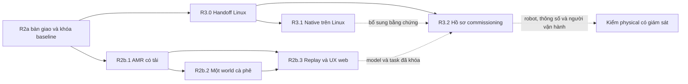

# MEKONIQ — Lab trên web và lộ trình tới máy thật sau R2a

**Cập nhật ghi bằng chứng cuối16/11:** [trạng thái actual](../final-recording-status.md), [tái hiện](../reproduce-final-recording.md) và [disposition cụ thể](../final-deferred-dispositions.md) là nguồn hiện trạng. Phần dưới giữ snapshot chuẩn bị trước các lượt ghi cuối; không dùng trạng thái cũ để retag producer, nhận native/physical hoặc công bố live realtime.

**Ngày thiết kế:** 2026-11-13 · **Trạng thái cập nhật 15/11:** đang implement trên hai worktree riêng theo yêu cầu người dùng, chưa nghiệm thu. Xem [tiến độ implementation](00-implementation-status.md) để phân biệt phần đã làm với kế hoạch còn lại.

**Định hướng người dùng đã chốt:** chưa chọn phần cứng; chuẩn bị cả nhánh xArm/ROS 2 và tay máy tự chế/PUMA/LinuxCNC; ưu tiên trải nghiệm web.

Đề xuất là hoàn thiện một hành trình có thể **xem, chạy, thay đầu vào, hiểu lỗi và xem lại ngay trên web**. MuJoCo đảm nhiệm tiếp xúc và tải; source giữ nghiệp vụ; Lab giữ hiển thị. Linux được chuẩn bị thành đích triển khai và kiểm chứng riêng. Có Linux không đồng nghĩa có robot hoặc đủ bằng chứng vận hành robot.

## 1. Đọc theo thứ tự

| Tài liệu | Nội dung |
|---|---|
| [00 — Tiến độ implementation](00-implementation-status.md) | Worktree, commit đã review, kiểm thử và phần còn lại |
| [01 — Nghiên cứu và baseline](01-research.md) | Code/evidence thực tế, nguồn upstream kiểm ngày 13/11, các thay đổi so với kế hoạch cũ |
| [02 — Spec R2b](02-r2b-web-lab-spec.md) | AMR có tải, cảnh cà phê liên tục, trải nghiệm web, quyết định giữ/bỏ |
| [03 — Contracts và evidence](03-contracts-and-evidence.md) | Clock, scene, tải, tiếp xúc, chuyển cốc, replay, comparison và gate |
| [04 — Spec R3](04-r3-linux-physical-readiness-spec.md) | Linux, Nav2, hai nhánh tay máy, hồ sơ bàn giao tới physical |
| [05 — Quyết định triển khai](05-implementation-decisions.md) | Các lựa chọn, lý do và đánh đổi đã ghi trong lúc thực thi |
| [Plan — Tổng quan](plans/README.md) | Thứ tự, dependency, điểm dừng và phạm vi từng gói |
| [Plan 01 — R2b nền và tải](plans/01-r2b-mobility.md) | Baseline sau R2a, fixture, plant, evidence và vertical slice |
| [Plan 02 — R2b cảnh và web](plans/02-r2b-cell-and-web.md) | Một world tay máy–AMR, replay, so sánh, đóng gói web, qualification |
| [Plan 03 — R3](plans/03-r3-linux-readiness.md) | Handoff, kiểm kiến trúc CPU, Nav2, xArm, LinuxCNC, commissioning dossier |

Đường dẫn code trong nội dung bắt đầu bằng `source/` hoặc `lab/` đều tính từ workspace `robot/`. File được ghi **mới/dự kiến** là đầu ra cần làm trong tương lai, không phải API đang có. Lệnh trong các plan là lệnh **khi thực thi plan**, không phải kiểm thử đã chạy trong lần nghiên cứu này.

## 2. Quan hệ với tài liệu đang triển khai

- **R2a** là tên chuẩn trong [spec đang làm](../../../superpowers/specs/2026-11-12-realistic-arm-web-ui-design.md); cách gọi R2.1/R2.a trong trao đổi này cùng chỉ phần đó.
- Bộ này không sửa spec/plan R2a, không đóng task R2a và không nhận quyền thay đổi các quyết định của nó trong lúc đang thực thi.
- Sau khi review, bộ này thay thế **phần R2 còn lại và R3** trong [spec 10/11 §7–8](../../../superpowers/specs/2026-11-10-simulation-extension-design.md) và [khung M00–M04/L00–L03](../../../superpowers/plans/2026-11-10-simulation-extension/02-release-2-3.md). Các yêu cầu R1/R1.1 và acceptance lịch sử vẫn có phạm vi cũ.
- Tên `R2b` giữ cách tách của R2a. Không chạy lại M00 của R2a, không tạo thêm worker MuJoCo độc lập chỉ để đổi tên release.
- Requirements/decisions mới dùng `R2B-`/`R3-`; cases dùng `MJ`, `CELL`, `WEB`, `DEP-`, `PHYS-`. Không lấy tiếp `D72`/`SX-61`, tránh đụng ID mà R2a có thể bổ sung.

Tài liệu nằm trong **workspace `robot/docs/`**, ngoài bốn repository. Đây là chủ ý: recorder/build R2a từ chối cây source/Lab có file sửa hoặc chưa theo dõi. Đợt soạn ngày 13/11 không đổi HEAD, runtime pin, schema, code, candidate hay acceptance sidecar của hai repo. Implementation ngày 14/11 dùng worktree riêng; bước bàn giao sẽ đưa bản cập nhật vào `source/docs/` của feature branch và cập nhật liên kết tương đối.

## 3. Những gì đã có và những gì chưa có

Snapshot đọc code:

| Thành phần | Định danh |
|---|---|
| source/main | `5e3029e03f822e64ebf2fdaea2362ce8ce4ec857` |
| lab/main | `09f3d097e6381468e4dd75375fc050cce03695ba` |
| Lab đang pin source | `85437650591e5e059e427f175497dce135ab5f39` |
| MuJoCo trong lock hiện tại | `mujoco==3.17.0`, Python 3.11 |
| Cây source/Lab lúc kiểm | sạch |

R1/R1.1 có qualification trên source `9b8f92f…`, Lab `26a679d…`, và acceptance sidecar của Henry ngày 11/11. Đó là bằng chứng đã nghiệm thu **của các commit đó**, không tự chuyển sang HEAD R2a. Chưa có thư mục qualification `r2a-*` trong cây tại snapshot; không suy phần trăm hoàn tất từ checkbox cũ. Chi tiết ở [nghiên cứu §1](01-research.md#1-baseline-từ-repository).

## 4. Các đợt có thể bàn giao riêng

| Đợt | Người dùng thấy gì | Điều kiện |
|---|---|---|
| **R2b.1 — AMR có tải** | Robot mang cốc/khối tải qua cua, dừng; thấy trượt, nghiêng, khoảng cách dừng và lý do kết thúc | R2a bàn giao; không cần Linux/robot |
| **R2b.2 — Từ trạm tới bàn** | Cùng một cốc được xArm đặt lên khay AMR rồi AMR mang đi trong một world MuJoCo | R2b.1; spike handoff chung world đạt |
| **R2b.3 — Trình diễn và điều tra trên web** | Preset có câu chuyện, timeline lỗi, A/B có phạm vi rõ, replay không cần runtime, gói chạy một runtime qua HTTPS | Làm replay sớm sau R2b.1; live hosting cần host/đích deploy được chỉ định |
| **R3.0 — Gói sẵn sàng cho Linux** | Một bộ đầu vào, kiểm tra host, lệnh và danh sách bằng chứng cần thu; trạng thái chưa chạy hiển thị đúng | Làm sau baseline R2a, không phải chờ hết R2b |
| **R3.1 — Native trên Linux** | Cùng giao diện web xem MuJoCo trên CPU thật và Nav2/Gazebo; kiểm hai nhánh arm riêng | Linux đúng profile; mỗi nhánh có gate riêng |
| **R3.2 — Sẵn sàng commissioning** | Hồ sơ robot/config/calibration, đường điều khiển source và điều kiện chuyển shadow → HIL → live rõ ràng | Chưa có robot vẫn làm được validator/handoff; kiểm physical vẫn chờ phần cứng |

## 5. Quyết định trọng tâm

1. **Web trước:** giữ three.js, mesh, SSE và pacing của R2a; đầu tư vào một hành trình liên tục, giải thích lỗi và replay. Không thêm engine chỉ để có thêm tên backend.
2. **Tiếp xúc chung world:** không chạy hai worker arm/AMR rồi gắn cốc bằng animation giữa chúng. R2b.2 có một đồng hồ, một engine và một vật thể cốc xuyên suốt handoff.
3. **Giảm phạm vi không cần thiết:** không bắt buộc đưa PID TS vào actuator mô-men; không coi so sánh ba engine là bảng xếp hạng; không lấy LinuxCNC làm điều kiện chặn trải nghiệm xArm trên web.
4. **Chuẩn bị hai nhánh phần cứng:** xArm dùng đường hãng/ROS 2; LinuxCNC dùng profile PUMA tham chiếu rồi profile máy thực khi có. Không đổi xArm thành PUMA trong report.
5. **Lab luôn là môi trường mô phỏng:** runtime Lab không được thêm đường phát lệnh robot thật. Physical đi qua source/coordinator, robotics agent hoặc cell gateway, với admission và commissioning riêng.

## 6. Hoàn tất nghĩa là gì

R2b hoàn tất phần local khi các gate bắt buộc của ba increment có artifact xem lại được, Lab pin đúng source và regression đúng commit; hosting công khai được ghi riêng, thiếu đích deploy không được ghi pass. R3 hoàn tất **hạng mục chuẩn bị** khi handoff kiểm được; native chỉ hoàn tất trên host đã thực chạy; physical chỉ hoàn tất khi có bằng chứng robot và người có trách nhiệm ký.

Ước lượng lập kế hoạch cho một kỹ sư quen codebase: R2b.1 **7–11**, R2b.2 **8–14**, R2b.3 **5–8** engineer-days; R3.0 **3–5**, Linux/MuJoCo/Nav2 **5–9**, nhánh xArm **5–9**, nhánh LinuxCNC **3–6**, hồ sơ commissioning **3–5**. Chưa gồm chờ host/robot, sửa lỗi vendor hoặc commissioning thực tế. Chốt lại sau các spike; không cộng số này thành ngày hứa bàn giao.
