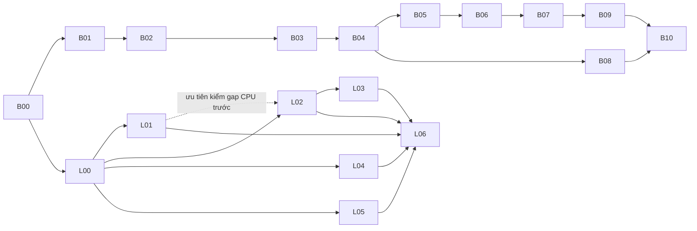

# Web Lab to Physical — Implementation Plan

**Hiện trạng sau N1, 16/11:** [kết quả mới](../../post-n1-final-recording/status.md), [tái hiện](../../post-n1-final-recording/reproduce.md) và [disposition](../../post-n1-final-recording/dispositions.md) dùng Source `0d46403` / Lab `7c97b20`. Review giữ verdict lịch sử ở tuple/scope đã nêu; capture mới và bốn assertions mock chưa giải quyết, native/physical chưa nghiệm thu. Các snapshot/kế hoạch cũ bên dưới giữ ngày và identity riêng.

> **For agentic workers:** REQUIRED SUB-SKILL: Use superpowers:subagent-driven-development (recommended) or superpowers:executing-plans to implement this plan task-by-task. Steps use checkbox (`- [ ]`) syntax for tracking. Đây là plan đề xuất; chưa cho phép bắt đầu sửa R2a đang thực thi.

**Goal:** Hoàn thiện Lab web có tải và handoff cà phê trong một world, rồi chuẩn bị/kiểm Linux và hai đường tới phần cứng mà không thay đổi authority của source.

**Architecture:** R2b.1 mở provider AMR sau PlantPort hiện có; R2b.2 có một world port dùng chung cho arm/AMR và một scheduler. Durable physics artifacts phục vụ report/replay; R3 dùng native profile riêng và handoff có kiểm hash/model/host.

**Tech Stack:** Node 24.22.2, pnpm 10.32.1, TypeScript/Ajv/Vitest/Playwright/three.js hiện có; Python 3.11 cho workers portable, MuJoCo pin R2a cuối; ROS lane Ubuntu 24.04/Jazzy/Harmonic; LinuxCNC lane theo package lock được xác minh riêng.

**Spec:** [R2b](../02-r2b-web-lab-spec.md), [contracts/evidence](../03-contracts-and-evidence.md), [R3](../04-r3-linux-physical-readiness-spec.md), [research baseline](../01-research.md).

## Global Constraints

- Chỉ bắt đầu implementation phụ thuộc R2a sau B00; không sửa spec/plan/code R2a trong lần soạn tài liệu này.
- Node 24.22.2; pnpm 10.32.1; portable workers Python 3.11; `PYTHONDONTWRITEBYTECODE=1` khi chạy pytest. Python ROS dùng bản của profile distro, không ép rclpy vào venv portable.
- Nền vật lý là engine pin của R2a đã bàn giao; snapshot nghiên cứu là `mujoco==3.17.0`. Không tự nâng lock ở B02.
- Một logical tick 20 ms; 10 substeps × 2 ms là baseline MuJoCo; tốc độ UI chỉ thay pacing.
- Source là authority mission/journal/custody, Lab chỉ simulation/replay. Không thêm Lab→hardware route.
- Một active world MuJoCo/runtime; một ACK đang bay; lost ACK → unknown, không resend hoặc respawn tiếp tục cùng run.
- New fields optional/versioned; mock BV01 golden, IR-SIM chunks, Webots bytes, archive readers và R2a behaviors giữ theo baseline.
- Geometry/units SI và frame đúng contract; dynamics `not_calibrated`; vendor files có commit/sha256/license/NOTICE.
- UI dùng `tr(vi,ja,en)`, giữ a11y/reduced-motion/2D/no-runtime path; không thêm framework/browser engine.
- Không sửa `trial/`, `web/`, cổng 1880/1884, runtime data hoặc evidence lịch sử để vượt gate.
- Mỗi mutation ở đúng repo; source runtime/schema/tool commit → export sạch → Lab re-pin commit. Không Git ở workspace root.
- Candidate tự động luôn `accepted:false`; human sidecar gắn hash/profile; skip là not_run.
- Task chuẩn bị không deploy, provision host trả phí, ký commissioning thật hoặc chạy robot. Các hành động đó cần đích/phạm vi người dùng giao khi thực thi.

## 1. Dependency và đường ra sớm

| Gói | Tasks | Đầu ra | Được làm khi chưa có Linux? |
|---|---|---|---|
| [01 — Mobility](01-r2b-mobility.md) | B00–B04 | AMR có tải chạy trên Lab, physics report/replay local | Có |
| [02 — Cell và web](02-r2b-cell-and-web.md) | B05–B10 | Cell liên tục, replay package, compare/study, image, candidate | Có; WEB06 hosting giữ external |
| [03 — Linux/readiness](03-r3-linux-readiness.md) | L00–L06 | Handoff, native profiles, hai arm lanes, dossier | L00, L05 phần chuẩn bị; host tests chờ Linux |



Các cạnh L03/L04→L06 biểu thị thu record của nhánh nào đã chạy; nhánh thiếu host không làm nhánh khác mất kết quả. B07 có phần replay/camera làm được từ B04, preset full cell chờ B06. L01 native CPU smoke R2a không chờ R2b hoàn tất; case R2b được thêm khi đã có increment tương ứng.

Đường một người: B00 → B01–B04 → B07 phần replay → B05–B06 → B07 hoàn thiện → B08–B10. Chuẩn bị L00/L05 trong lúc chờ host. Không cần xây native xArm/LinuxCNC trước khi đưa web Lab local ra review.

## 2. Quy ước thực thi

Paths trong task tính từ workspace; lệnh `pnpm/node` mặc định chạy tại `source/`, lệnh ghi rõ `lab/` chạy tại đó. File **Create** chưa tồn tại tại baseline. Interface mới được định nghĩa trong spec hoặc ngay task sản xuất nó; không coi snippet trong plan là code hiện hành.

Mỗi task có chu kỳ: viết test hành vi thất bại → chạy xác nhận fail vì tính năng thiếu → implement → focused tests → review diff/commit. Test engine cần engine thật; double chỉ kiểm protocol/lifecycle và được gắn `protocol_double`. Không chạy toàn bộ CI sau mỗi sửa nhỏ nếu focused checks đã đủ; mỗi release vẫn phải chạy checks bắt buộc.

Sau task đổi source runtime/schema/tool và commit sạch:

```sh
# Chạy từ workspace; artifact ngoài hai repo, tuyệt đối không overwrite artifact cũ.
export PATH="$HOME/.nvm/versions/node/v24.22.2/bin:$PATH"
artifact_dir=$(mktemp -d /tmp/mekoniq-post-r2a-export.XXXXXX)
(cd source && node scripts/export-lab-runtime.mjs "$artifact_dir")
(cd lab && node scripts/import-runtime.mjs "$artifact_dir")
(cd lab && node scripts/sync-engineering-contracts.mjs)
(cd lab && pnpm check:source)
```

Xem diff Lab và commit pin trong `lab/` với subject `chore: pin source runtime <sha thực>`. Không stage file ngoài task hoặc work của người đang làm. Các subshell trên chạy từng script tại đúng repo, dùng cùng `artifact_dir` tuyệt đối. Không sửa guard clean/pin để tiện phát triển.

## 3. Review và qualification

| Mốc | Bắt buộc kiểm |
|---|---|
| Sau B00 | Baseline R2a thực, open limitations, source/Lab pin đúng; không dựa HEAD nghiên cứu |
| Sau B02 | Model readback/physics thật; finite actuator; không pose reset; mobile same-build repeat |
| Sau B05 | Một world/one step; lỗi ACK và duplicate step; không map arm-only vào cell |
| Sau B06 | Prop continuity, receiver observations, phase-scoped contacts; false serve negatives |
| Sau B07 | Replay transport-deny, no-runtime, provenance, a11y/perf |
| Sau B10 | Full cases/artifact closure và regression cùng tuple; thiếu host được ghi riêng |
| Sau L01–L04 | Host/profile/scope đúng, native traces thực; no mock fallback |
| Sau L05 | Unknown target không thể thành live; measured/signature/admission boundaries nguyên vẹn |

## 4. Khi nào dừng một nhánh

- Model/dock không trong tầm hoặc thiếu license: dừng fixture liên quan, không kéo geometry/giảm yêu cầu âm thầm.
- Mobile physics không ổn định trong bounded-servo setup: lưu probe và nguyên nhân; không gắn chassis xuống sàn hoặc thay bằng kinematic animation.
- Handoff chung world chưa đạt: R2b.1 và replay vẫn bàn giao được; R2b.2 ghi blocked, không gọi demo arm+mock là full-cell.
- Native amd64 hỏng: chặn lời hứa/hosting MuJoCo amd64, giữ local arm64 và điều tra pin riêng.
- G2 unsupported trên native: motion lane vẫn có record; contact lane blocked với đúng model, không dùng fake hardware để đóng contact.
- Host/robot chưa có: hoàn thành gói prepared; ghi native/hardware not_run, không dừng các task web độc lập.

## 5. Traceability cuối

R2B-01→B00; R2B-02→B01/B02; R2B-03→B02; R2B-04→B03/B04; R2B-05→B05/B06; R2B-06→B06; R2B-07→B04/B07; R2B-08→B07; R2B-09→B08; R2B-10→B07; R2B-11→B09; R2B-12→B10.

R3-D01–04→L00/L01/L02/L04; R3-D05–08→L02/L03/L04; R3-D09–12→L05/L06. Cases và gate chính xác ở spec, không đặt duplicate gate chỉ để bảng đủ màu xanh.
