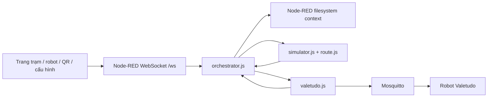

# Nghiên cứu trial và nền tảng MEKONIQ

Ngày khảo sát: 2026-10-30. Đây là bằng chứng đầu vào cho thiết kế, không phải báo cáo hệ thống production đã hoàn thành.

## 1. Phạm vi và cách đọc mã

- `source` trống khi bắt đầu; thư mục cha `robot` không có Git repository.
- `trial` có Git repository riêng. Một phiên khác đang nâng cấp feature policy; không đọc spec đó và không thay đổi working tree của `trial`.
- Sau khảo sát cấu trúc, cố định mốc phân tích ở commit **`5eda9b7c89d8c386891b79d56f5a9196afa23143`**, trước commit spec/policy `91a5857` và các thay đổi tiếp sau.
- Xuất commit bằng `git archive` ra thư mục tạm để đọc và chạy kiểm thử. Không chạy `deploy.sh`, `install.sh`, smoke có dịch vụ, hoặc lệnh điều khiển robot.
- Các số dòng dưới đây thuộc commit cố định. File đang được phiên khác sửa có thể đã đổi số dòng.

## 2. Kiến trúc hiện tại

| Thành phần | Hành vi đã đọc trong mã |
|---|---|
| `data/flows.json` | Wiring WebSocket, tick 0,5 giây, hai adapter, MQTT, API map và health |
| `data/lib/orchestrator.js` | 598 dòng tại baseline; hàng đợi, ưu tiên, phân công, trạng thái các điểm dừng, cảnh báo, KPI, gọi món/khách |
| `data/lib/valetudo.js` | 382 dòng; tọa độ riêng từng robot, map nén, MQTT, STOP trước đổi đích, retry, phát hiện kẹt và khôi phục kết nối |
| `data/lib/simulator.js` | 237 dòng; chuyển động trên đồ thị, vật cản, lối hẹp, nhường robot, lỗi giả lập |
| `data/lib/route.js` | Dijkstra trên đồ thị nhà hàng, đường một chiều/chậm/đóng, điểm không tiếp cận được |
| `data/lib/site.js` | Validate/normalize cấu hình, thực đơn, điểm, robot và bốn cờ `call`, `guide`, `order`, `pay` |
| `data/public` | HTML/JS cho trạm, robot, QR khách, bản đồ và setup; âm thanh, tiếng Việt/Anh |
| `data/settings.js` | Node-RED trên LAN, editor login tùy biến môi trường, filesystem context flush mỗi giây |
| `termux/install.sh` | Cài Node-RED/Mosquitto trên Android, boot script, watchdog process, mật khẩu MQTT |

## 3. Hành vi nên giữ làm tiêu chí hồi quy

1. Nhân viên giao nhiều bàn trong một nhiệm vụ, gắn từng khay với điểm giao.
2. Robot tới bếp, chờ xác nhận xếp đồ, tới bàn, chờ nhận đồ rồi về vị trí chờ.
3. Hủy sau khi đã xếp đồ phải trả khay về trạm xuất phát; không đánh dấu đồ đã giao.
4. Thu dọn phải đưa chén đĩa về khu rửa; không bỏ dở khi đang mang đồ.
5. Xử lý xác nhận lặp, xác nhận cũ, đổi bàn và callback đích cũ.
6. Ưu tiên việc gấp; xong việc nhận việc kế tiếp không cần ghé dock.
7. Nhắc nhận món, timeout, chuyển giao cho nhân viên, tạm dừng/chạy tiếp.
8. Robot pin thấp không nhận thêm việc; phát hiện offline, broker lỗi và trạng thái phục hồi.
9. Điểm đích gắn với bản đồ riêng từng robot; đổi robot/topic không dùng nhầm map cũ.
10. Cấu hình có revision; không ghi đè thay đổi của thiết bị khác hoặc xóa điểm đang dùng.

Đây là hành vi sản phẩm cần kiểm tra lại; không có nghĩa phải giữ nguyên cấu trúc hoặc toàn bộ chính sách cũ.

## 4. Khoảng trống cần xử lý khi xây production

| Phát hiện từ baseline | Bằng chứng mã | Quyết định cho kiến trúc mới |
|---|---|---|
| WebSocket nhận các lệnh nghiệp vụ trực tiếp; `by`, vai trò và `atRobot` đến từ client | `orchestrator.js:446`, `:487`; `flows.json:11` | Xác thực nhân viên/thiết bị, scope tenant/nhà hàng, quyền theo hành động; không tin client tự nhận vai trò |
| Lõi điều phối có nhánh riêng cho Valetudo | `orchestrator.js:93` | Tách target resolution, reachability, capability và ETA qua adapter |
| Driver lạ bị xử lý như simulator | `site.js:86` | Driver không đăng ký phải bị từ chối; simulator chỉ dùng khi cấu hình rõ |
| Snapshot gửi state chung | `orchestrator.js:552` | Projection theo vai trò; QR chỉ thấy phiên bàn của mình |
| Lưu trạng thái nguyên khối bằng context và flush theo chu kỳ | `settings.js:21` | Giao dịch PostgreSQL, idempotency, optimistic locking, outbox và migration có version |
| MQTT output QoS 0, command không retained; logic phục hồi dựa vào status/map | `flows.json:201`, `valetudo.js:298` | Giữ command không retained; thêm command journal, ACK nghiệp vụ và reconciliation. QoS không chứng minh robot đã thực hiện |
| Adapter có thể nhận “đã tới” theo chuyển trạng thái khi không có vị trí | `valetudo.js:171` | Production cần bằng chứng hoàn thành đủ tin cậy theo profile adapter; thiếu bằng chứng chuyển `needs_attention` |
| Adapter chấp nhận đích gần sau retry theo `acceptCm` | `valetudo.js:161` | Dung sai theo điểm phục vụ, cấu hình đã kiểm chứng; không tự nới dung sai khi mang đồ nóng |
| Chống xung đột lối hẹp nằm trong simulator | `simulator.js:81–128` | Không suy ra robot thật cũng được bảo vệ; có admission control cho vùng dùng chung |
| Nút “estop” trên web gửi STOP | `orchestrator.js:473` | Gọi đúng là yêu cầu dừng từ xa; E-stop vật lý thuộc mạch an toàn độc lập |
| Baseline gắn xác nhận cảnh báo thanh toán với đóng đơn | `orchestrator.js:526` | Tách yêu cầu của khách, receipt, thanh toán, settlement và đóng bàn thành các nghiệp vụ riêng |
| Lịch sử và log bị giới hạn bằng số phần tử | `orchestrator.js` | Audit bền vững, chính sách lưu trữ; báo cáo không dựa vào mảng RAM |
| Đơn giản hóa thành một site, số khay chung, luôn có dock | `site.js`, `orchestrator.js` | Tenant/venue riêng; tải/số khay theo robot; điểm đỗ độc lập dock sạc |

Những nhận xét này dành cho baseline đã cố định. Không đánh giá hay cản trở bản feature policy mà phiên khác đang phát triển.

## 5. Kiểm chứng baseline

Môi trường thực chạy: macOS, Node.js `v26.3.0`. Tất cả script dưới đây chạy trên bản xuất Git, không mở kết nối tới robot thật.

| Lệnh trong bản xuất | Kịch bản in dấu ✓ | Exit code |
|---|---:|---:|
| `node scripts/test.js` | 40 | 0 |
| `node scripts/test-valetudo.js` | 28 | 0 |
| `node scripts/test-site.js` | 15 | 0 |
| `node scripts/test-health.js` | 12 | 0 |
| `node scripts/test-review.js` | 6 | 0 |
| Tổng | **101** | **Tất cả 0** |

Chưa chạy browser E2E, MQTT smoke, Gazebo, kiểm thử tải hoặc phần cứng. Kết quả này xác nhận các test hiện có đạt ở baseline; không xác nhận an toàn robot hay chất lượng production.

[Kết quả máy đọc được, gồm stdout và exit code từng script](2026-10-30-baseline-test-evidence.json).

## 6. Nghiên cứu nguồn công khai

Các đoạn dưới là tóm tắt nguồn và quyết định kỹ thuật riêng của MEKONIQ. Không sao chép mã/CAD/PCB OOMWOO trong đợt này. Các trang giải pháp Mmenu có phần nội dung tải động; không có tài khoản sản phẩm hay bộ tài liệu API để kiểm tra hết hành vi.

### Nhà hàng và POS

- Mmenu công bố các nhóm order, bếp/bar, khách hàng, báo cáo, kho theo công thức, khuyến mãi; trang chủ còn mô tả phân quyền, bán hàng online, tích/đổi điểm và đa ngôn ngữ. Đây là căn cứ xác định các nhóm chức năng đối chiếu, không đủ để tuyên bố tương đương từng chi tiết. [Trang chủ Mmenu](https://mmenu.io/vn/vi).
- Nội dung của Mmenu về chuỗi mô tả quản lý tập trung, phân quyền từng nhà hàng, kho/nguyên liệu và báo cáo theo chi nhánh. [Mmenu về chuỗi](https://mmenu.vn/vn/vi/blog-news/tai-sao-chuoi-nha-hang-can-su-dung-phan-mem-ban-hang-chuyen-sau?id=4746).
- Mmenu mô tả QR đặt món trên Zalo. Đây là một kênh tích hợp cần quyền truy cập nền tảng, không chỉ một màn hình web. [QR và Zalo Mini App](https://wordpress.mmenu.io/vn/quet-ma-qr-va-dat-mon-mmenu/).
- Các chi tiết như tách bill, đặt cọc, FIFO/giá vốn, chấm công, buffet và quy tắc hoàn tiền trong bảng chức năng là yêu cầu MEKONIQ đề xuất để hoàn thiện sản phẩm; không gán cho Mmenu khi chưa kiểm chứng.

### Robot và giao thức

| Nguồn | Điều xác minh | Ảnh hưởng tới MEKONIQ |
|---|---|---|
| [Valetudo MQTT](https://valetudo.cloud/pages/integrations/mqtt/) | Có GoToLocation, BasicControl; năng lực khác nhau theo model/config; các command được mô tả không retained | Adapter riêng, kiểm tra capability thực tế, không hứa điều khiển tốc độ hay E-stop vật lý |
| [Nav2 Commander](https://docs.nav2.org/rolling/configuration_and_development/simple_commander_api/simple_commander_api/) | API gửi đích, theo dõi kết quả, cancel; hỗ trợ namespace | Gateway chuyển nhiệm vụ sang action trên robot; khi hiện thực phải dùng API/schema của distro đã pin, không lấy Rolling làm hợp đồng runtime |
| [VDA 5050 chính thức](https://www.vda.de/en/news/publications/publication/vda-5050) | Bản được công bố ở thời điểm khảo sát là 3.0.0, giao tiếp lệnh/trạng thái giữa fleet control và robot | Adapter chọn chính xác version theo thiết bị; không tự coi payload MQTT bất kỳ là VDA 5050 |
| [MassRobotics AMR](https://github.com/MassRobotics-AMR/AMR_Interop_Standard/blob/main/README.md) | Chia sẻ thông tin vị trí, vận tốc, hướng, sức khỏe và tình trạng công việc giữa robot | Dùng cho quan sát liên vận; không dùng như bằng chứng có quyền điều khiển robot |
| [Open-RMF](https://github.com/open-rmf/rmf_demos/blob/main/README.md) | Điều phối đội robot khác nhau và tài nguyên dùng chung như lối đi/cửa/thang máy | Giữ điểm tích hợp khi cần traffic management phức tạp; không thêm làm dependency bắt buộc ngay |
| [OOMWOO README](https://github.com/makerspet/oomwoo/blob/main/README.md) | Có mô phỏng, phần lắp ráp hoàn chỉnh vẫn chưa sẵn sàng | Tham khảo phương pháp; không fork toàn bộ làm sản phẩm nhà hàng |
| [OOMWOO architecture](https://github.com/makerspet/oomwoo/blob/main/docs/ARCHITECTURE.md) | Thiết kế CPU/MCU riêng; tài liệu ở trạng thái draft | Phân tách điều phối, navigation và safety; không coi là thiết kế đã được chứng nhận |
| [OOMWOO interfaces](https://github.com/makerspet/oomwoo/blob/main/docs/SOFTWARE_INTERFACES.md) | Mô tả topic/action chuẩn, frame, đơn vị và failure behavior | Áp dụng cách viết hợp đồng rõ ràng; không đưa topic simulator chuyên biệt vào domain nhà hàng |

Không xác minh lại giá BOM hoặc khả năng giao hàng của WHEELTEC/ZLTECH: đó không phải dependency để thiết kế phần mềm. Chưa có SDK/firmware mẫu của S100 hay tài liệu register/pinout cụ thể của bộ ZLTECH, nên chưa có cơ sở hứa driver phần cứng chạy được ngay.

### Nền tảng vận hành

- Chọn Node.js 24 LTS cho bản đầu vì đã có thời gian ổn định trong hệ sinh thái; Node 26 cũng được trang chính thức liệt kê LTS tại ngày khảo sát. Bản patch được khóa khi tạo build. [Node.js releases](https://nodejs.org/en/about/previous-releases).
- PostgreSQL 18 đang được hỗ trợ; image được pin patch/digest và có lịch cập nhật. [PostgreSQL versioning](https://www.postgresql.org/support/versioning/).
- Đề xuất robot dùng Ubuntu 24.04 và ROS 2 Jazzy, phù hợp hỗ trợ amd64/arm64 trong tài liệu distro. [ROS 2 Jazzy nguồn chính thức](https://github.com/ros2/ros2_documentation/blob/jazzy/source/Releases/Release-Jazzy-Jalisco.rst).
- Gazebo liệt kê Jazzy + Harmonic là cặp được khuyến nghị. Chọn cặp này làm baseline, không mặc định mọi distro ROS 2 dùng chung binary/message. [ROS/Gazebo compatibility](https://gazebosim.org/docs/harmonic/ros_installation/).

## 7. Ràng buộc cloud và offline được bổ sung trong phiên làm việc

Người dùng xác nhận: **“Không có máy chủ. Toàn bộ dùng cloud, nhưng cần có giải pháp chạy offline khi mất internet.”** Đề xuất máy chủ riêng tại nhà hàng đã được loại bỏ.

Hệ quả thiết kế: ứng dụng trên thiết bị phải có kho dữ liệu cục bộ và nhật ký giao dịch bền vững; cache trang web đơn thuần không đủ. Cloud không thể gửi lệnh robot qua một kết nối Internet đã mất, nên offline robot phải có executor trên máy tính robot/tablet và một đường liên lạc LAN còn hoạt động.

- Android có hướng dẫn data layer hỗ trợ offline, với nguồn dữ liệu cục bộ và mạng. [Android offline-first](https://developer.android.com/topic/architecture/data-layer/offline-first).
- Android giới hạn cách chạy tác vụ nền; foreground service có vòng đời và yêu cầu riêng. Cần thử trên tablet thật, không mặc định mở một tab web sẽ giữ gateway chạy mãi. [Android foreground services](https://developer.android.com/develop/background-work/services/fgs).
- IndexedDB/OPFS phù hợp lưu dữ liệu web, nhưng cần xử lý quota và eviction; không dùng localStorage hoặc cache trình duyệt làm bản ghi duy nhất của tiền đã thu. [Web storage](https://web.dev/articles/storage-for-the-web).

Người dùng tiếp tục xác nhận: nhiều tablet POS, bếp và robot phải phối hợp khi còn LAN; khi mất cả LAN, lưu từng thiết bị rồi sync lại; có luồng nhập bù dữ liệu của thời gian bảo trì toàn bộ. Thiết kế phân biệt ba chế độ này, có ownership và đối soát thay vì hợp nhất tiền/lệnh robot bằng timestamp.

Để không phụ thuộc broker cloud khi WAN mất, đã đọc thêm [Valetudo capabilities router](https://github.com/Hypfer/Valetudo/blob/master/backend/lib/webserver/CapabilitiesRouter.js) và [GoToLocation REST router](https://github.com/Hypfer/Valetudo/blob/master/backend/lib/webserver/capabilityRouters/GoToLocationCapabilityRouter.js). Mã upstream có đường REST cho capability; cần pin firmware/API và thử trên robot thật trước khi công bố transport này tương thích. HTTP trả thành công không phải bằng chứng đã tới đích.

Đã đối chiếu [NavigateToPose của Jazzy](https://github.com/ros-navigation/navigation2/blob/jazzy/nav2_msgs/action/NavigateToPose.action): goal chứa pose và behavior tree, có feedback và error result. Adapter phải kiểm tra ROS action terminal status và error result; không chỉ nhận request rồi đánh dấu complete.

## 8. Kết luận thiết kế

Giá trị lớn nhất của `trial` là các luồng phục vụ và tình huống phục hồi đã có kiểm thử. Nền tảng mới nên chuyển chúng thành domain độc lập transport, bổ sung dữ liệu giao dịch, danh tính, quyền, hợp đồng adapter và quy trình vận hành production. Phạm vi POS phải có tiêu chí nghiệm thu riêng; “giống Mmenu” không đủ để đánh dấu hoàn thành chỉ bằng một demo gọi món.
