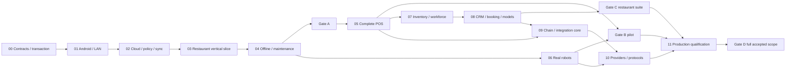

# MEKONIQ Production Platform Implementation Plan

> **For agentic workers:** REQUIRED SUB-SKILL: Use superpowers:subagent-driven-development (recommended) or superpowers:executing-plans to implement this plan task-by-task. Steps use checkbox (`- [ ]`) syntax for tracking.

**Goal:** Xây toàn bộ nền tảng nhà hàng và robot đã duyệt, từ nền móng cloud/offline đến triển khai production có bằng chứng nghiệm thu.

**Architecture:** Cloud quản lý trung tâm; một tablet có sẵn làm coordinator LAN, các tablet và robot có journal bền vững. Domain chia module, cùng hợp đồng schema; quyền ghi bill/robot độc quyền và đồng bộ facts không tự chạy lại side effects.

**Tech Stack:** Node.js 24 LTS, TypeScript strict/pnpm, NestJS, PostgreSQL 18, React/Vite/Capacitor Android, Kotlin/SQLite/Keystore, Python/rclpy, ROS 2 Jazzy/Ubuntu 24.04/Gazebo Harmonic.

**Spec:** [Kiến trúc đã duyệt](../specs/2026-10-30-production-platform-design.md), [offline và bảo trì đã duyệt](../specs/2026-10-30-offline-continuity-design.md), [phạm vi F01–F30](../../product/2026-10-30-capability-matrix.md).

## Global Constraints

- “Xây lại mã trong `source`; `trial` là nguồn tham khảo hành vi, không phải nhánh để sửa.”
- “Cloud là nền tảng trung tâm. Không lắp máy chủ riêng tại nhà hàng.”
- “Bản đầu dùng **coordinator cố định, không tự bầu leader khi timeout**.”
- “Tiền lưu số nguyên theo đơn vị tiền nhỏ nhất; VND là đồng. Không cộng tiền bằng float.”
- “Không tự phát lệnh di chuyển/thu tiền/in/xuất hóa đơn khi replay lịch sử.”
- “Cloud ACK là đã commit ở cloud; ACK LAN là coordinator đã commit.”
- Node.js 24 LTS; PostgreSQL 18; TypeScript strict; SQLite native trên Android; robot baseline ROS 2 Jazzy / Ubuntu 24.04 / Gazebo Harmonic.
- “Mất Internet nhưng còn LAN: nhiều tablet POS, bếp và robot vẫn phối hợp.”
- “Mất cả LAN: từng thiết bị giữ dữ liệu cục bộ; đồng bộ lại khi kết nối trở lại.”
- “Bảo trì toàn bộ: có phương án ghi nhận và nhập bù dữ liệu của thời gian gián đoạn.”
- “Web/app cung cấp **yêu cầu dừng từ xa**, không phải E-stop vật lý được bảo đảm.”
- Runtime/DB/image/package patch được khóa tại W00-T01; không dùng tag latest cho release.
- Các kiểm thử cũ 101 ca chỉ là baseline trial; không phải acceptance của source mới.

---

## 1. Trạng thái, phạm vi và cách dùng

Thiết kế đã được người dùng duyệt. Tài liệu này là **kế hoạch thực thi**, chưa triển khai mã ứng dụng. Không cần duyệt lại các quyết định đã có; chỉ mở quyết định mới nếu thử nghiệm chứng minh ràng buộc thiết kế không khả thi.

Kế hoạch có **12 wave, 62 task**; mọi checkbox bắt đầu chưa làm. [Index máy đọc được](2026-10-30-plan-index.json) ghi ID, file test, command và coverage. Mỗi wave là một plan tự đủ để giao việc, nhưng phải đọc spec và phần hợp đồng chung trước. Đường dẫn tương đối của application files và lệnh chạy đều tính từ thư mục `source/`.

Task có sáu bước: test hành vi → RED → phần lõi → wiring/lưu trữ → GREEN/hồi quy → evidence/commit. Đoạn mã trong plan là test khởi đầu và invariant quan trọng, không thay thế việc hoàn thiện toàn bộ interfaces/behavior đã liệt kê. Chia bước lập trình dài thành các vòng RED/GREEN nhỏ trong cùng task; không tạo một commit hàng nghìn dòng chỉ vì cùng ID.

Không tạo trước hàng loạt màn hình/API trả dữ liệu giả cho các wave chưa triển khai. Mỗi module được thêm phải có command handler, transaction, quyền, policy, UI cần thiết và test. Chức năng ngoài chưa có credential/hardware giữ disabled và `blocked_external`; không thay bằng success giả.

**Cam kết triển khai theo setting:** preset `trial-service` phải cung cấp tập chức năng của baseline trial đã khảo sát trên cùng release artifact với bộ nhà hàng đầy đủ. Sau provisioning nhà hàng/tablet/robot và map binding đã nghiệm thu, chỉ chọn preset/chỉnh setting; không sửa source hoặc build riêng. W02-T03 định nghĩa preset, W06-T06 kiểm hồi quy nghiệp vụ và cấu hình tối giản, W08-T04 giữ kiểm thử giữa các preset, W11-T05 kiểm cùng artifact khi release. Module nâng cao bị tắt không được gây lỗi dependency cho luồng trial; các dependency cốt lõi về identity, audit, lưu trữ/sync và an toàn luôn giữ. “Chỉ setting” không bỏ qua cài app, pair thiết bị, cấu hình bàn/điểm và nghiệm thu robot cho nhà hàng mới.

## 2. Wave, dependencies và mốc bàn giao

| Wave | Phạm vi | Task | Mốc |
|---|---|---:|---|
| [W00](2026-10-30-wave-00-foundations.md) | workspace, contracts và giao dịch nền | 5 | A |
| [W01](2026-10-30-wave-01-android-lan.md) | Android durable store và coordinator LAN | 5 | A |
| [W02](2026-10-30-wave-02-cloud-sync-policy.md) | cloud identity, policy và đồng bộ | 5 | A |
| [W03](2026-10-30-wave-03-restaurant-vertical-slice.md) | menu đến bếp, robot giả lập và bill tiền mặt | 6 | A |
| [W04](2026-10-30-wave-04-offline-maintenance.md) | partition, đối soát và nhập bù bảo trì | 6 | A |
| [W05](2026-10-30-wave-05-complete-pos.md) | POS, thu ngân và trải nghiệm phục vụ đầy đủ | 6 | B |
| [W06](2026-10-30-wave-06-real-robots.md) | Valetudo, ROS 2/Nav2 và pilot robot thật | 6 | B |
| [W07](2026-10-30-wave-07-inventory-workforce.md) | kho, mua hàng và nhân sự vận hành | 4 | C |
| [W08](2026-10-30-wave-08-customer-growth-models.md) | khuyến mãi, CRM, đặt bàn và mô hình nhà hàng | 4 | C |
| [W09](2026-10-30-wave-09-chain-integrations.md) | quản lý chuỗi và nền tảng tích hợp | 4 | D |
| [W10](2026-10-30-wave-10-provider-and-protocol-certification.md) | nhà cung cấp thật và chuẩn robot mở rộng | 6 | D |
| [W11](2026-10-30-wave-11-production-release.md) | chất lượng production, triển khai và chuyển đổi | 5 | D |



- **Gate A — W00–W04:** Hai hoặc nhiều tablet thật, KDS và fake executor có luồng bán/giao/thu cash xuyên suốt, mất WAN vẫn chạy, partition có đối soát, historical import không side effect. Robot thật chưa được công bố đạt.
- **Gate B — W05 và W06:** POS đầy đủ và ít nhất profile robot được commission tại venue pilot; rollback/cutover rehearsal có một nguồn phát lệnh.
- **Gate C — W07 và W08:** Quản trị kho/mua hàng/nhân sự/CRM/promotion/booking/các mô hình có ledger/report/UI. Không bị chặn phát triển chỉ vì một hãng robot chưa giao SDK.
- **Gate D — W09–W11:** Chuỗi và các provider/protocol thuộc release profile đã được nghiệm thu, vận hành production/restore/load/security/UAT đạt. Không gọi hoàn thành đầy đủ nếu một dòng chức năng bắt buộc vẫn blocked.

Có thể phát triển W06 song song nhánh W05–W08 sau khi hợp đồng robot và recovery ổn định; W09 phần chung có thể làm sau W02/W05, phần loyalty chuỗi cần W08. Dependency cụ thể trong từng task ưu tiên hơn đồ thị mức wave. Song song chỉ khi không cùng sửa schema/registry và đầu vào đã commit; một task không được giả định output chưa bàn giao của task khác.

Không gán lịch ngày/tuần khi chưa đo velocity và chưa có thiết bị/provider; checkpoint theo đầu ra đã nghiệm thu. Sau W01 và W04 dùng số đo thực tế để lập lịch pilot.

## 3. Hợp đồng chung phải khóa ở W00

Các type dưới là interface thiết kế cần tạo tại `packages/contracts`, `packages/domain/src/shared`, `packages/sync`. Không phải application code đang có.

### 3.1 Primitive và envelope

```ts
type JsonValue = null | boolean | number | string | JsonValue[] |
  { [key:string]:JsonValue };
type JsonObject = { [key:string]:JsonValue };
type Money = { currency:string; minor:string };
type JournalKind = "intent" | "accepted_fact" | "observation" | "historical_import";
type DomainEvent = { type:string; data:JsonObject };
type Decision =
  | {ok:true; events:DomainEvent[]; value:JsonObject}
  | {ok:false; code:string; details?:JsonObject};
type Scope = {organizationId:string; venueId:string};
type AggregateRef = Scope & {kind:string; id:string};
type Snapshot = {ref:AggregateRef; version:number; state:JsonObject};
type CommandEnvelope = Scope & {
  schemaVersion:1; operationId:string; type:string; actorRef:string;
  deviceId:string; deviceEpoch:string; coordinatorEpoch:number;
  expectedVersion?:number; policyRevision:number;
  occurredAt:string; recordedAt:string; payload:JsonObject; payloadHash:string;
};
type CommandResult = {
  status:"accepted"|"rejected"|"pending"|"unknown";
  code?:string; value:JsonObject; duplicate:boolean;
  ack:"none"|"local"|"venue"|"cloud"; operationId:string;
};
```

- `minor` là integer decimal string canonical, tối đa 30 chữ số (dấu âm thêm một ký tự). TS tính BigInt; SQLite text, PostgreSQL NUMERIC(30,0), Kotlin BigInteger/Python int. Positive amount constraints theo từng command, không đặt toàn bộ ledger cấm âm.
- Quantity dùng scaled integer decimal string và unit/scale đã định nghĩa, không float.
- `sequence` là positive decimal string; tăng trong native/database transaction; ID opaque hợp lệ tối đa 128 ký tự, production ID mới dùng UUID ngẫu nhiên. Các ID ngắn trong test là fixture hợp lệ, không là counter production.
- Timestamps wire RFC3339 UTC; domain adapter chuyển thành số epoch milliseconds `...Ms` khi cần so sánh. Không so sánh ISO string với number. Thứ tự sự kiện dùng producer sequence/aggregate version.
- Canonical bytes theo [RFC 8785](https://www.rfc-editor.org/rfc/rfc8785). Hash payload không gồm signature; signature ES256/P-256 SHA256 dạng JOSE raw r||s base64url, thư viện đảm nhiệm chuyển DER/JOSE. Golden vectors phải cùng kết quả TS/Python/Android.
- `JournalEntry` bổ sung entryId, producer sequence, aggregate/version, kind, timestamps, actor/grant references, canonical payload hash và signature. `RobotCommand` bổ sung commandId/missionId/stopId/missionRevision/robotId/controlEpoch/issuer/expiry và immutable target.
- Parser giới hạn command 256 KiB; batch sync ≤100 entries và ≤1 MiB; map/attachments có giới hạn riêng theo profile. Unsupported schema bảo toàn raw trong quarantine; không drop.

### 3.2 Atomic store và command router

```ts
type Mutation = {ref:AggregateRef; expectedVersion:number; newState:JsonObject};
type EffectIntent = {id:string; type:string; payload:JsonObject};
type CommitBatch = {
  command:CommandEnvelope;
  expectedAuthority:{coordinatorEpoch:number;policyRevision:number};
  mutations:Mutation[]; events:DomainEvent[]; effects:EffectIntent[];
  result:CommandResult;
};
type CommitReceipt = {result:CommandResult;duplicate:boolean;
  sequence:string;payloadHash:string;committed:true};
interface AtomicStore {
  readSnapshot(ref:AggregateRef):Promise<Snapshot>;
  commit(batch:CommitBatch):Promise<CommitReceipt>;
  journalCount():Promise<number>;
  close():Promise<void>;
}
type Handler = (command:CommandEnvelope, snapshots:Snapshot[]) => Decision;
interface CommandRouter {
  register(type:string, handler:Handler):void;
  dispatch(command:CommandEnvelope):Promise<CommandResult>;
}
```

`processCommand` load snapshot → authorize/policy → pure decision → build batch → atomic commit. Commit rechecks expected aggregate/authority/policy versions to close read–commit race; version conflict trả về người gọi, không rebase thu tiền/hủy món một cách im lặng. Router module registration ở file `packages/domain/src/modules.ts`; mỗi task thêm module ở đó và cùng production coordinator/test lab.

Native layer cấp sequence, tạo canonical journal bytes và ký trước COMMIT trong cùng boundary; nếu signer/storage lỗi transaction rollback và không ACK. Không để JS cấp sequence rồi native commit sau bằng giao dịch khác. Table tối thiểu: aggregate snapshots, operation receipts, producer counters, journal, audit, outbox, inbox, received/applied cursors, quarantine. Scope/operationId/hash và producer epoch/sequence có unique constraints.

[SQLite atomic commit](https://www.sqlite.org/atomiccommit.html) là cơ sở triển khai; process kill test không thay được power-loss/hardware qualification. PostgreSQL dùng transaction với application role không bypass [RLS](https://www.postgresql.org/docs/18/ddl-rowsecurity.html). Migrations của cloud/tablet tách file nhưng có cùng semantic conformance tests.

### 3.3 ACK và replay

Sync response có hai watermark: `receivedCursor` (raw journal đã commit, không gap) và `appliedCursor` (domain projection đã áp dụng liên tục). Per-entry result là applied/quarantined/pending/rejected với receipt hash/scope. UI không hiển thị “đã xử lý xong” cho raw record đang quarantine; outbox pruning chỉ dựa durable receiver receipt và retention policy, giữ bản chưa cloud ACK.

Không coi `kind=intent` là đủ quyền phát side effect. Dispatcher còn kiểm issuer/epoch, feature/policy, validity, idempotency/native effect receipt và destination scope. Historical/imported facts luôn đi projection, không đi dispatch. Live command đã unknown cần query/reconcile, không gửi lại chỉ vì outbox còn pending.

### 3.4 Adapter ports

```ts
interface RobotAdapter {
  describe():Promise<RobotManifest>;
  resolveTarget(target:TargetBinding):Promise<ResolvedTarget>;
  estimateReachability(target:ResolvedTarget):Promise<Reachability>;
  execute(command:RobotCommand):Promise<NativeAcceptance>;
  cancel(commandId:string):Promise<NativeCancellation>;
  requestStop(reason:string):Promise<StopAcknowledgement>;
  observe(listener:(event:RobotEvent)=>void):()=>void;
  reconcile(commandId:string):Promise<NativeExecutionState>;
}
```

W03-T04 định nghĩa các type trên trong `packages/robot-adapters/src/contract.ts`:
`RobotManifest` gồm capabilities/protocol/firmware/map/offline/load/trays/validation level; `TargetBinding` gồm logical waypoint và expected map; `ResolvedTarget` là discriminated ROS pose / Valetudo coordinate / vendor location; `Reachability` gồm reachable/reason/ETA optional; `NativeAcceptance` có accepted/nativeGoalId/unknown; cancellation/stop chỉ ACK request, không giả vật lý đã đứng yên; `NativeExecutionState` gồm sending/executing/completed/cancelled/failed/unknown + evidence; `RobotEvent` có type/id/commandId/bootId/sequence/observedAt/payload.

Connector W09-T03: `verify(raw,headers)`, `normalize(verified)`, `execute(intent)`, `query(reference)`. Provider-specific ports W10 mở rộng theo capability; không có universal refund/issue nếu provider không hỗ trợ. Python NativeNavigation W06-T03 có `start(goal_uuid,target)`, `query(goal_uuid)`, `cancel(goal_uuid)`, `request_stop()`; results có status/completed/evidence. Stable native goal ID giúp reconciliation; API không truy vấn được thì unknown, không khẳng định exactly-once physical execution.

Valetudo trên tablet: W06-T02 tạo native ExecutorService/ExecutorJournal/NativeRobotTransport và typed Capacitor bridge. TS adapter không tự phát mutation ngoài native executor; native lưu quyền/command trước I/O và giữ unknown nếu reboot không xác định được goal. ROS dùng Python executor W06-T03 trên onboard Linux. Hai runtime dùng cùng RobotCommand/journal conformance vectors; không cần thêm server tại nhà hàng.

## 4. Test harness và fixtures để task không phụ thuộc ngữ cảnh chat

W00-T05 tạo `tests/support/lab.ts`; W03-T01 tạo `tests/support/restaurant-lab.ts`. Test code trong các plan dùng các helper sau, **phải gọi production router/database**, không dựng fake success của domain.

| Helper | Chữ ký/hành vi | Task sở hữu |
|---|---|---|
| createLab | `() => Promise<Lab>`; PostgreSQL/file SQLite riêng mỗi test; cleanup trong finally | W00-T05 |
| createRestaurantLab | createLab + registry module đã tạo + restaurant-v1 fixture | W03-T01 |
| Lab.command | `(actor:string,type:string,payload:JsonObject,operationId?:string) => Promise<CommandResult>`; actor fixture map to signed identity | W00-T05 |
| Lab.seed | `(kind,id,overrides) => Promise<void>`; valid fixture factory theo aggregate, setup-only; không đi qua production public API | W00-T05; mỗi domain task bổ sung factory |
| Lab.state | `<T>(kind,id) => Promise<T>` đọc projection thực | W00-T05 |
| Lab.count | `(domainEventType) => Promise<number>`; đếm unique applied events, không số message retry/raw received | W00-T05 |
| Lab.effectCount | `(effectType) => Promise<number>`; số external side-effect attempts thực | W00-T05 |
| Lab.fault/restart | `fault(name)`, `restart('coordinator'|'cloud'|'executor')`; fault registry/child process kill checkpoints | W00-T05; plugin faults task tương ứng |
| Lab.partition/heal/sync | `partition('wan'|'lan'|'venue-b-wan')`, `heal()`, `sync()`; transport thực bị ngắt, sync chờ durable cursor hoặc timeout | W00-T05/W02-T04 |
| Lab.advance | `(milliseconds:number)`; fake clock unit/integration, không thay soak thực | W00-T05 |
| Lab.http/rlsVisibleIds | request authenticated API, query qua app DB role | W02-T01 |
| Lab.cloudAppliedCount/pendingCount | applied facts cloud; outbox pending của device | W02-T04 |
| Lab.unresolvedConflictCount | đọc conflict queue persistent | W04-T01 |
| Lab.importApproved | chạy Validate→Preview→Approve→Apply thật với manager fixture; không bypass approval logic | W04-T04 |
| Lab.guestToken/guestCommand | issue signed scoped token và submit đúng guest API | W05-T05 |
| Lab.report | `(kind,businessDate) => Promise<JsonObject>`; actual report query | W05-T06/W09-T02 |
| Lab.importTrial | actual dry-run/import converter, source fields được report | W06-T06 |
| Lab.externalOrder | actual signed sandbox ingress, giữ received/accepted riêng | W09-T03 |
| Lab.pushSignedAs | ký fixture journal bằng device test key khác scope, gửi sync thật | W11-T01 |
| Lab.createOfflineReceipt/upgradeCloud/restoreCloudCheckpoint | ca test migration dùng actual previous schema DB + migration + isolated restored DB | W11-T03 |

Module registry ban đầu chỉ test-only Journal.RecordNote; register module thực khi task đó tạo file. Fixture factory không đoán trạng thái để làm test pass: defaults được version trong `tests/fixtures`, validate schema và invariant. Mỗi seed partial trong snippet merge defaults của aggregate tương ứng; missing parent refs bắt buộc tạo fixture hợp lệ hoặc fail setup.

Identity fixtures: hai org/venue A/B; owner, manager, cashier, chef, guest, integration và device-a/device-b có scope rõ. Restaurant fixture: table-1; kitchen/bar/wash; parking; rice 50000 VND/kitchen, tea 20000 VND/bar; sim-1 2 khay; cash shift fixture có thể dùng cho test nhưng UI production mở ca bằng Shift.Open. Recipe rice-v1 dùng rice-raw chỉ thêm vào fixture registry tại W07-T01 khi module kho tồn tại. Factory chỉ seed module đã đăng ký, không tạo bảng hoặc trạng thái giả cho module tương lai. Không tự seed shared session đã mở; test tạo session khi cần.

Các rig chuyên biệt:
- W06-T02 `createValetudoRig`: real adapter + HTTP/MQTT test server; server.acceptGoto/telemetry, command fixture, event collector, close.
- W06-T03 Python `FakeNativeNavigation`, `command_fixture`: native call counter, accepted/query/cancel state persisted ngoài agent crash; không dùng ở production.
- W06-T04 `FakeActionClient`, `goal_fixture`, `NavigationResult`: ROS action accepted/terminal/errors; integration colcon/Gazebo riêng.
- W06-T05 `profile_fixture`, `validate_commissioning`: official profile + measured evidence validation, không tự sinh safety evidence.
- W10-T01 `createProviderRig(kind)`: selected profile, authentic redacted fixture replay, methods deliverFixture/partitionVenue/fault/issue/reconcile/callCount/settledCount/unappliedFundsCount/close. Không có configured provider phải fail prerequisite, không skip xanh.
- W10-T05 `createVdaRig`: MQTT emulator/schema validator, startOrder/state/completedEvents/close, ghi rõ emulated.
- W11-T02 `readMeasuredLoadReport`: đọc artifact do load run vừa tạo, reject missing/stale/wrong commit; không default thresholds giả.

Kotlin instrumentation test snippets đặt trong class tên file; test context/JUnit imports và fixture methods ở `androidTest`. `testBatch` cho cùng aggregate, `canonicalFixtureBytes/verifyEs256` dùng golden file; `AndroidLab` điều khiển hai serial đã enroll test. Python test helpers nằm dưới `robotics/agent/tests/support` và `tests/hardware`, pytest conftest chỉ thêm package paths; không cần ROS cho unit fake tests.

## 5. Tooling, lệnh chuẩn và evidence

W00-T01 tạo scripts như dưới; chúng **chưa tồn tại ở thời điểm viết plan**. Wrapper `scripts/test-runner.mjs` strip một delimiter `--`, truyền argv bằng spawn, không build shell command từ input. Suite chưa có config/module phải báo prerequisite, không success.

| Command | Trách nhiệm |
|---|---|
| `pnpm install --frozen-lockfile` | Install reproducible khi lockfile đã tạo; lần đầu resolve version có kiểm Node24 compatibility và lưu chính xác |
| `pnpm doctor` | Node/Docker/Python/JDK/Android SDK/các tool cần ở wave hiện tại; không sửa global environment |
| `pnpm build` / `pnpm typecheck` / `pnpm lint` | Workspace apps/packages hiện đã register; báo thiếu script cho package mới |
| `pnpm contracts:generate` / `pnpm contracts:check` | Tạo typings/fixtures codegen, fail nếu generated drift |
| `pnpm test:unit -- path` | Vitest deterministic domain |
| `pnpm test:contracts -- path` | TS/schema/golden compatibility; Python validator chạy riêng trong CI |
| `pnpm test:integration -- path` | Real SQLite/PostgreSQL, actual router/process kill |
| `pnpm test:e2e -- path` | Playwright HTTP/UI, real backend, own test ports |
| `pnpm test:android -- lifecycle` | Wrapper adb/Gradle, 2 serial distinct, actual app APK; physical device result riêng |
| `pnpm test:adapters -- path` | Adapter conformance protocol rigs |
| `pnpm test:providers -- path` | Provider contract + sandbox; input thiếu = blocked_external/failing prerequisite |
| `pnpm test:security -- path` | Boundary/abuse/regression |
| `pnpm test:acceptance -- continuity/release-manifest/first-shift` | Named registry dispatch tới suite thật và evidence assertions |
| `pnpm test:load` | Tạo measured artifact, assert thresholds từ artifact hiện tại |
| `python3 -m pytest robotics/agent/tests -q` | Agent unit/store tests trong Python environment đã pin |
| `colcon build`, `colcon test` | Chạy trong ROS workspace Linux Jazzy, log test-result; không chạy nhầm root source |
| `apps/tablet-android/android/gradlew -p apps/tablet-android/android connectedDebugAndroidTest` | Native SQL/Keystore/LAN instrumentation |

Runner cấu hình test HTTP/DB ports riêng do OS cấp, không dùng trial 1880/1884 hoặc robot IP thật. Compose là môi trường dev/cloud, không triển khai server trong nhà hàng. Android tool scripts require selected test serial và không tự force-stop app của thiết bị chưa enroll test.

Mỗi task tạo `docs/implementation/evidence/Wxx-Tyy.md` gồm actual commit, changed files, full commands, runtime/versions, kết quả, artifact links, limits và external blockers. Không commit secret/PII thật. Test failure/unknown là trạng thái có thật, không đổi expectation chỉ để xanh. Sau test phù hợp đạt, không lặp toàn suite vô ích; full regression chạy tại gate.

Các code step có snippet invariant; phần wiring ghi transaction/permission/UI integration phải hoàn thành cùng task. Khi test test-specific missing module, tạo stub export trước nếu cần rồi bảo đảm RED do behavior chưa có; lỗi compiler/toolchain không được dùng làm bằng chứng regression test tốt.

## 6. Coverage sản phẩm

ID task tra trong wave tương ứng (`W05-T03` ở file Wave05). Cột này là trách nhiệm thực hiện, **không phải bằng chứng chức năng đã xong**.

| ID | Yêu cầu | Task thực hiện/nghiệm thu |
|---|---|---|
| F01 | Identity/tenant/device | W02-T01, W02-T02, W11-T01 |
| F02 | Feature policy/presets | W02-T03, W06-T06, W08-T04, W11-T05 |
| F03 | Menu/modifiers/price | W03-T01, W05-T01 |
| F04 | Bàn/phiên/chuyển/gộp | W03-T02, W05-T02 |
| F05 | POS/QR/kiosk/robot ordering | W03-T06, W05-T05 |
| F06 | Order/courses/amendments | W03-T02, W05-T02 |
| F07 | KDS/bếp/bar | W03-T03, W05-T02 |
| F08 | Delivery/bussing/multi-stop | W03-T04, W05-T05, W06-T06 |
| F09 | Robot interoperability | W06-T01, W06-T02, W06-T03, W06-T04, W06-T05, W10-T05, W10-T06 |
| F10 | Bill/split/merge/tax | W03-T05, W05-T01, W05-T03 |
| F11 | Payment/manual/provider | W03-T05, W05-T03, W10-T02 |
| F12 | Refund/void/reconciliation | W05-T03, W04-T02 |
| F13 | Cash shift/cashbook | W03-T05, W05-T04 |
| F14 | Printing/devices | W05-T04, W11-T05 |
| F15 | Guest support/guide | W05-T05, W06-T01 |
| F16 | Reservations/waitlist/deposit | W08-T03 |
| F17 | Promotion/voucher | W08-T01 |
| F18 | CRM/loyalty | W08-T02, W09-T02 |
| F19 | Inventory/recipes | W07-T01, W07-T03 |
| F20 | Procurement | W07-T02 |
| F21 | Workforce | W02-T01, W07-T04 |
| F22 | Reports | W05-T06, W07-T04, W09-T02 |
| F23 | Chain | W09-T01, W09-T02 |
| F24 | Online/Zalo/delivery/POS | W09-T03, W10-T04 |
| F25 | E-invoice/accounting export | W10-T03 |
| F26 | Buffet/combo/weighted models | W08-T04 |
| F27 | Node-RED/SDK | W09-T04 |
| F28 | Production operations | W00-T01, W11-T01, W11-T02, W11-T03, W11-T04, W11-T05 |
| F29 | Offline/sync/partitions | W01-T01, W01-T03, W01-T05, W02-T04, W04-T01, W04-T02, W04-T05, W04-T06 |
| F30 | Maintenance/import | W04-T03, W04-T04, W04-T06, W11-T03 |

## 7. Coverage offline/bảo trì

Chi tiết expected outcome theo spec continuity §9. Các task ghi trong bảng phải đăng ký test với ID Oxx vào suite W04-T06; tests hỗ trợ hardware được nâng bằng evidence W06, không thay bằng một test registration-only.

| Ca | Task |
|---|---|
| O01 | W03-T06, W04-T06, W06-T06 |
| O02 | W00-T04, W01-T01, W03-T06 |
| O03 | W02-T04 |
| O04 | W04-T01, W04-T06 |
| O05 | W04-T01 |
| O06 | W04-T02 |
| O07 | W00-T05, W01-T01 |
| O08 | W01-T01, W01-T05, W04-T03 |
| O09 | W02-T04 |
| O10 | W04-T05, W06-T03 |
| O11 | W04-T05, W06-T02, W06-T03 |
| O12 | W02-T03, W09-T01 |
| O13 | W04-T06, W11-T02 |
| O14 | W04-T04 |
| O15 | W04-T04 |
| O16 | W04-T04 |
| O17 | W02-T05, W04-T04 |
| O18 | W04-T04 |
| O19 | W02-T04, W11-T03 |
| O20 | W04-T05, W06-T03 |
| O21 | W01-T03, W01-T05 |
| O22 | W04-T03, W04-T05, W11-T03 |

## 8. Bao phủ yêu cầu kiến trúc ngoài danh mục chức năng

| Ràng buộc | Task chịu trách nhiệm |
|---|---|
| Không sửa trial; migrate read-only; một nguồn command khi cutover | W06-T06, W11-T05 |
| Domain không phụ thuộc Valetudo/Node-RED/DOM/Node runtime | W00-T01, W00-T03, W03-T04 |
| Auth, RLS, guest scope, signed devices và secret handling | W02-T01, W02-T02, W05-T05, W11-T01 |
| Atomic journal/outbox/audit/idempotency | W00-T04, W01-T01, W02-T04 |
| Coordinator foreground/kiosk và runtime suspended | W01-T03, W01-T05 |
| Maps/reachability/capability/payload/speed/parking | W06-T01, W06-T02, W06-T04 |
| Fleet traffic vùng chung, không suy simulator sang hardware | W06-T01, W06-T05 |
| Goal ACK khác completion; native ambiguity/reboot | W06-T02, W06-T03, W06-T04 |
| Native executor trên tablet cho Valetudo, Linux executor cho ROS | W06-T02, W06-T03 |
| E-stop/hard safety independent, không unlock bằng atRobot | W03-T04, W06-T05, W11-T01 |
| Frame/đơn vị/version giao thức và mô phỏng | W00-T02, W06-T04, W10-T05 |
| RPO/RTO, retention/export, schema upgrades | W04-T03, W11-T03 |
| Load 20 tablet/10 robot/100 bàn, 10 command/s | W11-T02 |
| UI thao tác thật, accessibility, VI/EN, layout tablet | W01-T04, W03-T06, W05-T05, W05-T06 |
| Không fake provider success; official documents/license | W10-T01 đến W10-T06 |
| Outbox/metrics/observability và scope source-of-truth | W02-T05, W09-T02, W11-T02 |
| Backout không làm mất giao dịch mới | W04-T05, W11-T03, W11-T04, W11-T05 |

## 9. Input bên ngoài và cách xử lý blocker

| Input cần | Task dùng | Nếu chưa có |
|---|---|---|
| Hai tablet Android/model/OS/AP mạng thực | W01-T05, W04-T06 | Phát triển/emulator tiếp, gate physical Android chưa đạt |
| Robot Valetudo model/firmware/API endpoint và người giám sát | W06-T02, W06-T06 | Protocol emulator chỉ integration_tested |
| S100/ZLTECH SDK/register docs/driver/cơ khí/safety evidence | W06-T05 | Nav2/Gazebo tiếp tục; không viết register/pinout đoán |
| VDA/vendor robot version/factsheet/SDK/licensing | W10-T05/T06 | Generic contract hoàn thành nhưng profile disabled |
| Payment provider/merchant sandbox + webhook credentials | W10-T01/T02 | Manual cash/verified transfer vẫn hoạt động; provider chưa nghiệm thu |
| E-invoice provider, field rules và sandbox | W10-T01/T03 | Export/ledger chạy; không giả issued invoice |
| Zalo/marketplace/POS partner app registration/docs/permissions | W10-T01/T04 | Internal/guest web chạy; partner chưa bật |
| Cloud account/domain/TLS/secret manager/backup target, release authority | W11-T03/T04 | Artifacts/staging dry-run chuẩn bị đầy đủ, không deploy vào target đoán |
| Printer/transport model | W05-T04, W11-T05 | Spool/protocol fixture test được; physical print chưa được advertised |

Không cần yêu cầu tất cả input này trước khi bắt đầu W00. Mỗi blocker nằm ở task/gate đúng chỗ; không làm chậm các phần không phụ thuộc. Trước khi đề nghị publish/deploy thật, chuẩn bị manifest, diff, test evidence và rollback cụ thể.

## 10. Trình tự thực thi và giao việc

1. Bắt đầu **W00-T01**, thực hiện tuần tự trong wave; chưa chạy các test command của wave chưa tạo code.
2. Tại đầu task: đọc spec, plan tổng, task và outputs prerequisite; xác nhận Git sạch hoặc xác định thay đổi của người khác. Tạo worktree khi cần cách ly lúc thực thi, không sửa branch của trial.
3. Thực hiện các checkbox, kiểm tests phù hợp, ghi evidence, review diff, commit task.
4. Nếu phát hiện sai hợp đồng, cập nhật contract/schema + dependent tests và ghi thay đổi plan; không âm thầm đổi tên/shape khiến task kế tiếp dùng API cũ.
5. Qua gate mới nhận phạm vi pilot/release tương ứng. Không đợi hoàn thành mọi wave mới chạy demo người dùng.
6. Cập nhật index task status thành in_progress/implemented/verified/blocked_external/accepted có evidence; thông báo giới hạn thực tế. Hiện tất cả vẫn planned.

Hai cách thực thi được chuẩn bị: **inline** dùng `executing-plans` để làm từng task với checkpoint, hoặc **subagent-driven** dùng `subagent-driven-development` và reviewer theo task khi được chọn/được phép. Việc tạo plan này không tự spawn agent hoặc bắt đầu implementation. Không có yêu cầu duyệt lại kiến trúc; phiên triển khai tiếp theo bắt đầu từ task đầu tiên chưa thực hiện.

## 11. Self-review của bộ plan

- 30/30 nhóm chức năng và 22/22 ca continuity có task mapping, kiểm bằng index.
- Mỗi task có file paths, interface consumes/produces, behavioral test snippet, core implementation invariant, integration notes, command và commit/evidence.
- Hợp đồng money, time, sequence, ACK, journal kind và authority thống nhất trong phần chung; không chia hai kiểu identity cloud/tablet.
- Bằng chứng từ phần cứng/provider được tách khỏi mock; task không đủ input không được tự gán hoàn thành.
- Mốc A/B là deliverable giữa chương trình; phạm vi đầy đủ vẫn giữ tới D.
- Kiểm tra tài liệu ở lượt lập plan chỉ kiểm cấu trúc/link/coverage/consistency, không phải đã chạy tests production được mô tả trong các wave.
