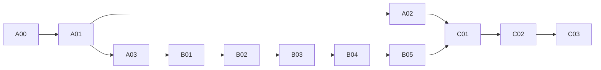

# LinkForge + IR-SIM Implementation Plan

> **For agentic workers:** REQUIRED SUB-SKILL: Use superpowers:subagent-driven-development (recommended) or superpowers:executing-plans to implement this plan task-by-task. Steps use checkbox (`- [ ]`) syntax for tracking. Đây là tài liệu handoff; chưa thực thi các task bên dưới.

**Goal:** Bổ sung model validation và 2D navigation simulation có evidence trên Mac, giữ toàn bộ tính năng và acceptance boundaries của MEKONIQ Lab.

**Architecture:** `ResolvedAssembly`/world là nguồn tạo projections. LinkForge chạy shadow; IR-SIM là provider `irsim_2d`, có runner TS sở hữu domain clock và Python plant độc lập. UI dùng renderer và gateway hiện có.

**Tech Stack:** Node 24.22.2, pnpm 10.32.1, TypeScript/Ajv/Vitest, Python 3.11, linkforge-core 1.6.0, ir-sim 2.12.0, pytest, Playwright, Three.js hiện có.

**Spec:** [Spec chính](../../specs/2026-11-08-linkforge-irsim/README.md), [contracts](../../specs/2026-11-08-linkforge-irsim/contracts.md), [workers/runtime](../../specs/2026-11-08-linkforge-irsim/workers-runtime.md), [verification](../../specs/2026-11-08-linkforge-irsim/verification.md). Đọc cả bốn trước code. [Nghiên cứu](../../../research/2026-11-08-linkforge-irsim.md) có baseline và những giả định đã bác bỏ bằng probe.

## Global Constraints

- Node 24.22.2; pnpm 10.32.1; không nâng major trong đợt này.
- Workers dùng Python 3.11; mỗi worker có venv/lock riêng; candidate pins `linkforge-core==1.6.0`, `ir-sim==2.12.0`.
- Business authority/contracts/adapters ở `source/`; presentation/project UX ở `lab/`.
- Không sửa `trial/` hoặc `web/`, không chạm robot hay cổng `1880`/`1884`; UI/runtime loopback `4175`/`4176`.
- Mọi độ dài dùng mét, góc radian, thời gian simulation lưu integer tick/ns; frame body x trước, y trái, z lên.
- Giữ protocol 1/2, projects/archives/reports cũ; fields mới optional hoặc versioned extension; không rewrite dữ liệu cũ ngầm.
- Mọi run pin project/assembly/world/model/controller/library/config/seed/source/schema identities; không nhận backend endpoints từ browser.
- UI Việt/Nhật/Anh; giữ accessibility, 2D fallback, no-runtime editor và offline mock launcher.
- Không fallback từ provider thiếu/lỗi sang mock, native hoặc hardware; ghi reason code và giữ evidence đúng provider.
- Không export dirty source; không thay pin hay evidence lịch sử để làm candidate có vẻ đã được kiểm.
- `implemented`, `tested`, `accepted` là ba trạng thái độc lập; native/hardware `blocked_external`/`not_run` không tự đổi.

---

## Gói công việc và dependency

| Gói | Tasks | Đầu ra review độc lập | Phụ thuộc |
|---|---|---|---|
| [01 — Model và validation](01-model-validation.md) | A00–A03 | Baseline/pins, contracts, LF shadow report, Serve fixtures | Không cần Linux |
| [02 — Navigation runtime](02-navigation-runtime.md) | B01–B05 | Scene, worker, controller, FD01 domain run và durable evidence | A00/A01/A03; validation gắn sau A02 |
| [03 — Lab và qualification](03-lab-qualification.md) | C01–C03 | Vertical UI, hai robot, batch/regression, release receipts | B04/B05; multi sau C01 |

Vertical slice dừng ở **C01**: một robot đi qua toàn bộ chuỗi Lab→LF→IR-SIM→source→report. B01–B04 headless có thể review riêng; chưa gọi đó là integrated Lab demo. Hai robot, batch dài và các gate release cần C02/C03.

Đối chiếu với tám bước trong đề xuất ban đầu:

| Bước đề xuất | Tasks thực hiện | Điều chỉnh sau nghiên cứu |
|---|---|---|
| 1. Baseline/contracts | A00, A01 | Chụp runtime pin riêng; thêm per-entity drive và provenance sensor |
| 2. LinkForge shadow | A02 | Raw validation, name mapping và parse parity bắt buộc |
| 3. Navigation compiler | A03, B01 | Fixture Serve thật trong assembly; giữ CompiledScene và native output semantics |
| 4. IR-SIM worker | B02, B03 | Thêm controller có global path/no-path policy; worker nhận velocity không tự sở hữu mission |
| 5. Mission Engine | B04 | SourceSession/dispatcher, clock, idempotency và recovery |
| 6. Digital Twin UI | C01 | Cần runtime/evidence B05 và artifact mới trước khi demo xuyên suốt |
| 7. Integration tests | B05, C02, C03 | Durable trace, two-robot/fault/batch, regression và candidate qualification |
| 8. Gazebo/ROS2/hardware | Handoff trong C03; thực thi ở đợt native riêng | Linux/hardware chưa nằm trong ước lượng Mac hoặc sáu gate mới |

## Bản đồ file và trách nhiệm

Paths dưới đây tính từ workspace, **new** là chưa tồn tại ở baseline:

| Vùng | Files/chức năng |
|---|---|
| Contracts | **new** `source/packages/contracts/schemas/{robot-physical-model-v1,navigation-model-2d-v1,navigation-scene-v1,model-validation-report-v1,irsim-worker-v1,navigation-run-evidence-v1}.schema.json`; generator output **new** `generated/navigation2d.ts` |
| Canonical projection | **new** `source/packages/lab-runtime/src/engineering/{physical-model,navigation-model,navigation-compiler,linkforge,validation-store}.ts`; sửa nhỏ `assembly.ts`, schemas và compiler registry |
| Model validation | **new** `source/robotics/model-validation/linkforge_worker/{__init__,__main__,adapter,names,parity}.py`, lock/pyproject/tests |
| Plant worker | **new** `source/robotics/navigation-2d/irsim_worker/{__init__,__main__,protocol,scene,session,snapshot}.py`, lock/pyproject/tests |
| Provider runtime | **new** `source/packages/lab-runtime/src/v2/navigation2d/{contracts,worker-client,controller,adapter,runner,readiness,evidence,oracle,scenario-fixtures,batch}.ts` |
| Shared description export | **new** `source/robotics/simulation/compiler/description.py`; pure URDF/CompiledScene helper extracted with byte parity tests, native singleton algorithm unchanged |
| Shared seams | Existing `v2/{capabilities,gateway,readiness,report,telemetry,scenario-matrix}.ts`, `engineering/{gateway,runtime-options}.ts`, CLI/exporter; giữ mock/native implementation |
| Lab UI | Existing `lab/src/{ui/workspace,ui/assembly-page,ui/engineering-panel,scenarios/engineering,twin/scene,twin/overlays,viewer/twin3d,viewer/engineering-scene,reports/replay,reports/metrics}.ts`; **new** validation panel/sensor view modules theo C01 |
| Provision/release | **new** worker manifests/bootstrap, `lab/scripts/start-irsim.mjs`, source batch recorder; sửa exporter/importer khi có test closure |

Không tạo package `packages/engineering` mới vì code thật nằm trong `packages/lab-runtime/src/engineering`. Không chuyển business workflow sang Python. New renderer layers tách file nhỏ, tránh phình `workspace.ts` thêm controller logic.

## Traceability

| Requirements | Tasks | Gate/cases |
|---|---|---|
| LFIR-01/17/18 | A00, C03 | NR01–12, INT02/03; release/native boundaries |
| LFIR-02/03 | A01, A03 | CMP01/05, per-robot drive cases |
| LFIR-04/05 | A02 | LF01–06, G-LF1/2 |
| LFIR-06 | A03, B01 | CMP01–05 |
| LFIR-07/10/13 | B02, B05 | IR08–10, SEN01/02 |
| LFIR-08/12 | B03, C02 | IR02–04/06/07 |
| LFIR-09/11 | B04 | IR01/05/10, INT02, G-IR1 |
| LFIR-14/16 | B05, C02, C03 | EVI01–03, INT03, G-IR3 |
| LFIR-15 | C01, C03 | INT01/04, G-INT1 |

## Ước lượng đã điều chỉnh

| Phần | Engineer-days dự kiến |
|---|---:|
| A00–A03: baseline, contracts/multi-drive, LF guards, Serve fixtures | 3–5 |
| B01–B05: compiler, plant, controller, domain/recovery/evidence | 7–10 |
| C01–C03: UI, two-robot/batch, regression/package qualification | 5–8 |
| Dự phòng integration/schema/geometry/performance | 3–5 |
| **Tổng** | **18–28** |

Đây là ước lượng lập kế hoạch cho một kỹ sư quen codebase, không cam kết lịch. Vertical slice khoảng **8–12 ngày làm việc** nếu không gặp blocker về geometry/provider compatibility. Hai người có thể giảm elapsed time ở validation và UI sau khi contracts khóa; không chia hai agent cùng sửa gateway/schema trong một checkout.

Ước lượng 10–17 ngày trong đề xuất chỉ khả thi khi giảm scope qualification hoặc đã có navigation/controller/recording dùng lại được. Code thực còn thiếu các phần đó và có Linux assumptions, single drive và parser repair cần xử lý. Chốt lại lịch sau A00/B02, không kéo native/hardware vào con số Mac.

## Chính sách handoff

- [ ] Mỗi task có deliverable, red/green checks và commit riêng trong đúng repo; cập nhật trạng thái ở bản plan thực thi, không đánh checkbox từ việc viết tài liệu này.
- [ ] Nếu baseline có dirty work, giữ nguyên và tạo worktree theo hướng dẫn repo; không reset/cherry-pick nhánh lịch sử để bắt đầu.
- [ ] Sau mỗi commit ảnh hưởng schema/export, source sạch trước sync/import Lab. Không tạo PR với pin trỏ artifact dirty.
- [ ] Review gates của task trước task phụ thuộc. Thiếu Linux/hardware chỉ chặn gate đó; không chặn các task Mac độc lập.
- [ ] Không tự merge/deploy hoặc đổi acceptance ledger khi chỉ hoàn thành implementation. C03 tạo kết quả review được và liệt kê gate còn mở.
