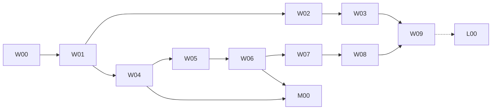

# Simulation Extension Implementation Plan

> **For agentic workers:** REQUIRED SUB-SKILL: Use superpowers:subagent-driven-development (recommended) or superpowers:executing-plans to implement this plan task-by-task. Steps use checkbox (`- [ ]`) syntax for tracking. Đây là tài liệu handoff; chưa thực thi task nào.

**Goal:** Thêm oracle thuật toán (Robotics Toolbox, PID) và plant Webots 3D cho FD01/FD07 trên Mac (R1), rồi MuJoCo (R2) và nghiệm thu native trên Linux (R3), mỗi release có bằng chứng và gate riêng.

**Architecture:** Checker thuật toán là tiến trình Python một lần gọi, so sánh và verdict nằm ở TS. Webots là plant thứ hai sau **cùng một** fixed-step runner của IR-SIM, qua một plant port; source vẫn sở hữu clock, mission và journal. R3 chạy đường native đã có, không thêm adapter.

**Tech Stack:** Node 24.22.2, pnpm 10.32.1, TypeScript/Ajv/Vitest, Python 3.11, roboticstoolbox-python 1.5.0, numpy/scipy, Webots R2025a (cài trên host), pytest, Playwright, three.js hiện có. R2: mujoco-core. R3: ROS 2 Jazzy + Gazebo Harmonic + Ubuntu 24.04, LinuxCNC 2.9.x uspace.

**Spec:** [2026-11-10-simulation-extension-design.md](../../specs/2026-11-10-simulation-extension-design.md). Đọc toàn bộ trước khi code; các ID `D..`, `SX-..`, `F..` trong plan trỏ về đó. Spec nền: [2026-11-08-linkforge-irsim](../../specs/2026-11-08-linkforge-irsim/README.md).

## Global Constraints

- Node 24.22.2 (`export PATH="$HOME/.nvm/versions/node/v24.22.2/bin:$PATH"` trước mọi `pnpm`/`node`); pnpm 10.32.1; không nâng major.
- Worker Python 3.11, mỗi worker một venv + lock có hash: `.venv-algorithm` (`robotics/algorithm`), `.venv-webots` (`robotics/simulation-3d`). Không cài lúc chạy. Pin `roboticstoolbox-python==1.5.0`. Webots đúng `R2025a`.
- Mọi pytest chạy với `PYTHONDONTWRITEBYTECODE=1`; lệnh dài bọc `perl -e 'alarm N; exec @ARGV' …`.
- Flag server mặc định tắt: `MEKONIQ_LAB_WEBOTS=1`. Tắt flag → `/health`, selector, mock, IR-SIM không đổi.
- Mét, radian, tick nguyên 20 ms / ns; frame x trước, y trái, z lên.
- Giữ protocol 1/2 và mọi project/archive/report/evidence cũ; schema chỉ mở theo nhánh cộng thêm (D11). Scene và chunk evidence IR-SIM không đổi byte.
- Không fallback giữa provider. Test cần engine thật mà engine vắng → `not_run`, không bao giờ pass. Test double không làm provider thành `installed`.
- Mọi số liệu dynamics mang `not_calibrated` khi đầu vào còn `assumed`.
- Không sửa `trial/`, `web/`; không chạm 1880/1884; UI/runtime loopback 4175/4176.
- Không export source dirty; sau mỗi commit source đổi runtime/schema/tool root thì Lab re-pin (`chore: pin source runtime <sha>`).
- Không ghi `accepted:true`; không sửa nội dung `candidate-03`, `lab/config/simulation-compatibility.json` hay evidence lịch sử. Candidate bị thay thế chỉ được xóa khỏi tree trong chính commit ghi candidate mới (quy ước repo; vẫn còn trong git history).
- Không push `main` (push là deploy production) trừ khi người dùng yêu cầu.

## Review Focus

Năm tình huống spec ngụ ý nhưng dễ lọt, mỗi dòng có test ở task sở hữu:

1. **Đã có một Webots khác đang chạy / port bận / tiến trình sót từ lần crash trước** → từ chối bằng `WEBOTS_PORT_IN_USE`, không bao giờ bám vào instance lạ (W06).
2. **Người vận hành đóng cửa sổ Webots hoặc máy ngủ giữa run** → run thành `unknown`/suspended, không served, không tiến trình sót, không tự khởi động lại (W07).
3. **Webots cài ở đường dẫn khác hoặc là bản nightly R2025b** → `WEBOTS_NOT_INSTALLED` / `WEBOTS_VERSION_MISMATCH` ở readiness, không chạy dở (W06).
4. **Robot đổ, lún sàn hoặc pose thành NaN** → run fail ngay với `PLANT_UNSTABLE`, không chờ mission timeout rồi báo lý do sai (W07).
5. **Venv checker chưa bootstrap, Python treo, hoặc đầu vào NaN/khổng lồ** → kết quả `not_run`/`fail` có lý do, không bao giờ `pass`; tiến trình bị kill theo deadline (W02).

---

## Gói công việc và dependency

| Gói | Tasks | Đầu ra review độc lập | Phụ thuộc |
|---|---|---|---|
| [01 — Release 1](01-release-1.md) | W00–W09 | Algorithm oracle, plant Webots, Lab, candidate R1 | Mac; Webots R2025a cài tay ở W00 |
| [02 — Release 2 và 3](02-release-2-3.md) | M00–M04, L00–L03 | Khung task; chi tiết hóa khi bắt đầu | R2: W04/W06 xong. R3: host Linux |

W02–W03 (Algorithm) và W04–W07 (Webots) độc lập sau W01; đừng để hai agent cùng sửa schema/gateway trong một checkout. Nếu W00 trượt tiêu chí dừng: làm W01 (chỉ phần algorithm), W02, W03, W09 (gate `G-WB*`, `G-INT2` ghi `blocked`), và hỏi người dùng về việc đưa R2 lên trước.

## Traceability

| Yêu cầu | Tasks | Cases / gate |
|---|---|---|
| SX-01 | W00, W09 | REG01 → G-REG1 |
| SX-02, SX-03 | W01, W02 | ALG01/02/03/05 → G-ALG1 |
| SX-04 | W03 | PID01–03 → G-ALG2 |
| SX-05 | W04 | REG01 |
| SX-06, SX-11 | W06 | WB08 → G-WB1; INT12 |
| SX-07, SX-08 | W05, W06 | WB01 → G-WB1 |
| SX-09 | W06 | WB02 → G-WB1 |
| SX-10, SX-12 | W07 | WB03–07 → G-WB2 |
| SX-13 | W08 | INT11, INT12 → G-INT2 |
| SX-14, SX-15 | W09 | mọi gate |

## Chính sách handoff

- [ ] Mỗi task một commit (hoặc vài commit nhỏ) trong đúng repo, prefix `feat:`/`fix:`/`test:`/`docs:`/`chore:`/`build:`; trạng thái cập nhật ở bản plan thực thi.
- [ ] Trước task đầu: `git -C source status --short` và `git -C lab status --short` phải rỗng; nếu không, dừng và hỏi.
- [ ] Dừng và báo cáo thay vì đoán khi: chunk IR-SIM đổi sau W04; W00 trượt; model không đứng vững ở W06; cần sửa `serve-demo-v1`.
- [ ] Hoàn thành implementation không phải là `accepted`. W09 tạo record review được và liệt kê gate còn mở.
