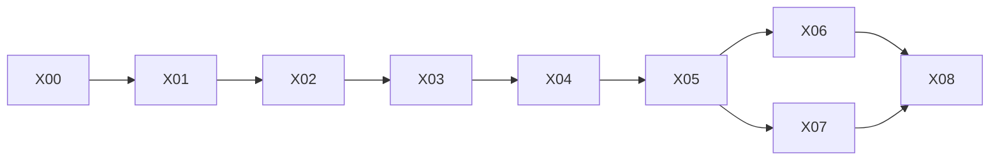

# Webots Arm (R1.1) Implementation Plan

> **For agentic workers:** REQUIRED SUB-SKILL: Use superpowers:subagent-driven-development (recommended) or superpowers:executing-plans to implement this plan task-by-task. Steps use checkbox (`- [ ]`) syntax for tracking. Đây là tài liệu handoff; chưa thực thi task nào.

**Goal:** Tay máy 6 khớp là plant Webots chạy `cup-pick`/`cup-place` và hành trình `WB-BV01` trên Mac, với trace khớp thực, ARM03 trên góc khớp thực và bằng chứng `r11-candidate-01`.

**Architecture:** Scenario runner hiện có giữ clock 20 ms. `MockArmPlant` ở chế độ `tracking` sinh lệnh khớp và giữ máy trạng thái chương trình; `webotsArmPorts` (một `CoffeePlantPorts`) gửi `jointTargets` tới `webots_worker` qua `mekoniq-sim3d/1` và đưa góc khớp thực về. AMR và máy pha vẫn là mock.

**Tech Stack:** như R1 (Node 24.22.2, pnpm 10.32.1, TypeScript/Ajv/Vitest, Python 3.11 `.venv-webots`, Webots R2025a, pytest, Playwright, three.js). Không thêm dependency.

**Spec:** [2026-11-10-webots-arm-design.md](../../specs/2026-11-10-webots-arm-design.md). Đọc toàn bộ trước khi code; `D18–D33`, `SX-16–30`, `G1–G11` trỏ về đó. Nền: [spec R1](../../specs/2026-11-10-simulation-extension-design.md), [plan R1](../2026-11-10-simulation-extension/README.md).

## Global Constraints

- Mọi Global Constraints của [plan R1](../2026-11-10-simulation-extension/README.md#global-constraints) giữ nguyên.
- `serve-demo-v1`, `serve-3d-v1`, bảng controller `integrations/arm-controller/models/puma560-reference/` không đổi byte. Chunk evidence IR-SIM không đổi (golden hash của W04 vẫn xanh).
- BV01 trên `mock-default`: `outcomeDigest` trước và sau X05 bằng nhau (ghi golden ở X01 trước khi sửa `mock-arm.ts`).
- Schema chỉ mở cộng thêm; request/response AMR đã ghi ở R1 còn hợp lệ.
- Target khớp ngoài giới hạn bị từ chối (`JOINT_TARGET_OUT_OF_RANGE`), không kẹp.
- Ngưỡng (`reachTolRad`, `settleTicks`, `followTolRad`, `followTicks`, `repeatJointRad`) lấy từ số đo X00 và nằm trong oracle profile; không sửa ngưỡng trong task sau để test xanh.
- Một Webots mỗi host: test cần engine thật chạy tuần tự.
- Sau mỗi commit source đổi runtime/schema/tool root: Lab re-pin. Không `accepted:true`. Không push `main`.

## Review Focus

1. **AMR Webots đang chạy khi mở `WB-BV01`** (hoặc ngược lại) → run thứ hai bị chặn `WEBOTS_CAPACITY` ở readiness, không có engine thứ hai (X05).
2. **Tay máy bị kẹt giữa chừng** (vật cản, `effort` thấp) → `ARM_FOLLOWING_ERROR` trong `followTicks`, không chờ `maxTicks` của scenario (X06).
3. **Lỗi khi đang giữ cốc** (cancel, va chạm, mất engine) → cốc vẫn `holding`, không thả, outcome cần reconcile; không có trạng thái "cốc biến mất" (X06).
4. **Engine trả góc khớp NaN hoặc ngoài giới hạn** → `PLANT_UNSTABLE`, chương trình dừng, không ghi mẫu đó vào ARM03 như hợp lệ (X04, X05).
5. **Project Lab không có `armCollisionProfile` hoặc model id khác fixture** → readiness `ARM_SCENE_UNAVAILABLE` / `ARM_MODEL_MISMATCH`, không dựng world với base ở gốc tọa độ (X05).

---

## Gói công việc

| Gói | Tasks | Đầu ra review độc lập |
|---|---|---|
| [01 — Tasks](01-tasks.md) | X00–X08 | Spike, contract, fixture, compiler, worker, ports, scenario, Lab, bản ghi |

X00 trượt tiêu chí dừng (spec §6.1) → dừng toàn bộ và hỏi người dùng. X07 (Lab) có thể chạy song song X06 nhưng không cùng checkout.

## Traceability

| Yêu cầu | Task | Case → gate |
|---|---|---|
| D33 | X00 | — |
| SX-16, SX-17 | X01 | INT14 → G-INT3 |
| SX-18, SX-20 | X02 | WA01 → G-WA1 |
| SX-19 | X03 | WA01, WA02 → G-WA1 |
| SX-21, SX-30 | X04 | WA02, WA03 → G-WA1 |
| SX-22, SX-27 | X05 | WA04 → G-WA2 |
| SX-23, SX-24, SX-25, SX-26 | X06 | WA05–WA08 → G-WA2 |
| SX-28 | X07 | INT13 → G-INT3 |
| SX-29, D32 | X08 | REG02 → G-REG2; mọi gate |

## Chính sách handoff

- [ ] Trước X00: `git -C source status --short` và `git -C lab status --short` rỗng; không thì dừng và hỏi.
- [ ] Mỗi task một commit (hoặc vài commit nhỏ), prefix `feat:`/`fix:`/`test:`/`docs:`/`chore:`.
- [ ] Dừng và báo thay vì đoán khi: X00 trượt; golden BV01 hoặc chunk IR-SIM đổi; cần sửa fixture `serve-*` hoặc bảng controller; tay máy không bám được với `effort` đã chọn ở X00.
- [ ] Xong implementation không phải `accepted`. X08 tạo bản ghi review được và liệt kê gate còn mở.
