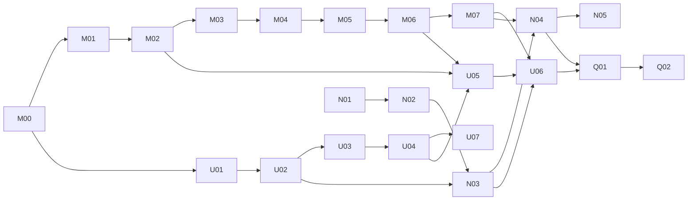

# Realistic Arm, Web Runtime and Lean UI (R2a) Implementation Plan

> **For agentic workers:** REQUIRED SUB-SKILL: Use superpowers:subagent-driven-development (recommended) or superpowers:executing-plans to implement this plan task-by-task. Steps use checkbox (`- [ ]`) syntax for tracking. Đây là tài liệu handoff; chưa thực thi task nào.

**Goal:** xArm 6 gắp và đặt cốc bằng tiếp xúc trong MuJoCo (`MJ-BV01`), Lab trên web điều khiển runtime cục bộ hoặc trong container, và trang Digital twin lấy khung 3D làm trung tâm, với bằng chứng `r2a-candidate-01`.

**Architecture:** Scenario runner hiện có giữ clock 20 ms. `MockArmPlant` ở chế độ `tracking` nhận một `ArmProgramSet` (waypoint đã giải sẵn trong fixture, quỹ đạo bậc năm, gắp tiếp xúc) và `mujocoArmPorts` gửi `jointTargets`/`gripperTargets`/`propPlacements` tới `mujoco_worker` qua `mekoniq-sim3d/1`. Gateway nhận phiên bearer và allowlist; `step` có `pace` giữ nhịp thời gian thực; Lab đọc SSE bằng `fetch`, phát mẫu qua bộ đệm theo thời gian mô phỏng, vẽ mesh bằng three.js.

**Tech Stack:** như R1.1 (Node 24.22.2, pnpm 10.32.1, TypeScript/Ajv/Vitest, Python 3.11, pytest, Playwright, three.js 0.180). Thêm: MuJoCo (bản do M00 chọn) trong `.venv-mujoco`; Docker để dựng image. Không thêm dependency JavaScript.

**Spec:** [2026-11-12-realistic-arm-web-ui-design.md](../../specs/2026-11-12-realistic-arm-web-ui-design.md). Đọc toàn bộ trước khi code; `D34–D71`, `SX-31–60`, `H1–H20` trỏ về đó. Nền: [spec R1](../../specs/2026-11-10-simulation-extension-design.md), [spec R1.1](../../specs/2026-11-10-webots-arm-design.md), [plan R1.1](../2026-11-10-webots-arm/README.md), [nghiên cứu](../../../research/2026-11-12-realistic-arm-web-ui.md).

## Global Constraints

- Mọi Global Constraints của [plan R1](../2026-11-10-simulation-extension/README.md#global-constraints) và [plan R1.1](../2026-11-10-webots-arm/README.md#global-constraints) giữ nguyên.
- `mock-default` BV01 giữ nguyên `outcomeDigest` (`tests/unit/bv01-mock-golden.test.ts`); world Webots giữ nguyên byte; request AMR và Webots arm đã ghi còn hợp lệ với schema mới.
- Cờ `MEKONIQ_LAB_MUJOCO` tắt → `/health`, bộ chọn, mock, IR-SIM, Webots y như hiện tại.
- Gateway khởi động không tham số có hành vi mạng đúng như hôm nay: bind `127.0.0.1`, Host và Origin chỉ `127.0.0.1:4175/4176`. Không bao giờ có `Access-Control-Allow-Origin: *`.
- File của hãng chỉ vào cây khi có commit, sha256 và license; NOTICE đi cùng mọi bản sao mesh.
- Lab mở từ origin không phải loopback không gửi request nào tới loopback trước khi người dùng bấm Kết nối.
- Góc khớp và độ mở kẹp ngoài giới hạn bị từ chối, không kẹp im lặng.
- Ngưỡng nằm trong oracle profile, lấy từ số đo M00; không sửa ngưỡng ở task sau để test xanh.
- Số liệu dynamics luôn kèm `not_calibrated`. Không `accepted:true`.
- Sau mỗi commit source đổi runtime, schema hoặc tool root: Lab re-pin. Không push `main`. Không deploy Cloud Run khi chưa có lệnh.
- Lệnh chạy từ `source/` hoặc `lab/` với `export PATH="$HOME/.nvm/versions/node/v24.22.2/bin:$PATH"`; pytest luôn `PYTHONDONTWRITEBYTECODE=1`; lệnh dài bọc `perl -e 'alarm N; exec @ARGV'`.

## Review Focus

1. **Đóng tab hoặc mất mạng giữa một `step` có nhịp** → runtime xử lý xong đúng số tick của request đó rồi đứng yên; không tick nào tự chạy thêm; mở lại thấy đúng tick đó (N02).
2. **Tab bị ẩn rồi hiện lại khi đang chạy** → hình nhảy tới mẫu mới nhất trừ độ trễ, không phát lại cả đoạn đã lỡ (U04).
3. **Runtime được mở ra ngoài loopback mà không có khóa truy cập** → từ chối khởi động `ACCESS_KEY_REQUIRED`; không có cổng công khai nào chỉ được bảo vệ bằng mã ghép nối in ra log (N01).
4. **Máy pha báo cốc mới ở vòi khi cốc trước còn nằm trên bệ** (lần gắp trước hụt) → worker từ chối `PROP_PLACEMENT_OCCUPIED`, chương trình không chạy trên cảnh có hai cốc chồng nhau, run chuyển `needs_attention` (M04, M06).
5. **Mesh tay máy không tải được hoặc sai sha256** → Lab vẽ chuỗi trụ, hiện `ARM_MESH_UNAVAILABLE`, run vẫn chạy và xem được (U05).

---

## Gói công việc

| Gói | Tasks | Đầu ra review độc lập |
|---|---|---|
| [01 — Tay máy MuJoCo](01-mujoco-arm.md) | M00–M07 | Spike, contract, fixture xArm 6, compiler MJCF, worker, máy trạng thái gắp tiếp xúc, ports, `MJ-BV01` |
| [02 — Runtime từ web](02-web-runtime.md) | N01–N05 | Gateway bearer/allowlist, `step` có nhịp, client Lab, image container, runbook Cloud Run |
| [03 — UI Lab](03-lab-ui.md) | U01–U07 | Bố cục mới, Vấn đề và bộ chọn, thanh điều khiển, khung nhìn, mesh, kết nối và preset; U07 là task dọn dẹp thêm khi thực thi |
| [04 — Qualification](04-qualification.md) | Q01–Q02 | Bảng `r2a`, recorder, bản ghi |

Thứ tự cho một người: M00 → U01–U04 → U07 → M01–M07 → N01–N04 → U05–U06 → N05 → Q01–Q02. M00 trượt tiêu chí dừng (spec §6.1) → dừng gói 01 và hỏi người dùng; gói 02 (N01–N03) và gói 03 (U01–U04) không phụ thuộc M00, vẫn làm được và vẫn có gate riêng (`G-RT1`, `G-UI1`), khi đó `G-MA1`, `G-MA2`, `G-RT2`, `G-INT4` ghi `blocked` (spec D70, D71). Task `source/` và task `lab/` không chạy song song trong cùng checkout.

## Traceability

| Yêu cầu | Task | Case → gate |
|---|---|---|
| D70 | M00 | — |
| SX-31, SX-32 (sim3d, telemetry, cảnh) | M01 | INT16 → G-INT4 |
| SX-33, SX-35 (flange) | M02 | MA01 → G-MA1 |
| SX-34 | M03 | MA01, MA02 → G-MA1 |
| SX-36, SX-35 (đọc lại) | M04 | MA02, MA03 → G-MA1 |
| SX-37, SX-38 | M05 | MA04 → G-MA2 |
| SX-42 | M06 | MA04 → G-MA2 |
| SX-39, SX-40, SX-41 | M07 | MA05–MA08 → G-MA2 |
| SX-43 | N01 | RT01 → G-RT1 |
| SX-32 (`pace`), SX-45 | N02 | RT03 → G-RT1 |
| SX-44, SX-47 (client) | N03 | RT02, RT04 → G-RT1 |
| SX-48 | N04 | RT05 → G-RT2 |
| SX-49 | N05 | CL01 → G-CLOUD1 |
| SX-50, SX-51, SX-52 | U01 | UI01, UI02 → G-UI1 |
| SX-53, SX-56 | U02 | UI02 → G-UI1 |
| SX-54, SX-55 | U03 | UI03 → G-UI1 |
| SX-46, SX-58 | U04 | UI04 → G-UI1 |
| SX-51, SX-52, SX-58 (dọn dẹp) | U07 | UI01, UI02, UI04 → G-UI1 |
| SX-57 | U05 | UI05 → G-INT4 |
| SX-47 (UI), SX-59 | U06 | INT15, INT16 → G-INT4 |
| SX-60, D71 | Q01, Q02 | REG03 → G-REG3; mọi gate |

## Chính sách handoff

- [ ] Trước task đầu: `git -C source status --short` và `git -C lab status --short` rỗng; không thì dừng và hỏi.
- [ ] Mỗi task một commit (hoặc vài commit nhỏ), prefix `feat:`/`fix:`/`test:`/`docs:`/`chore:`/`build:`.
- [ ] Dừng và báo thay vì đoán khi: M00 trượt; golden BV01, world Webots hoặc chunk IR-SIM đổi; license của một file hãng không xác định được; flange D-H và engine lệch quá 1 mm; cốc không giữ được với tham số M00 đã chọn; cần sửa fixture `serve-*`, `arm-ref-3d-v1` hoặc bảng controller.
- [ ] N05 chỉ tạo script và runbook. Lệnh deploy thật, tạo secret, mở dịch vụ công khai chỉ chạy khi người dùng ra lệnh và cho project, region.
- [ ] Xong implementation không phải `accepted`. Q02 tạo bản ghi review được và liệt kê gate còn mở (`G-CLOUD1` là `blocked_external` tới khi deploy).
