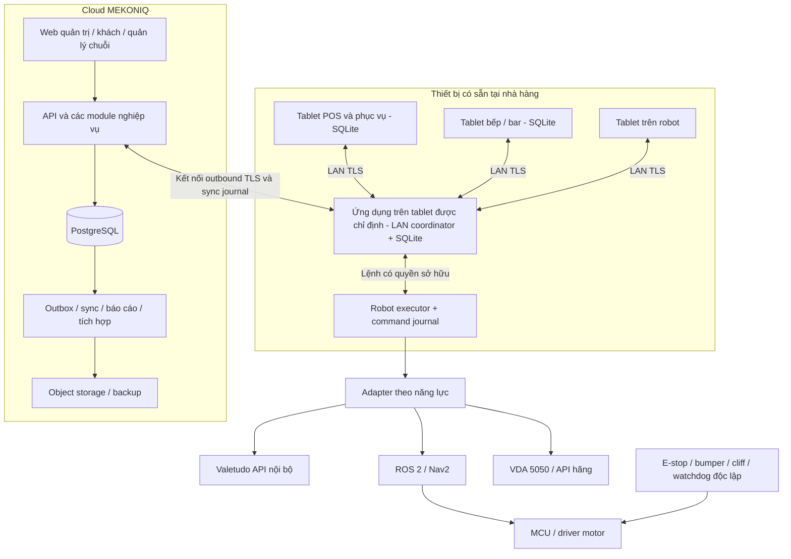

# MEKONIQ — kiến trúc production

Ngày: 2026-10-30. Trạng thái: **đã được người dùng duyệt trong phiên làm việc; chưa hiện thực**.

Tài liệu liên quan: [nghiên cứu trial](../../research/2026-10-30-trial-and-platform-research.md), [ma trận chức năng](../../product/2026-10-30-capability-matrix.md), [offline, phân vùng mạng và bảo trì](2026-10-30-offline-continuity-design.md).

## 1. Mục tiêu và ràng buộc đã xác nhận

1. Xây lại mã trong `source`; `trial` là nguồn tham khảo hành vi, không phải nhánh để sửa.
2. Robot phục vụ dùng được với nhiều chassis/giao thức, trước hết simulator, Valetudo và ROS 2/Nav2; có đường mở rộng VDA 5050 và SDK hãng.
3. Cung cấp bộ chức năng nhà hàng/menu/POS đầy đủ theo ma trận đã xác định, thay vì chỉ một màn demo gọi món.
4. Nhà hàng bật/tắt tính năng linh hoạt, không fork mã nguồn.
5. **Cloud là nền tảng trung tâm. Không lắp máy chủ riêng tại nhà hàng.**
6. Mất Internet nhưng còn LAN: nhiều tablet POS, bếp và robot vẫn phối hợp.
7. Mất cả LAN: từng thiết bị giữ dữ liệu cục bộ; đồng bộ lại khi kết nối trở lại.
8. Bảo trì toàn bộ: có phương án ghi nhận và nhập bù dữ liệu của thời gian gián đoạn.

Để đáp ứng 6–8, phần mềm trên tablet và robot bắt buộc có lưu trữ/logic cục bộ. “Không máy chủ riêng” không có nghĩa “không có tiến trình cục bộ”: một tablet có sẵn chạy dịch vụ điều phối LAN. Điều này không yêu cầu mua mini PC cho nhà hàng. Máy tính chạy navigation trên robot vẫn là phần của robot.

## 2. Các phương án và lựa chọn đề xuất

| Phương án | Ưu điểm | Giới hạn |
|---|---|---|
| Cloud + PWA cache trên từng thiết bị | Triển khai web đơn giản | Không tự cung cấp phối hợp LAN, gateway robot bền vững hoặc giao dịch chung khi WAN mất |
| **Cloud + ứng dụng tablet có dữ liệu cục bộ + dịch vụ LAN trên tablet + executor trên robot** | Đáp ứng ba chế độ gián đoạn, tận dụng thiết bị có sẵn | Cần ứng dụng Android, đồng bộ có hợp đồng và thử nghiệm vòng đời thiết bị |
| Cloud + mỗi tablet tự ghi mọi dữ liệu, hợp nhất bằng CRDT/LWW | Ghi độc lập dễ khi tách mạng | Không giải quyết được thu tiền trùng, đóng cùng bill, chi điểm hai lần hoặc hai chủ điều khiển robot |

Chọn phương án thứ hai. Dùng log bất biến và idempotency để đồng bộ; thao tác tài chính và robot cần quyền ghi độc quyền, không dùng “bản mới nhất thắng”. Không bổ sung máy chủ on-prem hoặc microservices theo từng bảng dữ liệu.

## 3. Kiến trúc triển khai



### Cloud

Backend chia module trong một codebase, deploy API và worker riêng khi cần. PostgreSQL lưu dữ liệu tổ chức, bản ghi đã đồng bộ, cấu hình, payment ledger, audit và các projection. Object storage chứa ảnh/menu, map artifact, tệp nhập và backup. Bắt đầu với managed PostgreSQL, container deployment, secret manager và monitoring; không cần Kubernetes để đạt bản production đầu.

Cloud sở hữu cấu hình gốc, quyền, quản lý chuỗi và tích hợp bên ngoài. Với hoạt động tại một nhà hàng, cloud chuyển yêu cầu đến coordinator đang được cấp quyền, rồi ghi nhận kết quả. Cloud không đồng thời là một chủ ghi thứ hai của cùng phiên bàn/bill/robot.

### Tablet và coordinator

Ứng dụng Android có giao diện dùng chung với web, database SQLite qua native plugin và dịch vụ LAN native. Tablet POS được chỉ định làm coordinator khi provision nhà hàng. Các tablet khác kết nối trực tiếp trên LAN; cloud là đường relay khi thiết bị có WAN nhưng không tới LAN.

Coordinator vận hành cả khi có Internet. Vì vậy, mất WAN không tạo việc “chuyển database chủ” giữa hai hệ thống đang cùng ghi. Nó ghi durable journal, tuần tự hóa nghiệp vụ tại nhà hàng và phân phối projection tới bếp/robot. Không cài Node-RED, PostgreSQL hoặc một Linux server riêng trên tablet.

Hồ sơ hỗ trợ đầu tiên yêu cầu tablet coordinator cắm nguồn, app hoạt động ở foreground/kiosk trong ca. Domain TypeScript chạy trong runtime app; native service chỉ ACK sau transaction SQLite đã commit. Native service còn sống nhưng domain runtime bị suspend không được coi là coordinator healthy. Việc hỗ trợ chạy toàn bộ domain trong background độc lập UI cần được chứng minh riêng, không suy ra từ việc dùng Capacitor.

Bản đầu dùng **coordinator cố định, không tự bầu leader khi timeout**. Nếu coordinator không tới được, thiết bị chuyển sang chế độ ghi cục bộ giới hạn trong spec offline. Đổi coordinator cần handoff/fencing rõ ràng. Đây là trade-off có chủ đích để tránh hai đầu mối cùng điều khiển một robot khi mạng bị chia cắt.

### Robot executor

Robot có ROS 2: executor trên onboard Linux. Robot chỉ cung cấp API như Valetudo: executor có thể chạy native trên tablet gắn robot hoặc tablet coordinator đã được provision, nhưng mỗi robot chỉ có một executor chủ động. Chỉ profile đã được thử nghiệm offline mới được bật nhận nhiệm vụ offline.

Valetudo bản mới ưu tiên transport REST LAN cho cấu hình không có broker cục bộ. Adapter MQTT được giữ cho các triển khai đã có broker phù hợp; **broker chỉ trên cloud không đáp ứng điều khiển offline**. Không tự chuyển MQTT sang REST giữa một chuyến khi chưa reconciliation. VDA 5050 cần endpoint/broker LAN trên thiết bị sẵn có nếu muốn offline; chưa có thì capability offline phải báo không hỗ trợ.

## 4. Stack đề xuất và cấu trúc mã

| Lớp | Lựa chọn | Lý do |
|---|---|---|
| Runtime cloud | Node.js 24 LTS, TypeScript strict, pnpm workspace | Liên tục với JS trong trial, module và type rõ; version patch được pin khi build |
| API | NestJS, REST OpenAPI, WebSocket có xác thực cho realtime/sync | Validation, guards, lifecycle; command và event có schema độc lập UI |
| Cloud data | PostgreSQL 18; SQL migrations; query layer có transaction rõ | Ràng buộc dữ liệu, lock, outbox và audit |
| Web và tablet UI | React + Vite; VI/EN trước; Capacitor cho Android | Dùng chung giao diện, native plugin cho storage/LAN/background |
| Tablet runtime | SQLite + Kotlin plugin/service, Android Keystore | Journal bền vững, kết nối LAN và định danh thiết bị; không dựa vào tab nền |
| Robot ROS | Python/rclpy, ROS 2 Jazzy, Ubuntu 24.04 | Action client gần runtime ROS; package theo distro |
| Mô phỏng vật lý | Gazebo Harmonic + robot description MEKONIQ | Kiểm thử Nav2 độc lập phần cứng; bộ fake deterministic dùng cho domain CI |
| Quan sát | Structured log, metric, trace theo operation/mission, audit riêng | Truy nguyên command qua cloud/tablet/executor |

Tất cả dependency/image phải khóa phiên bản và có quy trình cập nhật. Chọn Jazzy/Harmonic làm baseline đã có tài liệu tương thích, không khẳng định đó là distro mới nhất. [Nguồn nền tảng trong báo cáo nghiên cứu](../../research/2026-10-30-trial-and-platform-research.md).

Cấu trúc dự kiến, **chưa tạo mã scaffold**:

```text
source/
  apps/cloud-api/             HTTP, identity, backoffice và sync ingress
  apps/cloud-worker/          outbox, projection, connector jobs
  apps/operations-ui/         POS, KDS, fleet, robot display và quản trị
  apps/guest-web/             menu/QR và kênh khách, projection giới hạn
  apps/tablet-android/        Capacitor, SQLite, LAN service, key store
  packages/domain/            các module nghiệp vụ thuần, kiểm thử trên cloud/tablet
  packages/contracts/         JSON Schema/OpenAPI, codegen TS/Python
  packages/sync/              operation envelope, journal protocol, migration
  packages/ui/                component và i18n dùng chung
  packages/robot-adapters/    simulator, Valetudo, adapter SDK
  robotics/agent/             executor ROS 2 và durable command journal
  robotics/description/       URDF/xacro, footprint, tải và giới hạn đã đo
  robotics/navigation/        Nav2 config, map lifecycle, launch theo profile
  robotics/simulation/        world nhà hàng và scenarios
  integrations/              payment, e-invoice, print, Node-RED
  deploy/                    cloud containers, IaC, migration/backup tooling
  tests/                     contract, integration, E2E, partition/recovery
  docs/                      thiết kế, quyết định, runbook, commissioning
```

## 5. Ranh giới nghiệp vụ

| Module | Sở hữu | Không được làm |
|---|---|---|
| Identity/tenancy | User, role, venue membership, device identity | Tin role/tenant do client tự khai |
| Configuration/policy | Preset, feature revision, readiness, capabilities policy | Bỏ qua safety khi mua/bật tính năng |
| Catalog/pricing | Menu, modifiers, price book, tax/service profiles | Sửa giá snapshot của bill đã chốt |
| Service/order | Table session, order và order line | Coi một order đã trả tiền chỉ vì đã giao |
| Kitchen | Ticket, station, preparation quantity | Đánh dấu giao khách khi mới nấu xong |
| Fulfillment | Ready quantity, tray allocation, handoff/manual delivery | Gán cùng một phần món vào hai nhiệm vụ |
| Fleet/mission | Mission/stop, robot assignment, command intent | Biết topic Valetudo hoặc viết trực tiếp motor speed |
| Billing/payment | Bill snapshot, tender, settlement/refund, cash shift | Dùng lời khách báo đã chuyển khoản làm xác nhận ngân hàng |
| Inventory/procurement | Recipe version, stock movements, supplier documents | Tự nhập lại món đã chế biến chỉ vì khách hủy |
| Customer/loyalty | Consent, customer history, point ledger | Tiêu số dư chung chuỗi khi không có quyền/hạn mức offline |
| Reporting | Projection có watermark, xuất dữ liệu | Tự sửa order/payment để làm báo cáo khớp |
| Continuity/sync | Journal, dedup, ownership, import provenance | Replay lệnh robot hoặc thanh toán ngoài chỉ vì replay event |

Các module gọi application service/hợp đồng, không sửa bảng sở hữu bởi module khác. Invariant liên quan nhiều module trong cùng transaction của coordinator hoặc cloud owner. Side effect bên ngoài luôn qua outbox.

## 6. Luồng vận hành chuẩn

1. Nhân viên/khách gửi command có operation ID; xác thực scope và kiểm tra policy.
2. Coordinator tính giá từ menu phiên bản đã áp dụng; lưu order và outbox cùng transaction.
3. Bếp nhận ticket; mỗi phần món chuyển trạng thái chuẩn bị độc lập.
4. Nhân viên chọn món sẵn sàng và khay; fulfillment giữ allocation, fleet chọn robot đủ capability, map và tải.
5. Executor xác nhận nhận command; robot đi tới bếp; người xếp đồ xác nhận đúng mission/stop/revision.
6. Robot tới bàn theo bằng chứng điều hướng; khách/nhân viên xác nhận handoff. Giao một phần cập nhật đúng số lượng.
7. Thu ngân chuẩn bị bill; thu tiền/đối soát theo phương thức; bill đóng khi đủ điều kiện. Không buộc thanh toán và giao món có cùng thứ tự cho mọi preset.
8. Journal đồng bộ cloud khi có mạng. Retry không tạo thêm order, KDS ticket, robot command hoặc payment.

Nhà hàng không dùng POS nội bộ có thể tạo mission thủ công hoặc nhận fulfillment request từ POS ngoài. Nhà hàng không dùng robot giao qua nhân viên trên cùng fulfillment, không tạo robot giả.

## 7. Dữ liệu và tính nhất quán

Các aggregate chính: `Organization`, `Venue`, `User`, `Device`, `FeatureRevision`, `MenuVersion`, `TableSession`, `Order`, `KitchenTicket`, `FulfillmentAllocation`, `Bill`, `Payment`, `Refund`, `CashShift`, `Robot`, `MapRevision`, `WaypointBinding`, `Mission`, `MissionStop`, `RobotCommand`, `StockMovement`, `LoyaltyEntry`, `JournalEntry`, `ImportBatch`, `AuditEntry`.

- Mọi bản ghi có `organizationId`, `venueId` khi thích hợp; foreign key có scope, không chỉ filter trong UI.
- PostgreSQL áp dụng RLS cho dữ liệu tenant; application role không bypass RLS. Kết nối pooled phải đặt scope trong transaction, kiểm thử chống rò tenant.
- Tiền lưu số nguyên theo đơn vị tiền nhỏ nhất; VND là đồng. Không cộng tiền bằng float. Giá/thuế/phí/khuyến mãi được snapshot cùng version và quy tắc làm tròn.
- Quantity theo đơn vị định nghĩa; nguyên liệu dùng decimal có scale. Line allocation không vượt ready quantity. Hoàn tiền không vượt captured amount chưa hoàn.
- `operationId` toàn cục, `deviceId + sequence` duy nhất; cùng key khác payload là conflict. Dùng uniqueness trong database, không chỉ cache RAM.
- Một transaction lưu domain changes, journal, audit và outbox. Worker phát event sau commit; nhận lại event có inbox dedup.
- HTTP ACK, broker ACK, robot accepted và robot completed là bốn trạng thái khác nhau.
- State machine có `expectedVersion`; command lỗi thời phải bị từ chối hoặc vào conflict workflow được định nghĩa.
- Có `occurredAt`, `recordedAt`, `receivedAt`, business date và timezone. Thứ tự xử lý dựa sequence/causality, không dựa đồng hồ thiết bị.

Chi tiết quyền ghi khi offline, retry và nhập bù nằm ở spec continuity; không giả định đồng bộ database đa chủ là đủ.

## 8. Hợp đồng robot MEKONIQ

### 8.1 Capability và chứng cứ hỗ trợ

Manifest gồm: adapter/protocol version, firmware được kiểm thử, loại target, điều khiển speed, pause/cancel, docking, telemetry, completion evidence, offline execution, footprint, số khay, tải, map revisions và trạng thái an toàn có thể quan sát.

Trạng thái kiểm chứng: `simulated`, `integration_tested`, `hardware_validated`, `venue_approved`. Scheduler chỉ dùng profile phù hợp deployment. Không suy luận “hỗ trợ S100” từ tên chassis hoặc “hỗ trợ VDA 5050” từ việc publish MQTT.

Adapter tối thiểu cung cấp các thao tác khái niệm: `describe`, `resolveTarget`, `estimateReachability`, `execute`, `cancel`, `requestStop`, `observe`, `reconcile`. Tính năng không có trả lỗi `unsupported`; không báo thành công giả.

### 8.2 Command và event

Command envelope phải có:

- `schemaVersion`, `commandId`, `operationId`, `organizationId`, `venueId`, `robotId`.
- `missionId`, `stopId`, `missionRevision`, `controlEpoch`, `issuerDeviceId`.
- `issuedAt`, `expiresAt`, target immutable với `mapId/mapRevision/frame` hoặc vendor location reference.
- Các giới hạn đã xác thực: tải, tốc độ theo profile, arrival tolerance, loại confirmation.

Event có `eventId`, `commandId`, `executorBootId`, sequence, thời điểm quan sát, độ mới và payload đúng loại: `accepted`, `rejected`, `progress`, `completed`, `failed`, `cancelled`, `unknown`, `safety_state`.

Executor ghi journal trước side effect. Một command ID không được tạo hai native goal; sau crash ở khoảng “đã gửi nhưng chưa ghi ACK”, truy vấn goal/native state trước khi quyết định. Không thể chứng minh kết quả thì chuyển `unknown` và chờ đối soát, không gửi lại mù quáng.

Một robot chỉ nhận một chủ điều khiển tại một thời điểm. `controlEpoch` tăng khi handoff hợp lệ; executor lưu epoch bền vững và từ chối chủ cũ. Hết heartbeat không tự trao robot cho chủ mới. Dừng từ nguồn đã xác thực vẫn được xử lý trong phạm vi phù hợp, kể cả khi feature nhận việc mới đã tắt.

### 8.3 State machine và lỗi

Mission: `queued → assigned → executing → completed`, với các nhánh `paused`, `needs_attention`, `cancelling`, `cancelled`, `failed`. Stop: `pending → travelling → awaiting_action → completed/skipped`. Command có vòng đời riêng; kết quả đích cũ không được tiến mission mới.

Hủy khi đang chở đồ tạo bước return/unload. Robot bị mất kết nối giữ quyền giữ tải/vùng đang chiếm; không tự giao cùng phần món cho robot khác. Thao tác “giao thủ công” cần xác nhận hiện trạng tải và dừng/handoff robot.

Về nhà dùng `parkingPoint`; `chargingDock` là tùy chọn. S100/ZLTECH chưa có docking không bị buộc chạy HOME. Pin/tải/ngưỡng tốc độ theo từng robot, không lấy một cấu hình toàn site.

### 8.4 Map và điều phối nhiều robot

Domain lưu waypoint vật lý của nhà hàng và binding theo robot/map revision. ROS dùng mét/radian và frame rõ ràng; Valetudo chuyển đơn vị trong adapter. Không coi hai map cùng kích thước là cùng tọa độ. Chưa có map identity tin cậy thì binding phải được nhân viên xác nhận lại khi relocalize/reset.

Scheduler lọc robot đủ năng lực và biết mọi stop trước khi tính điểm ETA/tải/pin/độ ưu tiên. Không gán robot không biết đường rồi chờ lỗi để phát hiện.

Nav2 tránh vật cản cục bộ không tự thay thế quản lý lưu lượng cả đội. Với robot không thực thi được zone reservation/speed limit, chế độ đầu chỉ cho một robot di chuyển trong vùng xung đột dùng chung, hoặc chia vùng vận hành vật lý. Không đem tính năng nhường lối trong simulator gán cho robot thật.

### 8.5 Ranh giới an toàn

Web/app cung cấp **yêu cầu dừng từ xa**, không phải E-stop vật lý được bảo đảm. E-stop, bumper, cliff và watchdog phải vô hiệu chuyển động ở lớp độc lập phù hợp thiết kế phần cứng. Linux, cloud và Wi-Fi mất không được vô hiệu lớp này.

Không có API “nhả E-stop vật lý” chỉ bằng `atRobot=true`. Robot phải báo trạng thái đã nhả từ phần cứng và cần thao tác phục hồi có quyền. Profile Valetudo không chứng minh độc lập safety thì chỉ dùng ở phạm vi commissioning/giám sát đã được chấp thuận, không mặc định đạt yêu cầu robot chở 20–30 kg giữa khách.

## 9. Feature policy theo nhà hàng

Mỗi feature có key ổn định, version, dependencies, readiness rules, permission và cách dừng nhận việc. Các nhóm chính: POS, QR, robot ordering, delivery, bussing, guide, inventory, booking, loyalty, promotion, online channel, e-invoice.

Quyết định nhận việc mới là giao của: quyền dùng module, cấu hình venue, dependency, readiness, quyền actor, capability thiết bị và chế độ kết nối hiện tại. API, coordinator và worker đều kiểm tra; UI chỉ phản ánh cùng decision với reason code.

Trạng thái `enabled`, `draining`, `disabled`. Khi tắt, không nhận business mới nhưng vẫn có đường hoàn tất/hủy/refund/đối soát dữ liệu đã nhận. Version policy được snapshot trên command; safety và quyền hiện thời vẫn được kiểm tra khi thực thi. Không xóa dữ liệu khi tắt module.

Cloud phát hành config revision; coordinator áp dụng nguyên tử sau kiểm tra dependency và công việc đang mở. Trong lúc offline dùng revision đã lưu. Revocation từ cloud chưa truyền được không được giả định đã có hiệu lực tại thiết bị; UI quản trị hiển thị thiết bị chưa nhận. Auth offline có thời hạn và phạm vi riêng.

Audit, xác thực, tenant isolation, bảo vệ replay và thao tác dừng không phải feature trả phí có thể tắt.

## 10. Bảo mật và tích hợp

- User session xác thực, server-side RBAC/venue scope; refresh rotation/revocation, CSRF cho cookie và origin checks cho WebSocket.
- Thiết bị được enrollment riêng, private key trong Keystore; chứng thư và ACL theo venue. Guest token gắn table session, không tin query `table=T05` là quyền.
- Tablet LAN dùng pairing và TLS. Discovery qua mDNS là tiện ích, không phải xác thực; fallback địa chỉ provision khi multicast bị chặn.
- MQTT ACL theo robot, command không retained, không public broker/editor. Valetudo HTTP nội bộ cần mạng tách phù hợp và profile endpoint giới hạn; không để cloud nhận URL tùy ý rồi proxy.
- Payment qua provider/terminal; không lưu PAN/CVV. Khách tự báo đã trả là claim. Webhook phải kiểm chứng chữ ký, event ID, amount/currency/payee và trạng thái trước settlement.
- Provider callback trên cloud tạo external payment fact và chuyển tới owner bill. Không tự sửa bill bằng một đường ghi cạnh tranh với coordinator offline. Nếu có giao dịch ngoài hoàn thành muộn gây trả thừa, giữ khoản tiền và mở đối soát/refund, không bỏ callback hoặc sửa receipt cũ.
- In, payment và e-invoice đều có `pending/unknown/confirmed/failed`. Timeout không đồng nghĩa chưa làm; query/reconcile trước retry. Bản ghi tiền đã phát sinh không bị xóa vì provider lỗi.
- Node-RED dùng API/webhook có scope; không được ghi database hay publish command trực tiếp bỏ qua ownership/safety.

## 11. Vận hành production

Cloud health gồm liveness riêng readiness; theo dõi sync lag, event gaps, conflict queue, command ACK latency, robot heartbeat, payment unknown, worker lag và dung lượng SQLite. Dữ liệu cần audit tách khỏi debug log; token/thông tin nhạy cảm không ghi log.

Backup cloud mã hóa, restore diễn tập; tablet giữ journal chưa được xác nhận và checkpoint an toàn. Mục tiêu ban đầu: cloud PITR RPO ≤ 5 phút, RTO ≤ 30 phút, cần đo trong diễn tập. Giao dịch chưa sync chỉ tồn tại trên thiết bị/LAN replica; không hứa cloud backup bảo vệ dữ liệu chưa từng tới cloud.

Cập nhật dùng expand/contract migration, hỗ trợ client schema còn hoạt động, nâng từng thiết bị sau sync checkpoint. Trước migration không tương thích phải xuất journal, làm rõ thiết bị còn offline và đi qua maintenance workflow. Rollback app không được rollback mất tiền đã ghi.

Mục tiêu tải để test bản đầu: 1 venue/20 tablet/10 robot/100 bàn, 10 command nghiệp vụ/giây; xác nhận local p95 ≤ 500 ms và phân phối KDS p95 ≤ 1 giây trên LAN tham chiếu. Đây là tiêu chí dự kiến cần benchmark, không phải số đo đạt sẵn. Thiết bị Android/OS cụ thể là một phần của support matrix.

## 12. Chia dự án và thứ tự triển khai

| Mốc | Phạm vi | Điều kiện nghiệm thu |
|---|---|---|
| A — nền tảng cloud/continuity | Monorepo, identity, tenant, contracts, SQLite journal, fixed coordinator, sync, feature engine, một luồng order→KDS→robot giả lập→cash bill | Hai tablet và một executor fake chạy khi cắt WAN; tách LAN và phục hồi không trùng event/tiền/command; import maintenance dry-run |
| B — nhà hàng đầu tiên | POS/bàn/KDS/fulfillment/billing đầy đủ, cash shift/print, Valetudo LAN và ROS2 executor, giao diện role/robot | Hồi quy trial có chọn lọc; Gazebo; fault injection; kiểm thử tablet thật; commission từng robot thật trước khai thác |
| C — quản trị nhà hàng | Kho/công thức/mua hàng, promotion, CRM/loyalty, booking, buffet/combo, báo cáo | Ledger và báo cáo đối soát; dependency/preset tests; offline limits được kiểm chứng |
| D — chuỗi/tích hợp | Menu central/branch, online/Zalo/POS ngoài, payment/e-invoice provider, VDA/vendor profile theo thiết bị | Sandbox và production acceptance với tài khoản thật; multi-venue isolation/sync; conformance từng chuẩn |

Mỗi mốc là một nhóm spec/plan/implementation có dependency rõ. Không coi A hoặc B là đã hoàn thành toàn bộ yêu cầu Mmenu. Không dựng skeleton với endpoint trả success rồi gắn nhãn các module C/D đã xong.

## 13. Các cổng chất lượng và migration từ trial

1. Unit/model-based tests cho order/bill/mission/feature/ownership; property tests cho bảo toàn tiền và số lượng.
2. PostgreSQL/SQLite integration tests với transaction thật, duplicate/out-of-order và process kill trước/sau commit/ACK.
3. API tests cho auth, tenant isolation, scoped subscriptions, payload size, malformed input và policy bypass.
4. Android multi-device E2E: WAN down, LAN partition, coordinator killed, storage full, app update, clock skew và resync.
5. Robot contract conformance: stale command, cancel, reboot, map mismatch, retained telemetry, no ACK, unknown result và hai người điều khiển.
6. Gazebo thử kịch bản nhà hàng; hardware-in-loop đo hành vi thực. Simulation không chứng minh tải cơ khí, quãng đường phanh hoặc safety certification.
7. E2E chức năng theo ma trận sản phẩm; backup/restore và rehearsal bảo trì/nhập bù.

Migration chỉ đọc bản export cấu hình trial: map/waypoint, robot identity, menu và naming. Import có dry-run, validation, gán tenant/venue và báo cáo các trường không chuyển được. Không copy Node-RED runtime context thành order/payment production, không tự replay nhiệm vụ đang chạy.

Cutover kết thúc nhiệm vụ cũ, đối soát bill mở, snapshot, kiểm tra quyền điều khiển robot, chuyển một nơi điều khiển duy nhất, thử một chuyến rồi mở ca. Chạy shadow chỉ đọc; không để `trial` và hệ thống mới cùng phát lệnh robot.

## 14. Những gì chưa có bằng chứng để nghiệm thu

- SDK, profile firmware và robot thật của từng WHEELTEC/ZLTECH/VDA/vendor.
- Tablet Android và cấu hình Wi-Fi thực tế: sleep/Doze, AP isolation, multicast, printer.
- Provider payment, hóa đơn điện tử, Zalo hoặc kênh bán cụ thể và credential thử nghiệm.
- Kết quả benchmark, restore, partition test và commissioning của source mới.

Các điểm này không ngăn xây nền tảng, simulator và connector contracts; chúng ngăn tuyên bố tích hợp thực tế/production đã đạt khi chưa thử.
