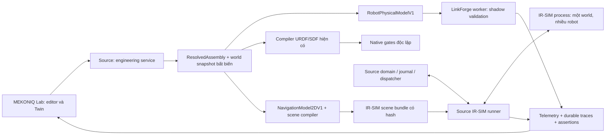

# MEKONIQ Lab — LinkForge và IR-SIM

Ngày: **2026-11-08**. Trạng thái: **spec đề xuất để phát triển; chưa triển khai, chưa accepted**. [Nghiên cứu và baseline](../../../research/2026-11-08-linkforge-irsim.md) ghi nguồn, commit và các probe đã chạy. [Implementation plan](../../plans/2026-11-08-linkforge-irsim/README.md) chia thành ba gói có dependency và kiểm thử cụ thể.

## 1. Mục tiêu và phạm vi

MEKONIQ giữ quyền sở hữu `EngineeringProject`, catalog, `ResolvedAssembly`, world, mission, journal và report. Bổ sung hai khả năng độc lập:

- LinkForge core kiểm chéo robot description, topology và dữ liệu vật lý; xuất description tham chiếu. Chạy shadow, không thay compiler native hiện tại.
- IR-SIM provider `irsim_2d` chạy AMR planar trong world nhà hàng, phát pose/odometry, LiDAR và collision observations. MEKONIQ điều phối nhiệm vụ và xác nhận tải/giao.

Vertical slice đầu: robot Serve có geometry rõ → validation report → scene IR-SIM → FD01 trong source → pose/mission/report trên Lab. Gói hoàn chỉnh thêm hai AMR cùng world, khách đi ngang, cancel/no-path, replay và headless batch.

Không bao gồm: thay Nav2, SLAM/localization thực, dynamics 3D, stability/tipping/spill, arm 6DOF trong IR-SIM, Blender extension, Linux VM provisioning, commissioning hay điều khiển hardware. Giữ nguyên AMR Gazebo/Nav2, xArm/MoveIt và PUMA/LinuxCNC ở các profile riêng.

## 2. Kiến trúc

`ResolvedAssembly` là canonical model cơ khí **đã resolve**; project/catalog/revisions là dữ liệu authoring gốc. `RobotPhysicalModelV1` và `NavigationModel2DV1` là projections bất biến, không có API sửa riêng. World là `EngineeringProject.runtimeProject.world`, khóa bằng `{id,revision,hash}`. Không chuyển URDF sang IR-SIM. Cả hai outputs phải chỉ về cùng assembly/project/world identities.

Một assembly toàn lab có thể là forest gồm AMR, arm và fixture. LinkForge validate từng **entity subgraph**, mỗi robot có đúng một root; không nối giả tất cả vào một robot để vượt topology check.

## 3. Các quyết định chính

| ID | Quyết định | Lý do / điều kiện đổi |
|---|---|---|
| D01 | Giữ source of truth và compiler hiện tại | Đã có URDF/SDF, contracts và bundle closure; tránh thay identity của legacy |
| D02 | LinkForge shadow; semantic parity bắt buộc | Probe 1.6.0 cho thấy parser sửa inertia/bỏ phần tử lỗi; `is_valid` không đủ |
| D03 | Backend ID `irsim_2d`; set/profile `engineering-irsim-2d-v1` | Theo server-owned capability catalog; không tạo API mode thứ tư |
| D04 | Một Python process cho mỗi IR-SIM run/world | Cách ly clock/RNG, timeout, memory và cleanup; robot cùng run dùng chung collision world |
| D05 | Source sở hữu scheduler fixed-step 20 ms | Đồng bộ với domain clock hiện có; tốc độ UI chỉ thay pacing |
| D06 | Controller MEKONIQ `grid-diff-v1` | Có oracle no-path/stop/yaw; không mặc định goal dash là navigation hoàn chỉnh |
| D07 | Projection footprint bảo thủ từ tất cả collision shapes | Khay/thanh nghiêng có thể nhô ngoài chassis; safety margin tách riêng |
| D08 | Typed JSON/NDJSON giữa TS và Python | YAML chỉ là output compiler; frontend không gửi Python, YAML hoặc command tuỳ ý |
| D09 | Durable trajectory/sensor chunks riêng khỏi SSE | Ring telemetry lossy hiện tại không thể chứng minh replay/collision coverage |
| D10 | Feature flags server-side, mặc định tắt | R-MOCK, coffee, native và no-runtime editor giữ hành vi hiện có |
| D11 | Native/hardware gates không kế thừa kết quả 2D | Headless pass chỉ có phạm vi model/provider thực chạy |

Tên `gazebo_native` trong đề xuất chỉ là nhãn nhóm UI nếu cần. ID backend đã có là **`gazebo_nav2`**; không đổi tên hoặc alias silently trong manifests.

## 4. Global Constraints

- Node 24.22.2; pnpm 10.32.1; không nâng major trong đợt này.
- Workers dùng Python 3.11; mỗi worker có venv/lock riêng; candidate pins `linkforge-core==1.6.0`, `ir-sim==2.12.0`.
- Business authority/contracts/adapters ở `source/`; presentation/project UX ở `lab/`.
- Không sửa `trial/` hoặc `web/`, không chạm robot hay cổng `1880`/`1884`; UI/runtime loopback `4175`/`4176`.
- Mọi độ dài dùng mét, góc radian, thời gian simulation lưu integer tick/ns; frame body x trước, y trái, z lên.
- Giữ protocol 1/2, projects/archives/reports cũ; fields mới optional hoặc versioned extension; không rewrite dữ liệu cũ ngầm.
- Mọi run pin project/assembly/world/model/controller/library/config/seed/source/schema identities; không nhận backend endpoints từ browser.
- UI Việt/Nhật/Anh; giữ accessibility, 2D fallback, no-runtime editor và offline mock launcher.
- Không fallback từ provider thiếu/lỗi sang mock, native hoặc hardware; ghi reason code và giữ evidence đúng provider.
- Không export dirty source; không thay pin hay evidence lịch sử để làm candidate có vẻ đã được kiểm.
- `implemented`, `tested`, `accepted` là ba trạng thái độc lập; native/hardware `blocked_external`/`not_run` không tự đổi.

## 5. Yêu cầu và đầu ra

| ID | Yêu cầu bắt buộc | Đặc tả chi tiết |
|---|---|---|
| LFIR-01 | Baseline trước/sau cho mọi đường legacy và pin/branch identity | [Verification](verification.md) |
| LFIR-02 | Projections có SI, provenance, digest và per-entity ownership | [Contracts §1–3](contracts.md) |
| LFIR-03 | Multi-drive không mất binding; hash legacy single-drive không đổi | [Contracts §2](contracts.md) |
| LFIR-04 | LinkForge naming map + parser parity + policy của MEKONIQ | [Workers §1](workers-runtime.md) |
| LFIR-05 | Báo cáo lỗi topology/inertia/sensor; không tự sửa model | [Contracts §4](contracts.md) |
| LFIR-06 | Footprint gồm ba khay/thanh nghiêng; units/frame/world/handoff chính xác | [Contracts §3](contracts.md) |
| LFIR-07 | Worker độc lập, typed protocol, idempotent step/control, cleanup | [Workers §2](workers-runtime.md) |
| LFIR-08 | Navigation controller versioned, no-path/blocked/collision riêng | [Workers §3](workers-runtime.md) |
| LFIR-09 | Mission source-owned, arrival không tự served; cancel/unknown đúng nghĩa | [Workers §4](workers-runtime.md) |
| LFIR-10 | Fixed-step clock, seed và repeatability có scope | [Workers §2, §5](workers-runtime.md) |
| LFIR-11 | Capability/readiness theo provider; flag off giữ đường cũ | [Workers §6](workers-runtime.md) |
| LFIR-12 | Hai robot cùng world và reservation source-owned | [Workers §3–4](workers-runtime.md) |
| LFIR-13 | LiDAR finite JSON, timestamps/freshness/pose nhất quán | [Contracts §5](contracts.md) |
| LFIR-14 | Durable trace/report/replay và metric độc lập renderer | [Verification](verification.md) |
| LFIR-15 | Lab validation/selector/layers/controls, VI/JA/EN và 2D | [Workers §7](workers-runtime.md) |
| LFIR-16 | Batch headless, quotas, crash và no silent skip | [Verification](verification.md) |
| LFIR-17 | Worker distribution manifest/license/rollback tách native | [Workers §6](workers-runtime.md) |
| LFIR-18 | Gates 2D, native, calibration, hardware độc lập | [Verification](verification.md) |

## 6. Thay đổi thiết kế và stale evidence

Khi chassis đổi từ 0.54 thành 0.58 m, editor tạo revision mới, source resolve lại rồi tạo digest mới. Validation cache key thay đổi; navigation compiler tính lại footprint từ toàn bộ robot. Nếu khay rộng hơn cả hai kích thước, footprint có thể **không đổi**: UI giải thích part nào quyết định envelope, không hứa sửa chassis luôn đổi clearance.

Run đang chạy giữ bundle cũ. UI đánh dấu model mới chưa chạy; muốn đánh giá thay đổi phải tạo run mới. Báo cáo/replay cũ giữ nguyên, gắn stale scope. Hai kích thước trên là fixture minh họa, không phải thông số Serve đã chốt.

## 7. Điều kiện bắt đầu và đầu ra phát hành

A00 bắt đầu từ hai repo hiện tại; không cần Linux/hardware. A03 cung cấp Serve engineering fixture có geometry/provenance và world 10 bàn với obstacles/handoff explicit. Một robot/FD01 là điều kiện vertical slice; hai robot là gate sau.

Sau sáu gate G-LF1/G-LF2/G-IR1/G-IR2/G-IR3/G-INT1 có evidence đúng candidate và review, chỉ tuyên bố: **MEKONIQ có integrated robot-model validation và 2D navigation simulation trên Mac trong các scenario đã kiểm**. Không thay trạng thái R-MOCK hay kết luận Nav2, physics 3D, calibration, safety/hardware.
