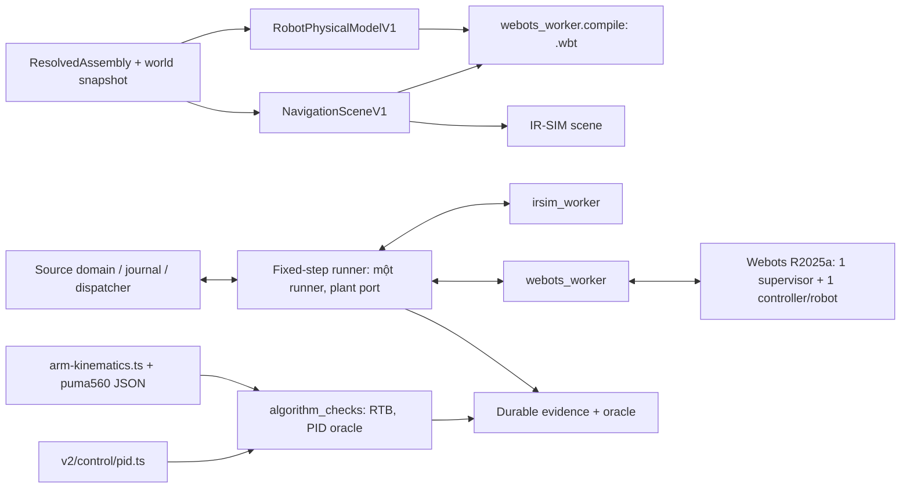

# MEKONIQ Lab — mở rộng mô phỏng: Algorithm, Webots, MuJoCo, Linux

Ngày: **2026-11-10**. Trạng thái: **spec đề xuất; chưa triển khai, chưa accepted**. Nguồn tham khảo: ba tài liệu đề xuất `MKQ-SIM-ARCH-01`, `MKQ-SIM-FUNC-01`, `MKQ-SIM-PLAN-01` (2026-11-10, do người dùng cung cấp). Spec này giữ các nguyên tắc của đề xuất (source là authority, một plant mỗi run, checker không đổi domain, ba trạng thái gate) và **sửa những chỗ đề xuất không khớp codebase** (§2). [Implementation plan](../plans/2026-11-10-simulation-extension/README.md).

Baseline đã đối chiếu trên máy: `source/main e52b841`, `lab/main a89276c`, Lab pin `c5a9d73`, cả hai tree sạch; `candidate-03` sáu gate `tested`, chưa `accepted`. macOS 26.5 arm64, Python 3.11/3.12/3.13 có sẵn, **Webots chưa cài**.

## 1. Mục tiêu và phạm vi

Ba release, mỗi release có candidate, gate và review riêng. Release sau không là điều kiện của release trước.

| Release | Nội dung | Máy | Tuyên bố được phép sau khi gate `tested` + review |
|---|---|---|---|
| **R1 — Algorithm + Webots** (ưu tiên cao) | Robotics Toolbox kiểm chéo kinematics tay máy; PID reference + oracle; regression IR-SIM trên commit mới; Webots 3D cho FD01/FD07 | Mac | "Kinematics PUMA560 và `pid-v1` của MEKONIQ khớp oracle độc lập; FD01/FD07 chạy trên plant Webots 3D với source điều phối, trong các scenario đã kiểm" |
| **R2 — MuJoCo** | Tải trọng, tiếp xúc, trượt, ổn định; so sánh Webots ↔ MuJoCo (↔ IR-SIM) theo bất biến ngữ nghĩa | Mac | "Có báo cáo dynamics lặp lại được trên tham số **giả định**"; không phải kết luận ổn định của robot thật |
| **R3 — Linux Integration** | Chạy thật `gazebo_nav2` và `linuxcnc_sim` **đã có trong codebase** trên Linux; bằng chứng riêng | Linux | "Native SIM đã chạy trên host Linux được ghi danh tính"; không phải nghiệm thu hardware |

Không bao gồm: thay Nav2/MoveIt, SLAM, camera/depth, tay máy trong Webots/MuJoCo, tích hợp ControlStudio, calibration đo thật, đóng gói Webots vào offline package, bất kỳ điều khiển hardware nào. `trial/`, `web/`, cổng 1880/1884 không bị chạm.

## 2. Kết quả nghiên cứu làm thay đổi đề xuất

Đã đọc codebase và nguồn upstream ngày 2026-11-10. Mục "suy luận" là chưa kiểm bằng probe và phải được W00 xác nhận.

| # | Phát hiện | Hệ quả thiết kế |
|---|---|---|
| F1 | `gazebo_nav2`, `linuxcnc_sim`, `coffee_io_sim` **đã là backend** (`v2/capabilities.ts`), có `v2/backends/gazebo-nav2.ts`, `v2/arm/adapter.ts`, `v2/sil/native-*.ts`, `robotics/simulation/` (Dockerfile, `image.lock.json` = `ros:jazzy` + Gazebo Harmonic + Ubuntu 24.04), `integrations/arm-controller/` (PUMA560 LinuxCNC). Gate `G-NATIVE-AMR`/`G-NATIVE-ARM` đã định nghĩa, `not_run` | R3 **không viết adapter mới, không đặt gate ID mới** (`G-DEP-*` của đề xuất bị bỏ). R3 là chạy và ghi bằng chứng cho đường native hiện có |
| F2 | Kinematics tay máy đã có bằng TS: `v2/models/arm-kinematics.ts` (`PUMA560_REFERENCE` modified-DH, `forwardKinematics`, `jacobianCondition`, `solvePose`), golden `tests/fixtures/digital-twin/arm-fk-golden.json`, tham số `integrations/arm-controller/models/puma560-reference/` | Robotics Toolbox là **oracle độc lập cho code đang có**, không cần "arm tổng hợp 3DOF/6DOF" như đề xuất. Robot Serve hai bánh không có bài IK. Lưu ý có **hai bảng tham số khác nhau**: `PUMA560_REFERENCE` trong TS (golden `arm-fk-golden.json`, 4 pose) và `modified-dh.json` (inch/độ, giới hạn của mẫu LinuxCNC, golden `reference-poses.json`, 8 case) — xem D08 |
| F3 | Đã có tiền lệ checker Python một lần gọi: `pythonChecker` (`v2/arm/session.ts`), `createLinkForgeValidator` (JSON stdin/stdout) | Checker thuật toán dùng đúng mẫu này; **không** thêm gateway route hay worker dài hạn |
| F4 | Không có PID nào trong codebase; controller AMR là `grid-diff-v1` xuất vận tốc | "PID oracle" cần một đối tượng để kiểm: thêm `pid-v1` (TS) và oracle Python độc lập. Xem D09 về nơi nó được dùng |
| F5 | Runner IR-SIM (`navigation2d/runner.ts`, 575 dòng) chứa cả phần chung (tick, zone traffic, evidence, ACK) lẫn phần riêng IR-SIM; `readiness.ts` `dispatcher` gắn cứng mọi set `portable_python` vào `createIRSimScenarioRun`; evidence schema có `engine.id const 'irsim_2d'`; Lab gắn cứng `CAPABILITY_MISSING:irsim_navigation_v1` (`lab/src/scenarios/support.ts:17`) | Ngoài bốn điểm này còn các `const` IR-SIM trong schema: evidence (`seed.engineSeedAlgorithm`, `engineRng.library`, `engine` đóng `additionalProperties:false`), `NavigationSceneV1.engine`, và các chuỗi cứng trong `evidence.ts` (`buildNavigationEvidence`), checkpoint `provider`, limitations/`coverage.dynamics` của report (`runner.ts`). Record evidence khớp khóa chính xác nên không chứa được `z/roll/pitch`; mọi `collisionId` `engine_discrete` đều tính là va chạm vật lý. D11 xử lý tất cả. Phần còn lại (catalog, sets, `execution`, readiness rows, scenario `basedOn`, oracle, campaign, zone-bridge, `python-env.ts`, tool closure) dùng lại nguyên |
| F6 | Fixture Serve có đủ khối lượng, inertia, bán kính bánh 0.09 m, khoảng cách 0.36 m, đường cong mô-men (2.5 N·m → 0 tại 20 rad/s), LiDAR 360 tia 10 Hz — **tất cả `assumed`** | Gần đủ để dựng model 3D, **trừ một điểm**: fixture chỉ có hai bánh trên một trục, không có caster/điểm tựa thứ ba, nên trong engine 3D robot sẽ đổ về phía trước/sau (D16). `NavigationSceneV1.world` chỉ có polygon 2D, không có chiều cao vật cản (D17). Mọi kết quả dynamics mang nhãn `not_calibrated` |
| F7 | **Webots**: bản ổn định mới nhất vẫn là R2025a (2025-02); Homebrew cask bị vô hiệu từ 2026-09 → cài tay từ dmg; **không có headless trên macOS** (cần phiên GUI); `--batch --minimize --mode=fast --stdout --stderr --port` có; extern controller chạy bằng Python ngoài qua thư viện `controller` thuần `.py` trong `WEBOTS_HOME`; với `synchronization TRUE`, engine chỉ tiến đúng `duration/basicTimeStep` bước mỗi lần controller gọi `step()` rồi chờ; `optimalThreadCount>1` và `randomSeed=-1` làm mất tính lặp lại. `urdf2webots` 2025.0.0 không còn hoạt động từ 2025-02, kéo theo `rospkg` | Webots là **engine cài trên host**, không nằm trong closure portable. Clock do source sở hữu là khả thi về tài liệu nhưng **phải probe** (W00). Không dùng `urdf2webots` (D04) |
| F8 | **Robotics Toolbox** 1.5.0 (2026-10-23, MIT) có wheel arm64 cho py3.10–3.14, đã bỏ ràng buộc numpy<2; 1.5.0 đổi cách xoay inertia URDF; `robot_descriptions` có thể tải model lúc chạy (suy luận) | Pin chính xác; chỉ dùng `DHRobot` dựng từ JSON của MEKONIQ, không gọi loader tải mạng. scipy mới nhất cần py≥3.12 → venv 3.11 pin dòng scipy cũ hơn |
| F9 | **MuJoCo** 4.0.0 phát hành 2026-11-06 (4 ngày); tách `mujoco-core` (chỉ cần numpy, đủ cho headless); URDF import không có actuator và bỏ qua lỗi chính tả im lặng | R2 pin lại lúc bắt đầu; sinh MJCF trực tiếp từ projection, không import URDF |
| F10 | **ControlStudio**: repo chỉ có `Readme.txt`, không source, không license, không API, chỉ Windows | Loại khỏi phạm vi hoàn toàn, kể cả vai trò "tham chiếu ngoài" |
| F11 | Lab đã có twin 3D bằng three.js; LiDAR và contact là lớp **chỉ 2D** có lý do hiển thị | "3D" của R1 là **plant 3D**, hiển thị qua twin hiện có. Không nhúng GUI Webots, không thêm lớp LiDAR 3D |

## 3. Kiến trúc

Một run chọn **đúng một** plant. Checker thuật toán chạy ngoài run, không có clock, không ghi domain.

## 4. Quyết định

| ID | Quyết định | Lý do / điều kiện đổi |
|---|---|---|
| D01 | Ba release độc lập; plan chi tiết chỉ cho R1, R2/R3 ở mức task và được chi tiết hóa khi bắt đầu | Kết quả probe W00 quyết định hình dạng protocol 3D mà R2 dùng lại |
| D02 | Backend `webots_3d`; set `engineering-webots-3d-v1`; scenario `WB-FD01`, `WB-FD07` (`basedOn` FD01/FD07); `execution:{host:'portable_python',clock:'source_fixed_step',manualStep:false,speedMultipliers:[1,4,16,64]}` | Theo đúng mẫu `engineering-irsim-2d-v1`; không thêm giá trị `host` mới vì worker vẫn là Python do source step |
| D03 | **Một** fixed-step runner. Tách phần riêng IR-SIM của `runner.ts` ra sau một plant port; `dispatcher` chọn theo `providers.amr`. "Không đổi" nghĩa là: cùng seed và fixture, **sha256 của từng chunk stream** (trajectory/sensors/control/collisions) trước và sau khi tách bằng nhau — ghi golden hash trước khi sửa, test so sau khi sửa. Document evidence chứa `sourceCommit`/`adapterHash` nên không so byte toàn văn. Candidate-04 chỉ chứng minh gate vẫn qua. Plant port cung cấp cả danh tính engine, `provider` của checkpoint, limitations và `coverage` của report | Sao chép 575 dòng là hai nơi sửa cho mỗi lỗi clock/ACK. Nếu việc tách làm đổi byte evidence IR-SIM mà không sửa được → dừng, báo cáo, không ép |
| D04 | World Webots (`.wbt`) sinh trực tiếp từ `RobotPhysicalModelV1` + `NavigationSceneV1` trong `webots_worker/compile.py`; **không** qua URDF/`urdf2webots` | Giống quyết định cũ "không chuyển URDF sang IR-SIM"; converter đã ngừng phát triển. Parity được **đo trên engine** (đọc lại pose/trục/khối lượng qua Supervisor), không tin converter |
| D05 | Topology: Node ⇄ `webots_worker` (NDJSON stdio) ⇄ Webots. Worker khởi động Webots, là extern **supervisor**, và chạy một tiến trình extern controller cho mỗi robot. Mọi controller `synchronization TRUE`; `basicTimeStep` là ước nguyên của 20 ms; `optimalThreadCount=1`; `randomSeed` lấy từ seed của run | Supervisor chỉ truy cập device của chính Robot node của nó nên mỗi AMR cần controller riêng (suy luận từ tài liệu; W00 xác nhận). Một process group, kill cả nhóm khi lỗi |
| D06 | Webots là engine của host. Danh tính run = `webots --version` phải đúng `R2025a` + sha256 của executable + lock digest của worker. Launcher không cài, không tải. Offline package không kèm Webots: báo `WEBOTS_NOT_INSTALLED` | Qt LGPL và dung lượng cần audit riêng trước khi đóng gói; không phải việc của R1 |
| D07 | **W00 là spike có tiêu chí dừng** (§6.1). Trượt tiêu chí → `G-WB*` ghi `blocked` kèm lý do; phần Algorithm của R1 vẫn phát hành; người dùng quyết định có đưa MuJoCo lên trước không | Rủi ro lớn nhất của R1 nằm ở chỗ chưa ai chạy Webots trên máy này |
| D08 | Robotics Toolbox kiểm chéo `arm-kinematics.ts` trên **cả hai** bảng PUMA560: checker nhận tham số DH dạng số (SI, đã đổi đơn vị ở TS qua loader hiện có `v2/arm/session.ts`), dựng `DHRobot` modified-DH. Mỗi bảng so với golden của chính nó; ngoài ra thêm pose sinh theo seed trong giới hạn khớp để so hai chiều RTB ↔ TS (không cần golden). Python chỉ trả giá trị RTB; so sánh và verdict ở TS theo `oracleProfile` có version | Hai hiện thực độc lập cùng tham số. Python không tự phán pass để tránh oracle tự chấm mình |
| D09 | `pid-v1` là module TS thuần (`v2/control/pid.ts`): P/PI/PID rời rạc, lọc đạo hàm trên measurement, bão hòa đầu ra, anti-windup kẹp tích phân. Oracle Python độc lập (numpy + scipy) sinh lại đáp ứng và kiểm bằng nghiệm tuyến tính khi không bão hòa. **R1: `pid-v1` chưa nằm trong vòng plant** — Webots dùng motor velocity với `maxTorque`/`maxVelocity` từ fixture. R2: `pid-v1` là vòng tốc độ bánh cho actuator mô-men của MuJoCo | Đưa vòng mô-men tự viết vào Webots ngay làm R1 khó ổn định mà không tăng giá trị FD01/FD07. Đây là lựa chọn của người viết spec, cần người dùng xác nhận (§10) |
| D10 | Protocol worker 3D `mekoniq-sim3d/1`: cùng envelope, cùng ops, cùng luật ACK với `mekoniq-irsim/1`; snapshot = trường của `IRSimSnapshotV1` + phần mở rộng tùy chọn (`z`, `roll`, `pitch`, trạng thái bánh, contact). Schema mới `sim3d-worker-v1`; không sửa `irsim-worker-v1`. Lệnh vẫn là vận tốc thân `[v,ω]` như adapter hiện tại; worker đổi sang tốc độ bánh bằng bán kính/khoảng cách của model | Runner chung đọc phần chung; R2 dùng lại nguyên protocol |
| D11 | Mở schema theo kiểu **cộng thêm, phân nhánh theo `engine.id`** (`oneOf`), nhánh IR-SIM giữ nguyên từng `const`: (a) `navigation-run-evidence-v1`: nhánh `webots_3d` có `engineVersion`, `executableSha256`, `basicTimeStepMs`, `pythonVersion`, `lockDigest`, `seed.engineSeedAlgorithm:'webots-worldinfo-seed-v1'`; (b) `navigation-scene-v1.engine`: nhánh `webots_3d` `{id,version:'R2025a',basicTimeStepMs}` + thuộc tính tùy chọn `world3d` (D17); scene IR-SIM hiện có **không đổi byte, không đổi digest**; (c) record trajectory thêm trường **tùy chọn** `pose3d:{z,roll,pitch}` — vắng mặt với IR-SIM nên chunk IR-SIM không đổi; reader chấp nhận đúng tập khóa cũ hoặc cũ + `pose3d`; (d) `collisionIds` của Webots chỉ gồm ID vật cản/robot mà **thân robot** chạm; tiếp xúc bánh/caster với sàn bị lọc ở worker và không bao giờ thành `collisionId`. R1 không lưu điểm/lực tiếp xúc thô (R2 thêm stream riêng). Schema hash đổi → Lab re-pin | Không tạo schema evidence song song; Webots không mang scene tự nhận là IR-SIM |
| D12 | Lab tối thiểu: thêm set vào selector, tổng quát hóa kiểm capability (`sim3d_navigation_v1`), launcher `pnpm lab:webots`, nhãn provider/engine trong report, twin 3D và replay dùng `pose3d` khi có. LiDAR/contact giữ là lớp 2D. Không có tab "nhóm kiểm thử", không có UI cho campaign thuật toán, không có màn so sánh | Kết quả thuật toán là evidence headless cho reviewer. Thêm UI khi có người thật sự cần xem ngoài file |
| D13 | Qualification: tách bảng `SUITES/CASES/GATES` khỏi lõi `qualify`/`checkQualification` trong `scripts/irsim-qualification.mjs`; record mới `documentType:'sim-extension-qualification'`, recorder `scripts/record-sim-extension.mjs`, alias acceptance `sim-extension`. Evidence ở `docs/implementation/evidence/sim-extension/<release>-candidate-NN/` | Một lõi fail-closed; không viết guard thứ hai |
| D14 | Regression IR-SIM của R1 = chạy lại `record-irsim.mjs` trên commit phát hành → `linkforge-irsim/candidate-04`; nội dung candidate-03 không bị sửa, và theo quy ước repo nó được xóa khỏi tree trong commit ghi candidate-04 | Commit đổi thì bằng chứng cũ không còn nói về code mới |
| D15 | R3 dùng pin native hiện có (Jazzy + Harmonic + Ubuntu 24.04, LinuxCNC 2.9.x uspace). Recorder từ chối khi `process.platform!=='linux'` và ghi `systemd-detect-virt`. VM Linux chạy trên chính máy Mac chỉ là **diễn tập** (`rehearsal:true`), không thể thành `tested` | Đúng yêu cầu "không dùng mô phỏng Mac để đánh dấu gate Linux"; nâng lên Lyrical/Jetty là quyết định riêng, không trộn vào đợt nghiệm thu |
| D16 | Fixture mới **`serve-3d-v1`** = Serve + caster thụ động (cầu ma sát thấp, trước và sau) là **component thật trong engineering project**, provenance `assumed`. `serve-demo-v1` không sửa, IR-SIM tiếp tục dùng nó. `WB-FD01`/`WB-FD07` dùng `serve-3d-v1` (và bản fleet tương ứng) | Robot giao đồ hai bánh thật đều có caster; model cũ thiếu vì 2D không cần. Thêm vào model (không tổng hợp trong compiler) thì parity SX-08 vẫn có nghĩa và digest IR-SIM không đổi. Không khóa pitch bằng ràng buộc giả. Cần người dùng xác nhận (§10) |
| D17 | Chiều cao và vật liệu 3D là đầu vào compiler có version trong fixture: `world3d:{obstacleHeightM, wallHeightM, floorFriction, casterFriction}`, tất cả `assumed`, nằm trong scene (D11b) nên có digest. Giá trị khởi điểm: bàn 0.75 m, tường 1.2 m; mặt phẳng LiDAR lấy từ vị trí mount trong model và phải thấp hơn mặt bàn | Scene 2D không có chiều cao; không đoán ngầm trong code |

## 5. Global Constraints

Giữ nguyên toàn bộ Global Constraints của spec `2026-11-08-linkforge-irsim` (Node 24.22.2, pnpm 10.32.1, Python 3.11 cho worker, SI + frame x-trước/y-trái/z-lên, protocol 1/2, không fallback provider, không export dirty, ba trạng thái gate, VI/JA/EN). Bổ sung:

- Mỗi worker mới có venv và lock riêng (`uv pip compile --generate-hashes`, py3.11): `.venv-algorithm` (`robotics/algorithm`), `.venv-webots` (`robotics/simulation-3d`), R2 `.venv-mujoco`. Không cài lúc chạy.
- Flag phía server, mặc định tắt: `MEKONIQ_LAB_WEBOTS=1` (R2: `MEKONIQ_LAB_MUJOCO=1`). Tắt flag → `/health`, selector, mock, IR-SIM y như hiện tại.
- Root mới vào `PORTABLE_TOOL_PATHS`: `robotics/algorithm`, `robotics/simulation-3d`. Chạy pytest với `PYTHONDONTWRITEBYTECODE=1`.
- Test cần engine thật mà engine vắng mặt thì là `not_run`, **không bao giờ pass**; test double không làm provider thành `installed`.
- Mọi số liệu dynamics đi kèm `not_calibrated` chừng nào đầu vào còn `assumed`.
- Không bao giờ ghi `accepted:true`; chỉ reviewer đặt `acceptedBy`.

## 6. Release 1 — yêu cầu

### 6.1 W00: probe Webots (spike, mã vứt đi)

Chạy trong thư mục scratch, không commit code spike; chỉ commit ghi chép vào `docs/research/2026-11-10-simulation-extension.md`. Tiêu chí, tất cả phải đạt để tiếp tục W03+:

1. Cài R2025a từ dmg chính thức; `webots --version` trả đúng chuỗi; ghi sha256 executable và dmg.
2. Python 3.11 trong venv import được `controller` từ `WEBOTS_HOME` và nối extern controller tới Webots do tiến trình cha khởi động với `--batch --minimize --mode=fast` trên port không mặc định. (Sửa 2026-11-13: worker không còn dùng `--minimize`, vì trên macOS Webots R2025a thu nhỏ đôi khi không bao giờ nạp world sau vài lần bị kill; nay là `--batch --no-rendering --mode=fast`, đo được lidar và giá trị đọc lại giống hệt khi có render.)
3. Một supervisor + hai robot controller, tất cả synchronized: thời gian engine **chỉ** tiến khi mọi controller đã `step(20)`; 1000 tick liên tiếp, `simTime == tick × 20 ms` chính xác.
4. LiDAR 360 tia trả scan hữu hạn khi cửa sổ thu nhỏ (và ghi rõ có dùng được `--no-rendering` hay không).
5. Hai lần chạy cùng seed, cùng lệnh bánh: pose cuối lệch ≤ 1e-6 m (ghi luôn có bit-identical hay không).
6. p95 wall-clock mỗi tick 20 ms ≤ 20 ms với hai robot (tức ≥ 1× realtime). Chậm hơn → ghi số, vẫn tiếp tục nhưng `speedMultipliers` của set rút về `[1]`.
7. Kill Webots giữa chừng → worker thấy trong ≤ 5 s; không còn tiến trình con sót.

Trượt 1–5 hoặc 7: dừng theo D07.

### 6.2 Yêu cầu

| ID | Yêu cầu bắt buộc |
|---|---|
| SX-01 | Baseline trước/sau: mọi suite `linkforge-irsim`, R-MOCK, `contracts:check`, typecheck, lint, build xanh trước khi sửa và sau mỗi task chạm seam chung |
| SX-02 | `algorithm_checks` (Python, một lần gọi, JSON stdin → stdout, `python -I -B`): op `rtb_fk`, `rtb_jacobian`, `rtb_ik`, `pid_response`; chỉ nhận tham số số học đã validate theo schema; không nhận đường dẫn, module hay code |
| SX-03 | Kết quả `AlgorithmResultV1` (schema mới `algorithm-result-v1`): `checkerId`, `caseId`, `verdict: pass\|fail\|not_run`, `metrics`, `oracleProfileDigest`, `inputDigest`, `toolVersions`, `reasons`. `NaN`/vô hạn/thiếu mẫu là `fail`, không phải 0 |
| SX-04 | `pid-v1` thuần, tất định, không đọc đồng hồ; có test đơn vị riêng ngoài oracle |
| SX-05 | Runner chung + plant port; IR-SIM qua port cho ra evidence giống hệt trước khi tách |
| SX-06 | `webots_worker` tuân `mekoniq-sim3d/1`; một request đang bay; `bootId` cố định; chỉ `step` làm tiến thời gian; mất ACK → `unknown`, không gửi lại, không khởi động engine mới để tiếp tục |
| SX-07 | Compiler `.wbt` tất định (cùng input → cùng byte), từ chối: thiếu inertia/khối lượng ≤ 0, khớp không hỗ trợ, đường dẫn asset thoát khỏi bundle, `basicTimeStep` không chia hết 20 ms |
| SX-08 | Parity model: sau `create`, đọc lại từ engine pose link, trục khớp, khối lượng, bán kính/khoảng cách bánh; so với `RobotPhysicalModelV1` trong dung sai của `oracleProfile` |
| SX-09 | LiDAR Webots phát `LidarScanV1` hợp lệ; so với ray-cast hình học độc lập trên `NavigationSceneV1` |
| SX-10 | `WB-FD01`, `WB-FD07` chạy bằng mission/confirmation/reservation của source; đến nơi **không** tự thành served; hủy và `unknown` đúng nghĩa như IR-SIM |
| SX-11 | Readiness theo provider với reason code: `WEBOTS_DISABLED`, `WEBOTS_NOT_INSTALLED`, `WEBOTS_VERSION_MISMATCH`, `WEBOTS_NO_GUI_SESSION`, `WEBOTS_WORKER_UNAVAILABLE`, `WEBOTS_LOCK_MISMATCH`; smoke `create` thật, cache 60 s |
| SX-12 | Evidence bền (trajectory/sensors/control/collisions) dùng `navigation2d/evidence.ts` với đúng các mở rộng của D11; va chạm thân robot từ engine ghi `engine_discrete` (bánh/caster–sàn đã lọc), oracle quét độc lập vẫn chạy trên trajectory |
| SX-13 | Lab: chọn set Webots, chạy FD01 → xác nhận giao → report → replay; FD07 hai robot; VI/JA/EN; flag tắt thì không có gì đổi |
| SX-14 | Campaign Webots ≥ 20 run, gồm 3 lần lặp cùng seed cho mỗi scenario, một run hủy, một run kill engine; không skip im lặng |
| SX-15 | Record qualification fail-closed theo D13; `accepted:false` |

### 6.3 Case và gate

Ngưỡng dưới đây là **ngưỡng kiểm thử ban đầu**, nằm trong `oracleProfile` có version, không phải năng lực đo của robot.

| Case | Kiểm | Ngưỡng ban đầu |
|---|---|---|
| ALG01 | FK: RTB vs `forwardKinematics` vs golden của từng bảng (4 pose `arm-fk-golden.json`; các case FK hợp lệ của `reference-poses.json`) + ≥ 50 pose theo seed so hai chiều | tịnh tiến ≤ 1e-6 m, quay ≤ 1e-6 rad |
| ALG02 | IK khứ hồi: nghiệm `solvePose` → FK bằng RTB (ngưỡng = dung sai chấp nhận mà `solvePose` tự khai: 1e-3 m / 0.0087 rad); nghiệm IK của RTB → FK bằng TS (≤ 1e-6); trong giới hạn khớp | như mô tả |
| ALG03 | Jacobian RTB vs sai phân hữu hạn của FK TS; số điều kiện vs `jacobianCondition`; pose suy biến được gắn cờ ở cả hai | sai số chuẩn hóa ≤ 1e-6 |
| ALG04 | **Thuộc R3, không thuộc G-ALG1.** Trace khớp `{tick,actualRad,commandedRad}` chỉ sinh từ frame trạng thái của bridge LinuxCNC đang chạy (`v2/arm/session.ts`), không có trên Mac. Ở R3, RTB kiểm trace thật trong giới hạn vị trí/vận tốc | không vi phạm; R1 ghi `not_run`, không viết generator mới để có cái mà kiểm |
| ALG05 | Âm tính: pose ngoài tầm, vượt giới hạn khớp, DH hỏng, pose gần suy biến (các case có sẵn trong `reference-poses.json`) | từ chối rõ ràng ở cả hai phía |
| PID01 | Bước nhảy P/PI/PID trên plant bậc nhất suy từ drive Serve, không bão hòa: `pid-v1` vs oracle vs nghiệm tuyến tính | sai lệch từng mẫu ≤ 1e-9; overshoot/settling khớp |
| PID02 | Bão hòa + anti-windup: setpoint vượt biên rồi hồi | đầu ra luôn trong biên; tích phân bị kẹp; thời gian hồi khớp oracle |
| PID03 | Trễ + nhiễu có seed + bước tải | trace tất định, khớp oracle ≤ 1e-9 |
| WB01 | Parity model/world (SX-07/08) | theo profile |
| WB02 | LiDAR vs ray-cast (SX-09) | theo profile |
| WB03 | `WB-FD01` end-to-end, giao chỉ sau xác nhận | oracle của FD01 |
| WB04 | `WB-FD07`: cả hai robot di chuyển, zone một chủ. Ghi chú mang theo nguyên văn: mission do source điều phối được tuần tự hóa bởi `__venue_movement__`; R1 **không** có rig tranh chấp cho Webots | oracle của FD07 |
| WB05 | Hủy; kill worker; kill Webots; ACK trễ | `unknown`/suspended, không served, không tiến trình sót |
| WB06 | Lặp lại 3× cùng seed | pose trong dung sai profile |
| WB07 | Evidence/replay đủ tick; thiếu chunk → fail | — |
| WB08 | Clock: tick đơn điệu, `simTimeNs = tick × 20e6`, không lệnh ma | — |
| INT11 | Hành trình Lab FD01 và FD07 trên Webots thật, ba ngôn ngữ | — |
| INT12 | Flag tắt/Webots vắng: selector, `/health`, mock, IR-SIM không đổi; closure và artifact đúng | — |
| REG01 | `linkforge-irsim/candidate-04` sáu gate `tested` trên cùng commit; R-MOCK regression xanh | — |

| Gate | Cases | Không được suy ra |
|---|---|---|
| G-ALG1 | ALG01, ALG02, ALG03, ALG05 | Tay máy thật, va chạm, MoveIt/LinuxCNC |
| G-ALG2 | PID01–03 | Chất lượng điều khiển trên plant 3D hay robot thật |
| G-WB1 | WB01, WB02, WB08 | Dynamics đúng; cảm biến thật |
| G-WB2 | WB03–07 | MuJoCo, Nav2, ổn định tải, an toàn |
| G-INT2 | INT11, INT12 | Bất kỳ provider nào khác |
| G-REG1 | REG01 | `accepted` cho gate cũ |

## 7. Release 2 — MuJoCo (yêu cầu mức cao)

- Backend `mujoco_3d`, set `engineering-mujoco-3d-v1`, cùng protocol `mekoniq-sim3d/1`, cùng runner. `mujoco-core` pin lúc bắt đầu R2 (4.0.0 nếu đã ổn định ≥ 4 tuần và không có bản vá chặn; nếu không, dòng 3.x mới nhất).
- MJCF sinh trực tiếp từ projection. Actuator mô-men giới hạn theo đường cong drive; `pid-v1` đóng vòng tốc độ bánh trong TS mỗi tick.
- Tải trọng là đầu vào scenario có version (khay rỗng/đầy/lệch); khối lượng tải là giả định và ghi rõ.
- Case: MJ01 parity; MJ02 khay rỗng vs đầy khi vào cua (góc nghiêng, lực tiếp xúc, dịch chuyển tải); MJ03 quét ma sát/độ trượt (sai lệch pose so với odometry); MJ04 dừng gấp và va chạm; MJ05 nổ số/khối lượng âm/thiếu collision bị từ chối; MJ06 lặp lại; MJ07 evidence. X01: cùng fixture qua IR-SIM/Webots/MuJoCo so theo **bất biến** (kết cục domain, thứ tự sự kiện, quỹ đạo trong hành lang dung sai) — lệch giữa engine là **kết quả được ghi**, không tự là fail.
- Gate: `G-MJ1` (MJ01–07), `G-X1` (X01). Lab: thêm set, hiện số liệu contact/tilt trong report qua `comparison.ts`/`residuals.ts` sẵn có.

## 8. Release 3 — Linux (yêu cầu mức cao)

- Không code adapter mới. Việc cần làm: runbook, recorder, và sửa những gì đường native lộ ra khi chạy thật lần đầu.
- Host: máy Linux thật hoặc VM cloud, Ubuntu 24.04, theo `robotics/simulation/image.lock.json`; LinuxCNC 2.9.x `uspace` với cấu hình SIM của `integrations/arm-controller`, không nạp HAL driver phần cứng.
- Case (giữ tên của đề xuất làm case ID): DEP-NAV-01..04 → `G-NATIVE-AMR`; DEP-CNC-01..03 và ALG04 → `G-NATIVE-ARM`; DEP-SEC-01 thuộc cả hai. Đầu vào là native handoff đã có (`candidate-03/native-handoff.md`) cập nhật theo commit phát hành.
- Evidence: `docs/implementation/evidence/sim-extension/r3-candidate-NN/` gồm `/etc/os-release`, kernel, arch, `systemd-detect-virt`, digest image, phiên bản gói, rosbag/telemetry, log LinuxCNC, journal source, exit code. Trạng thái trong `lab/config/simulation-compatibility.json` **không sửa**; record mới tham chiếu gate ID cũ.
- Thiếu host Linux → R3 là `blocked_external`, không phải lỗi của R1/R2.

## 9. Bố cục file (R1)

| Vùng | File |
|---|---|
| Contracts | **new** `packages/contracts/schemas/{algorithm-result-v1,sim3d-worker-v1}.schema.json`; sửa `navigation-run-evidence-v1` (D11); thêm vào map của `scripts/generate-contracts.mjs` |
| Algorithm | **new** `robotics/algorithm/{algorithm_checks/,tests/,pyproject.toml,requirements.in,requirements.lock,licenses.json}`; **new** `packages/lab-runtime/src/v2/control/pid.ts`, `v2/algorithm/checker.ts` |
| Runner | sửa `v2/navigation2d/{runner,readiness}.ts` (plant port, dispatch theo provider) |
| Webots | **new** `robotics/simulation-3d/{webots_worker/,tests/,…lock}`; **new** `v2/simulation3d/{worker-client,webots,readiness,lidar-oracle,scenario-fixtures}.ts`, `v2/navigation2d/plant.ts`; **new** fixture `robotics/simulation-3d/fixtures/serve-3d-v1/`; sửa `v2/navigation2d/evidence.ts` và schema scene/evidence (D11); sửa `v2/{capabilities,scenario-registry,scenario-matrix,gateway}.ts`, `cli.ts` |
| Tooling | sửa `scripts/{native-sim/tool-identity,bootstrap-portable-simulation,portable-licenses,export-lab-runtime,irsim-qualification,test-runner}.mjs`; **new** `scripts/{sim-extension-qualification,record-sim-extension}.mjs` |
| Lab | sửa `lab/src/scenarios/{support,catalog}.ts`, i18n, `viewer/twin3d.ts`, report; tổng quát hóa `scripts/start-irsim.mjs` theo provider; `package.json` thêm `lab:webots`, `test:webots-e2e` |

Tên thư mục `v2/navigation2d` giữ nguyên dù runner thành chung: đổi tên là churn không mua được gì.

## 10. Việc để người dùng quyết

Những mục dưới đây là lựa chọn của người viết spec; mặc định ghi trong ngoặc sẽ được dùng nếu không có ý kiến khác.

1. D09: R1 để Webots dùng motor velocity sẵn có, `pid-v1` chỉ vào vòng plant ở R2 (mặc định: đúng vậy).
2. D15: VM Linux trên chính máy Mac không được tính là bằng chứng R3 (mặc định: không tính, chỉ diễn tập).
3. D12: R1 không có UI cho kết quả thuật toán (mặc định: không có).
4. ALG dùng PUMA560 hiện có thay cho arm tổng hợp (mặc định: PUMA560).
5. D16: thêm caster giả định vào một fixture Serve mới cho 3D thay vì sửa `serve-demo-v1` (mặc định: fixture mới `serve-3d-v1`). Nếu robot Serve thật có cấu hình bánh khác (ví dụ bốn bánh, hai caster một phía), cần thông số đó trước W04.

## 11. Ước lượng

| Phần | Engineer-days |
|---|---:|
| R1: baseline + spike Webots | 2–3 |
| R1: Algorithm (RTB, PID, schema, evidence) | 3–4 |
| R1: runner chung + Webots worker + FD01/FD07 | 7–10 |
| R1: Lab, campaign, qualification, re-pin | 3–5 |
| **R1 tổng** | **15–22** |
| R2 | 8–12 |
| R3 (sau khi có host Linux) | 6–10 |

Ước lượng cho một kỹ sư quen codebase; chốt lại sau W00.
