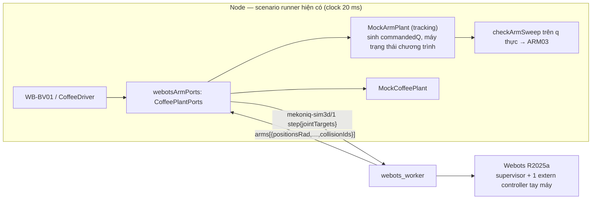

# Simulation Extension R1.1 — Tay máy trong Webots: thiết kế

- **Mã:** MKQ-SIM-ARM-01 · **Ngày:** 2026-11-10 · **Trạng thái:** đề xuất, chờ duyệt (chưa triển khai)
- **Nền:** [2026-11-10-simulation-extension-design.md](2026-11-10-simulation-extension-design.md) (R1, các ID `D01–D17`, `SX-01–15`). Tài liệu này tiếp tục đánh số từ `D18`, `SX-16`.
- **Plan:** [../plans/2026-11-10-webots-arm/README.md](../plans/2026-11-10-webots-arm/README.md)

## 1. Mục tiêu và phạm vi

R1 đã đưa robot bánh xe vào Webots. R1.1 đưa **tay máy 6 khớp** vào Webots trên Mac và chạy hành trình cà phê hiện có (BV01) với tay máy là plant 3D thật, thay cho nội suy khớp của `mock_arm`.

**Trong phạm vi**

- Provider mới `webots_arm`: tay máy là plant Webots có khối lượng, quán tính, giới hạn mô-men và tốc độ; khớp được điều khiển vị trí; góc khớp thực đọc từ cảm biến.
- Hai chương trình đã có `cup-pick`, `cup-place` (`ARM_PROGRAMS`) chạy trên plant đó, qua đúng contract `CellAdapter` hiện tại.
- Scenario `WB-BV01` (kịch bản BV01, AMR và máy pha vẫn là mock) trên set mới `engineering-webots-arm-v1`.
- Bằng chứng: trace khớp `commandedRad`/`actualRad` mỗi tick, sai số bám, ARM03 (capsule-sweep) tính trên **góc khớp thực**, va chạm do Webots báo.
- Lab: preset, nhãn provider, vẽ tay máy theo chuỗi khớp trong 3D.

**Ngoài phạm vi (không làm, không được suy ra từ kết quả)**

- Gắp bằng tiếp xúc và ma sát. Gắp là **sự kiện** (lệnh đóng kẹp tại pose gắp), như `mock_arm` và `sim_gripper.py`. Tiếp xúc/trượt thuộc MuJoCo (R2).
- Chất lỏng. Cà phê vẫn là plant sự kiện `mock_coffee`.
- AMR và tay máy trong cùng một world Webots. AMR trong `WB-BV01` là `mock_amr`; vật cản AMR vẫn đi qua `materializeArmScene` vào bộ kiểm capsule.
- Tay máy thật của sản phẩm. Không có dữ liệu: catalog `ufactory-xarm6`, `ufactory-gripper-g2` rỗng, `xarm_ros2` chưa pin và mesh chưa review license.
- `pid-v1` trong vòng điều khiển khớp (giữ D09: vào vòng plant ở R2 với actuator mô-men).
- LinuxCNC, MoveIt, G-NATIVE-ARM, ALG04 (vẫn thuộc R3).

## 2. Phát hiện từ codebase (đã kiểm 2026-11-10)

| # | Phát hiện | Hệ quả |
|---|---|---|
| G1 | Contract tay máy là **chương trình có tên**, không phải quỹ đạo: `CellAdapter.execute({capability:'start_job',programRef})`; `ARM_CHOREOGRAPHY` trong `packages/cell-adapters/src/mock-arm.ts` là danh sách waypoint khớp (rad) | Giữ nguyên contract. Bộ sinh quỹ đạo của `MockArmPlant` thành nguồn lệnh; Webots thành plant |
| G2 | `MockArmPlant.advance()` gán `s.q=next` (plant ≡ lệnh) và so đích bằng `===` | Cần tách: `commandedQ` do bộ sinh, `q` do plant; đích đạt theo dung sai |
| G3 | `RunProviders.coffeePorts` (`scenario-runner.ts:36`) là seam tiêm `CoffeePlantPorts`; `advance()` đã là `Promise<void>` | Không cần runner mới: BV01 chạy trên scenario runner hiện có, mỗi tick `await` một bước Webots |
| G4 | `engineering-component` đã có khớp `revolute` với `JointLimitsBounded{lower,upper,velocity,effort}`, link có `massKg/comM/inertiaKgM2`, `drive` cho phép `null` | Không cần schema mô hình mới; chỉ cần fixture |
| G5 | `compile.py::_check_model` từ chối mọi khớp khác `fixed`/`continuous` (`JOINT_UNSUPPORTED`) và đòi caster | Thêm nhánh compiler cho tay máy, không nới nhánh AMR |
| G6 | `sim3d-worker-v1`: `step.payload.velocities[{robotId,vMps,omegaRadps}]`, state bắt buộc `poseDriveMap`, `wheels` | Mở nhánh cộng thêm cho tay máy; hash schema đổi |
| G7 | Có **hai** bảng "puma560-reference": bảng Lab `PUMA560_REFERENCE` (`arm-kinematics.ts:24`, waypoint của `mock_arm` viết cho bảng này) và bảng controller `modified-dh.json` (ghi rõ `massKg`, `inertia` là `NOT_PROVIDED: never fill from PUMA defaults`) | Dùng bảng Lab cho hình học; khối lượng là **giả định có nhãn**, không lấy từ tài liệu PUMA |
| G8 | Evidence đã có: `ArmTraceSample{tick,actualRad,commandedRad,…}`, `ArmCollisionEvidenceRecord` (ARM03), `ArmFault` gồm `arm-following-error`, `arm-collision` | Dùng lại, không định dạng mới |
| G9 | Lab vẽ tay máy là một hình trụ (`viewer/twin3d.ts:64`); hàng q1..q6 đã có (`twin/arm/arm-view.ts`) | Vẽ chuỗi khớp là việc mới nhưng nhỏ: `forwardKinematics` đã trả `frames` |
| G10 | Webots cho phép một engine mỗi host (`WEBOTS_MAX_ACTIVE_RUNS`) | `webots_arm` và `webots_3d` dùng chung một slot |
| G11 | Hai Minor hoãn ở R1 (seed uint32 vào `SFInt32`; thư mục `/tmp/webots/<user>`) nằm trong closure portable | R1.1 đằng nào cũng đổi closure, nên sửa luôn ở đây |

## 3. Kiến trúc

Mỗi tick: bộ sinh tính `commandedQ` → worker đặt vị trí đích cho 6 `RotationalMotor` và bước engine 20 ms → `actualQ` quay về → bộ sinh nhận `actualQ` làm `q`, kiểm sai số bám, kiểm sweep, quyết định waypoint đã đạt.

## 4. Quyết định

| ID | Quyết định | Lý do |
|---|---|---|
| D18 | Provider `webots_arm`, set `engineering-webots-arm-v1` = `{amr:mock_amr, arm:webots_arm, coffee:mock_coffee}`, `mode:'simulation'`, `scenarioIds:['WB-BV01']`, `execution{host:'portable_python',clock:'source_fixed_step'}` | Theo đúng cách thêm `webots_3d`; scenario `WB-` không chạy trên set cũ |
| D19 | Không viết runner mới. `plantDispatcher` nhận thêm bảng tay máy: set có `providers.arm==='webots_arm'` → `createScenarioRun` với `coffeePorts=webotsArmPorts(runtime)` | G3 |
| D20 | `MockArmPlant` thêm chế độ `tracking` (tham số dựng, mặc định tắt): `advance()` chỉ tính `commandedQ`; `observe(actualQ)` áp trạng thái thực. Đích đạt khi `max|actual−goal| ≤ reachTolRad` trong `settleTicks` tick liên tiếp. Chế độ mặc định giữ nguyên từng byte hành vi mock | G2; một máy trạng thái chương trình, không sao chép |
| D21 | Điều khiển: vị trí của Webots (`RotationalMotor.setPosition`) với `maxVelocity`, `maxTorque` lấy từ `limits.velocity`, `limits.effort` của fixture. `pid-v1` không trong vòng | D09; ít tham số phải chỉnh nhất |
| D22 | Lỗi bám: `max|actual−commanded| > followTolRad` trong `followTicks` tick → dừng với `ARM_FOLLOWING_ERROR` (dùng đường `arm-following-error` có sẵn). Va chạm Webots báo (tay–vật tĩnh, tay–chính nó ngoài cặp kề) → `ARM_COLLISION` | G8; lỗi dừng ngay, không chờ timeout |
| D23 | Fixture mới `arm-ref-3d-v1` (component engineering): hình học sinh **tất định** từ `PUMA560_REFERENCE` bằng script, link là trụ bán kính `DEFAULT_ARM_GEOMETRY.linkRadiusM`; khối lượng, quán tính, `effort` là **assumed** và ghi `provenance`. Bảng controller và `serve-*` không đổi | G4, G7 |
| D24 | Mọi báo cáo `WB-BV01` mang `not_calibrated` và `armPlant:{engine:'webots_3d',control:'position_servo',grip:'event',dynamics:'assumed'}` | Không ai đọc nhầm thành dynamics thật |
| D25 | Protocol vẫn `mekoniq-sim3d/1`, mở cộng thêm: `create.payload.arms?`, `step.payload.jointTargets?:[{armId,positionsRad[1..8]}]`, snapshot `arms?:[{armId,positionsRad,velocitiesRadS,collisionIds}]` (tối đa 1). Request/response AMR hiện có hợp lệ không đổi | G6; không cần `/2` |
| D26 | World tay máy sinh từ tài liệu mới `arm-scene-3d-v1` (TS dựng từ `armCollisionProfile.baseInMap`, vật cản tĩnh của `declareArmScene`, fixture tay máy). World **không** chứa AMR, cốc hay máy pha | Ngoài phạm vi §1; AMR động vẫn vào bộ kiểm capsule |
| D27 | Gắp là sự kiện: `gripper` và `holding` do máy trạng thái quyết định ở pose gắp; cốc đang giữ là capsule trong `checkArmSweep`. Webots không mô phỏng kẹp | §1 |
| D28 | ARM03 tính trên **`actualQ`** từng tick (đoạn `prevActual→actual`), không phải trên lệnh | Đó là thứ plant 3D thêm được so với mock |
| D29 | Lặp lại: hai run cùng seed phải cùng outcome và trace khớp lệch ≤ `repeatJointRad` (đo ở X00, ghi vào oracle profile). Không so digest | Engine không tái lập từng bit (R1: 1e-12 m) |
| D30 | Một engine mỗi host: `webots_arm` và `webots_3d` đếm chung `WEBOTS_MAX_ACTIVE_RUNS`; chung cờ `MEKONIQ_LAB_WEBOTS=1`, chung `.venv-webots` | G10; không thêm cờ |
| D31 | Sửa luôn hai Minor R1 trong closure: `engineSeed` đưa về `[0, 2³¹−1]` trước khi ghi `WorldInfo.randomSeed`; worker dò đúng thư mục tạm Webots thực dùng | G11 |
| D32 | Kết thúc R1.1 phải **ghi lại** bằng chứng R1 (IR-SIM, R-MOCK, R1) trên commit phát hành, vì schema và closure đổi. Bản ghi R1.1 là `sim-extension/r11-candidate-01`, mang bản sao bản ghi R1 cùng commit | Quy ước repo: bản ghi mô tả đúng runtime |
| D33 | X00 là spike có tiêu chí dừng (§6.1). Trượt → dừng, báo người dùng; không hạ ngưỡng để qua | Tay máy có trọng lực với khối lượng giả định có thể không đứng được dưới servo vị trí |

## 5. Global Constraints

Giữ toàn bộ Global Constraints của plan R1 (Node 24.22.2, pnpm 10.32.1, Python 3.11 từ lock, `PYTHONDONTWRITEBYTECODE=1`, tick 20 ms, mét/radian, không fallback provider, engine vắng → `not_run`, không `accepted:true`, không đụng `trial/`, `web/`, cổng 1880/1884, không push `main` khi chưa có lệnh). Thêm:

- Chunk evidence IR-SIM và `serve-demo-v1`, `serve-3d-v1` không đổi byte. `mock-default` BV01: báo cáo trước và sau D20 có cùng `outcomeDigest`.
- Schema chỉ mở cộng thêm (D25). Request AMR ghi lại từ R1 phải còn hợp lệ với schema mới.
- Góc khớp ngoài `limits` không bao giờ được gửi tới engine: worker từ chối `JOINT_TARGET_OUT_OF_RANGE`, không kẹp im lặng.
- Số liệu dynamics luôn kèm `not_calibrated`.

## 6. Yêu cầu

### 6.1 Spike X00 — tiêu chí dừng

World viết tay, một tay máy theo `PUMA560_REFERENCE` với khối lượng giả định. Đạt **cả** sáu:

1. Giữ pose `home` 10 s mô phỏng, sai số khớp ≤ 0,005 rad, không NaN.
2. Chạy hết waypoint của `cup-pick` rồi `cup-place` ở tốc độ của `MOCK_ARM_PARAMS`, sai số bám đỉnh ≤ 0,05 rad.
3. Dừng tại mỗi waypoint trong ≤ 25 tick với sai số ≤ 0,01 rad.
4. Hai lần chạy cùng seed: trace khớp lệch ≤ 1e-6 rad (nếu lớn hơn, ghi số đo và đề xuất `repeatJointRad`; trên 1e-3 là trượt).
5. p95 thời gian tick ≤ 15 ms trên máy này.
6. Webots báo va chạm khi đặt một hộp tĩnh cắt đường đi, và không báo khi không có hộp.

Đầu ra: `docs/research/2026-11-webots-arm-spike.md` với số đo và các tham số chọn (`reachTolRad`, `settleTicks`, `followTolRad`, `followTicks`, `repeatJointRad`, `effort` từng khớp).

### 6.2 Yêu cầu chức năng

| ID | Yêu cầu |
|---|---|
| SX-16 | Catalog có `webots_arm` và set `engineering-webots-arm-v1`; cờ tắt → `WEBOTS_UNCONFIGURED`, mọi set khác không đổi |
| SX-17 | Schema `sim3d-worker-v1` và `arm-scene-3d-v1` mở theo D25, D26; `pnpm contracts:generate` không drift |
| SX-18 | Fixture `arm-ref-3d-v1` sinh tất định; chạy lại script cho đúng byte đã commit |
| SX-19 | Compiler sinh world tay máy: mỗi khớp revolute → `HingeJoint` + `RotationalMotor` + `PositionSensor`; từ chối khối lượng ≤ 0, thiếu quán tính, mesh, khớp `prismatic`/`continuous` trong tay máy, quá 8 khớp |
| SX-20 | Parity tĩnh: FK tính từ anchor/axis trong world đã sinh khớp `forwardKinematics` (TS) ≤ 1e-9 m tại các pose của `arm-fk-golden.json` |
| SX-21 | Worker: `create` với `arms`, `step` với `jointTargets`, snapshot `arms`; giữ ACK, clock, priming và idempotency như AMR |
| SX-22 | `webotsArmPorts` chạy `cup-pick`, `cup-place` tới `completed` với `TransferEvidence` như mock |
| SX-23 | Lỗi bám và va chạm dừng chương trình ngay với mã ở D22; cốc đang giữ không bao giờ được thả khi lỗi |
| SX-24 | Mất worker hoặc engine giữa chương trình → outcome `unknown`, không gửi lại, không tiến trình sót |
| SX-25 | `WB-BV01` hoàn tất: `completed`, `served=2`, cốc ở `table:…`, ARM03 `pass` trên `actualQ` |
| SX-26 | Report có trace khớp (lệnh/thực), sai số bám đỉnh và RMS từng khớp, khối `armPlant` (D24) |
| SX-27 | Readiness của set: version, lock, slot engine dùng chung, smoke `create` thật trên scene tay máy |
| SX-28 | Lab: preset `webots-coffee`, nhãn provider trên hàng khớp (thực/lệnh), tay máy vẽ theo chuỗi khớp trong 3D; cờ tắt → nút bị chặn có lý do |
| SX-29 | Qualification, recorder `--release r1.1`, guard acceptance; `accepted:false` |
| SX-30 | D31: seed trong `[0,2³¹−1]`, thư mục tạm đúng; có test |

### 6.3 Case và gate

| Case | Nội dung | Gate |
|---|---|---|
| WA01 | Fixture tất định + parity tĩnh (SX-18, SX-20) | G-WA1 |
| WA02 | Readback từ engine: khối lượng link, trục khớp, giới hạn khớp đúng fixture | G-WA1 |
| WA03 | Clock/ACK/idempotency với `jointTargets`; target ngoài giới hạn bị từ chối | G-WA1 |
| WA04 | `cup-pick` + `cup-place` hoàn tất trên engine thật, sai số bám trong ngưỡng | G-WA2 |
| WA05 | `WB-BV01` đầu-cuối (SX-25) | G-WA2 |
| WA06 | Lỗi: va chạm chèn vào, lỗi bám (hạ `effort`), giết worker, giết engine, cancel khi đang giữ cốc | G-WA2 |
| WA07 | Lặp lại cùng seed (D29) | G-WA2 |
| WA08 | Evidence và report đầy đủ (SX-26), đọc lại được | G-WA2 |
| INT13 | Lab chạy `WB-BV01` trên Webots thật (Playwright) | G-INT3 |
| INT14 | Cờ tắt và set cũ không đổi; BV01 mock cùng `outcomeDigest` | G-INT3 |
| REG02 | Bản ghi IR-SIM, R-MOCK và R1 ghi lại trên cùng commit, mọi gate cũ vẫn `tested` | G-REG2 |

**Không được suy ra từ các gate này:** lực gắp, cốc trượt, đổ, tải thật của tay máy, an toàn người, hành vi LinuxCNC/MoveIt, tay máy sản phẩm.

## 7. Bố trí file

| Vị trí | Thay đổi |
|---|---|
| `packages/contracts/schemas/sim3d-worker-v1.schema.json` | nhánh `arms`, `jointTargets` |
| `packages/contracts/schemas/arm-scene-3d-v1.schema.json` | mới |
| `packages/cell-adapters/src/mock-arm.ts` | chế độ `tracking`, `observe()` |
| `packages/lab-runtime/src/v2/capabilities.ts` | backend, set |
| `packages/lab-runtime/src/v2/simulation3d/arm-ports.ts`, `arm-scene.ts` | mới |
| `packages/lab-runtime/src/v2/navigation2d/readiness.ts`, `simulation3d/readiness.ts` | dispatcher, readiness, slot chung |
| `packages/lab-runtime/src/v2/scenario-registry.ts`, `scenario-matrix.ts` | `WB-BV01` |
| `robotics/simulation-3d/fixtures/arm-ref-3d-v1/`, `scripts/generate-arm-fixture.mjs` | mới |
| `robotics/simulation-3d/webots_worker/{compile,session,engine,supervisor}.py`, `arm_controller.py` | nhánh tay máy, D31 |
| `scripts/sim-extension-qualification.mjs`, `record-sim-extension.mjs`, `export-lab-runtime.mjs` | bảng r1.1 |
| `lab/src/scenarios/{catalog,support}.ts`, `viewer/twin3d.ts`, `twin/arm/*`, `ui/*` | preset, nhãn, vẽ chuỗi khớp |

## 8. Mặc định cần người dùng xác nhận

1. **Tay thay thế.** Dùng hình học `PUMA560_REFERENCE` của Lab với khối lượng giả định. Nếu có dữ liệu tay pha cà phê thật (DH hoặc URDF, khối lượng, mô-men khớp), fixture đổi ở X02 và mọi thứ sau đó giữ nguyên.
2. **Gắp là sự kiện, cà phê là mock.** Vật lý gắp để R2.
3. **AMR là mock trong `WB-BV01`.** Ghép AMR Webots và tay máy vào một world là release sau.
4. **Vẽ chuỗi khớp trong Lab** nằm trong R1.1 (X07). Có thể cắt mà không ảnh hưởng gate G-WA1/2.
5. **Sửa hai Minor R1 (D31)** trong R1.1.
6. **R1.1 chạy trước R2.** R2 (MuJoCo) sau đó nhận cả AMR lẫn tay máy qua cùng protocol.

## 9. Ước lượng

| Gói | Ngày kỹ sư |
|---|---|
| X00 spike | 1–2 |
| X01–X04 contract, fixture, compiler, worker | 4–6 |
| X05–X06 ports, scenario, lỗi | 3–4 |
| X07 Lab | 2–3 |
| X08 qualification + ghi lại (≈ 3 giờ máy) | 1–2 |
| **Tổng** | **11–17** |

Rủi ro lớn nhất: X00 tiêu chí 1–3 (servo vị trí với khối lượng giả định). Nếu trượt, lựa chọn là tăng `effort` giả định (vẫn `assumed`) hoặc chờ dữ liệu tay thật; không chuyển sang điều khiển động học (đặt góc khớp trực tiếp), vì khi đó Webots không thêm gì so với mock.
