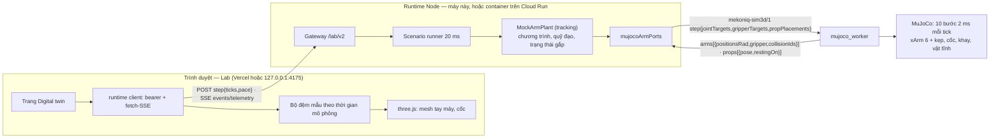

# Simulation Extension R2a — tay máy thực tế (MuJoCo), mô phỏng từ web, UI gọn: thiết kế

- **Mã:** MKQ-SIM-R2A-01 · **Ngày:** 2026-11-12 · **Trạng thái:** đã duyệt 2026-11-12 (người dùng); đang triển khai theo plan
- **Nền:** [R1](2026-11-10-simulation-extension-design.md) (`D01–D17`, `SX-01–15`), [R1.1](2026-11-10-webots-arm-design.md) (`D18–D33`, `SX-16–30`). Tài liệu này đánh số tiếp từ `D34`, `SX-31`; phát hiện đánh số `H1…`.
- **Nghiên cứu:** [docs/research/2026-11-12-realistic-arm-web-ui.md](../../research/2026-11-12-realistic-arm-web-ui.md) (nguồn, phiên bản, mục chưa kiểm).
- **Plan:** [../plans/2026-11-12-realistic-arm-web-ui/README.md](../plans/2026-11-12-realistic-arm-web-ui/README.md)

## 1. Mục tiêu và phạm vi

R1.1 đã cho tay máy chạy trong Webots, nhưng đó là hình học PUMA560 vẽ bằng trụ, khối lượng giả định, gắp là sự kiện, hình cập nhật vài lần mỗi giây, chỉ chạy được khi UI và runtime cùng ở `127.0.0.1`, và màn hình chạy dài hơn bốn lần chiều cao màn hình. R2a sửa ba việc đó, mỗi việc là một phần có gate riêng:

| Phần | Mục tiêu | Kết quả nhìn thấy được |
|---|---|---|
| **A — Tay máy thực tế** | xArm 6 và tay kẹp chạy trong MuJoCo trên Mac: hình học, giới hạn, khối lượng của hãng; quỹ đạo có gia tốc; gắp cốc bằng tiếp xúc và ma sát | Cốc là vật thể: được kẹp, nhấc, mang đi, đặt lên khay; trượt thì rơi và được ghi nhận |
| **B — Mô phỏng từ web** | Lab trên web điều khiển một process runtime: hôm nay là process trên máy người dùng, sau này là cùng process đó trong container trên Cloud Run | Mở Lab đã deploy, bấm Kết nối, chạy `MJ-BV01`, hình chuyển động theo thời gian thực |
| **C — UI gọn** | Màn hình Digital twin lấy khung 3D làm trung tâm; chỉ luôn hiện thứ cần để chạy và hiểu trạng thái; chi tiết mở khi cần | Không cuộn trang khi chạy; tay máy vẽ bằng mesh; chi tiết kỹ thuật nằm trong một bảng bên phải |

**Trong phạm vi**

- A: provider `mujoco_arm`, set `engineering-mujoco-arm-v1`, scenario `MJ-BV01` (kịch bản BV01; AMR và máy pha vẫn là mock); fixture `xarm6-g2-v1` nhập từ nguồn của UFACTORY; worker `mujoco_worker`; quỹ đạo `quintic-sync-v1`; gắp tiếp xúc; cốc và khay là vật thể trong cảnh.
- B: phiên bearer và allowlist origin/host ở gateway; `step` có nhịp thời gian thực; Lab chọn được địa chỉ runtime; stream đọc bằng `fetch`; image container chạy headless; runbook Cloud Run.
- C: bố cục mới của trang Digital twin; khung 3D giữ cảnh, vẽ mesh, nội suy giữa hai mẫu; thanh điều khiển chung cho chạy và xem lại; bảng chi tiết; chế độ xem.
- Bằng chứng: bản ghi `sim-extension/r2a-candidate-01` và ghi lại các bản ghi cũ trên cùng commit.

**Ngoài phạm vi (không làm, không được suy ra từ kết quả)**

- Chất lỏng. Cà phê vẫn là `mock_coffee`; khối lượng đồ uống trong cốc là một số giả định.
- AMR trong MuJoCo. AMR là `mock_amr`; khay nhận cốc là vật tĩnh đứng thay cho khay của AMR đã vào vị trí. AMR tải trọng trong MuJoCo là R2b (phạm vi R2 cũ của spec R1 §7, không đổi nội dung).
- Điều khiển mô-men tự viết, `pid-v1` trong vòng, MoveIt, LinuxCNC, firmware xArm trong Docker (chỉ amd64, bản 2024).
- Vật lý chạy trong trình duyệt (MuJoCo WASM), truyền pixel, WebRTC, WebSocket.
- Nhiều người dùng trên cloud, lưu run bền trên cloud, IAP.
- Thiết kế lại các trang Lab khác (Design, Assembly, Restaurant, Scenarios, Results, Deployment).
- Webots: giữ nguyên làm backend hồi quy, không thêm tính năng, không xóa.
- Hiệu chuẩn. Mọi số dynamics vẫn mang `not_calibrated`.

## 2. Phát hiện (codebase và nghiên cứu, kiểm 2026-11-12)

| # | Phát hiện | Hệ quả |
|---|---|---|
| H1 | Lab chỉ gọi runtime cùng origin (`/lab/v1`, `/lab/v2`) bằng cookie `HttpOnly; SameSite=Strict` + CSRF (`lab/src/scenarios/controls.ts:112`, `v2/gateway.ts:72`). Gateway bind `127.0.0.1`, chỉ nhận Host và Origin `127.0.0.1:4175/4176` (`src/gateway.ts:11,42,89`) | Lab trên Vercel không nối được process nào. Cần phiên không dựa cookie và allowlist cấu hình được |
| H2 | Stream là hai `EventSource` (sự kiện bền có cursor, telemetry có mất) cùng đường hỏi định kỳ; `EventSource` được tiêm qua `StreamDeps` (`lab/src/runtime/stream.ts:14`) | `EventSource` không gửi được header: thay bằng một lớp đọc SSE qua `fetch` cùng giao diện, phần còn lại của `stream.ts` không đổi |
| H3 | Trình duyệt bơm `step{ticks:25}` rồi tự chờ (`workspace.ts:270`); runtime chạy 25 tick liền nhau (`scenario-runner.ts:404`); telemetry ghi 10 Hz thời gian mô phỏng và mỗi 100 ms chỉ đẩy mẫu mới nhất (`telemetry.ts:6`, `event-stream.ts:55`) | Ở 1× hình chỉ đổi khoảng 2 lần/giây (suy ra từ code, chưa đo). Nhịp thời gian thực phải nằm ở runtime |
| H4 | Khung 3D dựng lại mọi vật mỗi lần cập nhật và chỉ vẽ khi có dữ liệu (`twin3d.ts:59`); tay máy là trụ và cầu dựng từ gốc khớp của fixture (`arm-chain.ts`, `arm-frames.ts`) | Vẽ mesh cần cảnh giữ nguyên, chỉ đổi phép biến đổi; `armFrames` dùng lại được |
| H5 | Trang Digital twin sau một run cao 4043 px ở bề rộng 1440; khung 3D chiếm khoảng 24 % một màn hình; 10 thẻ preset, chọn backend, lịch lỗi, tốc độ, vận hành, báo cáo, bằng chứng, đối tượng, bảng kỹ thuật đều hiện cùng lúc (`workspace.ts:168-189`) | Phần C |
| H6 | `MockArmPlant` đã nhận `model` và `tracking`, nhưng waypoint `W` và `ARM_CHOREOGRAPHY` là hằng của module viết cho PUMA560; chuyển động là kẹp bước từng khớp ở 10 % tốc độ, các khớp không đồng bộ; gắp và thả là sự kiện tức thời trong `complete()` (`mock-arm.ts:12,110,126`) | Chương trình và kiểu chuyển động thành tham số dựng; mặc định giữ nguyên từng byte hành vi mock |
| H7 | `engineering-component` đã có hình `mesh` (`blobSha256`, `scale`) và `SourceRef.kind` gồm `manufacturer`, `measured`, `derived`, `assumed` | Không cần schema model mới; nguồn gốc từng số ghi được ngay |
| H8 | `sim3d-worker-v1` có `arms`, `jointTargets` (tối đa 8 khớp) nhưng không có tay kẹp và vật tự do; `SIM3D_WIRE.module` cố định `webots_worker` (`simulation3d/worker-client.ts:11`); dispatcher chọn plant tay máy theo id provider (`navigation2d/readiness.ts:52`) | Mở cộng thêm protocol; thêm wire spec thứ hai |
| H9 | Catalog `ufactory-xarm6` rỗng; `robotics/manipulation/vendor.lock.json` còn `VENDOR_COMMIT_UNPINNED`, `MESH_LICENCE_UNREVIEWED`; `selection.md` chọn xArm 6 + Gripper G2. `scripts/import-engineering-vendor.mjs` đã có: nhập file theo commit, sha256, license | Dùng script đó; hai blocker trên được gỡ ở M02 |
| H10 | `forwardKinematics`, `solvePose` (`models/arm-kinematics.ts`) và `checkArmSweep` (`models/arm-collision.ts`) nhận model modified-DH bất kỳ; UFACTORY công bố bảng D-H, khối lượng và trọng tâm link của xArm 6. Nhưng: `ArmSourceModel.provenance` là literal `'illustrative_reference'`; `ArmGeometry` có một bán kính cho mọi link và cốc đang giữ là capsule dọc trục công cụ; `validateArmCollisionProfile` (`models/arm-scene.ts:22`) chỉ nhận profile của PUMA560. `checkArmSweep` đã có tùy chọn `allowedPairs` | Kinematics TS dùng lại được với một bảng tham số và ba mở rộng cộng thêm nhỏ (D39, D48) |
| H11 | MuJoCo 4.0.1 (2026-11-11): `mujoco-core` chỉ cần numpy, không GL, có wheel cp311 cho macOS arm64 và manylinux. 4.0.0 có lỗi solver phân kỳ, sửa ở 4.0.1. Bit-exact chỉ trong cùng phiên bản và kiến trúc | Một worker chạy được trên Mac lẫn container. So trace giữa Mac và cloud phải dùng dung sai |
| H12 | Menagerie không có xArm 6 và Gripper G2. `xarm_ros2` (BSD-3) có URDF, mesh, quán tính. Hãng có `ufactory_robot_viewer`: xArm 6 + G2 trong MuJoCo, gắp không dùng weld. Nguồn mesh G2 có phần chưa truy được | Model phải nhập và sinh, không lấy sẵn. Gắp bằng ma sát là khả thi. License G2 phải xét ở M00 |
| H13 | Trang HTTPS gọi `http://127.0.0.1`: Chrome/Edge ≥ 142 và Firefox ≥ 151 hỏi quyền một lần; Safari không cho (lỗi WebKit 171934). Header `Access-Control-Allow-Private-Network` đã bỏ | Launcher cục bộ vẫn là đường mặc định; Lab trên web nối máy cục bộ là tiện ích cho Chrome/Edge/Firefox |
| H14 | Cloud Run service gen2 chạy được tiến trình con và SSE; request tối đa 60 phút; hệ file trong RAM; trạng thái trong RAM cần đúng một instance | Cùng image chạy được; run trên cloud không bền |
| H15 | Foxglove, Viser, Meshcat, Webots, Gazebo đều truyền trạng thái và vẽ trong trình duyệt ở 25–64 Hz; chỉ Isaac Sim truyền pixel | Giữ kiến trúc hiện tại |
| H16 | Foxglove, Rerun, MuJoCo simulate, Isaac Sim, PolyScope X: viewport ở giữa, một thanh điều khiển, panel bên đóng mở được, một bảng theo đối tượng đang chọn, một danh sách "Problems" | Bố cục phần C (§6.3) |
| H17 | Máy này có Docker 29.8.2 đang chạy, `gcloud`, `uv`, `python3.11` | Image thử được tại chỗ |
| H18 | Project (`lab-project-v2`) chỉ có `armCollisionProfile.baseInMap`, hai chiều cao đùn và điểm giao trên sàn; không có pose máy pha, bệ vòi, khay hay kích thước cốc. Trạm cà phê hiện có đặt base ở z = 1,2 m và khay AMR ở 0,5 m, nhiều khả năng ngoài tầm với 0,7 m của xArm 6 (chưa tính) | Hình học trong trạm không lấy được từ project: nó là dữ liệu của fixture, trong khung base (D42, D47); cần một project trạm mới cho xArm 6 |
| H19 | Schema `twin-sample-v2` đóng: `TwinArmState.gripper` là enum mở/đóng, `TwinCupState` chỉ có chủ giữ, không có pose | Phải mở cộng thêm schema này thì Lab mới vẽ được độ mở kẹp và cốc theo plant |
| H20 | Có hai runner: `scenario-runner.ts` (mock, tay máy plant) và `navigation2d/runner.ts:501` (IR-SIM, Webots AMR). Mỗi `step` là một receipt lưu lại; runner từ chối sau 10 000 receipt (`scenario-runner.ts:380`); checkpoint ghi hai lần mỗi action | `pace` phải vào cả hai runner; số tick mỗi `step` có nhịp phải đủ lớn để `maxTicks` 180 000 không chạm giới hạn receipt |

## 3. Kiến trúc



Mỗi tick: bộ sinh quỹ đạo tính `commandedQ` và độ mở kẹp → worker chạy 10 bước vật lý → góc khớp thực, độ mở kẹp, pose cốc, tiếp xúc quay về → máy trạng thái nhận trạng thái thực, kiểm sai số bám, kiểm ARM03, quyết định waypoint đã đạt và cốc có được giữ không. Chỉ `step` làm thời gian trôi; `step` có `pace` làm runtime giữ nhịp thời gian thực trong lúc xử lý request đó.

## 4. Quyết định

### 4.1 Phần A — tay máy MuJoCo

| ID | Quyết định | Lý do |
|---|---|---|
| D34 | Phát hành này tên **R2a**. Ba phần A, B, C có gate riêng và phát hành riêng được. Phạm vi R2 cũ (AMR tải trọng, `G-MJ1`, `G-X1`) đổi tên **R2b**, nội dung không đổi | Tay máy và web là thứ người dùng cần trước; không để gate này chờ gate kia |
| D35 | Engine là MuJoCo. Pin ở M00 theo quy tắc đã duyệt ở spec R1 §7: dòng 4.0.x (`mujoco-core`) nếu bản vá mới nhất đã phát hành ≥ 4 tuần và không có lỗi chặn; nếu không thì `mujoco 3.17.x`. MJCF sinh ra chỉ dùng phần hợp lệ ở cả hai dòng | H11; 4.0 mới 6 ngày và đã có một bản vá solver |
| D36 | Provider `mujoco_arm`; set `engineering-mujoco-arm-v1` = `{amr:mock_amr, arm:mujoco_arm, coffee:mock_coffee}`, `mode:'simulation'`, `scenarioIds:['MJ-BV01']`, `bundle:false`, `execution` như set Webots arm; cờ `MEKONIQ_LAB_MUJOCO=1`; venv `.venv-mujoco`; tool root `robotics/simulation-mujoco`; capability `sim3d_arm_contact_v1`; một run mỗi runtime (`MUJOCO_MAX_ACTIVE_RUNS=1`), slot riêng, không chung với Webots. Set này chỉ nhận project có `armCollisionProfile.modelId:'xarm6-reference'`; các set khác tiếp tục chỉ nhận `puma560-reference` (`ARM_MODEL_MISMATCH`) | Theo đúng cách thêm `webots_arm` (D18, D30); MuJoCo không cần GUI nên không tranh slot Webots |
| D37 | Fixture `xarm6-g2-v1` là một component engineering (H7) sinh **tất định** bằng script từ file hãng đã nhập qua `import-engineering-vendor.mjs` (commit, sha256, license từng file). Gốc khớp, trục, giới hạn, lực, khối lượng, trọng tâm, quán tính mang `manufacturer`; mesh hiển thị và va chạm là blob theo sha256; má kẹp va chạm là hộp. Hệ số điều khiển, ma sát, tham số tiếp xúc nằm ở `physics.json`; hình học trạm trong khung base (bệ vòi, khay, cốc, khung gắp) nằm ở `cell-layout.json`; cả hai mang `assumed`. Fixture kèm một project trạm cà phê cho xArm 6 | H9, H12, H18; component là nguồn sự thật như D23, engine chỉ là bản biên dịch |
| D38 | Tay kẹp: Gripper G2 nếu ở M00 mọi file G2 có commit và license truy được; nếu không thì xArm Gripper từ `xarm_ros2`, fixture ghi `gripper.substitute:true`. Hình dạng má kẹp riêng của sản phẩm chưa có nên má kẹp là hộp `assumed` | H12; không đưa file không rõ nguồn vào cây |
| D39 | Kinematics phía TS: thêm `XARM6_REFERENCE` (id `xarm6-reference`, modified D-H do hãng công bố, `provenance:'manufacturer_nominal'`, kiểu được nới cộng thêm). FK của bảng này, FK của Robotics Toolbox (`rtb_fk` sẵn có) và vị trí flange đọc từ engine phải khớp trong dung sai đo ở M00; lệch quá 1 mm thì dừng và báo. `validateArmCollisionProfile` nhận thêm tham số model (mặc định PUMA560, hành vi cũ không đổi) | H10; `checkArmSweep` và `solvePose` dùng bảng này nên nó phải đúng với thứ engine mô phỏng |
| D40 | MJCF sinh trực tiếp từ component + `physics.json` + cảnh trong `mujoco_worker/compile.py`, tất định. Không nhập URDF lúc chạy | D04; URDF import của MuJoCo không có actuator và bỏ qua lỗi im lặng (F9) |
| D41 | Vật lý: bước 2 ms, 10 bước mỗi tick, tích phân `implicitfast`, nón ma sát elliptic. Khớp tay máy là actuator vị trí có giới hạn lực (lực từ fixture, hệ số `assumed`). `pid-v1` không trong vòng | H12; đây là cách hãng và Menagerie mô hình hóa servo khớp; giữ D09 |
| D42 | Chương trình thành dữ liệu dựng: `ArmProgramSet{modelId, waypoints, choreography, motion, contact, collision}`. Mặc định là hằng PUMA560 hiện có. Với `mujoco_arm`, waypoint tính bằng `solvePose` **lúc sinh fixture** từ các pose nhiệm vụ của `cell-layout.json` (trước gắp, gắp, nhấc, trước đặt, đặt, về; gắp ngang) và commit thành `programs.json` cùng sai số IK; pose không tới được hoặc số điều kiện vượt `MAX_CONDITION` làm script sinh fixture thất bại. Project chỉ đặt trạm vào bản đồ bằng `baseInMap`; khay của trạm lệch điểm `coffee_pickup` của project quá 0,05 m → readiness `ARM_CELL_LAYOUT_MISMATCH`. Bảng waypoint và digest nằm trong evidence | H6, H18; chương trình là dữ liệu đã review, không tính lại lúc chạy |
| D43 | Chuyển động `quintic-sync-v1`: mỗi đoạn waypoint là một quỹ đạo bậc năm nghỉ-tới-nghỉ, mọi khớp cùng thời gian, thời gian đoạn lấy từ giới hạn vận tốc và gia tốc khớp nhân `speedFraction`. Viết bằng TS thuần trong bộ sinh lệnh. Mock giữ `linear-clamp` | Một máy trạng thái, không thêm dependency. Trần: không nối trơn qua điểm trung gian, không giới hạn jerk; khi cần thì đưa Ruckig vào worker |
| D44 | Gắp bằng tiếp xúc, không weld. Máy trạng thái ra lệnh đóng/mở kẹp ở đúng các bước `grip`/`release` hiện có rồi chờ kẹp ổn định. `holding` và `objectPresent` lấy từ plant (cốc đang chạm cả hai má kẹp); kiểm nhấc lấy từ độ cao cốc; thả chỉ thành công khi cốc nằm yên trên khay. Cốc rời kẹp khi chương trình đang giữ → dừng `CUP_DROPPED`. Lỗi không bao giờ **ra lệnh** mở kẹp; cốc rơi do vật lý là quan sát được ghi lại | H12; đây là thứ plant mới thêm được so với R1.1 |
| D45 | Cốc là vật tự do khai trong cảnh: hình trụ của component catalog `cup-ref` (đường kính 80 mm, cao 100 mm, 0,02 kg) cộng khối lượng đồ uống giả định. Runtime đặt cốc lên bệ dưới vòi khi máy pha mock báo cốc ở vòi, và cất cốc khỏi cảnh khi quyền giữ chuyển sang AMR mock. Khay nhận là vật tĩnh tại pose giao, luôn có mặt | AMR ngoài phạm vi §1; không có cốc "biến mất" trong lúc tay máy còn giữ |
| D46 | Protocol vẫn `mekoniq-sim3d/1`, mở cộng thêm: `step.payload.gripperTargets?:[{armId,openingM}]`, `step.payload.propPlacements?:[{propId,pose\|null}]`; snapshot `arms[].gripper?:{openingM,heldPropIds}`, `props?:[{propId,position,quaternionXyzw,restingOn}]`. Telemetry `twin-sample-v2` mở cộng thêm: `TwinArmState.gripperOpeningM?`, `TwinCupState.positionM?`, `quaternionXyzw?`, `restingOn?`. Request, response và mẫu của AMR và Webots arm hợp lệ không đổi | H8, H19; D25 |
| D47 | Cảnh là tài liệu mới `arm-cell-scene-v1`, TS dựng từ `baseInMap` và vật tĩnh của project cộng `cell-layout.json` của fixture: tay máy và base, vật tĩnh, bệ vòi, khay, cốc, khung gắp, `allowedContacts`, `world3d` giả định, `engine{id:'mujoco_3d',timestepMs:2,substeps:10}`, `engineSeed`. `arm-scene-3d-v1` của R1.1 không đổi | D26, H18 |
| D48 | ARM03 vẫn tính bằng capsule-sweep trên góc khớp thực (D28). `ArmGeometry` mở cộng thêm bán kính riêng từng link và trục của cốc đang giữ trong khung công cụ (gắp ngang: cốc vuông góc trục tiếp cận). Cặp trong `allowedContacts` (kẹp hoặc cốc đang giữ với bệ vòi, khay) đi qua tùy chọn `allowedPairs` sẵn có và không tính là va chạm; danh sách loại trừ nằm trong evidence. `collisionIds` của worker chỉ gồm tiếp xúc link tay máy với vật tĩnh hoặc với link không kề | H10; tay kẹp phải chạm vùng gắp, không có danh sách này thì mọi lần gắp đều là "va chạm" |
| D49 | Mọi báo cáo `MJ-BV01` mang `not_calibrated` và `armPlant:{engine:'mujoco_3d',engineVersion,control:'position_actuator',grip:'contact',dynamics:'manufacturer_nominal+assumed'}` | D24; khối lượng của hãng là danh định, không phải số đo |
| D50 | Lặp lại: hai run cùng seed trên cùng máy lệch ≤ `repeatJointRad` (đo ở M00). Không so giữa hai kiến trúc. Run trong container không bao giờ là bằng chứng cho `G-MA1`, `G-MA2`; nó chỉ chứng minh image chạy được (`G-RT2`) | H11; D29 |
| D51 | Lab vẽ tay máy bằng mesh hiển thị của fixture (STL, `STLLoader` của three đã cài), đặt theo `armFrames`. `sync-engineering-contracts.mjs` chép component, blob mesh và NOTICE sang `lab/fixtures/engineering/xarm6-g2-v1/`. Tổng mesh hiển thị ≤ 8 MB; vượt thì script nhập giảm lưới và ghi tham số. Revision fixture khác revision model của run → vẽ chuỗi trụ như cũ và hiện lý do | H4; mesh đi cùng bản Lab đã ghim nên không cần đường tải mới từ runtime |

### 4.2 Phần B — mô phỏng từ web

| ID | Quyết định | Lý do |
|---|---|---|
| D52 | Địa chỉ runtime là một thiết lập của Lab: mặc định cùng origin (`/lab`, launcher như hiện nay, chạy mọi trình duyệt); tùy chọn `http://127.0.0.1:<cổng>` hoặc URL HTTPS. Lab mở từ origin không phải loopback **không tự dò** runtime; kết nối luôn bắt đầu từ một thao tác bấm. *Đã chốt khi triển khai (2026-11-13):* commit của runtime khác commit Lab đã ghim thì chặn tạo run trên **mọi** đích, kể cả cùng origin; không bao giờ chặn ghép nối hay xem | H13: quyền mạng cục bộ chỉ nên hỏi khi người dùng chủ động |
| D53 | `/lab/v2/sessions` trả thêm `sessionToken`; gateway nhận phiên từ `Authorization: Bearer` hoặc cookie hiện có. Phiên đến bằng bearer không cần `X-CSRF-Token` (không có credential tự gửi). `/lab/v1` giữ nguyên, chỉ cùng origin. *Đã chốt khi triển khai (2026-11-13):* Lab giữ token phiên bearer trong session storage của tab trình duyệt (không dùng local storage), xóa khi gặp 401 hoặc khi ngắt kết nối | H1; đường cookie giữ nguyên nên test và bằng chứng cũ không đổi |
| D54 | Bind, Host và Origin thành tham số khởi động: `--bind` (mặc định `127.0.0.1`), `--public-host`, `--allow-origin` (lặp được, khớp chính xác, không wildcard). Mặc định đúng như hôm nay. Preflight cho phép `Authorization`, `Last-Event-ID`; không gửi `Access-Control-Allow-Private-Network` | H13; mặc định đóng |
| D55 | Host không có terminal dùng khóa truy cập `MEKONIQ_LAB_ACCESS_KEY` (≥ 32 ký tự): `/sessions` nhận nó như mã ghép nối nhưng không tiêu hủy; sai quá 5 lần/phút **tính cho cả runtime** (không theo địa chỉ) → 429. Giới hạn này và khóa chỉ có hiệu lực khi biến môi trường được đặt; khi đó khóa là credential duy nhất: không phát hay nhận mã ghép nối nào, route phiên `/lab/v1` bị từ chối. Trần: một khóa chung, một người thuê; nhiều người dùng thì chuyển sang IAP. Bất kỳ ai tới được URL đều có thể giữ cho việc ghép nối bị khóa trong từng phút. (*Đã chốt khi triển khai (2026-11-13):* bản trước ghi "từ một địa chỉ"; sau proxy và trên loopback mọi client có cùng địa chỉ socket, còn `X-Forwarded-For` giả được) | H14 |
| D56 | Stream giữ SSE. Lab đọc bằng `fetch` + `ReadableStream` qua lớp `FetchEventSource` có đúng phần giao diện `EventSource` mà `stream.ts` dùng, gửi bearer và `targetAddressSpace:'loopback'` khi đích là loopback. Nối lại và cursor không đổi | H2; không thêm dependency, chạy qua Cloud Run |
| D57 | `step.payload.pace?:{factor}` (1, 4, 16, 64), ở **cả hai runner** (H20): runtime ngủ giữa các tick để thời gian mô phỏng không vượt thời gian thực × `factor`, tính từ một mốc của đoạn chạy liên tục; chậm quá 250 ms thì đặt lại mốc, không chạy bù (plant chậm hơn nhịp thì run chạy chậm hơn và UI hiện tốc độ đo được). Có `pace` thì `ticks ≤ 50`. Trình duyệt vẫn là thứ duy nhất làm run tiến: Lab gửi liên tiếp các `step` 20 tick, nên `maxTicks` 180 000 cần 9 000 receipt, dưới giới hạn 10 000. Health báo `features.pacedStep` | H3, H20; không có vòng lặp tự chạy ở server nên không có xung đột revision và không tốn CPU khi không ai xem |
| D58 | Hình trực tiếp dùng chính các mẫu 10 Hz của báo cáo; không có đường lấy mẫu thứ hai. Thay đổi duy nhất ở runtime là chu kỳ đẩy 40 ms (giảm trễ). Lab phát mẫu theo thời gian mô phỏng qua bộ đệm trễ cố định 150 ms, nội suy góc khớp và pose giữa hai mẫu đã nhận, không bao giờ vượt mẫu mới nhất | H3, H15; giữ quy tắc "không ngoại suy" của twin và không đổi số mẫu của báo cáo |
| D59 | Một image container: Node 24, `runtime.mjs`, schema, `.venv-mujoco`, tool root MuJoCo; chỉ có mock và `mujoco_arm`; đọc `PORT`; linux/amd64 | H14; Webots cần GUI, IR-SIM và engineering compile chưa ai cần trên cloud |
| D60 | Cloud Run: service gen2, `max-instances=1`, timeout 3600 s, tính tiền theo request, ingress công khai, khóa truy cập từ Secret Manager, allowlist đúng origin của Lab. Run nằm trong RAM và mất khi instance tắt. **Deploy chỉ khi có lệnh của người dùng** (cần project, region, chấp nhận chi phí); trước đó `G-CLOUD1` là `blocked_external` | H14; D57 làm CPU chỉ cần trong lúc có request |

### 4.3 Phần C — UI

| ID | Quyết định | Lý do |
|---|---|---|
| D61 | Chỉ trang Digital twin đổi. Bố cục ba vùng cố định: thanh run, khung nhìn, thanh điều khiển; bảng chi tiết bên phải đóng mặc định. Trang không cuộn dọc ở màn hình ≥ 1024 × 700 | H5, H16 |
| D62 | Hai mức, không hơn. Mức 1 (luôn hiện): tên kịch bản, trạng thái runtime, nhãn "Mô phỏng · chưa hiệu chuẩn", trạng thái run, thời gian mô phỏng, số đã giao, số vấn đề, nút hành động chính, khung nhìn, thanh điều khiển. Mức 2: bảng chi tiết bốn thẻ đặt tên theo nội dung: **Đối tượng**, **Kỹ thuật**, **Báo cáo**, **Thiết lập** | NN/g: tối đa hai mức, tên cửa nói rõ bên trong có gì |
| D63 | Không có công tắc "chế độ kỹ sư". Người xem lại và kỹ sư dùng cùng màn hình; kỹ sư mở thẻ Kỹ thuật | Nielsen 2026: chia theo tần suất việc, không theo vai trò |
| D64 | Readiness, attention và lỗi runtime gom thành một danh sách **Vấn đề** có số đếm trên thanh run; mỗi dòng có câu mô tả, đối tượng liên quan và mã lý do. Vấn đề đầu tiên cần con người xử lý hiện thành một dải "bước tiếp theo" trong khung nhìn | H16 (Foxglove Problems); mã chỉ để chẩn đoán |
| D65 | Khung nhìn giữ cảnh và chỉ đổi phép biến đổi; vẽ theo `requestAnimationFrame` chỉ khi đang có mẫu mới và người dùng không bật giảm chuyển động. Menu **Hiển thị** chứa 3D/2D, các lớp, chú giải và ghi chú nguồn gốc lớp. Có nút về góc nhìn gốc và vừa khung đối tượng chọn. 2D vẫn là đường lùi khi không có WebGL | H4 |
| D66 | Một thanh điều khiển cho cả chạy lẫn xem lại: chạy/dừng, bước +5 s, tốc độ, thời gian mô phỏng, và tốc độ đo được khi nó lệch tốc độ chọn quá 10 %; khi xem lại thêm thanh trượt có mốc sự kiện. Phím: `Space`, `→`, `F` (vừa khung), `I` (bảng chi tiết), `W` (chế độ xem: ẩn hết trừ khung nhìn, nhãn mô phỏng và thanh điều khiển), `?` (bảng phím) | H16 |
| D67 | 10 thẻ preset thay bằng một bộ chọn kịch bản: mục chạy được với runtime đang nối xếp trước; mục không chạy được vẫn hiện, kèm lý do | H5 |
| D68 | Nhãn sự thật không mất: nhãn mô phỏng luôn trên màn hình (biểu tượng + chữ); chế độ, nguồn gốc, hash, mã lý do chuyển vào bảng chi tiết và test khẳng định từng thứ còn tới được (§6.3) | Quy ước repo: không tuyên bố quá bằng chứng |
| D69 | Không thêm dependency, không thêm framework. CSS thêm vào `main.css`; quy tắc CSS của markup bị bỏ được xóa cùng lúc | Giữ phong cách Lab |

### 4.4 Kiểm chứng

| ID | Quyết định | Lý do |
|---|---|---|
| D70 | M00 là spike có tiêu chí dừng (§6.1). Trượt → dừng phần A, báo người dùng; không hạ ngưỡng, không lặng lẽ chuyển sang weld. Phần B (`G-RT1`) và phần C (`G-UI1`) không cần MuJoCo: chúng làm tiếp và kiểm trên BV01 mock | D33; D34 |
| D71 | Kết thúc R2a ghi lại IR-SIM, R-MOCK, R1, R1.1 trên commit phát hành rồi ghi `sim-extension/r2a-candidate-01` (`record-sim-extension.mjs --release r2a`), mang bản sao các bản ghi nền. Gate của phần chưa làm được ghi `blocked` kèm lý do, không ghi `tested`. `accepted:false` | D32: schema và closure đổi; D07 |

## 5. Global Constraints

Giữ toàn bộ Global Constraints của R1 và R1.1. Thêm:

- `mock-default` BV01 giữ nguyên `outcomeDigest` (golden `bv01-mock-golden.test.ts`); world Webots giữ nguyên byte; mọi request AMR và Webots arm đã ghi còn hợp lệ với schema mới.
- Cờ `MEKONIQ_LAB_MUJOCO` tắt → `/health`, bộ chọn, mock, IR-SIM, Webots y như hiện tại.
- Gateway khởi động không tham số có hành vi mạng đúng như hôm nay. Không bao giờ có `Access-Control-Allow-Origin: *`.
- File của hãng chỉ vào cây khi có commit, sha256 và license; NOTICE đi cùng mọi bản sao mesh, kể cả trong Lab đã deploy.
- Lab mở từ origin công khai không gửi request nào tới loopback trước khi người dùng bấm Kết nối.
- Góc khớp và độ mở kẹp ngoài giới hạn không bao giờ tới engine: worker từ chối, không kẹp im lặng.
- Số liệu dynamics luôn kèm `not_calibrated`. Không `accepted:true`.
- Không push `main`, không deploy Cloud Run khi chưa có lệnh.

## 6. Yêu cầu

### 6.1 Spike M00 — tiêu chí dừng

Mã spike nằm ngoài cây git. Đạt **cả** chín:

1. Nhập được URDF, mesh và quán tính xArm 6 ở một commit cố định; mọi file có license ghi được; quyết định tay kẹp theo D38.
2. Model biên dịch trên bản MuJoCo chọn theo D35; giữ `home` 10 s mô phỏng: sai số khớp ≤ 0,005 rad, không NaN, không cảnh báo solver.
3. Chạy trọn chuỗi gắp–đặt bằng `quintic-sync-v1`: sai số bám đỉnh ≤ 0,05 rad; dừng tại mỗi waypoint trong ≤ 25 tick với sai số ≤ 0,01 rad.
4. Gắp ngang: kẹp cốc trụ của `cup-ref` (đường kính 80 mm, cao 100 mm) nặng 0,32 kg (0,02 kg cốc + 0,30 kg đồ uống giả định), nhấc 150 mm, mang qua trọn quỹ đạo đặt; cốc trượt so với kẹp ≤ 5 mm; 10/10 lần với vị trí cốc lệch ngẫu nhiên có seed ±5 mm. Thả: cốc nằm yên trên khay trong ≤ 50 tick, lệch ≤ 10 mm. Bố cục trạm trong khung base (bệ vòi, khay) do spike chọn trong tầm với và ghi lại.
5. Âm tính: hạ ma sát má kẹp xuống 0,1 thì cốc rơi và `heldPropIds` rỗng trong ≤ 25 tick.
6. Hai lần cùng seed: trace khớp lệch ≤ 1e-9 rad (ghi số đo; trên 1e-6 là trượt).
7. p95 thời gian một tick (10 bước) ≤ 5 ms trên máy này; đo thêm trong container linux/amd64 và ghi lại (không là tiêu chí nếu chạy qua giả lập).
8. Vị trí flange: bảng D-H (TS) so với engine tại 20 pose có seed lệch ≤ 1 mm; ghi số đo để chốt dung sai D39.
9. Mesh hiển thị: tổng dung lượng và số tam giác; `STLLoader` đọc được mọi file; ≤ 8 MB hoặc có tham số giảm lưới.

Đầu ra: `docs/research/2026-11-mujoco-arm-spike.md` với số đo và tham số chọn: bản MuJoCo, tay kẹp, bố cục trạm, `kp`/`kv` từng khớp, ma sát, `solref`/`solimp`, `speedFraction`, gia tốc khớp, bán kính capsule từng link, `reachTolRad`, `settleTicks`, `followTolRad`, `followTicks`, `repeatJointRad`, `gripSettleTicks`, `dropTicks`, `liftMinM`, `slipTolM`, `fkTolM`.

### 6.2 Yêu cầu chức năng

| ID | Yêu cầu |
|---|---|
| SX-31 | Catalog có `mujoco_arm` và set `engineering-mujoco-arm-v1`; cờ tắt → `MUJOCO_DISABLED`, mọi set khác không đổi |
| SX-32 | Schema `sim3d-worker-v1`, `twin-sample-v2`, `arm-cell-scene-v1`, `lab-action-v2` mở theo D46, D47, D57; `pnpm contracts:generate` không drift |
| SX-33 | Fixture `xarm6-g2-v1` (component, `physics.json`, `cell-layout.json`, `programs.json`, project trạm) sinh tất định từ file hãng đã nhập; chạy lại cho đúng byte đã commit; NOTICE và manifest nhập đủ license từng file; `vendor.lock.json` có commit và license |
| SX-34 | Compiler MJCF tất định; từ chối khối lượng ≤ 0, thiếu quán tính, khớp không phải `revolute` trong chuỗi tay máy, blob mesh thiếu hoặc sai sha256, quá 8 khớp, `home` ngoài giới hạn |
| SX-35 | Parity: khối lượng link, trục khớp, giới hạn, giới hạn lực đọc lại từ engine bằng fixture; flange TS ↔ RTB ↔ engine trong `fkTolM` |
| SX-36 | Worker: `create`, `step` với `jointTargets`, `gripperTargets`, `propPlacements`; snapshot `arms`, `props`; giữ ACK, clock, idempotency như Webots; target ngoài giới hạn → `JOINT_TARGET_OUT_OF_RANGE` hoặc `GRIPPER_TARGET_OUT_OF_RANGE`, tick không tăng; trạng thái không hữu hạn → `PLANT_UNSTABLE` |
| SX-37 | `ArmProgramSet` và `quintic-sync-v1` trong `MockArmPlant`; không truyền gì thì hành vi mock giữ nguyên từng byte |
| SX-38 | Gắp tiếp xúc theo D44: `objectPresent`, `holding`, kiểm nhấc, kiểm thả đều lấy từ plant; `TransferEvidence.grip='contact'` |
| SX-39 | `MJ-BV01` hoàn tất: `completed`, `served=2`, cốc ở `table:…`, ARM03 `pass` trên góc khớp thực, mỗi lần chuyển cốc có bằng chứng gắp tiếp xúc |
| SX-40 | Lỗi dừng chương trình ngay với mã đúng: vật cản chèn vào → `ARM_COLLISION`; hạ lực khớp → `ARM_FOLLOWING_ERROR`; hạ ma sát má kẹp → thất bại rõ ràng ở bước kiểm nhấc (`TRANSFER_REJECTED`, run `needs_attention`) và/hoặc `CUP_DROPPED`, không bao giờ `completed`, không có lệnh mở kẹp; giết worker → outcome `unknown`, không gửi lại, không tiến trình sót; cancel khi đang giữ cốc → không có lệnh mở kẹp. *Đã chốt khi triển khai (2026-11-13):* bản trước ghi "hạ ma sát → `CUP_DROPPED`". Với ma sát má 0,1 cốc trượt trong lúc nhấc, nên chuyển giao bị từ chối ở bước kiểm nhấc, rồi `CUP_DROPPED` chốt khi cốc rời má kẹp; test khẳng định cả hai theo thứ tự. Lỗi hạ lực khớp chạy trên một bản sao tạm của tool root worker (`physics.json` của fixture không mang giới hạn lực actuator). Ca bệ vòi còn cốc (thêm khi triển khai) kết thúc bằng `ARM_COLLISION` trước khi worker kịp từ chối `PROP_PLACEMENT_OCCUPIED`; lời từ chối đó được chứng minh ở mức worker và ports |
| SX-41 | Report có trace khớp (lệnh/thực), sai số bám đỉnh và RMS, bảng waypoint IK, trace cốc, khối `armPlant` (D49), danh sách `allowedContacts` |
| SX-42 | Readiness của set: venv và lock, phiên bản engine, smoke `create` thật trên cảnh của project, slot, `ARM_SCENE_UNAVAILABLE`, `ARM_MODEL_MISMATCH`, `ARM_CELL_LAYOUT_MISMATCH` |
| SX-43 | Gateway: phiên bearer, allowlist, bind, khóa truy cập, giới hạn thử (D53–D55); mặc định không đổi |
| SX-44 | `FetchEventSource` cho đúng các hành vi `stream.ts` đang dựa vào: nối lại từ cursor, `reset`, heartbeat quá hạn, `session_lost`, `run_lost`, mất mạng |
| SX-45 | `step` có `pace` trên `mock-default` giữ tỉ lệ thời gian mô phỏng/thời gian thực trong ±3 % qua 30 s ở 1× và 4×; từ lúc bấm dừng tới tick cuối ≤ 500 ms ở 1×; runner fixed-step (IR-SIM, Webots) nhận cùng `pace`; không `pace` thì hai runner chạy đúng như hôm nay. *Đã chốt khi triển khai (2026-11-13):* với runner fixed-step, bằng chứng là evidence có nhịp và không nhịp giống hệt nhau cho cùng một chuỗi hành động, và golden không nhịp không đổi mà không gọi đồng hồ thật lần nào; run có nhịp không thể tái tạo golden 500 tick (một `step` có nhịp mang tối đa 50 tick) |
| SX-46 | Bộ đệm mẫu: giá trị hiển thị luôn nằm giữa hai mẫu đã nhận; mẫu cũ quá ngưỡng thì đứng yên và hiện "cũ" như hiện nay |
| SX-47 | Lab: thiết lập địa chỉ runtime, kết nối bằng thao tác bấm, so commit runtime với bản ghim (`RUNTIME_PIN_MISMATCH` chặn chạy), thông báo rõ khi trình duyệt chặn loopback. *Đã chốt khi triển khai (2026-11-13):* lệch commit chặn tạo run trên mọi đích, kể cả cùng origin, và không chặn ghép nối, xem hay đọc báo cáo (D52) |
| SX-48 | Image dựng từ một export sạch; trong container `MJ-BV01` hoàn tất; health chỉ có mock và `mujoco_arm` |
| SX-49 | Runbook và script deploy Cloud Run (`--dry-run` in ra lệnh, không gọi API); deploy thật chỉ theo lệnh |
| SX-50 | Bố cục D61: ở 1440 × 900 khung nhìn ≥ 60 % diện tích cửa sổ khi bảng chi tiết đóng, ≥ 45 % khi mở; trang không cuộn dọc |
| SX-51 | Mức 1 đúng danh sách D62; bảng chi tiết đóng khi mở trang; trạng thái đóng/mở và thẻ đang chọn được nhớ trong trình duyệt |
| SX-52 | Mọi thông tin đang có trên trang hôm nay nằm ở vị trí ghi trong bảng §6.3 |
| SX-53 | Danh sách Vấn đề và dải bước tiếp theo (D64) |
| SX-54 | Thanh điều khiển và phím (D66); xem lại dùng cùng thanh |
| SX-55 | Chế độ xem (`W`) và bảng phím (`?`) |
| SX-56 | Bộ chọn kịch bản (D67) |
| SX-57 | Tay máy, tay kẹp vẽ bằng mesh; cốc vẽ tại pose plant báo; flange của chuỗi mesh trùng flange tính từ gốc khớp của component ≤ 1e-6 m (không phải bảng D-H, thứ được phép lệch engine tới `fkTolM`); mesh không tải được thì vẽ chuỗi trụ và báo `ARM_MESH_UNAVAILABLE`. *Đã chốt khi triển khai (2026-11-13):* phần kiểm ở mức launcher nằm trong spec của launcher MuJoCo (`mujoco-mesh-fallback.spec.ts`); e2e trên launcher mock mà plan định được thay bằng spec trình duyệt chỉ có UI (`arm-mesh.spec.ts`, `arm-cell.spec.ts`), vì backend mock không sinh mẫu `mujoco_arm`. Khung 3D của trạm MuJoCo vẽ thêm hai giá đỡ của trạm (bệ vòi và khay: hình học giả định của trạm mô phỏng) và một chân đế cùng các chân minh họa **không** được mô phỏng; preset `mujoco-coffee` mở với khung nhìn đặt vào trạm tay máy, tốc độ 1× |
| SX-58 | Không lỗi axe mức serious/critical; giảm chuyển động được tôn trọng; VI/JA/EN; dùng được ở bề rộng 390 px (bảng chi tiết thành tấm dưới) |
| SX-59 | Preset `mujoco-coffee`, launcher `pnpm lab:mujoco`, capability `sim3d_arm_contact_v1`; cờ tắt → mục bị chặn có lý do |
| SX-60 | Qualification bảng `r2a`, recorder, guard; `accepted:false` |

### 6.3 Màn hình Digital twin

```text
┌ thanh ứng dụng (không đổi) ───────────────────────────────────────────────────────┐
├ [Cà phê · tay máy MuJoCo ▾] [● Máy này] [⚠ Mô phỏng · chưa hiệu chuẩn]              │
│                       Đang chạy · 00:42 · Đã giao 1/2 · 1 vấn đề   [Tạm dừng] [☰]  │
├────────────────────────────────────────────────────────────┬─────────────────────┤
│                                          [Hiển thị ▾][⌂][⛶]│ Đối tượng │ Kỹ thuật │
│                                                            │ Báo cáo │ Thiết lập  │
│                     KHUNG NHÌN 3D                          │                     │
│                                                            │ (đóng mặc định;     │
│  ┌ Bước tiếp theo: xác nhận đã giao cốc 1 ───── [Xác nhận]┐│  mở bằng ☰ hoặc I)  │
│  └────────────────────────────────────────────────────────┘│                     │
├────────────────────────────────────────────────────────────┴─────────────────────┤
│ [▶/⏸] [+5 s] [1× ▾]  ━━━━━━━━━●━━━━━━━ (mốc sự kiện khi xem lại)  00:42,3  [Hủy]  │
└───────────────────────────────────────────────────────────────────────────────────┘
```

| Thứ đang hiện hôm nay | Vị trí mới |
|---|---|
| Nhãn chế độ (`SIMULATION · simulated`) | Thanh run, nhãn mô phỏng (luôn hiện); bấm vào để xem giải thích và giới hạn |
| Trạng thái, thời gian mô phỏng, số đã giao | Thanh run |
| Chip telemetry (SSE, tuổi mẫu, gap, drop) | Thanh run: chấm trạng thái runtime + chữ (trực tiếp / chậm / mất kết nối); số liệu ở thẻ Kỹ thuật |
| 10 thẻ preset | Bộ chọn kịch bản trên thanh run |
| Form mã ghép nối | Hộp runtime (bấm vào trạng thái runtime): nơi chạy, địa chỉ, mã, commit |
| Chọn backend set, lịch lỗi, giới hạn tốc độ AMR, seed, "chạy với đầu vào mới", mở lại run | Thẻ Thiết lập |
| Tốc độ chạy; +5 s; tự chạy; tạm dừng; hủy; chạy lại | Thanh điều khiển (chạy lại và bắt đầu là nút hành động chính trên thanh run) |
| 3D/2D, các lớp, chú giải, ghi chú lớp chỉ có ở 2D, nguồn gốc lớp, ghi chú "cảnh chỉ đọc" | Menu Hiển thị của khung nhìn |
| Thẻ "bước tiếp theo" | Dải trong khung nhìn, chỉ khi cần con người |
| Chuỗi attention, preflight chưa đạt | Danh sách Vấn đề; preflight đầy đủ ở thẻ Thiết lập |
| Hàng đợi chu trình và tài nguyên; danh sách đối tượng; thông tin đối tượng chọn | Thẻ Đối tượng (công việc xếp trước) |
| Danh tính run (set, backend, model, project, recipe, commit, run id, run rev.) | Thẻ Kỹ thuật |
| Bảng khớp lệnh/thực, TCP, giới hạn, kiểm va chạm, chèn lỗi thử | Thẻ Kỹ thuật |
| Tóm tắt báo cáo, khối tay máy, xuất JSON/CSV/HTML, báo cáo đã lưu, nhập bằng chứng | Thẻ Báo cáo |
| Xem lại | Nút ở thẻ Báo cáo; điều khiển bằng thanh điều khiển |

### 6.4 Case và gate

| Case | Nội dung | Gate |
|---|---|---|
| MA01 | Fixture tất định, license đủ, parity flange TS ↔ RTB ↔ engine (SX-33, SX-35) | G-MA1 |
| MA02 | Đọc lại từ engine: khối lượng, trục, giới hạn, giới hạn lực đúng fixture | G-MA1 |
| MA03 | Clock, ACK, idempotency với khớp, kẹp, cốc; target ngoài giới hạn bị từ chối | G-MA1 |
| MA04 | Gắp và đặt hoàn tất trên engine thật: sai số bám trong ngưỡng, cốc được nhấc, trượt ≤ `slipTolM`, nằm yên trên khay | G-MA2 |
| MA05 | `MJ-BV01` đầu-cuối (SX-39) | G-MA2 |
| MA06 | Năm lỗi của SX-40; lỗi hạ ma sát là thất bại rõ ràng ở bước kiểm nhấc và/hoặc `CUP_DROPPED`, không bao giờ hoàn tất, không có lệnh mở kẹp (*Đã chốt khi triển khai (2026-11-13):* bản trước: "`CUP_DROPPED`") | G-MA2 |
| MA07 | Lặp lại cùng seed (D50) | G-MA2 |
| MA08 | Evidence và report đầy đủ (SX-41), đọc lại được | G-MA2 |
| RT01 | Ma trận gateway: mặc định đóng, bearer, cookie cũ, origin lạ, Host lạ, khóa truy cập, giới hạn thử | G-RT1 |
| RT02 | Stream qua `fetch`: cắt giữa chừng rồi nối lại không mất sự kiện bền; server tự đóng; gap telemetry rõ ràng; mất phiên | G-RT1 |
| RT03 | `step` có nhịp (SX-45, kèm ghi chú đã chốt về runner fixed-step) | G-RT1 |
| RT04 | Lab phục vụ từ một origin khác điều khiển BV01 mock trên runtime cục bộ (Playwright, Chromium) | G-RT1 |
| RT05 | Container (SX-48): image dựng cho kiến trúc của máy ghi chạy `MJ-BV01` tới `completed`; lần chạy linux/amd64 được ghi số đo, không là tiêu chí | G-RT2 |
| CL01 | Trên Cloud Run: health, kết nối bằng khóa truy cập, `MJ-BV01` hoàn tất, stream nối lại | G-CLOUD1 (`blocked_external` tới khi có lệnh deploy) |
| UI01 | Bố cục và không cuộn (SX-50) | G-UI1 |
| UI02 | Mức 1 đúng danh sách; từng dòng của bảng §6.3 tới được (SX-51, SX-52) | G-UI1 |
| UI03 | Thanh điều khiển, phím, chế độ xem, xem lại (SX-54, SX-55) | G-UI1 |
| UI04 | axe, giảm chuyển động, ba ngôn ngữ, 390 px, cảnh giữ nguyên và nội suy mẫu (SX-46, SX-58) | G-UI1 |
| UI05 | Mesh tay máy khớp chuỗi khớp của component; cốc theo plant; mesh lỗi thì lùi về chuỗi trụ (SX-57) | G-INT4 |
| INT15 | Lab chạy `MJ-BV01` trên MuJoCo thật qua launcher (Playwright), có ảnh chụp | G-INT4 |
| INT16 | Cờ tắt và set cũ không đổi; BV01 mock cùng `outcomeDigest`; e2e mock, IR-SIM, Webots xanh trên UI mới | G-INT4 |
| REG03 | Bản ghi IR-SIM, R-MOCK, R1, R1.1 ghi lại trên cùng commit, mọi gate cũ `tested` | G-REG3 |

`G-RT1` và `G-UI1` không phụ thuộc MuJoCo (D70). `G-MA1`, `G-MA2`, `G-RT2`, `G-INT4` cần phần A.

Kiểm tay, ghi trong README của bản ghi, không thuộc gate: Lab đã deploy nối runtime cục bộ trên Chrome và Firefox (có ảnh hộp hỏi quyền); thông báo trên Safari.

**Không được suy ra từ các gate này:** lực kẹp thật, ma sát thật giữa má kẹp và cốc, cốc đổ hay tràn, tải thật, độ chính xác lặp lại của xArm thật, hành vi firmware xArm, an toàn người, độ trễ trên mạng thật ngoài phép đo đã ghi, an toàn đa người dùng trên cloud. Cũng không suy ra rằng `MJ-BV01` chạy được trên linux/amd64: image linux/amd64 mới chỉ chạy qua giả lập, ở đó `MJ-BV01` dừng với `PLANT_UNSTABLE` (engine báo gia tốc hỏng trong lần gắp đầu), chưa rõ nguyên nhân, chưa thử trên máy amd64 thật; `G-RT2` chỉ nói về image dựng cho kiến trúc của máy ghi (*Đã chốt khi triển khai (2026-11-13):*).

## 7. Bố trí file

| Vị trí | Thay đổi |
|---|---|
| `packages/contracts/schemas/sim3d-worker-v1.schema.json`, `twin-sample-v2.schema.json`, `lab-action-v2.schema.json` | nhánh kẹp, cốc; pose cốc và độ mở kẹp; `pace` |
| `packages/contracts/schemas/arm-cell-scene-v1.schema.json` | mới |
| `packages/cell-adapters/src/mock-arm.ts`, `arm-motion.ts` (mới) | `ArmProgramSet`, `quintic-sync-v1`, gắp tiếp xúc |
| `packages/lab-runtime/src/v2/models/arm-kinematics.ts`, `arm-collision.ts`, `arm-scene.ts` | `XARM6_REFERENCE`; bán kính từng link và trục cốc; profile theo model |
| `packages/lab-runtime/src/v2/simulation3d/mujoco.ts`, `mujoco-arm-ports.ts`, `arm-cell-scene.ts` (mới); `worker-client.ts` | provider, ports, cảnh, wire spec |
| `packages/lab-runtime/src/v2/capabilities.ts`, `scenario-registry.ts`, `scenario-matrix.ts`, `twin-projection.ts`, `report.ts`, `beverage/coffee-ports.ts`, `navigation2d/readiness.ts` | set, `MJ-BV01`, telemetry kẹp và cốc, khối report, dispatcher |
| `packages/lab-runtime/src/gateway.ts`, `cli.ts`, `v2/gateway.ts`, `v2/scenario-runner.ts`, `v2/navigation2d/runner.ts`, `v2/event-stream.ts` | bearer, allowlist, bind, khóa truy cập, `pace` ở hai runner, chu kỳ đẩy |
| `robotics/simulation-mujoco/` (mới): `mujoco_worker/`, `tests/`, `fixtures/xarm6-g2-v1/`, `pyproject.toml`, `requirements.in`, `requirements.lock`, `licenses.json`, `README.md` | worker, fixture, lock |
| `robotics/manipulation/vendor.lock.json`, `robotics/catalog/documents/` | commit, license, file hãng đã nhập |
| `scripts/generate-xarm6-fixture.mjs` (mới), `bootstrap-portable-simulation.mjs`, `native-sim/tool-identity.mjs`, `portable-licenses.mjs`, `export-lab-runtime.mjs`, `sim-extension-qualification.mjs`, `record-sim-extension.mjs` | fixture, venv, closure, bảng `r2a` |
| `deploy/lab-runtime/Dockerfile`, `deploy/lab-runtime/cloud-run.sh`, `docs/operations/lab-runtime-cloud-run.md` (mới) | container, runbook |
| `lab/src/runtime/` (`fetch-event-source.ts`, `target.ts` mới; `stream.ts`), `lab/src/scenarios/{controls,catalog,support}.ts` | địa chỉ runtime, bearer, stream, preset |
| `lab/src/ui/workspace.ts`, `run-bar.ts`, `transport.ts`, `inspector.ts`, `problems.ts` (mới); `operations-panel.ts`, `report-panel.ts`, `engineering-panel.ts`; `lab/src/styles/main.css` | bố cục mới |
| `lab/src/viewer/twin3d.ts`, `arm-mesh.ts` (mới), `lab/src/twin/sample-buffer.ts` (mới), `lab/src/twin/arm/*` | cảnh giữ, mesh, nội suy |
| `lab/scripts/start-irsim.mjs`, `test-irsim-e2e.mjs`, `sync-engineering-contracts.mjs`, `lab/tests/e2e/*` | `lab:mujoco`, đồng bộ fixture, e2e theo UI mới |

## 8. Mặc định cần người dùng xác nhận

1. **Engine là MuJoCo; Webots giữ làm hồi quy.** Đây là R2 đã định, làm tay máy trước; AMR tải trọng thành R2b.
2. **Tay máy là xArm 6 từ nguồn của UFACTORY.** Tay kẹp là Gripper G2 nếu license truy được, nếu không là xArm Gripper có nhãn thay thế. Cần biết sản phẩm sẽ dùng tay kẹp và má kẹp nào; có bản vẽ má kẹp thì fixture đổi ở M02.
3. **AMR vẫn là mock, khay là vật tĩnh, không có chất lỏng.** Bố cục trong trạm (bệ vòi, khay, cốc, tư thế gắp ngang) là dữ liệu giả định của fixture, đi theo base tay máy; project chỉ đặt trạm vào bản đồ. Có bản vẽ trạm thật thì `cell-layout.json` đổi ở M02.
4. **"Chạy trên web" nghĩa là Lab trên web điều khiển một process runtime**, vật lý không chạy trong trình duyệt. Lab đã deploy nối máy cục bộ được trên Chrome, Edge, Firefox (hỏi quyền một lần), không được trên Safari; `pnpm lab:mujoco` vẫn là đường mặc định.
5. **Cloud Run: một khóa truy cập chung, một instance, run không lưu bền, region `asia-southeast1`.** Deploy chờ project GCP và lệnh của bạn.
6. **UI chỉ đổi trang Digital twin**; không có công tắc chế độ kỹ sư; chi tiết nằm ở bảng bên phải.
7. **Thứ tự:** M00 → khung UI mới (U01–U04) → tay máy (M01–M07) → runtime từ web (N01–N05) → mesh và kết nối trong UI (U05–U06) → ghi bằng chứng.

Người dùng đã duyệt spec và plan ngày 2026-11-12, gồm cả bảy mặc định trên. Câu hỏi ở mục 2 (sản phẩm dùng tay kẹp và má kẹp nào) chưa có câu trả lời: áp dụng D38, má kẹp là hộp giả định. M00 có thể bắt đầu.

## 9. Ước lượng

| Gói | Ngày kỹ sư |
|---|---|
| M00 spike | 2 |
| M01–M07 tay máy MuJoCo | 10–13 |
| N01–N05 runtime từ web, container, runbook | 5–7 |
| U01–U06 UI Lab | 7–10 |
| Q01–Q02 qualification và ghi lại (khoảng 2,5 giờ máy) | 2–3 |
| **Tổng** | **26–35** |

Rủi ro lớn nhất: M00 tiêu chí 4 (giữ cốc bằng ma sát với tham số giả định) và tiêu chí 1 (license tay kẹp G2). Nếu tiêu chí 4 trượt, lựa chọn đưa cho người dùng là chỉnh ma sát và lực kẹp giả định, hoặc weld có nhãn `grip:'weld_assist'`; không quay về gắp là sự kiện, vì khi đó MuJoCo không thêm gì so với Webots.
